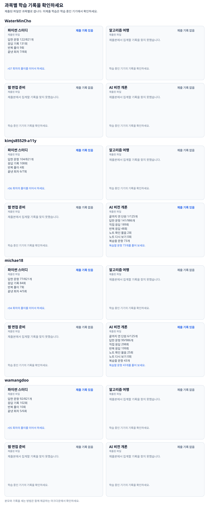

# 과목별 학습을 확인하세요

### 과목별 학습 기록을 확인하세요

제출된 파일만 집계합니다. 다음 행동도 제출 기록을 기준으로 안내합니다. 미제출 학습은 학습 중인 기기에서 확인하세요.

| 학습자 | 대과목 | 데이터 출처 | 기록 상태 | 학습·풀이 | 시도·복습 | 다음 행동 |
|---|---|---|---|---|---|---|
| WaterMinCho | 파이썬 스터디 | 제출된 파일 | 제출 기록 있음 | 답한 문항 122/821개 끝낸 회차 7/8회 | 응답 기록 131회 반복 풀이 9회 | r07 회차의 풀이를 이어서 하세요. |
| WaterMinCho | 알고리즘 여행 | 제출된 파일 | 제출 기록 없음 | 제출 기록 없음 | 제출 기록 없음 | 학습 중인 기기의 기록을 확인하세요. |
| WaterMinCho | 웹 면접 준비 | 제출된 파일 | 제출 기록 없음 | 제출 기록 없음 | 제출 기록 없음 | 학습 중인 기기의 기록을 확인하세요. |
| WaterMinCho | AI 비전 개론 | 제출된 파일 | 제출 기록 없음 | 제출 기록 없음 | 제출 기록 없음 | 학습 중인 기기의 기록을 확인하세요. |
| kimjs85529-a11y | 파이썬 스터디 | 제출된 파일 | 제출 기록 있음 | 답한 문항 104/821개 끝낸 회차 6/7회 | 응답 기록 108회 반복 풀이 4회 | r06 회차의 풀이를 이어서 하세요. |
| kimjs85529-a11y | 알고리즘 여행 | 제출된 파일 | 제출 기록 없음 | 제출 기록 없음 | 제출 기록 없음 | 학습 중인 기기의 기록을 확인하세요. |
| kimjs85529-a11y | 웹 면접 준비 | 제출된 파일 | 제출 기록 없음 | 제출 기록 없음 | 제출 기록 없음 | 학습 중인 기기의 기록을 확인하세요. |
| kimjs85529-a11y | AI 비전 개론 | 제출된 파일 | 제출 기록 있음 | 끝까지 연 단원 1/125개 답한 문항 61/985개 | 직접 응답 85회 반복 응답 24회 노트 확인 물음 2회 노트 다시 보기 0회 복습할 문항 13개 | i14/14a 단원을 읽어 보세요. |
| michae18 | 파이썬 스터디 | 제출된 파일 | 제출 기록 있음 | 답한 문항 77/821개 끝낸 회차 4/5회 | 응답 기록 84회 반복 풀이 7회 | r04 회차의 풀이를 이어서 하세요. |
| michae18 | 알고리즘 여행 | 제출된 파일 | 제출 기록 없음 | 제출 기록 없음 | 제출 기록 없음 | 학습 중인 기기의 기록을 확인하세요. |
| michae18 | 웹 면접 준비 | 제출된 파일 | 제출 기록 없음 | 제출 기록 없음 | 제출 기록 없음 | 학습 중인 기기의 기록을 확인하세요. |
| michae18 | AI 비전 개론 | 제출된 파일 | 제출 기록 있음 | 끝까지 연 단원 6/125개 답한 문항 74/985개 | 직접 응답 254회 반복 응답 180회 노트 확인 물음 25회 노트 다시 보기 0회 복습할 문항 0개 | 오늘 틀린 문항 3개를 풀어 보세요. |
| wamangdoo | 파이썬 스터디 | 제출된 파일 | 제출 기록 있음 | 답한 문항 92/821개 끝낸 회차 5/6회 | 응답 기록 102회 반복 풀이 10회 | r05 회차의 풀이를 이어서 하세요. |
| wamangdoo | 알고리즘 여행 | 제출된 파일 | 제출 기록 없음 | 제출 기록 없음 | 제출 기록 없음 | 학습 중인 기기의 기록을 확인하세요. |
| wamangdoo | 웹 면접 준비 | 제출된 파일 | 제출 기록 없음 | 제출 기록 없음 | 제출 기록 없음 | 학습 중인 기기의 기록을 확인하세요. |
| wamangdoo | AI 비전 개론 | 제출된 파일 | 제출 기록 없음 | 제출 기록 없음 | 제출 기록 없음 | 학습 중인 기기의 기록을 확인하세요. |

집계 방법을 확인하세요

- 파이썬 스터디의 답한 문항: 현재 공개된 문항 중 응답을 채점한 문항을 한 번씩 셉니다. 미응답으로 확정한 기록은 제외합니다.
- 파이썬 스터디의 끝낸 회차: 만든 회차 중 종료 기록이 있는 회차를 셉니다. 진단 회차도 포함합니다.
- 파이썬 스터디의 응답 기록: 프로필에 남은 문항별 응답 기록을 셉니다. 같은 결과로 다시 채점하면 기록을 늘리지 않습니다.
- 파이썬 스터디의 반복 풀이: 같은 문항에 두 번째 이후로 답한 기록을 셉니다. 다른 회차에서 다시 답한 기록도 포함합니다.
- AI 비전 개론의 끝까지 연 단원: 마지막 단계까지 연 기록이 있는 공개 단원을 한 번씩 셉니다.
- AI 비전 개론의 답한 문항: 답을 판정한 공개 연습 문항을 한 번씩 셉니다. 보기나 함께 가린 칸에서 판정한 문장도 포함합니다.
- AI 비전 개론의 직접 응답: 연습 문항에 직접 답한 기록을 셉니다. 보기의 동반 판정이나 정답 인정 요청은 별도 응답으로 더하지 않습니다.
- AI 비전 개론의 반복 응답: 같은 연습 문항에 두 번째 이후로 직접 답한 기록을 셉니다.
- AI 비전 개론의 노트 확인 물음: 노트의 떠올리기·세 수준 확인 물음·돌려 가며 빈칸에 답한 기록을 셉니다.
- AI 비전 개론의 노트 다시 보기: 공개 단원을 다시 보기로 연 기록을 셉니다. 같은 단원을 여러 번 열면 각각 셉니다.
- AI 비전 개론의 복습할 문항: 학습일과 기존 복습 규칙으로 정한 오늘 복습 목록의 공개 문항을 셉니다. 학습일은 새벽 4시에 바뀝니다.

