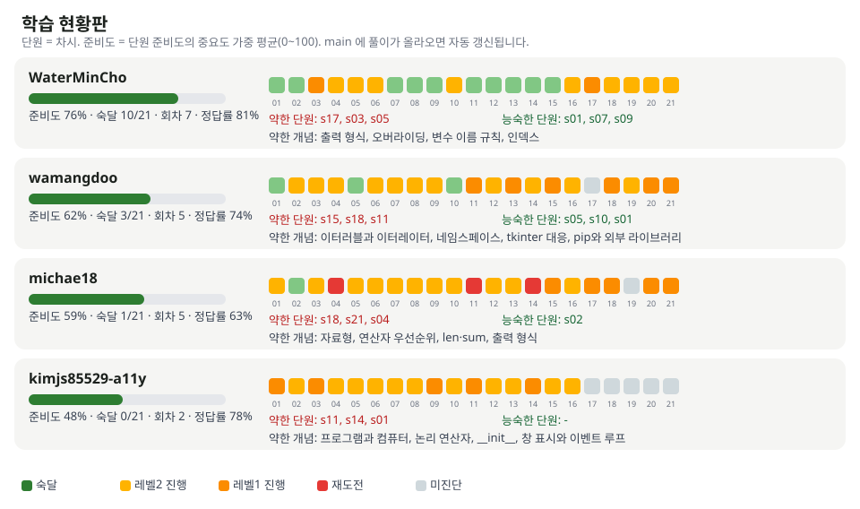

# 학습 현황판

| 이름 | 준비도 | 숙달 | 진행 중 레벨 | 약한 단원 | 능숙한 단원 | 약한 개념 | 회차 | 마지막 풀이 |
|---|---|---|---|---|---|---|---|---|
| WaterMinCho | ▓▓▓▓▓▓▓░░░ 70% | 9/21 | L1 4 · L2 7 | s03, s21, s02 | s01, s07, s09 | 출력 형식, 변수 이름 규칙, 인덱스, findall과 finditer | 6 | 2026-10-15 14:04 |
| wamangdoo | ▓▓▓▓▓░░░░░ 54% | 2/21 | L1 3 · L2 11 | s11, s07, s13 | s05, s10 | 네임스페이스, tkinter 대응, pip와 외부 라이브러리, 이터러블과 이터레이터 | 4 | 2026-10-15 13:11 |
| kimjs85529-a11y | ▓▓▓▓▓░░░░░ 48% | 0/21 | L1 5 · L2 11 | s11, s14, s01 | - | 프로그램과 컴퓨터, 논리 연산자, __init__, 창 표시와 이벤트 루프 | 2 | 2026-10-10 13:21 |
| michae18 | ▓▓▓▓░░░░░░ 45% | 0/21 | L1 8 · L2 8 | s11, s02, s03 | - | 프로그램 실행 과정, 변수와 대입, 자료형, 연산자 우선순위 | 2 | 2026-10-08 17:47 |

단원 번호 = 차시. 기준: 마지막 풀이 2026-10-15 14:04. main 에 풀이가 올라올 때마다 Actions 가 갱신합니다.
