#  프로그래밍 스터디

프로그래밍 공부와 코딩 테스트 준비를 같이 하려고 만든 프로그램입니다. 실행하면 창이 열리고 문제 풀이, 채점, 해설 확인, 제출을 그 안에서 합니다. 첫 화면의 공부 트랙 목록에서 파이썬 스터디, 알고리즘 여행, 웹 면접 준비 가운데 하나를 골라 들어갑니다.

파이썬 스터디에는 ROKEY 11기 파이썬 교과목 평가(10/16)를 준비하며 만든 파이썬 문제가 들어 있습니다. 알고리즘 여행은 코딩 테스트에 자주 나오는 알고리즘을 주제별로 16묶음으로 나눈 문제 모음이고, 한 묶음을 던전이라고 부릅니다. 프로그래머스처럼 `solution` 함수를 Python 이나 JavaScript 로 완성해 풉니다. 웹 면접 준비는 프런트엔드 채용의 라이브 코딩과 직무 면접 꼬리 질문을 연습하는 트랙입니다.

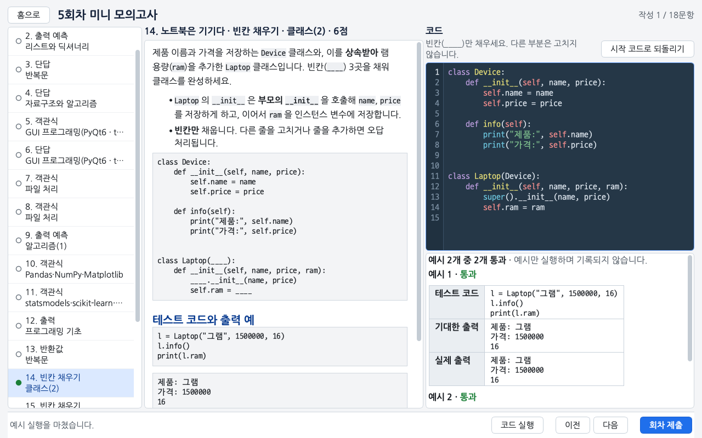

## 바뀐 점

- 첫 화면과 웹 면접 준비 화면을 새로 그렸습니다. 글자를 키우고, 화면마다 파란 단추를 하나만 두고, 목록은 줄을 눌러 엽니다. 첫 화면 맨 위의 '이어서 할 일' 카드에서 하던 일을 바로 이어 합니다. 자세한 내용은 [켜기와 첫 화면](#켜기와-첫-화면)에 있습니다.
- 2026년 10월 판부터 첫 화면이 생겼습니다. 예전 홈 화면은 첫 화면의 공부 트랙에서 파이썬 스터디 줄을 누르면 나오고, 새로 생긴 알고리즘 여행은 알고리즘 여행 줄로 들어갑니다.
- 웹 면접 준비 미션 화면에 [화면 띄우기]와 [테스트 돌리기]가 생겼습니다. Windows PowerShell 에서 `npm run dev` 가 실행 정책 때문에 막혀도 두 단추로 앱을 띄우고 테스트를 돌립니다. PowerShell 에 직접 입력할 때는 `npm` 대신 `npm.cmd` 를 씁니다. 자세한 내용은 [라이브 코딩 미션](#라이브-코딩-미션)에 있습니다.
- 웹 면접 준비 화면이 붙었습니다. 첫 화면의 공부 트랙에서 웹 면접 준비 줄을 눌러 웹 홈에 가면 라이브 코딩 미션, 꼬리 질문 사슬, 학습 노트를 창에서 풉니다. 터미널 명령 `python study.py web …` 도 그대로 됩니다. 지금 출제된 미션과 쓰는 법은 [웹 면접 준비](#웹-면접-준비)에 있습니다.
- 이번 판을 받은 뒤 처음 제출하기 전에 프로그램을 한 번 껐다 켜 주세요. 켜 둔 예전 프로그램으로 제출하면 다른 컴퓨터에서 올린 알고리즘 여행 기록이 그 PR 에서 빠질 수 있습니다.
- [문제 받기]가 파이썬 스터디 기록과 알고리즘 여행 기록을 따로 맞춥니다. 한 컴퓨터에서 회차를 풀어 제출하고 다른 컴퓨터에서 알고리즘 여행 문제를 풀었다면, 그 컴퓨터에서 받을 때 회차 기록을 가져오고 알고리즘 여행 기록은 지우지 않습니다.

## 학습 로드맵

ROKEY 11기 교과와 채용 공고를 바탕으로 수료 뒤 갈 수 있는 직무를 여섯 길로 나누고, 길마다 배울 순서를 그림으로 그렸습니다.

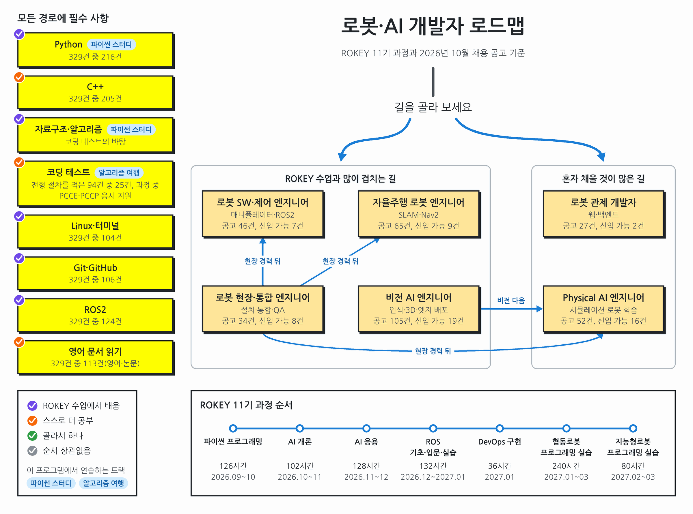

### 그림 읽는 법

파란 줄을 따라 위에서 아래로 노란 상자를 차례로 배웁니다. 노란 상자 양옆의 연한 상자는 그 단계에서 함께 익힐 세부 주제입니다. 회색으로 칠한 상자는 같은 자리에 대신 쓸 수 있는 도구입니다. 상자 귀퉁이에 붙은 동그란 표시의 색으로 어디서 배우는지와 고를 수 있는지를 구분합니다.

| 표시 | 뜻                                                                   |
| ---- | -------------------------------------------------------------------- |
| 보라 | ROKEY 수업에서 배웁니다. 11기 교과별 커리큘럼 표를 보고 표시했습니다 |
| 주황 | 교과표에 없어서 스스로 더 공부합니다                                 |
| 초록 | 같은 자리에 쓰는 다른 도구입니다. 하나를 골라 배웁니다               |
| 회색 | 순서와 상관없이 필요할 때 배웁니다                                   |

표시 옆에 물음표가 붙은 상자는 교과표에 같은 이름이 나오지 않아 표시 색을 짐작해서 정했습니다. 실무 프로젝트 차시별 목차가 나오면 표시를 다시 정합니다.

하늘색 꼬리표(파이썬 스터디, 알고리즘 여행, 웹 면접 준비)가 붙은 상자는 이 프로그램에서 연습할 수 있습니다. 흰 글상자에는 공고를 세어 본 결과와 공부할 때 챙길 점을 적었습니다.

### 여섯 길

| 길                      | 맞는 사람                                                                                                                                               |
| ----------------------- | ------------------------------------------------------------------------------------------------------------------------------------------------------- |
| 로봇 SW·제어 엔지니어   | 로봇 팔이 물건을 집고 옮기도록 동작을 계획하고 제어하는 프로그램을 짜고 싶은 사람. 실무 프로젝트의 협동로봇 실습 240시간이 이 직무에 필요한 역량입니다. |
| 자율주행 로봇 엔지니어  | 이동 로봇이 지도를 그리고(SLAM) 목적지까지 길을 찾아가게(Nav2) 만들고 싶은 사람                                                                         |
| 비전 AI 엔지니어        | 카메라 영상에서 물체를 찾는 모델을 학습시켜 장비에 올리고 싶은 사람. 제조 검사와 의료 영상 회사까지 더해 공고가 가장 많습니다                           |
| 로봇 현장·통합 엔지니어 | 고객 현장에서 로봇을 설치하고 장비를 연결하고 고장 원인을 찾는 일을 하고 싶은 사람. 출장이 잦지만 학사 신입 공고 비율이 가장 높습니다                   |
| Physical AI 엔지니어    | 시뮬레이터에서 로봇에게 동작을 학습시키는 연구를 하고 싶고 대학원 진학도 생각하는 사람                                                                  |
| 로봇 관제 개발자        | 여러 로봇의 위치와 상태를 웹 화면과 서버로 모아 보여 주는 일을 하고 싶은 사람, 웹 개발을 해 본 사람                                                     |

직무명을 누르면 로드맵이 펼쳐집니다.

<details>
<summary>로봇 SW·제어 엔지니어</summary>

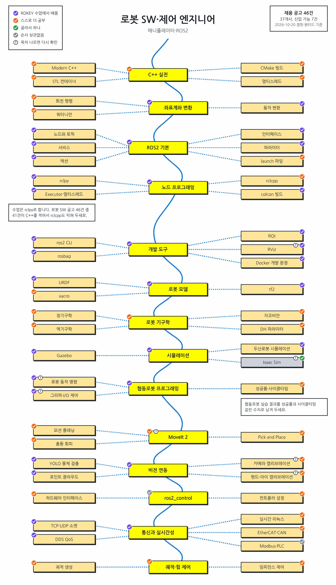

</details>

<details>
<summary>자율주행 로봇 엔지니어</summary>

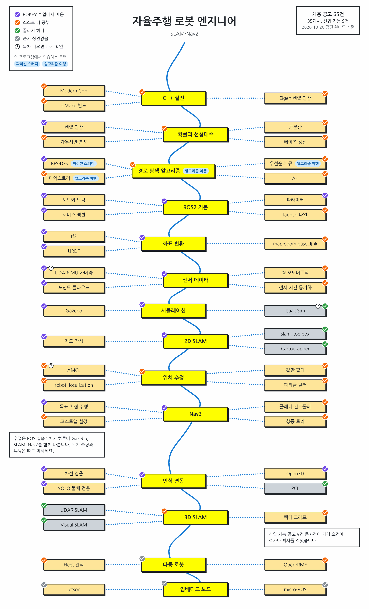

</details>

<details>
<summary>비전 AI 엔지니어</summary>

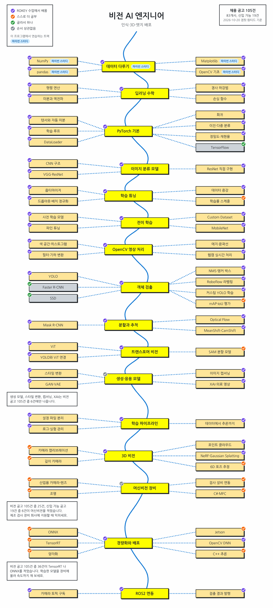

</details>

<details>
<summary>로봇 현장·통합 엔지니어</summary>

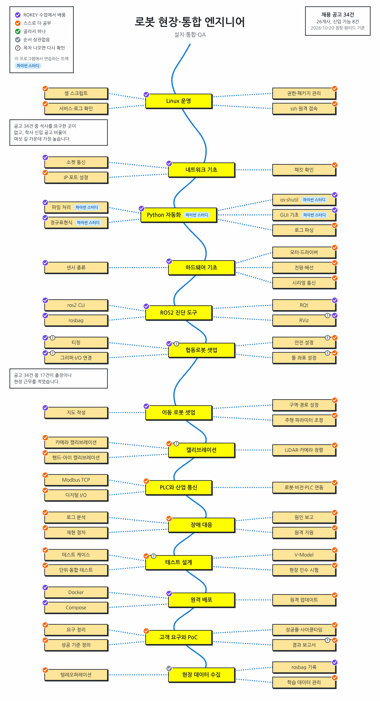

</details>

<details>
<summary>Physical AI 엔지니어</summary>

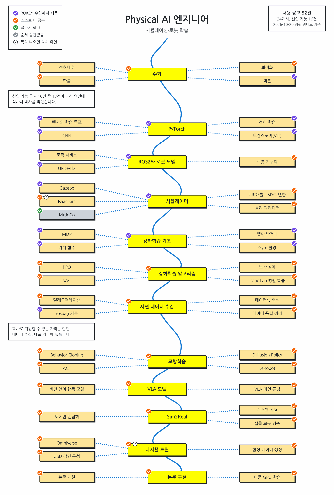

</details>

<details>
<summary>로봇 관제 개발자</summary>

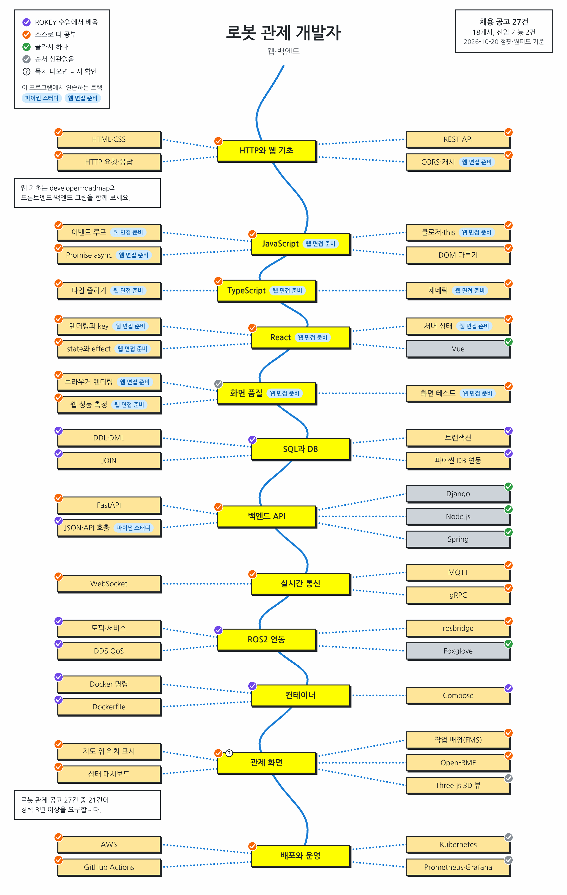

</details>

### 이 프로그램에서 연습할 수 있는 부분

- 파이썬 스터디에서는 모든 길에 필요한 Python과 자료구조·알고리즘 기초를 풀고, 비전 AI 길의 NumPy·pandas·Matplotlib과 현장·통합 엔지니어 길의 파일 처리·정규표현식도 함께 다룹니다.
- 알고리즘 여행은 모든 길의 코딩 테스트에 나오는 알고리즘을 Python과 JavaScript로 연습하는 트랙입니다. 지금은 던전 1~3(해시·투 포인터, 누적합·차분, 이분 탐색)을 풀 수 있고, 자율주행 로봇 길에 나오는 다익스트라·우선순위 큐는 나머지 던전과 함께 차례로 출제됩니다.
- 웹 면접 준비는 로봇 관제 개발자 길의 JavaScript, TypeScript, React, 브라우저 동작을 라이브 코딩 미션과 꼬리 질문으로 연습하는 트랙입니다. 지금은 미션 w01·w03 과 주제 1·3·6·7·11 이 출제되어 있습니다.

C++는 공고 329건 중 205건, ROS2는 124건에 나오지만 아직 이 프로그램에 연습 트랙이 없습니다.

### 그림의 근거

보라 표시는 11기 교과별 커리큘럼과 Life Guide의 교육과정 표를 따랐습니다. 공고 수는 2026년 10월 20일 점핏과 원티드에 열려 있던 공고 329건(161개사)을 센 값입니다. 그림 내용은 `tools/roadmap/roadmap.json`에 있고, 고친 뒤 `tools/roadmap/draw.py`로 다시 그립니다.

## 시험 정보

| 항목 | 내용                                                            |
| ---- | --------------------------------------------------------------- |
| 일시 | 10/16(금) 14:30 ~ 16:30, 프로그래머스                           |
| 범위 | 강의 자료 + 주간 요약본                                         |
| 유형 | 빈칸 채우기, 반환값 문제, 출력 문제, 객관식                     |
| 채점 | 부분 점수가 없고, 요구한 형식과 정확히 같아야 정답입니다        |
| 금지 | IDE, VSCode, 파이썬 레퍼런스, 메모, 검색 (실행하기 버튼만 가능) |

파이썬 스터디 화면은 시험과 비슷하게 맞췄습니다. 왼쪽에 문항 목록, 가운데에 문제, 오른쪽에 답안이 있습니다. 코드를 적는 칸은 프로그래머스 편집기처럼 남색 바탕이고, 예약어와 문자열 같은 파이썬 문법에 따라 글자색이 달라집니다. 괄호와 따옴표는 자동으로 닫히고 자동완성은 없습니다. 복사, 붙여넣기, 우클릭 메뉴도 막아 두었습니다.

## 최초 한번 준비해야할 것

- 파이썬 3.10~3.14(64비트)가 필요합니다. 새로 설치한다면 [3.14](https://www.python.org/downloads/latest/python3.14/)를 고릅니다. 3.15 에는 PyQt6 가 아직 설치되지 않습니다. 이미 설치돼 있으면 아래 1번처럼 터미널을 열고 `python --version` 으로 버전을 확인합니다.
- git 도 필요합니다. Windows 는 [Git for Windows](https://git-scm.com/download/win)를 설치합니다.
- 알고리즘 여행을 JavaScript 로 풀려면 Node.js 20 이상, 웹 면접 준비의 라이브 코딩 미션을 풀려면 Node.js 22.12 이상도 설치합니다. 설치 방법은 [Node.js 설치](#nodejs-설치)에 있고, 알고리즘 여행을 Python 으로만 풀고 미션을 풀지 않으면 설치하지 않아도 됩니다.
- 깃허브 ID 를 스터디장에게 알려 주고, GitHub 알림이나 메일로 온 저장소 초대를 수락합니다.

그다음 저장소를 받아 실행합니다. 터미널에서 쓰던 예전 버전을 받아 둔 폴더가 있으면 새로 받지 않고 [안 될 때](#안-될-때)의 네 줄 명령으로 새 버전을 받은 뒤 3번부터 합니다.

1. 프로그램을 둘 폴더를 탐색기로 열고 주소 칸에 `cmd` 를 입력한 뒤 Enter 를 누릅니다. 그 폴더에서 터미널(검은 창)이 열립니다. macOS 는 터미널 앱을 엽니다.
2. 아래 명령을 입력합니다. `programming-study` 폴더가 생깁니다.

   ```bash
   git clone https://github.com/WaterMinCho/programming-study.git
   ```

3. `programming-study` 폴더의 `start.pyw`(macOS 는 `ROKEY.app`)를 더블클릭합니다. 검은 창 없이 프로그램 창이 열립니다. Windows 탐색기에 확장자가 보이지 않아 `start` 가 두 개로 보이면 종류가 'Python File (no console)'인 파일을 엽니다. 톱니바퀴 아이콘의 `start.bat` 을 열어도 검은 창이 잠깐 떴다가 닫히고 프로그램 창만 남습니다.
4. 처음 실행하면 '프로그래밍 스터디 준비' 창이 설치할지 묻습니다. [설치]를 누르면 화면을 그리는 PyQt6 를 `~/.rokey-study/venv` 에 설치하는데, 내려받는 양이 85MB 쯤이고 설치하면 250MB 쯤 됩니다. 수업 때 PyQt6 를 설치했다면 묻지 않습니다.
5. 프로그램 창이 열리면 깃허브 ID(github.com/ 뒤에 나오는 이름)를 입력하고 [시작]을 누릅니다. 첫 화면이 열립니다.
6. 첫 화면의 공부 트랙에서 파이썬 스터디 줄을 누르고, 파이썬 스터디 홈의 [진단 테스트 시작]을 누릅니다. 단원마다 2문항씩 42문항이고 40분쯤 걸립니다. 모르는 문항은 비워 두고 제출해도 됩니다. 알고리즘 여행은 진단 테스트 없이 바로 시작합니다.

그래도 창이 열리지 않으면 Windows 는 터미널에서 `python study.py` 를 실행하고, macOS 는 `start.command` 를 더블클릭합니다. 이때는 검은 창이 먼저 열리고 이어서 프로그램 창이 열리며, 검은 창을 닫으면 프로그램도 닫힙니다. 설치도 검은 창에서 묻습니다. "설치할까요? [y/N]"이 나오면 `y` 를 입력하고 Enter 를 누릅니다. 준비 창을 띄울 수 없는 파이썬(Homebrew 파이썬 등)에서는 처음 설치할 때 프로그램이 `start.bat` 이나 `start.command` 를 대신 엽니다.

Sourcetree 같은 앱으로 받은 폴더에서는 macOS 가 `ROKEY.app` 을 확인되지 않은 앱으로 막습니다. 그때는 `start.command` 로 켜거나 터미널에서 `python3 study.py` 를 실행합니다.

이 문서에 나오는 터미널 명령은 `start.bat` 이 있는 폴더에서 입력합니다. 탐색기로 그 폴더를 열고 주소 칸에 `cmd` 를 입력하면 터미널이 열립니다. `python` 이 실행되지 않으면 Windows 는 `py`, macOS 는 `python3` 로 바꿔 입력합니다(예: `py study.py update`).

## 켜기와 첫 화면

다음부터는 `start.pyw` 나 `start.bat`(macOS 는 `ROKEY.app`)을 더블클릭해 켭니다. 열리지 않으면 Windows 는 터미널에서 `python study.py` 로, macOS 는 `start.command` 로 켭니다. 켤 때마다 새 문제와 프로그램 새 버전을 받아 오고, 첫 화면의 [새 문제 받기]나 파이썬 스터디 홈의 [문제 받기]를 눌러도 똑같이 받습니다. 프로그램이 바뀌었으면 '프로그램 갱신' 창이 뜨고, [다시 시작]을 누르면 새 버전으로 다시 열립니다.

켜면 첫 화면이 열립니다. 위쪽에 '오늘 할 공부' 제목과 이어서 할 일 카드가, 그 아래에 공부 트랙 목록, 최근 7일 학습, 제출 목록이 있습니다.

- 이어서 할 일 카드에는 지금 하던 일 하나가 나옵니다. 실전 중이거나 읽는 중인 미션, 오늘 복습할 꼬리 질문 사슬이 있으면 그것이, 없으면 가장 최근에 기록을 남긴 트랙의 다음 할 일이 나옵니다. 오른쪽의 파란 단추([이어 하기], [복습 시작], [시작]처럼 나옵니다)를 누르면 그 화면이 바로 열립니다.
- 공부 트랙 목록에는 파이썬 스터디, 알고리즘 여행, 웹 면접 준비 줄이 있고, 줄마다 진행 수치 하나와 다음 할 일이 적혀 있고, 웹 면접 준비 줄은 다음 할 일 대신 오늘 복습할 사슬 수가 나옵니다. 줄을 누르면 파이썬 스터디 홈, 던전 지도, 웹 홈으로 갑니다.
- '최근 7일 학습'은 날짜마다 파이썬 스터디와 알고리즘 여행의 채점 횟수, 웹 면접 준비의 검사와 꼬리 질문 기록을 막대 세 개로 보여 줍니다. 파이썬 스터디는 회차를 한 번 채점하면 문항 수와 상관없이 1번으로 세고, 웹 면접 준비는 [검사하기] 한 번과 끝낸 사슬 하나를 1번으로 셉니다. 막대 위에 이 수를 더한 채점 횟수가, 오른쪽 위에 연속 학습일이, 막대 아래에 최근 채점 5개가 나옵니다.
- 제출 목록의 [풀이 제출]과 [새 문제 받기]는 파이썬 스터디 홈에 있는 단추와 같은 일을 합니다.

파이썬 스터디 홈, 던전 지도의 왼쪽 위 [처음으로]와 웹 홈의 [← 처음 화면]을 누르면 첫 화면으로 돌아옵니다.

## 파이썬 스터디 풀기

첫 화면의 공부 트랙에서 파이썬 스터디 줄을 누르면 파이썬 스터디 홈이 열립니다. 홈의 '지금 할 일' 버튼([3회차 시작]처럼 나옵니다)을 누르면 이번 회차가 열립니다. 화면에 '3회차 미니 모의고사'라고 나오는 것이 회차입니다. 120분짜리 실전 모의고사는 아래 '모의고사 보기'대로 터미널에서 따로 봅니다.

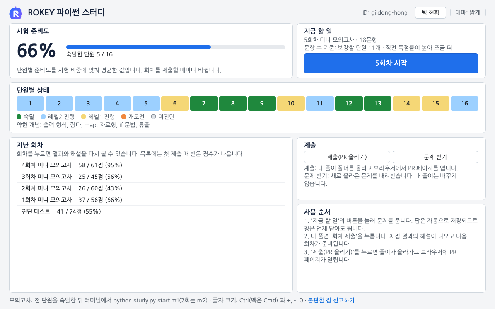

- 답은 적는 대로 저장됩니다. 창을 닫아도 다음에 이어서 풉니다.
- 답을 적은 문항은 왼쪽 목록에서 초록 동그라미로 바뀝니다. 맞았는지는 회차를 제출해야 나옵니다.
- 코드 문항의 [코드 실행]은 문제에 나온 예시만 돌립니다. 시험의 '실행하기'와 같고, 눌러도 기록되지 않습니다.
- 코드를 적는 칸에는 줄 번호가 보이고, Ctrl+F(맥은 Cmd+F)를 누르면 그 칸 안의 글자를 찾습니다.
- 코드 칸에서 Ctrl+/(맥은 Cmd+/)를 누르면 커서가 있는 줄이나 고른 줄 앞에 `# ` 가 붙어 주석이 되고, 다시 누르면 풀립니다.
- 다 풀면 [회차 제출]을 누릅니다. 이때 채점하고 결과를 내 컴퓨터에 기록합니다. 안 푼 문항은 오답이 됩니다. GitHub 에 올리는 것은 [제출(PR 올리기)]로 따로 합니다.
- 결과 화면에서 점수와 단원별 판정을 보고, 문항을 골라 [해설 보기]로 정답과 해설을 봅니다. 해설은 회차를 제출한 뒤에 열립니다.
- 틀린 문항은 [다시 풀기]로 고친 뒤 [다시 채점]을 눌러 볼 수 있습니다. 다시 채점한 점수는 단원 판정에 들어가지 않고 첫 제출만 들어갑니다.
- 홈 오른쪽 위의 [오답 노트]를 누르면 첫 제출에서 틀렸거나 비워 둔 문항이 차시별로 모여 나옵니다. 문항을 고르면 문제와 내 답이 보이고, 결과 화면처럼 [해설 보기]와 [다시 풀기]를 누를 수 있습니다.

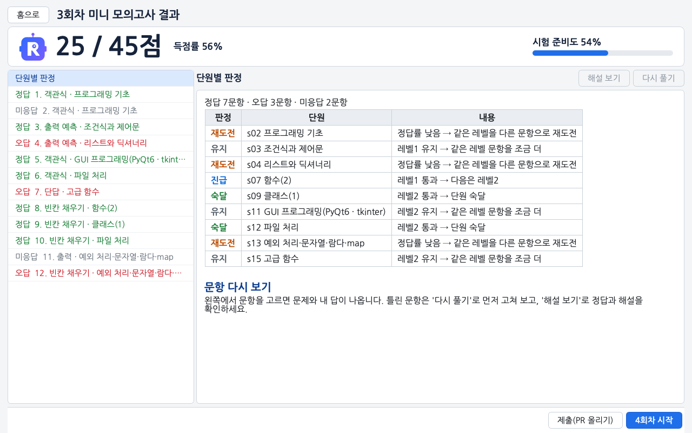

글자 크기는 Ctrl(맥은 Cmd)과 `+`, `-`, `0` 으로 바꿉니다. 홈 오른쪽 위의 테마 버튼([테마: 시스템]처럼 나옵니다)을 누를 때마다 시스템, 밝게, 어둡게 순서로 바뀌고, 시스템은 운영체제 설정을 따릅니다. 첫 화면 오른쪽 위에도 같은 순서로 도는 단추가 있는데, 거기에는 누르면 바뀔 쪽([어둡게 보기]처럼)이 적혀 있습니다.

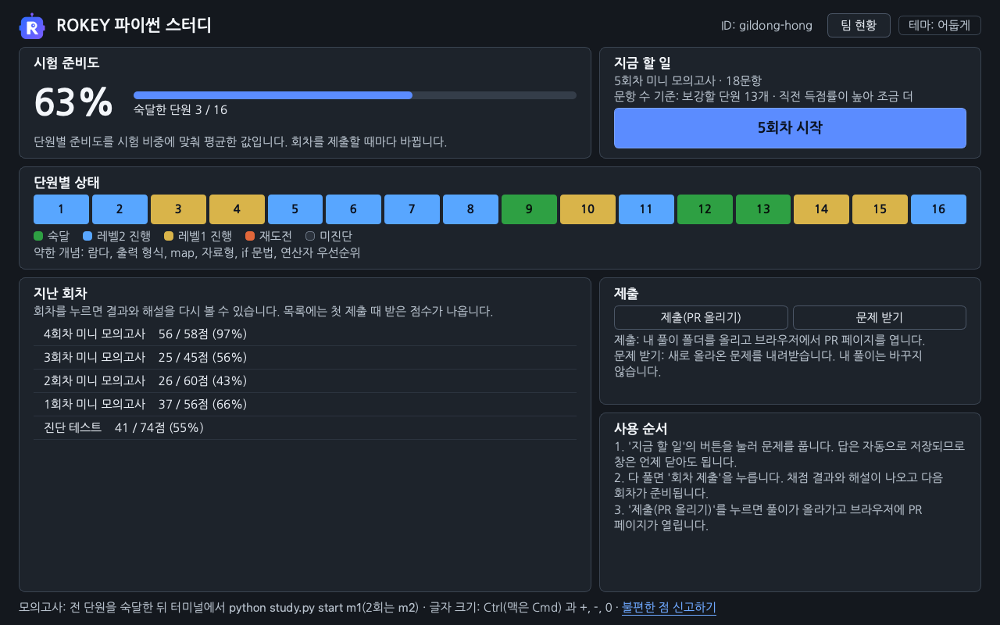

## 답 적는 법과 채점

| 유형        | 답 적는 법                                                                                                                  | 채점                                                                                |
| ----------- | --------------------------------------------------------------------------------------------------------------------------- | ----------------------------------------------------------------------------------- |
| 객관식      | 보기 카드를 누르거나 숫자 키로 고릅니다. "모두 고르세요" 문항은 여러 개를 고릅니다                                          | 고른 보기가 정답과 정확히 같아야 합니다                                             |
| 출력 예측   | 실행하면 화면에 찍히는 글자를 똑같이 적습니다. 답을 따옴표로 감싸지 않고, `['a', 'b']` 처럼 출력에 찍히는 따옴표만 적습니다 | 글자 단위로 같아야 합니다                                                           |
| 단답        | 따옴표로 감싸지 않고 한 줄로 적습니다                                                                                       | 대소문자까지 같아야 합니다. 대소문자나 띄어쓰기를 가리지 않는 문항이 몇 개 있습니다 |
| 빈칸 채우기 | 코드의 `____` 자리만 채웁니다                                                                                               | 빈칸 밖을 고치면 오답입니다                                                         |
| 반환값      | `solution` 함수를 완성합니다                                                                                                | 반환값이 자료형까지 같아야 합니다(3 과 3.0 은 다른 값)                              |
| 출력        | 프로그램을 작성합니다                                                                                                       | 출력이 글자 단위로 같아야 합니다                                                    |

- 회차와 진단 테스트는 100점 만점입니다. 문항마다 유형과 레벨로 가중치를 정하고, 가중치에 비례해 100점을 나눕니다. 가중치 표와 계산 방법은 [docs/CRITERIA.md](docs/CRITERIA.md)의 '회차 배점'에 있습니다.
- 시험처럼 부분 점수가 없어서, 코드 문항(빈칸 채우기, 반환값, 출력)은 테스트를 전부 통과해야 점수를 받습니다.
- 출력을 비교할 때 줄 끝 공백과 맨 끝 빈 줄은 무시합니다.
- `input("안내 문구")` 의 안내 문구는 출력으로 치지 않습니다.
- 한 문제는 5초 안에 끝나야 합니다.
- 한 문제를 실행하는 동안 메모리를 512MB 넘게 쓰면 오답입니다.

## 알고리즘 여행

### 던전 지도

첫 화면의 공부 트랙에서 알고리즘 여행 줄을 누르면 던전 지도가 열립니다. 왼쪽 지도에는 던전 16개가 권장 순서대로 길로 이어져 있고, 원 안의 숫자가 던전 번호입니다. 원을 누르면 오른쪽에 그 던전의 소개, 익히는 기술, 문제 목록이 나옵니다. 던전은 순서와 상관없이 모두 열려 있습니다. 지금은 던전 1~3 이 출제되어 있고, 나머지는 '준비 중'으로 보이다가 출제되면 [새 문제 받기]로 들어옵니다.

던전 하나는 기초, 중급, 보스 문제로 이뤄지고, 선택 문제가 있는 던전도 있습니다.

- 기초 문제는 중급을 풀기 전에 손에 익히는 준비 문제라서 건너뛰어도 됩니다. 중급 문제의 지문 위에 "준비 문제: 1-1 장부 정산"처럼 연결된 앞 문제(대개 기초 문제)가 나옵니다.
- 그 던전의 중급 문제를 모두 통과하면 보스 문제가 열립니다. 잠긴 보스는 목록에서 흐리게 보이고, 몇 개를 통과했는지 함께 나옵니다.
- 보스를 통과하면 그 던전을 클리어합니다. 지도의 원이 초록으로 바뀌고, 보스에서 새로 익힌 기술이 지도에 나옵니다.
- 선택 문제는 보스와 상관없이 따로 연습하는 문제입니다. 보스 잠금과 첫 화면 알고리즘 여행 줄의 '다음은 …'(다음에 풀 문제)에 들어가지 않습니다.

문제 목록의 `S3 / Lv2` 같은 글자는 난이도이고, 앞은 백준 티어, 뒤는 프로그래머스 레벨입니다. 문제를 두 번 누르거나 고른 뒤 [문제 풀기]를 누르면 문제 화면이 열립니다.

### 언어 고르기

지도와 문제 화면 오른쪽 위의 [Python], [JavaScript]로 풀 언어를 고릅니다. 고른 언어는 이 컴퓨터에 기억되어 다음에 켜도 이어집니다. 코드는 언어마다 따로 저장되어서 언어를 바꿔도 다른 언어로 쓰던 코드가 지워지지 않습니다. 한 언어로 통과하면 그 문제를 통과한 것이고, 같은 문제를 두 언어로 모두 풀어 볼 수도 있습니다.

JavaScript 는 Node.js 가 있어야 고를 수 있습니다. Node.js 를 찾지 못하면 'Node.js 가 필요합니다' 창이 뜨고, 언어 단추 옆에 'Node.js 필요'가 보이며 Python 으로 계속 풉니다. 설치 방법은 아래 [Node.js 설치](#nodejs-설치)에 있습니다.

### 문제 화면

왼쪽에는 [문제], [힌트], [해설] 탭이 있고 오른쪽에는 코드 칸과 결과 칸이 있습니다. 위쪽 [던전 지도]를 누르면 지도로 돌아갑니다.

- 코드는 적는 대로 저장되고, 저장한 시각이 아래 상태 줄에 나옵니다. [시작 코드로 되돌리기]를 누르면 처음 받은 코드로 돌아갑니다.
- 이 화면에서는 복사와 붙여넣기가 됩니다. 앞 던전에서 직접 만든 자료구조 코드를 뒤 던전에서 다시 쓸 수 있게 열어 두었습니다. 파이썬 스터디의 회차 화면은 지금처럼 막혀 있습니다.
- 줄 번호, 찾기(Ctrl+F), 주석(Ctrl+/)은 파이썬 스터디의 코드 칸과 같게 동작하고, 맥은 Ctrl 대신 Cmd 를 누릅니다. JavaScript 에서는 Ctrl+/ 가 줄 앞에 `// ` 를 붙입니다.
- 보스 문제에는 제목 아래에 "보스 문제입니다. 이 던전의 3-1, 3-2, 3-3에서 익힌 기술을 함께 씁니다." 같은 띠가 나옵니다.

### 코드 실행과 채점

- [코드 실행]은 입출력 예와 내가 추가한 테스트 케이스를 돌리고, 테스트마다 입력값, 기댓값, 실행 결과, 출력을 보여 줍니다. 테스트 하나를 10초까지 기다리고 기록하지 않습니다. 결과 맨 아래에 "채점에서는 Python 2.5초, JavaScript 3초 안에 끝나야 합니다."처럼 그 문제의 시간 제한이 나옵니다.
- [테스트 케이스 추가하기]로 내 테스트를 20개까지 더합니다. 값은 JSON 이나 파이썬 문법(`["a", "b"]`, `3`, `true`)으로 적고, [예시에서 가져오기]에서 입출력 예를 고르면 그 값을 채운 줄이 하나 생겨서 조금 고쳐 경계 사례(빈 목록, 가장 큰 값처럼 실수하기 쉬운 입력)를 만들 수 있습니다. 추가한 테스트는 Python 과 JavaScript 가 같이 씁니다.
- [제출 후 채점하기]는 숨은 테스트까지 돌려 정확성과 효율성 점수를 매기고 기록합니다. 정확성 테스트는 입출력 예, 경계 사례, 작은 무작위 입력이고, 효율성 테스트는 시간 제한 안에 끝나야 하는 큰 입력입니다. 테스트마다 "테스트 3 〉 통과 (0.42ms, 15.3MB)" 같은 줄이 하나씩 붙고, 합계가 100.0 이면 통과입니다.
- 실행이나 채점이 오래 걸리면 [중지]를 누릅니다. 중지한 채점은 기록하지 않습니다.
- 채점 결과는 이 컴퓨터에만 기록됩니다. GitHub 에 올리는 것은 첫 화면의 [풀이 제출]로 따로 합니다.

배점, 시간 제한, 통과 판정은 [docs/CRITERIA.md](docs/CRITERIA.md)의 '알고리즘 여행'에 있습니다.

### 힌트와 해설

- [힌트] 탭에서 [힌트 1 보기]부터 한 단계씩 엽니다. 뒤 단계일수록 풀이에 가까운 내용이 나오고, 연 단계는 기록에 남습니다.
- 해설은 그 문제를 한 언어로라도 통과하면 열립니다. 해설에는 풀이 설명과 그림, 고른 언어의 기준 풀이, 더 풀어 볼 실제 문제(백준, 프로그래머스)가 들어 있고, 보스 해설에는 어느 부분을 어느 문제에서 익혔는지 정리한 합성표가 더 있습니다. 칸이 좁아 그림이 줄어 보이면 그림을 눌러 원래 크기로 봅니다.
- 통과하기 전에 해설을 보려면 [해설] 탭의 [포기하고 해설 보기]를 누릅니다. 확인 창에서 [해설 열기]를 누르면 해설이 열리고 기록에 '해설 보고 풂'으로 남으며, 그 뒤에 통과하면 지도에 '해설 보고 통과'로 나옵니다.
- 해설이 열린 문제를 채점하면 실패한 정확성 테스트 줄 끝에 그 테스트가 확인하는 경계 사례가 적힙니다. 테스트의 입력값과 기댓값은 해설이 열린 뒤에도 보여 주지 않습니다.

### 생성 입력 캐시

생성기로 만드는 테스트 입력(효율성 테스트의 큰 입력, 정확성 테스트의 작은 무작위 입력 묶음)은 처음 채점할 때 이 컴퓨터에서 만들고, `~/.rokey-study/journey-cache/`(Windows 는 `C:\Users\<사용자 이름>\.rokey-study\journey-cache`)에 보관해 두었다가 다음 채점부터 다시 씁니다. 그래서 문제마다 첫 채점은 입력을 만드느라 더 오래 걸립니다. 보관한 입력이 모두 합쳐 1GB 를 넘으면 오래 쓰지 않은 것부터 지웁니다.

지도 왼쪽 아래에 '생성 입력 캐시 120MB'처럼 지금 크기가 나오고, [캐시 비우기]를 누르면 보관한 입력을 모두 지웁니다. 지워도 코드와 기록은 남고, 다음 채점 때 입력을 다시 만듭니다.

### 기록

알고리즘 여행의 코드와 기록은 `submissions/<내 ID>/journey/` 에 저장됩니다. 코드는 문제와 언어마다 `d01/p1.py`, `d01/p1.js` 같은 파일이고 시작 코드를 고쳤을 때만 생깁니다. 채점, 연 힌트, 포기하고 연 해설은 `progress.json` 에 쌓이고 [코드 실행]은 쌓이지 않습니다. 고른 언어와 마지막으로 연 문제는 이 파일이 아니라 컴퓨터마다 따로 기억합니다.

## 웹 면접 준비

프런트엔드 채용의 라이브 코딩과 직무 면접을 연습하는 트랙입니다. 라이브 코딩은 면접 전에 작은 React + TypeScript 코드베이스를 받아 읽고, 면접 시간에 면접관이 하나씩 건네는 요구를 그 코드 위에서 고치는 전형입니다. 직무 면접에서는 답에 나온 낱말을 붙잡아 원리까지 한 단계씩 더 묻는데, 그런 질문 묶음을 이 프로그램에서는 꼬리 질문 사슬이라고 부릅니다. 트랙은 라이브 코딩 미션, 꼬리 질문 사슬, 두 가지에 필요한 개념을 채우는 학습 노트로 이루어집니다. 토스증권 2026년 공고에 적힌 전형 형식을 따라 새로 지은 연습 문제이고, 실제 출제 문제와는 관계가 없습니다.

첫 화면의 공부 트랙에서 웹 면접 준비 줄을 누르면 웹 홈이 열립니다. 위 막대에 검사 도구 상태와 [설치 관리]가 보이고, 그 아래에 이어서 할 일 카드, 오늘 복습, 라이브 코딩 미션, 꼬리 질문, 학습 노트 목록이 이어집니다. 목록의 줄을 누르면 그 화면으로 바로 가고, 이어서 할 일 카드의 파란 단추는 지금 하던 미션이나 오늘 복습을 엽니다. 둘 다 없으면 권장 순서에서 다음에 할 학습 노트, 미션, 사슬을 엽니다. 지금은 미션 w01(상품 목록에 검색 붙이기)과 w03(거래내역 불러오기), 주제 1·3·6·7·11 의 사슬, 학습 노트 l01·l03·l06·l07·l11·l20·l21 이 출제되어 있습니다. 나머지는 목록 끝의 [준비 중 N개 보기]를 누르면 이름이 보이고, 출제되면 [새 문제 받기]로 들어옵니다.

창 없이 풀 때는 터미널 명령 `python study.py web …` 을 씁니다. 명령 목록은 `python study.py web --help` 로 보고, 다른 터미널 명령과 같이 `start.bat` 이 있는 폴더에서 입력합니다. 화면과 명령은 같은 기록(`record.json`)을 쓰므로 섞어 써도 됩니다.

### 준비하기

꼬리 질문 사슬과 학습 노트는 Python 만 있으면 됩니다. 라이브 코딩 미션은 Node.js 22.12 이상과 검사 도구가 있어야 합니다. 검사 도구는 미션의 단계 검사를 돌리는 vitest, jsdom, React, Testing Library 묶음이고, 웹 홈 위 막대의 [설치 관리]를 누르면 설치 상태를 보여 주는 창이 열리고, 무엇을 어디에 설치하는지는 그 창의 [자세히]에 있습니다. [설치하기]를 누르면 저장소 맨 위 `package.json` 에 적힌 판이 저장소 맨 위 `node_modules` 폴더에 설치되고, 진행 중에는 설치 로그의 끝 몇 줄이 창에 보입니다. 설치한 크기는 약 80MB 이고 저장소에는 올라가지 않습니다. 인터넷은 처음 설치할 때 한 번 필요하고, 그 뒤 검사는 인터넷 없이 돕니다. 설치한 뒤에는 같은 창의 [자세히] 안에 [다시 설치하기]와 [지우기]가 있습니다. 검사 도구 없이 미션을 받으려 하면 설치할지 묻고, 그냥 받으면 코드를 읽고 고칠 수는 있지만 [검사하기]는 설치한 뒤에 됩니다.

터미널에서는 아래 명령이 같은 일을 합니다.

```bash
python study.py web status       # 찾은 Node.js 판, 검사 도구 설치 여부, 미션·사슬·학습 노트 현황, 오늘 복습
python study.py web install      # 검사 도구 설치. 무엇을 어디에 설치하는지 보여 주고 "설치할까요? (y/n)" 를 묻습니다
python study.py web uninstall    # 검사 도구 지우기
```

`install --yes` 는 묻지 않고 설치합니다. 설치는 10분 안에 끝나야 하고, 진행 내용은 `~/.rokey-study/web/install.log` 에 남습니다. 실패하면 창과 터미널 모두에 이유와 로그 위치가 나옵니다. 저장소의 패키지 목록이 바뀌면 웹 홈 위 막대에 '검사 도구 다시 설치 필요'가, `status` 에 "패키지 목록이 바뀌었습니다" 가 나오고, [설치 관리]의 [다시 설치하기]나 `install` 을 한 번 더 실행하면 됩니다.

Node.js 는 알고리즘 여행과 같은 자리에서 찾되 22.12 이상인 판만 받고, 알고리즘 여행의 'Node.js 가 필요합니다' 창에서 고른 위치도 같이 봅니다. 프로그램을 켤 때 한 번 찾고, 찾은 판은 [설치 관리] 창의 [자세히]에 보입니다. nvm 이나 nvm-windows 로 여러 판을 두었다면 기본 판을 22.12 이상으로 두거나, 환경 변수 `STUDY_NODE` 에 node 실행 파일 경로를 적습니다. 설치 방법은 아래 [Node.js 설치](#nodejs-설치)에 있습니다.

### 라이브 코딩 미션

미션은 시작 전, 진행 중(읽는 중과 실전 중), 끝남 상태를 지납니다. 웹 홈의 미션 목록에서 줄을 누르면 미션 화면이 열립니다. 위 막대에 남은 시간이, 그 아래에 단계 표시(끝난 단계는 체크, 지금 단계는 파란 원, 넘어간 단계는 주황 줄, 열리지 않은 단계는 번호만)가 보이고, 왼쪽 카드에는 읽기 안내나 지금 요구가, 오른쪽 카드에는 미션 정보나 검사 결과가 나옵니다. 시계는 모두 기록된 시각으로 계산해서 프로그램을 껐다 켜도 이어 흐르고, 일시정지는 없습니다.

1. [미션 받기]를 누르면 미션 코드가 `submissions/<내 ID>/web/missions/w03/` 에 복사되고 읽기 시간(w03 은 20분)이 시작됩니다. [폴더 열기]를 누르면 그 폴더가 Cursor 나 VS Code(없으면 탐색기)로 열립니다. 읽기 안내대로 에디터의 터미널에서 `npm run dev` 와 `npm test` 를 돌려 봅니다. 아래 막대의 [화면 띄우기]를 누르면 `npm run dev` 와 같은 서버가 떠서 브라우저에 앱이 열리고, [화면 끄기]를 누르거나 미션 화면을 떠나거나 프로그램을 닫으면 서버가 꺼집니다. [테스트 돌리기]는 `npm test` 와 같은 테스트를 돌려 통과한 개수를 위 막대의 미션 이름 오른쪽에 적고, 실패가 있으면 첫 실패 문구를 창으로 보여 줍니다. 두 단추는 미션을 받고 검사 도구를 설치한 뒤에 켜집니다. 패키지는 저장소 맨 위에 설치되어 있으니 미션 폴더에서 `npm install` 을 하지 않습니다. 따로 설치하면 React 가 두 벌 읽혀 `Invalid hook call` 오류가 날 수 있어서 검사 전에 경고가 나옵니다. 읽기 시간이 끝나면 시계가 빨갛게 지난 시간을 셉니다.
2. 오른쪽 카드의 '에디터의 AI 자동완성을 껐습니다'에 표시하고(기록만 합니다) [실전 시작]을 누르면 실전 시간(w03 은 45분)이 시작되고 0단계가 열립니다. 읽기 시간이 남아 있어도 시작할 수 있습니다.
3. 0단계는 받은 코드를 목표 시간(w03 은 3분) 동안 설명하는 단계입니다. 자동 검사가 없고, 목표 시간이 지나면 점검 항목이 열립니다. 말한 항목에 표시하고 [설명 끝내기]를 누르면 1단계 요구가 열립니다.
4. 1단계부터는 왼쪽에 면접관의 요구, 검사가 확인하는 내용, 목표 시간 막대가 나옵니다. 코드를 고친 뒤 [검사하기]를 누르면 1단계부터 지금 단계까지의 검사가 모두 돌고, 오른쪽에 통과한 검사 수와 검사마다 통과·실패가 나옵니다. 실패한 검사의 영어 원문은 [원문 보기]로 펼칩니다. 지금 단계의 검사를 모두 통과하면 다음 요구가 열립니다. 앞 단계 검사가 깨지면 깨진 단계가 나오지만 진행을 막지는 않습니다. 단계에 따라 통과한 뒤 면접관이 이어서 묻는 질문이 나오는데, 30초 시계 안에 소리 내어 답하고 말한 항목에 표시한 뒤 [답을 마쳤습니다]를 누릅니다.
5. [힌트 듣기]는 언제든 누를 수 있고 누른 시각이 기록에 남습니다. [이 단계 건너뛰기]는 그 단계의 목표 시간이 지나면 켜지고, 넘어간 단계로 기록됩니다. [안내 다시 보기]로 읽기 안내를 다시 볼 수 있습니다.
6. 모든 단계를 통과하거나 [실전 끝내기]를 누르면 끝납니다. 왼쪽 카드의 해설, 내 코드와 비교, 스스로 점검 탭에 단계별 결과와 해설, 내 코드와 모범 답안의 차이, 템플릿과 모범 답안의 차이, 스스로 점검 항목이 나옵니다. 요구에 나오지 않은 버그를 숨긴 미션은 이때 숨긴 검사를 한 번 돌립니다. 스스로 점검 항목은 표시하면 바로 기록에 남습니다. 끝난 미션을 다시 열면 같은 해설이 보입니다.
7. 오른쪽 카드의 '이어서 할 일'에서 이 미션의 꼬리 질문 줄을 누르면 그 미션의 꼬리 질문 사슬이 열리고, 학습 노트 줄을 누르면 묶인 학습 노트를 읽습니다. 꼬리 질문은 미션을 끝내기 전에는 열리지 않습니다. 처음부터 다시 풀려면 아래 막대 왼쪽의 [다시 하기]를 누릅니다. 내 폴더가 템플릿으로 덮어써지고 기록은 새 시도로 나뉘므로, 지난 코드를 남기려면 그 전에 [풀이 제출]로 올려 둡니다.

실전 시간이 지나도 시계는 멈추지 않고 넘긴 시간을 빨갛게 따로 셉니다. 읽기 시간과 면접 시간을 어떻게 쓸지는 학습 노트 l21(라이브 코딩 60분 운영표)에 있습니다.

Windows 의 VS Code·Cursor 터미널은 기본이 PowerShell 이라서 `npm run dev` 가 "npm.ps1 파일을 로드할 수 없습니다" 오류로 막힐 수 있습니다. PowerShell 은 `npm` 을 스크립트 파일 npm.ps1 로 찾는데, Windows 의 기본 실행 정책이 스크립트 실행을 막기 때문입니다. `npm.cmd run dev`, `npm.cmd test` 로 입력하거나 [화면 띄우기]와 [테스트 돌리기]를 쓰면 되고, `Set-ExecutionPolicy` 로 실행 정책을 바꾸지 않아도 됩니다. 두 단추는 npm 을 거치지 않고 `npm run dev` 가 부르는 개발 서버 vite 와 `npm test` 가 부르는 vitest 를 node 로 바로 실행합니다.

터미널에서는 `python study.py web get w03`(받기, 처음부터 다시 하려면 `--again`), `start w03`, `check w03`(0단계면 점검 항목 표시, 그 뒤는 단계 검사), `hint w03`, `skip w03`, `finish w03`, `dev w03`(화면 띄우기, Ctrl+C 로 끄기), `test w03`(테스트 돌리기) 이 같은 일을 합니다. 통과 뒤 질문에 답하지 못하고 넘어갔으면 `answer w03` 으로 다시 답합니다. 묻는 자리에 답을 미리 적어 둘 수도 있어서 `start w03 --no-ai yes`, `check w03 --said 1,3`, `answer w03 --said 1,2`, `finish w03 --self 1,2` 처럼 적으면 묻지 않습니다. 터미널에서는 0단계 목표 시간이 지나기 전에도 `check w03` 으로 점검 항목에 표시하고 1단계로 넘어갈 수 있습니다.

### 꼬리 질문 사슬

웹 홈의 오늘 복습이나 꼬리 질문 목록에서 사슬 줄을 누르면 그 사슬이 열립니다. 주제 칩을 누르면 그 주제의 사슬 목록으로 바뀝니다. 사슬 화면에는 면접관 질문이 크게 나오고, 그 아래에 면접관이 보여 주는 코드와 말한 내용을 적는 칸이 있습니다. 사슬 소개는 [배경 보기]를 누르면 코드 위에 펼쳐집니다.

1. 질문마다 답 시간(대개 60초)이 막대로 차오르는 동안 소리 내어 답하고 [답 확인]을 누릅니다. 시간이 지나도 막지 않고 넘긴 초만 빨갛게 세어 기록합니다. 모르겠으면 [모르겠습니다]를 누릅니다. 말한 내용을 적는 칸은 선택이고 500자까지입니다.
2. 답에서 짚어야 할 내용이 목록으로 나옵니다. 필수 꼬리표가 붙은 항목은 답에 꼭 들어가야 하는 내용이고, 보충 항목은 더 말하면 좋은 내용입니다. 말한 항목에 표시합니다. 이 사슬을 전에 풀었다면 그때 적은 답과 항목마다 그때 표시했는지가 함께 보입니다.
3. 필수 항목을 빠뜨리면 그 질문에서 꺼낼 수 있는 말을 적은 '막히면' 안내와 '막힌 곳에서 아는 데까지 말했습니다' 표시가 나옵니다. 이 표시는 판정에 들어가지 않습니다. 사슬 끝 화면에 표시한 질문 수가 나오고, 웹 홈 꼬리 질문 목록 아래에 표시한 비율이 나옵니다.
4. [다음 질문]을 누르면 그 질문의 판정이 기록되고 다음 질문이 나옵니다. 적어 둔 내용은 다음 복습 때 지난 답으로 보입니다. 적은 내용은 [풀이 제출]하면 공개 저장소에 올라가니 그 점을 생각해 적습니다.
5. 마지막 질문에서 [사슬 끝내기]를 누르면 통과한 질문 수와 다음 복습 날짜, 질문별 판정(통과·부분·막힘), 약한 답 예시와 이어서 답한 예가 나오고, 맨 아래 학습 노트 줄을 누르면 그 사슬의 원리가 적힌 절로 갑니다. [한 번 더 풀기]로 같은 사슬을 바로 다시 풀 수 있습니다.

터미널에서는 `python study.py web drill 3-A` 처럼 사슬 id 를 적으면 그 사슬을 풀고, id 를 비우면 오늘 복습 목록의 첫 사슬을 풉니다. 질문마다 답한 뒤 Enter 를 누르고(모르겠으면 `m`), 말한 항목의 번호를 띄어쓰기로 적습니다. 사슬 id 는 `status` 의 주제 목록에 나옵니다.

판정은 필수 항목을 모두 말했으면 통과, 일부만 말했으면 부분, 하나도 말하지 않았거나 [모르겠습니다]를 눌렀으면 막힘입니다. 복습은 간격을 두고 되풀이하는 방식이라서, 통과하면 다음 복습이 멀어지고 막히면 다음 날 다시 나옵니다. 화면에는 다음 복습 날짜만 보이고, 간격 단계(상자 1~5)는 기록에만 있습니다. 오늘 복습 목록에는 복습 날짜가 된 사슬과 아직 안 푼 새 사슬이 하루 2개까지 들어갑니다. 상자별 간격과 목록을 만드는 규칙은 [docs/CRITERIA.md](docs/CRITERIA.md)의 '웹 면접 준비'에 있습니다.

### 학습 노트

웹 홈의 학습 노트 목록에서 줄을 누르면 학습 노트 화면이 열립니다. 글은 카드 안에 640px 폭으로 나오고, 맨 아래 [다음 절]을 누르면 다음 절로 넘어갑니다. 그림은 알고리즘 여행의 해설처럼 한 장씩 넘겨 보고, 아직 그림 파일이 없는 자리에는 '그림 준비 중'과 캡션만 보입니다. 꼬리 질문 사슬의 끝이나 미션 해설에서 온 경우에는 그 사슬의 절이 맨 위에 오도록 스크롤됩니다. Node.js 가 없어도 읽을 수 있습니다. 읽은 페이지는 기록에 남아 목록에서 끝남 표시가 붙고 이어서 할 일에서 빠집니다.

터미널에서는 `python study.py web show l20` 처럼 페이지 id 를 적으면 학습 노트가 나옵니다. 그림 자리에는 `[그림]` 으로 시작하는 캡션 한 줄만 나옵니다.

### 기록

웹 면접 준비의 코드와 기록은 `submissions/<내 ID>/web/` 에 저장됩니다. 미션 코드는 `missions/w03/` 같은 폴더이고, 미션 진행, 검사 결과, 힌트, 사슬의 답과 표시, 읽은 학습 노트는 `record.json` 에 쌓입니다. [풀이 제출]을 누르면 이 폴더도 같이 올라가고, 미션 폴더 안의 `node_modules` 와 `dist` 는 올라가지 않습니다. PR 코멘트와 현황판에는 아직 들어가지 않습니다.

저장소에 올리지 않는 값은 `~/.rokey-study/web/` 에 둡니다. 설치 로그 `install.log`, 하루에 더하는 새 사슬 수를 바꾸는 `settings.json`(`{"new_per_day": 1}` 처럼 적습니다), 이력 내용이 들어가는 '내 경력 사슬'의 기록이 여기에 들어갑니다.

## Node.js 설치

알고리즘 여행을 JavaScript 로 풀 때와 웹 면접 준비의 라이브 코딩 미션을 풀 때 필요합니다. 알고리즘 여행은 Node.js 20 이상, 웹 면접 준비의 미션은 22.12 이상이 있어야 합니다. 꼬리 질문 사슬과 학습 노트는 Node.js 없이 풉니다.

1. 터미널에서 `node --version` 을 입력합니다. `v22.23.2` 처럼 22.12 이상이 나오면 설치하지 않아도 됩니다. `v20.10.0` 처럼 20 이상 22.12 미만이면 알고리즘 여행만 됩니다.
2. 명령을 찾지 못하거나 판이 낮으면 [nodejs.org](https://nodejs.org) 에서 LTS 버전(오래 지원하는 안정판)을 내려받아 설치합니다. Windows 는 `.msi`, macOS 는 `.pkg` 설치 파일을 받아 기본값으로 설치합니다.
3. 알고리즘 여행에서 [JavaScript]를 누릅니다. 프로그램을 켜 둔 채로 설치했다면 이때 뜨는 'Node.js 가 필요합니다' 창의 [다시 찾기]를 누르거나 프로그램을 껐다 켭니다. 웹 면접 준비는 프로그램을 켤 때 찾은 판을 [설치 관리] 창의 [자세히]에서 보여 주고, 켜 둔 채로 설치했다면 껐다 켭니다.

프로그램은 PATH 에 등록된 폴더와 아래 폴더에서 node 를 찾습니다. Windows 는 기본 설치 폴더와 nvm-windows, Volta, Scoop 이 설치하는 폴더를 보고, macOS 는 기본 설치 폴더와 Homebrew, nvm, Volta, fnm 이 설치하는 폴더를 봅니다. macOS 에서 [다시 찾기]를 누르면 로그인 셸 설정(`.zprofile`, `.bash_profile`)에 넣은 PATH 도 살핍니다. 그래도 찾지 못하면 같은 창의 [Node 위치 지정…]을 누르고 node 실행 파일을 고릅니다. 위치는 터미널에서 `where node`(macOS 는 `which node`)를 입력하면 나옵니다. 고른 위치는 이 컴퓨터에 기억되고 웹 면접 준비도 그 위치를 같이 봅니다. 웹 면접 준비의 화면과 터미널 명령은 이 창을 띄우지 않으므로, 같은 자리에서 찾지 못하면 환경 변수 `STUDY_NODE` 에 node 실행 파일 경로를 적어 둡니다.

## 풀이 올리기(PR)와 리뷰

첫 화면의 [풀이 제출], 파이썬 스터디 홈과 결과 화면의 [제출(PR 올리기)]를 누르면 내 풀이 폴더(`submissions/<내 ID>/`)가 GitHub 의 `study/<내 ID>` 브랜치로 올라가고 브라우저에 PR 페이지가 열립니다. 알고리즘 여행의 코드와 기록(`submissions/<내 ID>/journey/`)도 같이 올라갑니다. PR(Pull Request)은 내 풀이를 저장소에 합쳐 달라고 올리는 글이고, 팀원이 여기에 코멘트를 답니다. 조금 지나면 PR 에 단원별 상태와 약한 개념이 코멘트로 달립니다. 이 코멘트와 아래 현황판, [팀 현황]은 아직 파이썬 스터디 기록만 보여 줍니다.

- 처음 누를 때 GitHub 로그인을 한 번 합니다. Windows 는 브라우저 로그인 창이 뜨고, macOS 는 [docs/GIT_GUIDE.md](docs/GIT_GUIDE.md)의 순서대로 미리 설정합니다.
- 더 풀고 다시 누르면 같은 PR 에 이어서 올라갑니다.
- 스터디 시간에 서로의 PR 을 보고 약한 단원을 설명해 줍니다. 리뷰가 끝나면 스터디장이 Squash and merge 를 눌러 PR 을 저장소에 합칩니다(머지).
- PR 이 머지되면 아래 학습 현황판과 프로그램의 [팀 현황] 화면이 바뀝니다.

로그인 설정, 제출이 안 될 때 확인할 것, PR 에서 피드백하는 방법은 [docs/GIT_GUIDE.md](docs/GIT_GUIDE.md)에 있습니다.


[현황판을 표로 보기](https://github.com/WaterMinCho/programming-study/blob/dashboard/DASHBOARD.md)

홈 오른쪽 위의 [팀 현황]을 누르면 팀원들의 준비도와 단원별 상태가 카드로 나옵니다. 내 카드는 이 컴퓨터의 풀이 기록입니다. 다른 사람의 카드는 main 에 머지된 풀이 기준이고, 프로그램을 켤 때와 홈의 [문제 받기]를 누를 때 새로 받습니다.

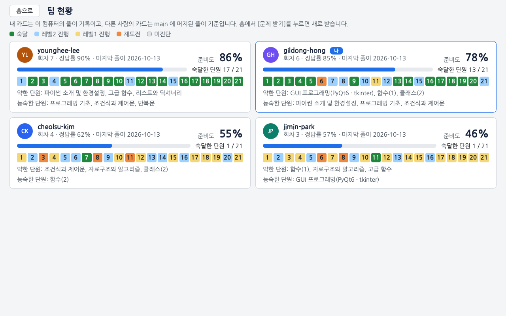

## 문제를 고르는 방식

- 진단 테스트로 단원(차시)마다 출발 레벨을 정합니다. 레벨은 1 기본, 2 응용, 3 심화입니다.
- 회차마다 전 단원에서 15~30문항을 섞어 냅니다. 약한 단원이 더 자주 나오고, 틀린 문항은 2회차 뒤에 다시 나옵니다.
- 한 레벨에서 푼 문항이 2~3개면 전부 맞혀야 하고, 4개 이상이면 최근 4문항 중 3문항 이상을 맞혀야 다음 레벨로 올라갑니다.
- 레벨2를 통과한 단원을 숙달로 칩니다. 홈의 시험 준비도는 단원별 상태를 0~100 으로 합친 값입니다.
- 클래스 1·2, GUI, 예외 처리, 정규표현식 단원(9·10·11·13·14차시)은 추첨 가중치가 1.5배라 더 자주 나옵니다.

규칙과 숫자 전체는 [docs/CRITERIA.md](docs/CRITERIA.md)에 있습니다.

## 모의고사 보기

실전 모의고사는 3회(`m1`, `m2`, `m3`)가 있고 각각 120분, 100점입니다. `m1` 과 `m2` 는 1~16차시, `m3` 은 1~21차시에서 냅니다. `m3` 의 Q17, Q18, p02, p10 은 시험 범위 밖인 21차시 문항입니다. 화면이 아니라 터미널에서 봅니다. 전 단원을 숙달한 뒤에 보기를 권하지만 그 전에도 받을 수 있습니다. 아래는 1회 기준이고, 2회와 3회는 `m1` 자리에 `m2`, `m3` 을 씁니다.

1. `python study.py start m1` 을 실행합니다. 이때부터 120분을 잽니다. 남은 시간은 보여 주지 않으니 시계를 봅니다.
2. 문제지는 `problems/m1/quiz.md` 와 `problems/m1/p01/problem.md` 같은 파일이고, 답은 `submissions/<내 ID>/m1/` 의 `quiz.py` 와 `p01.py` 같은 파일에 적습니다. 파일은 메모장 같은 편집기로 엽니다.
3. `quiz.py` 는 화면과 달리 파이썬 값으로 적습니다. 객관식은 숫자(`Q1 = 3`), 출력 예측과 단답은 따옴표로 감싼 글자(`Q17 = "답"`), 여러 줄 출력은 `"""` 로 감쌉니다. 같은 안내가 `quiz.py` 맨 위에도 적혀 있습니다.
4. `python study.py grade m1` 로 채점합니다. 틀린 문항의 해설은 `python study.py explain m1 Q3` 처럼 봅니다.
5. 프로그램의 [제출(PR 올리기)]를 누르면 모의고사 풀이도 같이 올라갑니다.

## 폴더와 차시별 복습 자료

회차는 여러 차시를 섞어서 냅니다. 차시별로 복습하려면 `problems/s03/README.md` 처럼 차시 폴더의 `README.md` 를 엽니다. 개념 정리와 시험에서 헷갈리는 부분이 적혀 있습니다.

| 폴더                                      | 내용                                                                                                                                                                                                                                                                                                                                                                                                                                            |
| ----------------------------------------- | ----------------------------------------------------------------------------------------------------------------------------------------------------------------------------------------------------------------------------------------------------------------------------------------------------------------------------------------------------------------------------------------------------------------------------------------------- |
| `problems/s01` ~ `s21`                    | 1~21차시. 파이썬 소개, 프로그래밍 기초, 조건문, 리스트와 딕셔너리, 반복문, 함수 1·2, 자료구조와 알고리즘, 클래스 1·2, GUI, 파일 처리, 예외·문자열·람다·map, 정규표현식, 고급 함수, 알고리즘 1·2, Pandas·NumPy·Matplotlib, statsmodels·scikit-learn·SciPy, Seaborn·OpenCV, 파이썬 활용 심화. 18~20차시는 패키지를 다루는 차시라 객관식과 단답만 있습니다. 20차시의 캐스케이드 분류기 이후와 21차시는 시험 범위가 아니라서 회차에 나오지 않습니다 |
| `problems/m1`, `m2`, `m3`                 | 모의고사 1회, 2회, 3회. 각각 120분, 100점                                                                                                                                                                                                                                                                                                                                                                                                       |
| `problems/c1`, `c2`                       | 코딩테스트 연습 Lv.1, Lv.2 (선택)                                                                                                                                                                                                                                                                                                                                                                                                               |
| `dungeons/d01` ~ `d16`                    | 알고리즘 여행의 던전. 지문(`problem.md`)과 소개 글은 공개 파일이고, 숨은 테스트, 힌트, 해설, 기준 풀이는 던전마다 `sealed.json` 하나에 묶여 있습니다. 아직 출제되지 않은 던전은 폴더가 없습니다                                                                                                                                                                                                                                                 |
| `journey/`                                | 알고리즘 여행의 코드 실행기와 채점기                                                                                                                                                                                                                                                                                                                                                                                                            |
| `web/missions`, `web/drills`, `web/learn` | 웹 면접 준비의 미션, 꼬리 질문 주제, 학습 노트. 읽기 안내(`brief.md`), 템플릿 코드(`app/`), 학습 노트(`page.md`)는 공개 파일이고, 단계 요구, 검사, 해설, 사슬 본문은 미션과 주제마다 `sealed.json` 하나에 묶여 있습니다. 목록과 권장 순서는 `web/index.json` 에 있고, 아직 출제되지 않은 것은 폴더가 없습니다                                                                                                                                   |
| `webprep/`                                | 웹 면접 준비의 서비스, 검사 실행, 기록, 복습 일정, 터미널 명령                                                                                                                                                                                                                                                                                                                                                                                  |
| `package.json`, `package-lock.json`       | 웹 미션 검사 도구의 판 목록. `python study.py web install` 이 이 목록대로 `node_modules` 에 설치합니다                                                                                                                                                                                                                                                                                                                                          |
| `submissions/<내 ID>`                     | 내 회차, 풀이, 기록(`profile.json`)                                                                                                                                                                                                                                                                                                                                                                                                             |
| `submissions/<내 ID>/journey`             | 알고리즘 여행의 내 코드(`d01/p1.py`, `d01/p1.js`), 내가 추가한 테스트 케이스(`d01/p1.cases.json`), 기록(`progress.json`)                                                                                                                                                                                                                                                                                                                        |
| `submissions/<내 ID>/web`                 | 웹 면접 준비의 내 미션 코드(`missions/w03/`)와 기록(`record.json`)                                                                                                                                                                                                                                                                                                                                                                              |
| `docs`                                    | [GIT_GUIDE](docs/GIT_GUIDE.md)(제출과 피드백), [CRITERIA](docs/CRITERIA.md)(판정 규칙), [AUTHORING](docs/AUTHORING.md)(스터디장용 운영 메모와 출제 규격), [JOURNEY_AUTHORING](docs/JOURNEY_AUTHORING.md)(알고리즘 여행 출제 규격과 교차 검증), [WEB_AUTHORING](docs/WEB_AUTHORING.md)(웹 면접 준비 출제 규격과 교차 검증)                                                                                                                       |

## 안 될 때

### 창이 열리지 않을 때

창이 열리지 않고 오류만 나오면 터미널에서 `python study.py update` 를 실행해 새 버전을 받은 뒤 다시 켭니다. `update` 가 오류로 끝나면 바로 아래의 네 줄을 입력합니다.

`start.pyw` 나 `ROKEY.app` 으로 켰을 때 프로그램 오류로 창을 열지 못하면 알림 창이 뜨고, 오류 내용은 알림에 적힌 `~/.rokey-study/launch.log` 파일에 남습니다. 터미널에서 `python study.py` 로 켜면(macOS 는 `start.command`) 같은 오류가 검은 창에 나옵니다.

### 예전 버전을 받아 뒀거나 문제 받기가 계속 오류로 끝날 때

터미널에서 쓰던 예전 버전을 받아 뒀거나(폴더에 `start.bat` 이 없습니다), 프로그램을 켤 때마다 "문제를 받다가 오류가 났습니다"가 나오면 `programming-study` 폴더에서 아래 네 줄을 따옴표까지 똑같이 차례로 입력한 뒤 프로그램을 켭니다.

```bash
git fetch origin main
git reset -q FETCH_HEAD
git checkout -q -- ":(top)" ":(top,exclude)submissions"
git clean -fdq ":(top)problems"
```

새로 clone 하지 않아도 되고, 풀이 폴더(`submissions`)는 바뀌지 않아서 풀던 기록이 새 프로그램에서 이어집니다.

### ID 를 잘못 넣었을 때

프로그램을 끄고 `submissions/<잘못 넣은 ID>` 폴더 이름을 맞는 ID 로 바꾼 뒤, 터미널에서 `python study.py init <맞는 ID>` 를 실행합니다. 다시 켜면 풀던 기록이 이름을 바꾼 폴더에서 이어집니다. 잘못된 ID 로 이미 제출했다면 그 PR 은 스터디장에게 닫아 달라고 하세요.

### 제출이 안 될 때

프로그램이 띄운 안내마다 확인할 것을 [docs/GIT_GUIDE.md](docs/GIT_GUIDE.md#제출이-안-될-때)에 적어 두었습니다.

### 알고리즘 여행 줄에 기록을 읽을 수 없다고 나올 때

`submissions/<내 ID>/journey/progress.json` 을 읽지 못하면 첫 화면의 공부 트랙 아래에 이유가 나오고 알고리즘 여행 줄이 눌리지 않습니다. 파이썬 스터디 회차는 계속 풀 수 있지만, 이 파일을 고칠 때까지 프로그램을 켤 때와 [새 문제 받기]를 누를 때는 "알고리즘 여행 기록 파일(journey/progress.json)을 읽을 수 없어 멈췄습니다."가 나오며 문제를 받지 않고, [풀이 제출]은 "읽을 수 없는 풀이 파일이 있어 올리지 않았습니다"가 나오며 올리지 않습니다. 이 파일은 채점, 힌트, 해설 기록을 담은 JSON 파일이라, 메모장 같은 편집기로 열어 오류 문구가 가리키는 곳(JSON 형식이 깨졌으면 '4번째 줄 3번째 글자 근처'처럼 자리가 나옵니다)을 고친 뒤 프로그램을 다시 켭니다. 고치기 어려우면 그 문구를 적어 아래 '사용이 불편하거나 오류가 납니다' 이슈로 알려 주세요.

### 그 밖에 불편하거나 이상할 때

저장소의 Issues → New issue 에서 양식을 골라 적습니다.

| 양식                            | 적을 것                                                                                            |
| ------------------------------- | -------------------------------------------------------------------------------------------------- |
| 사용이 불편하거나 오류가 납니다 | 프로그램이 안 되거나 설명이 헷갈릴 때 씁니다. 오류 창이 뜨면 [오류 내용 복사]를 눌러 붙여 넣습니다 |
| 문제나 정답이 이상합니다        | 문항 ID(예: `s03_Q4`, 알고리즘 여행은 `1-3`)와 무엇이 이상한지 적습니다                            |
| 문제를 더 만들어 주세요         | 더 연습하고 싶은 단원이나 개념을 적습니다                                                          |

이슈를 쓰면 스터디장에게 알림이 가고, 처리되면 이슈가 닫히면서 알림이 옵니다.

## 터미널 명령

창 없이 풀려면 `go` 를 씁니다. 답은 `submissions/<내 ID>/<회차>/` 의 `quiz.py` 와 `.py` 파일에 직접 적습니다. 알고리즘 여행은 창에서 풀고, 웹 면접 준비는 창에서도 풀고 아래 `web` 명령으로도 풉니다. 명령마다 `--user <ID>` 를 붙이면 다른 ID 의 기록을 씁니다.

`go` 는 적어 둔 답을 채점해 첫 제출로 기록합니다(채점 전에 한 번 묻습니다). 화면에서 풀던 회차에 쓰면 쓰다 만 답까지 기록되므로, 화면으로 풀 때는 화면의 [회차 제출]만 씁니다. 터미널 모드는 빈 문항을 오답으로 넘기지 않아서, 모든 문항에 답을 적어야 회차가 끝나고 다음 회차가 나옵니다.

| 명령                             | 하는 일                                                                            |
| -------------------------------- | ---------------------------------------------------------------------------------- |
| `python study.py`                | 창 열기. 진행 상황과 오류가 이 터미널에 나옵니다                                   |
| `python study.py update`         | 새 버전과 새 문제 받기 (창이 열리지 않을 때)                                       |
| `python study.py go`             | 다음 할 일 이어 가기 (진단, 풀기, 채점, 다음 회차)                                 |
| `python study.py me`             | 단원별 숙달도와 약한 개념                                                          |
| `python study.py explain s03_Q4` | 정답과 해설                                                                        |
| `python study.py grade r02`      | 2회차(`r02`) 다시 채점                                                             |
| `python study.py start m1`       | 실전 모의고사(120분). 채점은 `grade m1`. 2회는 `m2`, 3회는 `m3`                    |
| `python study.py start c1`       | 코딩테스트 연습 Lv.1. 채점은 `grade c1`. Lv.2 는 `c2`                              |
| `python study.py web status`     | 웹 면접 준비 현황: Node.js 와 검사 도구, 미션·사슬·학습 노트, 오늘 복습, 다음 추천 |
| `python study.py web install`    | 미션 검사 도구 설치 (처음 한 번, 인터넷 필요). 지우기는 `web uninstall`            |
| `python study.py web get w03`    | 미션 코드를 내 폴더로 복사하고 읽기 시간 시작. 처음부터 다시 하려면 `--again`      |
| `python study.py web start w03`  | 실전 시작. 0단계(코드 설명)가 열립니다                                             |
| `python study.py web check w03`  | 0단계면 점검 항목 표시, 그 뒤는 단계 검사                                          |
| `python study.py web answer w03` | 통과 뒤 질문에 답하지 못하고 넘어갔으면 그 질문에 다시 답하기                      |
| `python study.py web hint w03`   | 면접관 힌트 듣기                                                                   |
| `python study.py web skip w03`   | 목표 시간이 지난 단계 넘어가기                                                     |
| `python study.py web finish w03` | 미션 끝내기: 해설, 모범 답안 비교, 스스로 점검                                     |
| `python study.py web dev w03`    | 미션 폴더에서 `npm run dev` 와 같은 화면 서버 띄우기, Ctrl+C 로 끄기               |
| `python study.py web test w03`   | 미션 폴더에서 `npm test` 와 같은 테스트 돌리기                                     |
| `python study.py web drill 3-A`  | 꼬리 질문 사슬 풀기. 사슬을 비우면 오늘 복습의 첫 사슬                             |
| `python study.py web show l20`   | 학습 노트 읽기                                                                     |

## 라이선스

프로그램 코드(`study.py`, `adaptive.py`, `session.py`, `gitflow.py`, `bootstrap.py`, `mdlite.py`, `gui/`, `journey/`, `webprep/`, `tools/`, `tests/`)는 [GPL-3.0](LICENSE)입니다. 화면에 쓰는 PyQt6 가 GPL-3.0 이라 같은 조건을 따릅니다.

`gui/fonts/` 의 글꼴은 SIL OFL 1.1 을 따릅니다. 화면 글꼴은 [나눔고딕](gui/fonts/OFL.txt), 코드 글꼴은 [D2Coding](gui/fonts/OFL-D2Coding.md)입니다.

`problems/`, `dungeons/`, `web/` 의 문제, 해설, 개념 정리, 그림, 미션 템플릿 코드는 이 스터디의 학습 자료이고 GPL 적용 대상이 아닙니다. 다른 곳에 옮겨 쓰려면 스터디장에게 문의해 주세요.
