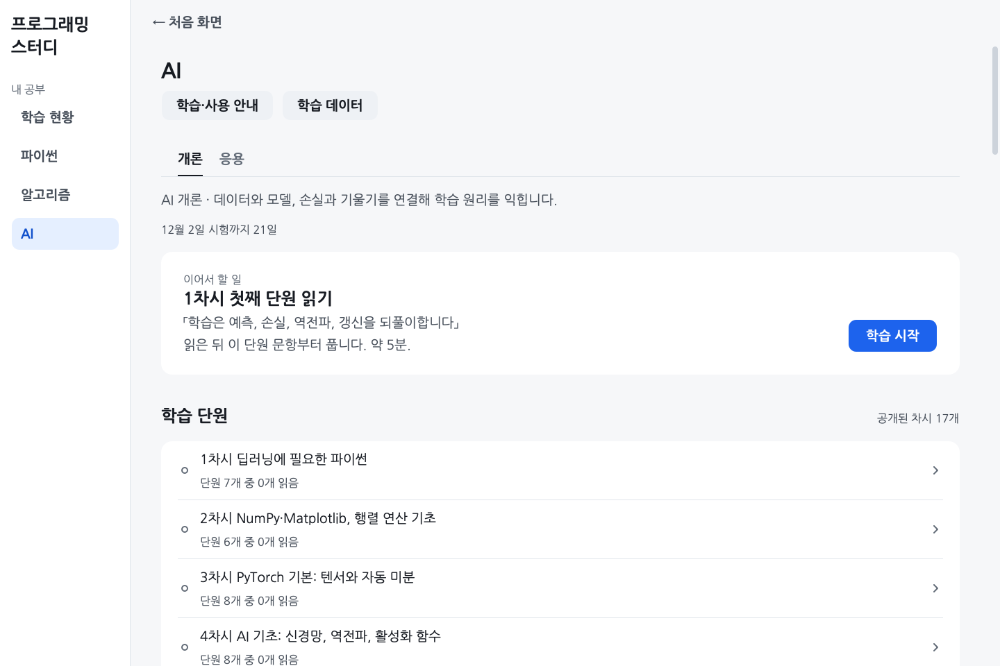
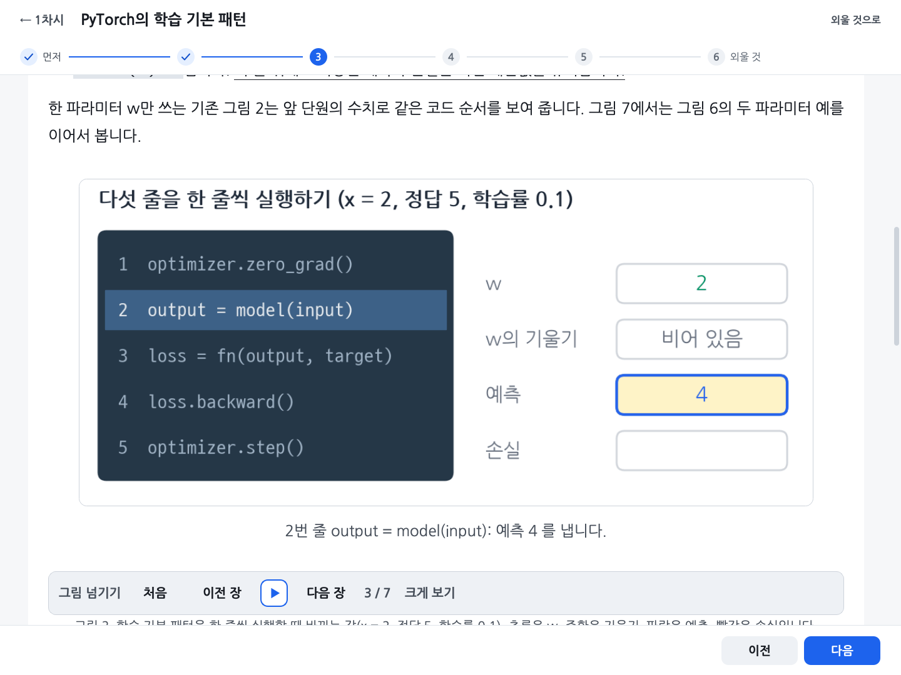

# AI 개론과 응용을 학습합니다

[처음 안내로 돌아갑니다](../README.md)

## AI 개론·응용

ROKEY AI 개론·응용의 개념과 코드를 익히는 트랙입니다. 차시마다 학습 단원을 읽고, 그 단원에서 나온 빈칸·고르기 문제를 풉니다. 맞힌 문항도 며칠 간격을 두고 다시 나옵니다. 하루에 몇 단원, 몇 문항을 풀라는 목표는 없고 문제집을 원하는 만큼 풉니다. PyTorch와 OpenCV를 설치하지 않으며 코드는 실행하지 않고 빈칸과 고르기로만 묻습니다. 개론 1\~17차시와 상황별 코드 연습, 모의고사 3회, 응용 1\~3차시가 공개되어 있습니다.

15차시에서는 이미지 크기를 맞추는 여러 설정과 검증 결과로 모델 상태를 골라 복원하는 방법을 비교합니다. 설명에 필요한 조건·코드·그림을 같은 단원에 두어 외부 노트북 번호를 몰라도 따라갈 수 있게 했습니다.

16차시에는 숫자 이미지의 CNN 모양·hook·Dropout·증강과 모델 선택을 연결하는 단원을 더했습니다. 17차시에는 토큰화에서 Trainer 학습과 검증 모델 선택, accuracy·F1 계산까지 이어지는 단원을 더했습니다. 두 단원은 그림 9장과 새 고정 문항 10개, 참거짓 16개, 수치를 바꿔 내는 계산 문제 2종으로 연습합니다. 예시 수치와 모델을 실행해 측정한 결과는 구분합니다.

첫 화면이나 왼쪽 메뉴에서 [AI]를 고르고 [개론]·[응용] 중 공부할 과정을 선택합니다. [학습·사용 안내]는 실제 화면에 번호와 테두리를 표시한 안내 팝업입니다. [이전]·[다음]으로 넘기며 따라 하고, 작은 글씨는 [크게 보기]로 확인합니다. 학습 단원을 읽고 [연습 시작]으로 문제를 푼 뒤, 문제집의 복습을 따로 진행할 수 있습니다.

학습 화면에서는 설명과 그림을 함께 봅니다. 그림은 크게 열어 볼 수 있고 움직이는 그림은 재생·일시 정지하거나 장면을 직접 고를 수 있습니다. 화면 사진의 ID와 진도는 설명용 예시입니다.

- 이어서 할 일은 마지막으로 중단한 학습 단계나 미완료 풀이 묶음으로 돌아갑니다. 단원 연습 묶음을 끝내면 같은 차시의 다음 단원, 마지막 단원까지 끝내면 다음 차시의 첫 단원을 안내합니다. 최근 수업 날짜나 복습 일정이 이 대상을 바꾸지 않습니다. 단원 연습 완료와 모든 문항 숙달은 구분합니다.
- 학습 단원 목록의 차시 줄에는 읽은 단원 수가 나오고, 누르면 차시 화면이 열립니다. 단원 줄에는 읽기·단원 연습·복습 확인을 나누어 표시합니다. 아래 막대의 [이 차시 풀기]는 홈의 차시 문제집과 같습니다. 위 막대의 [전체 노트]는 차시의 모든 단원을 정답을 편 채로 다시 읽는 화면이고, [외울 것]은 단원마다의 외울 것 질문을 모아 답을 가린 채 보여 줍니다.
- 「문제집」 제목 아래에 복습 확인의 기준이 나옵니다. 섞어 풀기는 읽은 단원의 문항을 차시를 섞어 20문항씩 내고 복습 문항이 앞에 나옵니다. '1차시 문제집' 같은 차시 문제집은 단원을 읽지 않아도 그 차시의 모든 문항을 20문항씩 냅니다. 줄마다 복습 확인 묶음 수와 복습 문항 수가 나오고, 같은 문제집을 몇 번이든 다시 풀어도 됩니다. 오답 노트 줄을 누르면 공유 오답 노트가 AI 개론 칩으로 열립니다.
- 상황별 코드 목록에는 여러 차시에서 나온 코드를 '학습 루프' 같은 상황 하나로 모은 단원이 나옵니다. 줄에는 몇 차시 뒤에 읽기를 권하는지가 나오지만 그 차시를 읽기 전에도 열 수 있습니다. 단원을 읽으면 그 단원 문항이 섞어 풀기와 복습에 나오고, 권하는 차시의 문제집에도 섞여 나옵니다. 학습 루프·평가·회귀·이진 분류·다중 분류·CNN·파일 데이터·전이 학습의 여덟 단원이 공개되어 있습니다.

학습 화면은 입력 준비, 예측, 손실, 기울기, 갱신과 별도 평가를 그림으로 연결합니다. 단원 처음과 마지막에는 전체 흐름을 펴서 보여주고, 중간에는 현재 연결 과정을 표시하며 [전체 흐름 보기]로 펼칩니다. 마지막에는 이 과정이 필요한 이유를 다시 생각해 볼 수 있습니다.

10~17차시 첫 단원의 마지막에는 앞뒤 차시를 잇는 그림이 있습니다. 같은 분류 예에서 입력·특징·점수의 모양과 배치 수를 따라가며, 이번에 바꾸는 것과 유지하는 것을 구분합니다. 차시 본문의 실험과 구별한 설명용 예이며, 사진에서 문장으로 입력이 바뀌어도 점수·손실·갱신의 관계를 이어 봅니다.

설명과 계산 뒤에는 조건과 결과를 짧게 연결해 다시 봅니다. 예를 들어 `backward()`는 기울기 계산, SGD의 `step()`은 파라미터 갱신으로 구분합니다. 조건이 다른 개념을 무조건 같은 뜻으로 묶지 않습니다. ReLU가 0에서 수학적으로 미분 가능하지 않아도 PyTorch가 기울기 0을 정해 계산하는 예외도 그림으로 확인합니다.

[세 단계로 다시 보기]의 [심화 설명]을 누르면 고급 설명·코드·그림이 별도 창으로 열립니다. 닫으면 원래 읽던 단계와 위치로 돌아옵니다. 기본 학습을 마치기 위해 팝업을 열 필요는 없습니다.

여러 차시와 공식 학습 예제에서 반복하는 핵심어는 형광펜과 볼드로, 긴 핵심 원리는 밑줄로 표시합니다. 색만으로 뜻을 구분하지 않으며 코드와 수식의 글자 위치는 유지합니다.

두 코드를 나란히 보며 다른 줄을 확인하고, 코드 빈칸을 한 자리씩 채워 보는 단계도 있습니다. 한 자리씩 채울 때는 답 확인 뒤 정답과 그 자리에 연결된 해설을 보여 줍니다. 틀린 자리는 세 자리 뒤에 다시 나옵니다. 이 단계의 답은 복습 상자에 반영하지 않습니다.

읽기 마침, 단원 연습 마침, 복습 확인은 서로 다른 기록입니다. 복습 확인은 예정된 복습에서 서로 다른 날의 첫 답을 세 번 연속 맞힌 문항 묶음 수입니다. 단원을 읽은 날은 제외합니다. 같은 내용을 묻는 여러 형태는 한 묶음으로 세며, 이미 풀어본 형태가 모두 기준을 충족해야 그 묶음을 확인한 것으로 셉니다. 기준을 충족한 묶음이 없으면 복습 확인 전으로 표시합니다.

### 응용은 입력 준비부터 이어갑니다

AI 홈의 [개론]·[응용]으로 과정을 바꿉니다. 과정마다 읽던 단계·연습·복습을 이어가며 개론의 기존 기록은 유지합니다. 상황별 코드와 기존 모의고사는 개론에 있습니다.

응용 1~3차시는 2026년 11월 11일 받은 초판 자료를 바탕으로 선반영했습니다. 수업 중 갱신본을 받으면 바뀐 입력과 설명을 대조합니다. 4차시 이후는 아직 공개하지 않았습니다.

| 차시 | 이어서 배우는 내용 | 학습 자료 |
| --- | --- | --- |
| 1 | 픽셀·색·배열 모양을 읽고 입력을 준비합니다. | 4단원, 고정 문제 16개, 그림 15개 중 GIF 4개 |
| 2 | 잡음을 줄이고 크기·아핀·원근 좌표를 바꿉니다. | 5단원, 고정 문제 30개, 그림 24개 중 GIF 5개 |
| 3 | 프레임 읽기에서 경계·직선·영역 중심 검출로 이어집니다. | 5단원, 고정 문제 30개, 그림 25개 중 GIF 5개 |

2·3차시에는 초급·중급·심화로 다시 보는 설명이 각각 세 곳 있습니다. 고정 필터·도형 검출과 모델의 가중치 학습을 구분하며 계산 예는 직접 그린 그림으로 확인합니다. 실제 영상이나 모델을 실행해 얻은 성능 수치로 제시하지 않습니다.

개론에서 모델의 학습 원리를 익히고 응용에서 입력 준비·분류·검출로 연결합니다. 생성·설명·3차원 영상·강화학습은 필요한 기초를 확인해 갈라지는 학습 경로로 준비합니다. 교재의 파일 순서를 곧 학습 순서로 삼지는 않습니다.

### AI 개론 모의고사

개론에는 모의고사 3회가 있으며 각 30문항·60분입니다. 현재 응용에는 모의고사가 없습니다. 1회는 1\~12차시, 2·3회는 1\~17차시를 다룹니다. 시작 전에는 범위를 확인하고 [시작]을 누릅니다.

답은 자동 저장되고 [제출]을 누른 뒤 정답과 해설을 확인합니다. 시간이 끝나면 그때까지 쓴 답으로 자동 제출합니다. 중간에 나가거나 프로그램을 꺼도 시간은 계속 흐르며 홈의 모의고사 목록에서 이어 풉니다.

문항마다 1점으로 **맞힌 문항 수 / 30**을 표시합니다. 빈칸이 여러 개면 모두 맞혀야 1점이며 고르기는 정답 보기를 빠짐없이 골라야 합니다. 정답이 아닌 보기를 함께 고르면 오답입니다. 부분 점수는 없습니다. [AI 연습](#연습)의 '일부 맞았습니다' 표시와 모의고사 점수는 구분합니다.

### 학습 단원

학습 본문과 입력은 보통에서 22px·줄 높이 40px, 크게에서 24px·44px, 더 크게에서 26px·48px로 표시합니다. 읽기 영역은 큰 창에서 1600px까지 넓어지고 문단과 그림·물음 사이를 띄웠습니다. 좁은 표는 열 제목과 항목별 값을 세로로 나누어 보여 줍니다. 작은 창에서는 화면 폭에 맞추며, 그림 속 글자도 본문 크기와 함께 커집니다. 전체 노트와 세 단계 설명에도 같은 기준을 적용합니다.

단원은 설명·그림·확인 물음을 단계별로 보여 줍니다. 위 막대 아래의 단계 표시에서 지금 단계가 파란 원으로 보이고, 아래 막대의 [이전]·[다음]이나 ←·→ 키로 넘깁니다. 입력 칸이나 그림을 고른 동안에는 ←·→ 가 그쪽에서 쓰이므로 Alt+←·→ 로 넘깁니다. 수업에서 들은 단원은 위 막대의 [외울 것으로]를 눌러 마지막 단계로 바로 갈 수 있습니다.

- 첫 단계 「먼저 풀어 보기」는 설명을 읽기 전에 짐작으로 고르는 문항입니다. 보기를 고르면 바로 기록되고 몇 단계에서 답을 확인하는지 나옵니다. 그 단계를 떠나기 전까지는 다른 보기로 바꿀 수 있습니다. 채점하지 않고, 고른 답과 정답은 뒤 단계의 「짐작 확인」에 나옵니다.
- 움직이는 그림은 처음 열면 한 번 재생하고 마지막 장에서 멈춥니다. [멈춤]으로 멈춰 읽거나 [처음]·[이전 장]·[재생]·[다음 장]으로 다시 볼 수 있습니다. 지금 장의 설명이 그림 바로 아래에 나오고 장을 넘기면 같이 바뀝니다. 그림을 누른 뒤에는 ←·→ 로도 장을 넘기고, Alt+←·→ 는 단계를 넘깁니다.
- 그림의 [크게 보기]를 누르면 확대창이 열립니다. 작은 창에서 한 번에 보이지 않는 부분은 가로·세로 스크롤로 확인하고 [닫기]로 학습 화면에 돌아옵니다.
- 그림을 읽지 못하면 저장된 캡션·대체 내용·장별 설명을 표시합니다. [다시 시도]는 같은 자리에서 그림 파일만 다시 읽습니다. 학습 단계나 답안은 다시 열지 않으며 파일이 계속 없거나 손상됐으면 설명과 안내를 유지합니다.
- 「떠올리기」는 빈칸 하나를 적고 [확인]을 누르면 바로 맞고 틀림, 정답, 까닭이 나옵니다. 칸이 비어 있으면 채점하지 않습니다. 틀려도 다음 단계로 넘어갈 수 있고 복습 날짜에는 들어가지 않습니다.
- 「왜일까요?」는 질문을 읽고 답을 충분히 생각한 뒤 펼쳐보세요. [답 보기]를 누르면 이유를 확인할 수 있습니다.
- 어려운 개념이 나오는 단계 끝에는 「세 단계로 다시 보기」가 접혀 있습니다. 펴면 같은 개념을 초급 수준은 숫자와 그림으로, 중급 수준은 계산과 식으로, 심화 수준은 정의와 코드로 차례로 설명합니다. 수준마다 확인 물음에 답을 적고 [확인]을 누르면 떠올리기처럼 바로 맞고 틀림이 나옵니다. 결과는 떠올리기처럼 기록되고 복습 날짜에는 들어가지 않습니다. 전체 노트와 [노트 보기] 창에서도 접혀 있고, 펴면 입력 칸 대신 확인 물음의 정답과 까닭이 나옵니다.
- 확인한 원리와 조건은 본문과 해설에서 바로 설명합니다. 자료의 오류를 대조한 기록은 학습 화면의 별도 정정 상자로 표시하지 않습니다. 「보충 설명」은 필요한 배경을, 「심화」는 더 깊은 내용을 다룹니다. 「2026 흐름 · 시험 범위 밖」은 접혀 있습니다.
- 마지막 단계 「외울 것」은 질문 목록입니다. 질문을 읽고 답을 충분히 생각한 뒤 펼쳐보세요. 이 단계를 열기만 해서는 완료되지 않습니다. [연습 시작]을 누르면 읽기 기록을 남기고 해당 단원의 연습을 엽니다. 연습 묶음을 끝내면 다음 단원을 안내합니다.

읽다가 나가면 [이어서 학습]으로 보던 단원과 단계로 돌아갑니다. 같은 실행에서 같은 단원을 왕복하면 떠올리기 입력, 그림 장, 펼친 설명과 읽던 위치를 복원합니다. 프로그램을 다시 켜도 학습 단계는 남고, 미완료 연습 묶음은 같은 문항·보기·입력으로 이어집니다. 학습 본문의 모든 입력과 스크롤을 재시작 뒤까지 저장하는 기능은 아닙니다. 자료가 바뀌어 이전 문항과 맞지 않으면 옛 묶음을 그대로 재생하지 않습니다.

### AI 개론·응용의 답안과 채점 기준을 확인합니다

**개론과 응용은 아래 규칙을 함께 사용합니다.** PyTorch·OpenCV 코드를 직접 실행하지 않고 빈칸에 들어갈 내용이나 알맞은 보기를 답합니다.

| 유형 | 답을 적는 법과 판정 |
| --- | --- |
| 낱말 | 개념이나 용어를 적습니다. 등록된 정답·동의어·허용 답과 비교하며 띄어쓰기·붙임표·영문 대소문자·일부 조사 차이를 허용합니다. |
| 코드 | 빈칸에 들어갈 코드만 적고 대소문자와 기호를 맞춥니다. `optimizer.____()`의 답이 `zero_grad`라면 `zero_grad()`도 허용합니다. |
| 숫자 | 계산한 값을 적습니다. 같은 값을 나타내는 `0.5`와 `1/2`는 같은 답으로 비교합니다. 반올림 자리나 단위를 지정한 문항은 그 조건을 따릅니다. |
| 모양 | `(32, 10)`처럼 축별 크기를 순서대로 적습니다. 축의 순서와 각 크기가 일치해야 맞습니다. |
| 배열 | `[1, 2]`처럼 값을 적습니다. 값의 순서와 중첩 구조를 맞춥니다. `True`와 `1`은 다른 답입니다. |
| 선택 | 보기를 누릅니다. 둥근 표시는 하나, 네모 표시는 여러 개를 고릅니다. 정답 보기와 고른 보기가 모두 일치해야 맞습니다. |

문자열을 그대로 적도록 지정된 칸은 대소문자와 문장 안 공백까지 비교합니다.

답을 적거나 고른 뒤 [**확실함**] 또는 [**긴가민가**]를 누르면 그 문항을 바로 채점합니다. 둘은 답에 대한 확신을 구분하며 정답을 비교하는 기준은 같습니다. 모르면 [모르겠어요]로 정답과 해설을 확인합니다.

Ctrl+Enter(맥은 Cmd+Enter)는 [확실함], Ctrl+Shift+Enter는 [긴가민가]입니다.

일반 빈칸 문항은 일부 칸만 맞히면 **일부 맞았습니다**로 표시해 맞은 칸과 틀린 칸을 알려줍니다. 개론에만 있는 상황별 코드 연습은 이번에 묻는 칸과 함께 가린 칸의 결과를 나눠 기록합니다. 연습 결과는 맞힌 문항 수와 복습 상태로 확인하며 모의고사처럼 점수를 합산하지 않습니다.

학습 본문 안의 「떠올리기」와 단계별 확인 물음은 [확인]을 눌러 답을 봅니다. 이 결과는 연습의 복습 날짜에 반영하지 않습니다. GitHub에 기록을 공유할 때는 현황 화면의 [풀이 제출]을 따로 누릅니다.

### 연습

연습 화면은 한 번에 한 문항을 보여 줍니다. 위 막대 오른쪽에 몇 번째 문항인지가, 카드 맨 위에 차시와 문항 꼴 꼬리표가 나오고, 상황별 코드 문항은 차시 대신 '학습 루프' 같은 상황 이름이 나옵니다. 묶음 제목이 차시를 말하는 차시 문제집과 단원 연습에서는 그 차시 문항에 차시 꼬리표를 붙이지 않습니다. 빈칸이 둘 이상이면 지문과 입력 칸에 ①② 번호가 붙고, 코드 안의 빈칸은 코드 줄 사이에 입력 칸이 놓입니다. Tab 으로 다음 칸에 갑니다. 하나만 고르는 보기는 둥근 표시, 여럿 고르는 보기는 네모 표시입니다. 시험처럼 복사와 붙여넣기는 막혀 있고, 글을 끌어다 놓아도 칸에 들어가지 않습니다.

- 답하면 카드 맨 위에 '맞았습니다', '일부 맞았습니다', '틀렸습니다'와 정답이 나오고 칸 테두리 색이 바뀝니다. 빈칸이 둘 이상이면 칸마다 '맞음'·'틀림'이 붙고, 코드 안 빈칸은 코드 아래 한 줄에 번호마다 나옵니다. 고르기는 보기마다 '정답'·'내 답' 꼬리표와 그 보기가 왜 맞거나 틀린지 한 줄이 붙습니다. 옳지 않은 것을 고르는 문항은 정답 줄 대신 '옳지 않은 문장' 줄이 나옵니다. 보기가 코드인 상황별 코드 문항은 정답 줄을 따로 쓰지 않고 보기의 '정답'·'내 답' 꼬리표로 보여 주며, 순서 고르기 보기에는 까닭 줄이 붙지 않고 해설이 순서를 설명합니다. 그 아래에 해설과 관련 학습 노트의 위치가 나옵니다. 노트 위치를 누르면 해당 단계를 엽니다.
- [확실함]을 누르고 틀리면 '확실하다고 했지만 틀렸습니다'가 나오고, 그 문항은 다음 날과 7일 뒤에 다시 나옵니다.
- 틀린 문항은 세 문항 뒤에 다시 나오고, 두 번 이어 맞히면 그 묶음에서 빠집니다. 다시 들어간 문항은 판정 아래에 몇 문항 뒤에 나오는지 적혀 있고, 그만큼 위 막대의 전체 문항 수가 늘어납니다.
- [노트 보기]는 그 문항의 근거가 된 학습 단계를 창으로 엽니다. 창을 닫아야 연습으로 돌아갑니다. 창 안의 떠올리기와 왜일까요는 답이 펴진 채로 나오고 기록에 남지 않습니다.
- 빈칸 답이 채점에서 틀렸지만 같은 뜻이라고 생각하면 [내 답도 맞음]을 누릅니다. 그 답은 맞은 것으로 바뀌고, 출제자가 모아 보고 받을 답에 더할지 정합니다.

묶음이 끝나면 이번 묶음의 첫 답에 맞힌 수, 새로 복습 확인 묶음 수, 다음 복습 날짜가 나옵니다. 오늘 새로 접한 문항은 이 묶음에서 마친 수를, 이전 학습일에도 풀었던 문항은 이번 첫 답에 맞힌 수를 따로 표시합니다. 단원을 읽은 날 틀린 문항이 있으면 그 문항은 오답 노트에 넣지 않았다는 줄도 나옵니다. 단원을 읽은 뒤 연 연습이면 [다음 단원]이(안 읽은 단원이 없으면 [섞어 풀기]가), 그 밖에는 [한 번 더]가 나옵니다. 자동 복습을 마쳤으면 다음 복습일과 홈으로 가는 단추를 보여 줍니다. 차시 문제집과 섞어 풀기에서는 계속 연습할 수 있습니다.

### 복습 확인

- 단원을 읽은 날에 맞힌 문항은 다음 날 다시 나옵니다. 그 뒤로는 맞힐 때마다 다음 복습까지의 간격이 1일, 2일, 4일, 7일, 14일로 늘고, 틀리면 다음 날로 돌아옵니다.
- 같은 날 두 번째로 맞히거나 복습 날짜 전에 맞힌 답은 간격을 늘리지 않습니다. 날짜가 되면 다시 확인합니다.
- 단원을 읽은 날을 제외하고 예정된 복습에서 서로 다른 세 날의 첫 답을 연속으로 맞히면 복습 확인 기준을 충족합니다. 같은 내용을 묻는 여러 형태는 한 묶음으로 셉니다. 기준을 충족한 뒤에도 7일, 14일 간격으로 나옵니다.
- 날짜는 새벽 4시에 바뀝니다. 밤 12시 전후에 푼 문항은 같은 날로 셉니다.
- 11월 25일부터 12월 1일까지는 그동안 연 문항이 모두 한 번씩 고르게 나뉘어 나옵니다.

### 오답 노트

그 문항의 단원을 읽은 날이 아닌 날에 그날 처음 낸 답이 틀린 문항이 오답 노트의 AI 개론 칩에 차시별로 모이고, 상황별 코드 문항은 '상황별 코드' 묶음에 모입니다. 단원을 읽은 날 틀린 문항은 넣지 않고 다음 날 복습에서 다시 냅니다. 그날 [확실함]으로 틀린 문항은 넣습니다. [모르겠어요]를 누른 문항은 '미응답 문항'에, 그 뒤 다른 날 맞힌 문항은 '다시 맞힌 문항'에 들어가고 또 다른 날 한 번 더 맞히면 목록에서 빠집니다. 문항 줄에는 문항 꼴과 문제 첫머리가 나오고, 오른쪽 칸에 근거, 문제, 내 답이 나옵니다. [해설 보기]로 정답과 해설을 펴고 [다시 풀기]를 누르면 그 문항과 같은 갈래 문항으로 연습이 열립니다.

### 기록

연습의 답, 읽은 단원, 짐작과 떠올리기 결과는 `submissions/<내 ID>/ai/record.json` 에 쌓이고 [풀이 제출]을 누르면 같이 올라갑니다. 맞힌 답의 글은 남기지 않습니다. 개론에서 보던 단계는 저장소에 올리지 않는 `~/.rokey-study/ai/<내 ID>/state.json`에 둡니다. 응용에서 보던 위치와 연습 초안은 같은 폴더 아래 `app/state.json`에 따로 둡니다. 복습 날짜와 복습 확인 수는 기록에서 그때그때 계산하고 따로 저장하지 않습니다. 계산 규칙은 [docs/CRITERIA.md](../docs/CRITERIA.md)의 'AI 개론'에 있습니다.

풀이 데이터 수집과 비공개 서버 전송은 [수집 안내](../learning_server/README.md#풀이-데이터-수집)에서 확인합니다.
