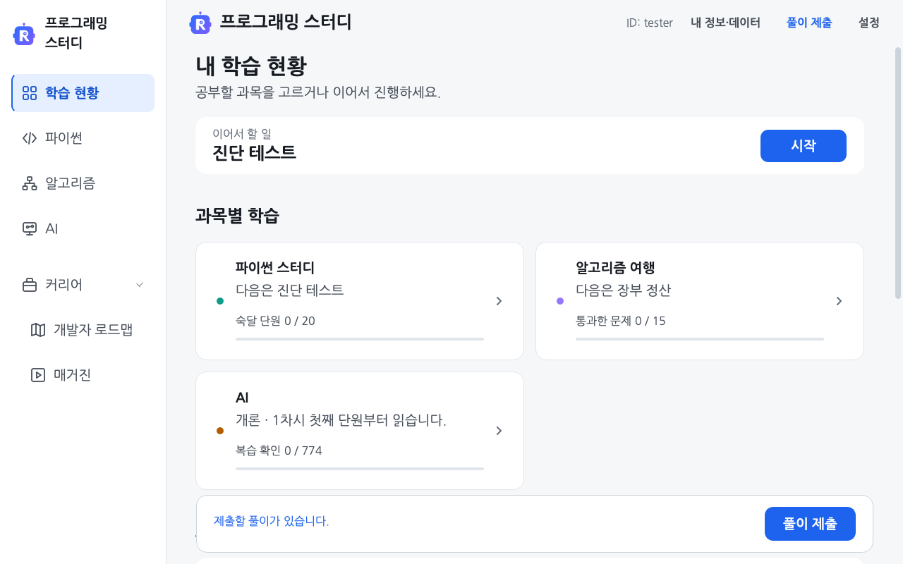

# 풀이 파일 비공개 제출

[학습 시작](LEARNER_START.md) · [수집 동의·철회](LEARNING_PRIVACY.md)

답안 파일·채점 결과·진도는 비공개 서버에 제출합니다. 직접 보내려면 [풀이 제출]을 누르세요. 문제 묶음을 마칠 때마다 보내려면 [답안 파일도 자동 제출]을 선택하세요. 일반 학습자의 풀이로 GitHub 공개 PR을 만들지 않습니다.

## 풀이 제출

1. 아직 동의하지 않았다면 첫 화면의 [내 정보·데이터]에서 수집 내용을 읽고 두 선택 항목에 표시한 뒤 [동의하고 수집 시작]을 누릅니다. 동의하지 않으면 전송하지 않고 이 컴퓨터에서 학습·채점을 계속합니다.
2. 제출할 풀이가 생기면 첫 화면 상단에 [풀이 제출]이 나타납니다. [내 학습 현황] 하단에도 파란 [풀이 제출] 버튼이 생깁니다. 어느 쪽을 눌러도 같은 파일을 보냅니다.
3. 하단에 ‘비공개 서버에 풀이를 저장했습니다.’가 나오면 접수를 마쳤습니다. 유효한 동의가 있으면 매번 동의나 서버 연결을 다시 묻지 않습니다.

보낼 파일 목록이 궁금하면 [내 정보·데이터]의 [보낼 풀이 파일 보기]를 엽니다. 목록을 열지 않아도 [풀이 제출]로 바로 보낼 수 있습니다. 전송 중에는 제출 버튼이 잠깐 꺼지고 완료·실패 안내는 같은 하단 영역에 남습니다. 실패해도 로컬 풀이는 유지됩니다. 오류에 따라 다시 보내는 방법은 [서버 저장을 확인하지 못했을 때](#서버-저장을-확인하지-못했을-때)를 확인하세요.

긴 오류는 하단에 짧게 표시하고 [자세히]에서 원문을 확인합니다.

기본 서버는 자동으로 연결합니다. 다른 서버 주소 입력은 일반 학습자에게 필요하지 않습니다.

스터디원용 다른 서버 연결

서버의 네 명 명단에 등록된 계정으로 GitHub 본인 확인을 마치면 첫 화면 상단에 [다른 서버 연결]이 보입니다. 일반 학습자에게는 표시하지 않습니다. 계정 정보를 새로 수집하지 않고 기존 기기 인증의 스터디원 여부를 사용합니다. 다른 서버를 처음 연결할 때는 주소와 파일 목록을 확인하고 [위 파일을 비공개 서버에 제출합니다.]에 표시한 뒤 [확인하고 제출]을 누릅니다. 기존 제출 연결이 있으면 같은 서버를 사용합니다. 이 메뉴로 운영자 권한을 얻지는 않습니다.

## 풀이 기록 전송과 답안 파일 자동 제출

연구에 동의하면 새 파이썬·AI 풀이 기록을 약 1분 간격으로 보냅니다. 이 기록에는 입력한 답안 본문을 넣지 않습니다. 파일을 자동으로 보낼지는 한 번 따로 묻습니다. [기록만 자동 전송]을 선택해도 연구 기록은 계속 보내며 [풀이 제출]로 파일을 직접 보낼 수 있습니다.

[답안 파일도 자동 제출]을 선택하면 프로그램을 켤 때 미제출 풀이를 보냅니다. **업데이트 전이나 이 선택 전에 작성한 제출 대상 파일도 포함합니다.** 파이썬에서는 [회차 제출]이나 [다시 채점]으로 결과를 열 때, AI 연습에서는 묶음의 마지막 문항을 채점했을 때 미제출 파일을 확인합니다. 오답이 있어도 보냅니다. AI 모의고사는 [제출]을 누르거나 제한 시간이 끝나 채점하면 보냅니다. 알고리즘 여행은 [채점하기]를 끝까지 마쳤을 때 확인합니다. 예시만 실행하거나 채점을 중단하면 이때 파일을 보내지 않습니다.

파이썬과 AI 모두 수집을 켰을 때만 파일을 백그라운드에서 자동 제출합니다. 마지막으로 접수된 파일 묶음과 내용의 해시가 같으면 건너뜁니다. 인터넷이 끊기거나 서버가 일시적으로 응답하지 않으면 로컬 풀이를 보관하고 간격을 늘려 다시 보냅니다. 용량·형식 오류가 있거나 자동 제출 작업을 마치지 못하면 파일·동의 선택·연결 상태가 그대로인 동안에는 다시 켜도 자동으로 반복하지 않습니다.

[내 정보·데이터]에서 파일 자동 제출 설정을 열고 [기록만 자동 전송]을 선택하면 이후 파일 자동 제출만 멈춥니다. 이미 보낸 기록과 파일도 삭제하려면 [동의 철회·비공개 기록 삭제]를 선택하세요. 기존 학습의 답안과 진도는 이 컴퓨터에 남습니다. 이미 전달한 연구 사본·백업은 운영자가 철회 기록과 대조합니다.

## 제출할 수 있는 파일 크기

한 번에 보내는 파일은 합계 4MiB, 최대 1,000개까지 받습니다. 줄바꿈·따옴표·역슬래시를 전송 형식으로 바꾸면 크기가 늘어날 수 있습니다. 새로 제출하는 파일은 실제 전송 요청이 6MiB를 넘으면 보내지 않습니다. 크기를 넘으면 로컬 답안을 보관한 채 전송을 멈춥니다. 크기 안내가 나오면 원래 답안을 보관하고 스터디장에게 오류 문구를 알려 주세요.

이전 프로그램에서 남은 전송 대기 파일은 같은 접수 번호로 서버에 먼저 확인합니다. 용량 초과로 대기 정보를 정리했다는 안내가 나오면 [풀이 제출]을 다시 눌러 현재 답안을 보냅니다.

## 서버 저장을 확인하지 못했을 때

실패해도 이 컴퓨터의 풀이는 남습니다. ‘자동 제출을 마치지 못했습니다’가 나오면 [풀이 제출]로 직접 다시 시도하세요. 파일을 읽을 수 없어 버튼이 보이지 않으면 [내 정보·데이터] → [보낼 풀이 파일 보기]에서 오류를 확인하고 스터디장에게 알려 주세요. 인증 오류(401)는 연결 파일을 그대로 두고 운영자에게 문의하세요. 응답을 받지 못한 접수는 같은 번호로 확인하며 새 답안과 섞어 덮어쓰지 않습니다. 다른 기기에서 먼저 제출한 기록과 충돌하면 자동으로 덮어쓰지 않고 멈춥니다.

예전 프로그램의 공개 제출 경로는 종료됐습니다. ‘공개 풀이 제출을 종료했습니다’가 보이면 프로그램을 다시 실행해 업데이트합니다. 수집 내용이 바뀌어 동의를 다시 묻는 경우 현재 내용을 읽고 선택합니다.

제출한 파일은 비공개로 보관하며 서버에서 실행하지 않습니다. 서버에는 최근 제출한 파일 묶음을 보관합니다. 전체 학습 기록을 보관하거나 컴퓨터를 옮기려면 [풀이와 기록 보관 방법](../gui/README.md#풀이-백업과-새-컴퓨터로-옮기기)을 따릅니다.
