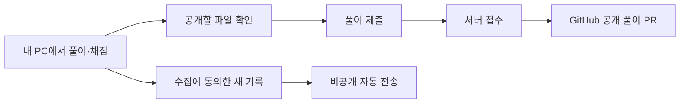
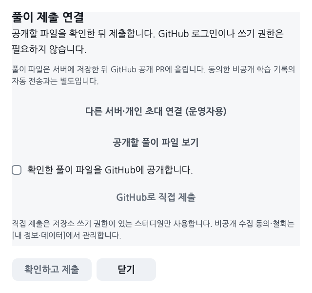

# 공개 풀이를 제출합니다

[프로그램 사용준비](../gui/README.md) · [풀이 제출과 리뷰](../submissions/README.md)

GitHub 링크로 프로그램을 받아 실행합니다. 일반 수강생은 초대 파일이나 GitHub 로그인 없이 제출할 수 있습니다. 모델을 개발하는 스터디원은 본인 fork와 개발 PR을 사용합니다.

## 공개할 파일을 확인합니다

1. 문제를 풀고 채점한 뒤 첫 화면의 [풀이 제출] 또는 [제출 연결]을 누릅니다.
2. [공개할 풀이 파일 보기]에서 목록을 확인합니다. 답안과 채점·진도 기록은 GitHub에 공개됩니다.
3. 공개 여부를 선택하고 [확인하고 제출]을 누릅니다. 서버 저장 뒤 PR 주소가 열립니다. 다음 제출에서도 공개할 파일을 확인합니다.

기본 서버는 프로그램에 설정되어 있습니다. 일반 수강생에게 서버 주소나 개인 코드를 따로 입력하도록 안내하지 않습니다. 운영자가 별도로 안내한 경우에만 [다른 서버·개인 초대 연결]을 사용합니다.

## 비공개 자동 전송과 구분합니다

| 자료 | 보내는 시점·위치 |
|---|---|
| 답안 파일과 채점·진도 기록 | 공개 여부를 확인하고 제출했을 때 서버에 접수한 뒤 GitHub PR에 올립니다. |
| 동의 뒤의 파이썬·AI 추가 기록 | 약 1분 간격으로 비공개 서버에 자동 전송합니다. 입력 답안 본문은 제외합니다. |
| 인증·동의 설정과 추가 데이터 DB | 공개 풀이 파일에 포함하지 않습니다. |

비공개 수집에 동의하지 않아도 학습·로컬 채점과 공개 풀이 제출을 사용할 수 있습니다. [내 정보·데이터](LEARNING_PRIVACY.md)에서 수집 동의와 철회를 관리합니다. 비공개 기록을 보내는 것으로 공개 PR이 자동 생성되지는 않습니다.

기기 ID는 로컬 폴더를 구분하며 GitHub 계정 소유를 인증하지 않습니다. 서버는 공개 풀이 경로와 비공개 수집 계정을 따로 발급합니다. PC 사이의 기록을 자동으로 합치지 않으므로 [기록 보관 안내](../gui/README.md#컴퓨터를-바꾸거나-사본을-보관합니다)를 확인하세요.

## 실패한 단계부터 다시 시도합니다

- 서버 저장을 확인하지 못했다면 이 기기의 풀이를 유지하고 다시 제출합니다.
- 서버 저장 뒤 GitHub 게시만 실패했다면 잠시 뒤 [풀이 제출]을 누릅니다. 같은 접수로 이어가며 중복 PR을 만들지 않습니다.
- 비공개 전송이 실패하면 이 기기에 보관하고 재연결 뒤 다시 보냅니다. 학습 화면은 계속 사용할 수 있습니다.
- 다른 PC의 풀이가 먼저 저장됐다는 안내가 나오면 양쪽 원본과 이전 접수 결과를 확인합니다. 서버 기록을 자동으로 덮어쓰지 않습니다.

공개 제출에는 5초 간격과 최근 24시간 100회 상한을 적용합니다. 같은 접수의 재시도는 새 제출 횟수에 넣지 않습니다. 학습량과 비공개 전송에는 이 상한을 적용하지 않습니다.

운영자의 서버 설정과 기존 초대 방식 확인하기

서버 전용 GitHub 토큰은 해당 저장소의 Contents·Pull requests 읽기/쓰기로 제한합니다. 공개 저장소 밖의 권한 600 파일에 저장하고 STUDY_GITHUB_CONFIG로 경로를 지정합니다. 참가자에게 토큰이나 서버 관리 계정을 전달하지 않습니다.

일반 배포는 STUDY_OPEN_REGISTRATION=1로 동의 후 등록을 사용합니다. 새 등록은 과목별 수집·공개 제출을 합쳐 최근 24시간 1,000건으로 제한합니다. 기기가 만든 비밀 값으로 등록 재시도를 확인합니다. 기존 개인 초대 연결도 운영자용으로 유지합니다. [운영 안내](LEARNING_SERVER.md)를 따릅니다.

공개 제출은 /v1/register/open으로 연결하고 /v1/submissions로 저장한 뒤 /v1/submissions/publish로 게시합니다. 서버는 개인 경로에만 게시하며 제출 파일을 실행하지 않습니다. main·프로그램·워크플로 파일은 제출 요청으로 고칠 수 없습니다.

기존 개인 초대 계정의 DELETE /v1/me는 해당 접수 파일과 연결한 비공개 기록을 삭제합니다. 새 기본 흐름의 연구 동의 철회는 과목별 비공개 계정만 삭제합니다. GitHub 공개 PR과 Git 이력은 자동 삭제하지 않습니다. 공개 풀이 삭제는 운영자에게 별도로 요청합니다.

