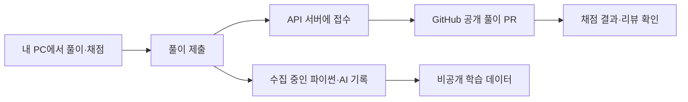

# 개인 초대로 풀이를 제출합니다

[프로그램 사용준비](../gui/README.md) · [풀이 제출과 리뷰](../submissions/README.md)

일반 수강생은 저장소 쓰기 권한이나 GitHub 로그인 없이 제출할 수 있습니다. 개인 초대로 서버를 연결하면 [풀이 제출]이 서버 저장과 GitHub PR 생성을 처리합니다. 팀원의 모델 개발은 기존처럼 본인 fork와 개발 PR을 사용합니다.



## 처음 한 번 연결합니다

1. 프로그램에서 문제를 풀고 채점합니다. 첫 화면 상단의 [제출 연결] 또는 하단의 [풀이 제출]을 누릅니다.
2. 스터디장이 개인별로 전달한 **서버 주소와 초대 코드**를 입력합니다. 코드 하나로 API 제출과 아직 연결하지 않은 과목의 데이터 전송을 준비합니다. 이미 사용하던 과목별 연결은 덮어쓰지 않습니다.
3. [공개할 풀이 파일 보기]에서 파일 목록을 확인합니다. 풀이 파일에는 답안과 채점·진도 기록이 들어가며 GitHub에서 공개됩니다.
4. [연결하고 제출]을 누릅니다. 서버 저장과 GitHub 게시를 확인하면 PR 주소가 열립니다. 이후에는 [풀이 제출]만 누르면 됩니다.

[](img/screen-api-setup.png)

입력한 ID로 이 기기의 풀이 폴더를 구분합니다. API 연결로 GitHub 계정 소유 여부를 인증하지는 않습니다. 서버는 개인별로 다른 공개 폴더와 브랜치를 발급하며 다른 사람의 폴더를 덮어쓰지 않습니다. 초대 코드는 다른 사람과 나누거나 공개 이슈에 올리지 않습니다.

## 공개 풀이와 비공개 기록을 구분합니다

| 보내는 자료 | 저장·표시 위치 |
|---|---|
| 풀이 파일, 채점·진도 기록 | 서버에 접수한 뒤 GitHub 공개 PR에 게시합니다. 로컬 원본은 유지합니다. |
| 수집을 시작한 뒤의 파이썬·AI 개론·응용 기록 | 기존 수집 API로 비공개 저장합니다. 입력 답안 본문은 기본으로 제외합니다. |
| 서버 인증·초대·추가 데이터 DB | 공개 풀이 파일에 포함하지 않습니다. |

API 제출은 수집 중인 과목의 추가 기록도 함께 전송합니다. [학습 데이터]에서 수집을 중단하면 해당 과목의 추가 기록은 보내지 않습니다. 추가 데이터를 삭제해도 일반 풀이 제출은 계속 사용할 수 있습니다. 과목별 [서버에 보내기]로 추가 기록만 보내는 방법도 유지합니다.

API 서버에는 마지막 접수의 풀이 파일과 이전 접수의 결과를 보관합니다. 이전 공개 풀이의 변경 이력은 GitHub에서 확인합니다. API 제출은 로컬 폴더를 지우거나 다른 PC의 기록을 자동으로 합치지 않습니다. PC를 바꿀 때는 [원본과 추가 기록을 보관](../gui/README.md#컴퓨터를-바꾸거나-사본을-보관합니다)하세요.

## 실패한 단계부터 다시 확인합니다

- 서버 연결·초대 오류가 나오면 받은 주소와 코드, 유효 기간을 확인합니다.
- **서버에 저장했고 GitHub 게시를 마치지 못했다면** 잠시 뒤 [풀이 제출]을 다시 누릅니다. 보관한 접수로 게시를 이어가며 같은 접수를 중복 저장하지 않습니다.
- 추가 학습 기록 일부만 실패했다면 공개 PR은 유지합니다. 다시 제출하면 미전송 기록을 이어 보냅니다.
- 다른 풀이가 서버에 먼저 저장됐다는 안내가 나오면 두 PC의 원본과 이전 접수 결과를 확인합니다. 서버 기록을 자동으로 덮어쓰지 않습니다.

공개 PR 제출에는 5초 간격과 최근 24시간 100회 상한을 적용합니다. 같은 접수의 재시도는 새 제출 횟수에 넣지 않습니다. 학습량과 비공개 기록 전송은 제한하지 않으며 공개 제출이 제한된 동안에도 추가 기록은 먼저 전송합니다.

## 스터디장의 서버 연결을 준비합니다

운영 계정에서만 진행합니다. 참가자에게 서버 관리 계정이나 GitHub 토큰을 전달하지 않습니다.

1. [GitHub의 세분화된 토큰 설정](https://github.com/settings/personal-access-tokens/new)에서 이 프로젝트 저장소 하나만 선택합니다. 저장소 권한은 **Contents: Read and write**, **Pull requests: Read and write**로 제한하고 만료일을 정합니다. 기존 개인 개발용 토큰을 복사하지 않습니다.
2. 서버의 공개 저장소 밖에 권한 `600`인 JSON 파일을 만들고 `repository`와 `token`을 보관합니다. 저장소 값은 `WaterMinCho/programming-study`입니다. 토큰 값은 화면 캡처·명령줄 인자·로그에 남기지 않습니다.
3. WSGI 설정에서 `STUDY_GITHUB_CONFIG`를 그 파일 경로로 지정하고 Reload합니다. 기존 `STUDY_DATA_DB`와 인증 키는 유지합니다. 갱신 전에 [DB와 키를 함께 백업](LEARNING_PILOT.md)합니다.
4. 아래 명령으로 새 비공개 폴더에 개인 초대를 발급합니다. 파일을 한 명에게 하나씩 전달합니다. 발급만으로 참가자의 등록이나 전송이 완료되지는 않습니다.

```sh
python -m learning_server --db ../private/learning.sqlite3 class-invites --url https://내-제출-서버 --count 100 --days 7 --out ../private/class-invites
```

서버는 `POST /v1/register`로 연결하고 `POST /v1/submissions`로 저장한 뒤 `POST /v1/submissions/publish`로 GitHub 게시를 처리합니다. 저장·게시 요청에는 참가자 인증을 사용합니다. GitHub 게시에는 서버가 발급한 경로만 사용하며 main·프로그램·워크플로 파일을 제출 요청으로 고칠 수 없습니다. 제출 파일은 API 서버에서 실행하지 않습니다.

서버 계정의 `DELETE /v1/me`는 접수 파일과 연결한 비공개 기록을 삭제하고 인증을 폐기합니다. **GitHub의 공개 PR과 Git 이력은 삭제하지 않습니다.** 공개 풀이 삭제는 스터디장에게 별도로 요청합니다. 게시 중인 요청은 끝난 뒤 다시 삭제합니다.

GitHub 자격 증명 없이 서버 저장만 성공한 상태를 제출 완료로 표시하지 않습니다. 기존 [저장 공간·백업·외부 운영 조건](LEARNING_READINESS.md)도 계속 적용합니다. 개인 초대 100개를 발급한 결과를 100명 동시 사용 검증으로 해석하지 않습니다.

GitHub 연결은 [Git 트리 생성 API](https://docs.github.com/en/rest/git/trees)와 [PR 생성 API](https://docs.github.com/en/rest/pulls/pulls#create-a-pull-request)를 사용합니다. 채점 작업은 읽기 권한으로 실행하고 결과 게시만 별도 작업에 쓰기 권한을 줍니다. [공식 토큰 권한 안내](https://docs.github.com/en/actions/tutorials/authenticate-with-github_token)를 따릅니다.
