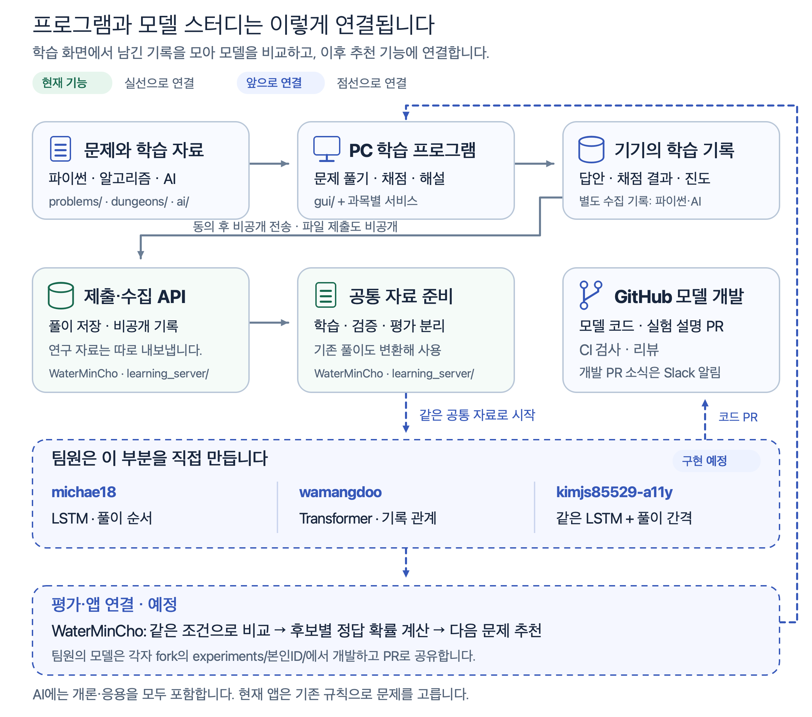
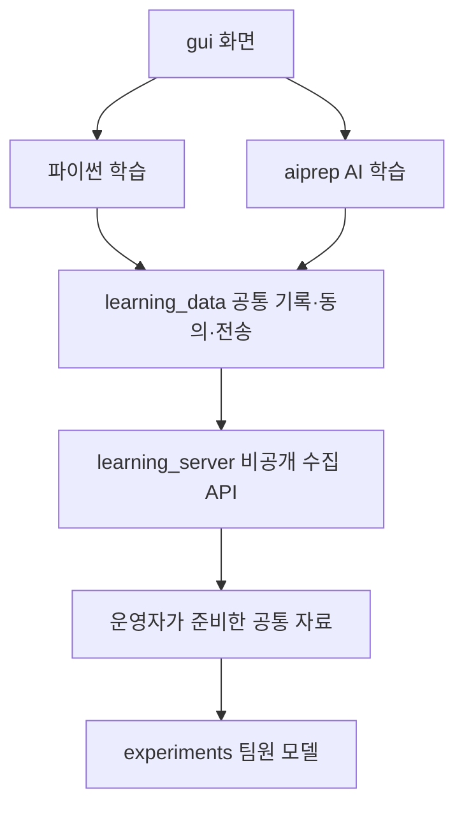
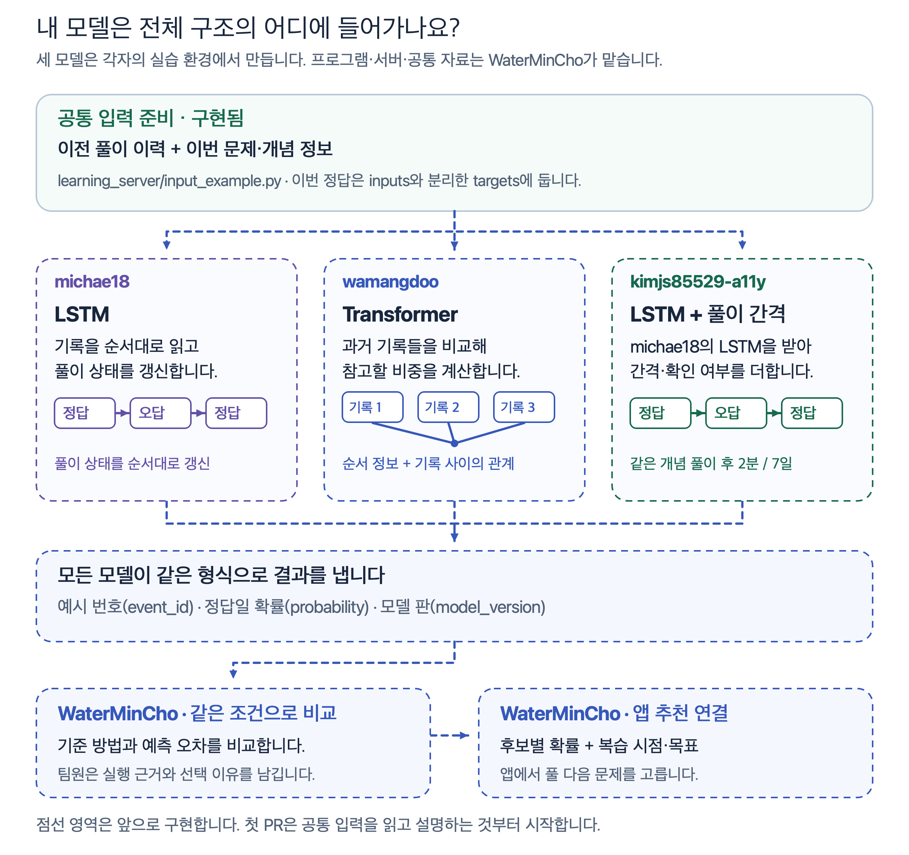

# 프로젝트 구조와 팀원 역할

<a id="프로젝트-전체-구조와-담당을-봅니다"></a>

[처음 안내로 돌아갑니다](../README.md)

이 프로젝트는 문제를 푸는 PC 프로그램과 풀이 기록을 모으는 서버, 그 기록으로 만드는 추천 모델로 나뉩니다. 현재 프로그램과 수집·자료 준비 기능이 있으며, 팀원이 만들 모델을 비교한 뒤 추천 기능에 연결할 계획입니다.

[](img/architecture/overview.png)

위에서 아래로 읽으면 풀이 기록이 어디에 저장되고 누구의 모델에 쓰이는지 따라갈 수 있습니다. 1~2단계는 현재 기능이며 3~5단계의 모델 학습·비교·추천 연결은 앞으로 진행합니다. 각 모델의 코드·테스트·설명은 본인 fork에서 PR로 공유합니다. 그림을 누르면 크게 볼 수 있습니다.

<a id="고칠-기능에-맞는-폴더를-찾습니다"></a>

## 기능별 코드 위치

위 그림은 학습과 모델 개발의 흐름을 보여줍니다. 아래에서는 코드를 고칠 폴더와 호출 관계를 확인합니다.

화면·과목별 학습·공통 데이터·서버를 나눕니다. 시작 파일은 저장소 맨 위에 있으며, 프로그램을 받은 뒤 실행하는 순서는 같습니다.

```text
programming-study/
├── start.bat / start.pyw / start.command   프로그램 시작
├── study.py / session.py / adaptive.py    파이썬 학습·채점
├── gui/                                  화면·공통 UI
├── aiprep/                               AI 학습·연습·채점
├── career/                               직무 로드맵·영상·논문 목록
├── journey/                              알고리즘 실행·학습
├── webprep/                              웹 학습 기능
├── learning_data/                        공통 기록·동의·전송·비공개 제출
├── learning_server/                      수집 API·보관·공통 자료 준비
├── experiments/본인GitHubID/              팀원의 모델·실험·설명
├── problems/ · dungeons/ · ai/ · web/      문제·해설·학습 자료
├── tests/                                기존 기능·화면·운영 검사
├── tools/                                검증·리뷰·운영 도구
└── docs/                                 사용·개발 안내
```

학습 데이터의 공통 기능은 [learning_data/](../learning_data/README.md)에 모았습니다. 파이썬과 수집 서버가 AI 학습 구현을 불러오지 않고 기록·동의·전송 기능을 사용할 수 있습니다. 서버 배포 파일에는 `learning_server/`와 `learning_data/`를 포함합니다.



팀원은 비공개 공유 폴더에서 같은 자료를 받아 각자 실험합니다. 먼저 [자료 버전과 샘플 받는 방법](LEARNING_DATA_ACCESS.md)을 확인하세요.

<a id="프로그램에서-기록이-만들어집니다"></a>

## 풀이 기록이 만들어지는 과정

학습자는 PC 프로그램에서 문제를 풀고 채점 결과와 해설을 봅니다. 화면은 `gui/`에, 문제와 학습 자료는 `problems/`, `dungeons/`, `ai/`에 있습니다. 파이썬의 회차·채점 흐름은 `session.py`, 알고리즘 실행은 `journey/`, AI 학습·연습은 `aiprep/`에서 처리합니다.

풀이·진도 기록과 모델 학습용 수집 기록은 용도를 나눠 보관합니다. 현재 수집 대상은 파이썬과 AI 개론·응용입니다. 알고리즘 여행과 웹 면접 준비의 기록은 추천 모델 학습 대상에 넣지 않습니다.

<a id="풀이-제출과-데이터-전송은-따로-합니다"></a>

<a id="파일-제출과-학습-과정-수집을-구분합니다"></a>

## 풀이 제출과 학습 기록 수집

| 기능 | 보내는 곳 | 사용하는 이유 |
|---|---|---|
| API 풀이 제출 | 비공개 서버 | 파일 자동 제출을 선택하면 묶음 채점 뒤와 시작할 때 답안 파일·채점·진도를 보냅니다. 수동 제출도 가능하며 GitHub 공개 PR은 만들지 않습니다. |
| 비공개 자동 전송 | 수집에 동의한 뒤 기본 수집 서버 | 새 기록을 자동 전송하고 공통 자료로 준비합니다. 입력 답안 본문은 제외합니다. |
| 모델 코드 PR 만들기 | 본인 fork에서 공통 저장소로 보내는 개발 PR | 직접 만든 모델 코드·실험·설명을 검토받습니다. |

API [풀이 제출]은 `learning_data/submission.py`의 `PrivateClient`에서 파일 묶음을 만들고 `learning_server/submissions.py`가 비공개로 저장합니다. 공개 풀이 게시 경로는 종료했습니다. Git은 프로그램 자료 업데이트와 팀원의 모델 코드 PR에 사용합니다. [API 연결과 재시도](API_SUBMISSIONS.md)를 확인하세요.

수집에 동의하면 그때부터 쌓이는 학습 기록을 약 1분 간격으로 비공개 서버에 보냅니다. 첫 실행에서 건너뛰었어도 나중에 [내 정보·데이터]에서 선택할 수 있습니다. [내 정보·데이터](LEARNING_PRIVACY.md)에서 철회하면 수집·전송을 멈추고 삭제를 확인합니다. 답안 파일은 별도 자동 제출 선택을 마치면 시작할 때와 묶음 채점 뒤에 보냅니다. 자동 제출을 끈 경우 [풀이 제출]을 직접 눌러 보냅니다. 파일 목록은 [내 정보·데이터]에서 선택해서 확인합니다. 수집 서버는 `learning_server/app.py`에서 요청을 받아 SQLite에 저장합니다. WaterMinCho가 내보낸 기록을 `dataset.py`와 `starter.py`로 공통 자료와 기준 예측으로 준비합니다. 연구 사용에 동의받은 기존 풀이도 변환해 같은 자료 준비 과정에 합칩니다.

실제 풀이 원본·인증 값·실제 자료로 학습한 모델 파일은 공개 저장소에 올리지 않습니다. 처음 실습할 때는 [합성 자료와 입력 예제](LEARNING_STARTER.md)를 사용합니다.

<a id="팀원의-모델은-같은-입력을-받아-비교합니다"></a>

## 팀원별 모델과 역할

[](img/architecture/model-roles.png)

모델 개발·실습은 각자의 PC나 Colab에서 진행합니다. 공통 학습·비교는 WaterMinCho의 맥에서 같은 자료와 조건으로 진행할 계획입니다. 프로그램을 실행하거나 수집 서버에 기록을 보냈다고 모델이 자동으로 학습되지는 않습니다. 모델 구현·같은 조건의 비교·앱 추천 연결은 앞으로 진행하며, 그림을 팀원의 현재 완료 상태로 읽지 않습니다.

| 담당 | 직접 만드는 부분 | 다른 부분에서 사용하는 방법 |
|---|---|---|
| WaterMinCho | 프로그램·수집 서버·공통 입력과 기준 방법 | 팀원의 모델을 같은 조건에서 비교하고 후보 문제 입력·추천 정책·화면을 연결합니다. 앱 추천 연결은 예정입니다. |
| michae18 | 기본 LSTM의 학습·평가·저장·예측 | 간격 모델의 바탕 코드로 공유합니다. 다른 모델과 같은 자료로 비교합니다. |
| wamangdoo | Transformer의 학습·평가·저장·예측 | 같은 풀이 기록을 다른 구조로 처리했을 때의 예측 결과를 비교합니다. |
| kimjs85529-a11y | 공유받은 LSTM에 풀이 간격과 시간 확인 여부 추가 | 같은 LSTM에서 시간 정보 유무만 바꿔 효과를 비교합니다. |

본인 fork를 내려받고 `experiments/본인GitHubID/`에 있는 README 옆에 모델 코드를 추가합니다. `train.py`는 모델 학습, `evaluate.py`는 평가, `predict.py`는 저장한 모델을 불러와 예측하는 코드로 준비합니다. 현재 공통 저장소에는 팀원별 입력 실습이 올라와 있습니다. 입력 확인 결과와 이번에 구현한 모델 코드·테스트·설명은 같은 PR에 모읍니다.

<a id="학습한-모델을-추천에-연결할-때를-구분합니다"></a>

## 모델 학습과 다음 문제 추천

학습할 때는 이전 풀이와 이번 문제 정보로 정답 가능성을 예측하고, 이번 실제 정오답과 비교해 모델을 조정합니다. 이번 정오답은 모델 입력과 분리합니다. 구체적인 `range` 문제 예시는 [담당별 미션](LEARNING_MISSIONS.md#같은-문제로-저장과-학습을-이해합니다)에 있습니다.

추천할 때는 저장한 모델에 그때까지 채점 결과를 확인한 풀이 이력과 아직 풀지 않은 후보 문제를 넣어 후보별 정답 확률을 계산할 계획입니다. 모델이 새 문제를 만드는 구조가 아닙니다. 추천 정책이 그 확률과 선수 개념·복습 시점·학습 목표를 함께 보고 다음 문제를 고릅니다. 후보 입력·추천 정책·앱 호출은 앞으로 연결하며 가짜 정답을 넣어 예측하지 않습니다.

간격 모델은 시각을 확인할 수 있는 파이썬과 AI 자료로 비교합니다. AI는 같은 문항 버전·풀이 위치의 반환 기록이 하나로 연결될 때 그 시각을 사용합니다. 연결하지 못한 시각은 미확인으로 남깁니다. 모델의 예측 오차와 추천을 받은 뒤의 학습 효과도 따로 평가합니다.

<a id="담당-부분부터-시작합니다"></a>

## 첫 작업과 PR

[fork와 첫 PR 안내](LEARNING_WORKFLOW.md)에서 작업 공간을 준비하고 [담당별 미션](LEARNING_MISSIONS.md)에서 입력과 모델을 확인합니다. PR을 올릴 때는 [담당 이슈를 본문에 연결](LEARNING_WORKFLOW.md#이슈와-pr-연결)합니다. 이후에는 [모델 개발 로드맵](LEARNING_ROADMAP.md)의 산출물에 맞춰 진행합니다. 실제 진행 상태는 GitHub 보드의 담당 이슈에서 확인합니다.

<a id="폴더-구조를-선택한-기준을-확인합니다"></a>

## 폴더를 이렇게 나눈 이유

패키지 코드를 `src/` 아래 두는 방식과 저장소에서 바로 실행하는 방식은 설치 과정과 import 경로에서 차이가 있습니다. [PyPA 공식 가이드](https://packaging.python.org/en/latest/discussions/src-layout-vs-flat-layout/)를 대조해, 이 프로젝트는 clone 뒤 start 파일을 실행하는 절차에 맞춰 루트의 기능별 패키지를 유지했습니다. 서로 다른 과목이 공유하는 데이터 코드를 독립된 폴더로 분리했습니다. 자료 확인일은 2026년 11월 12일입니다.
