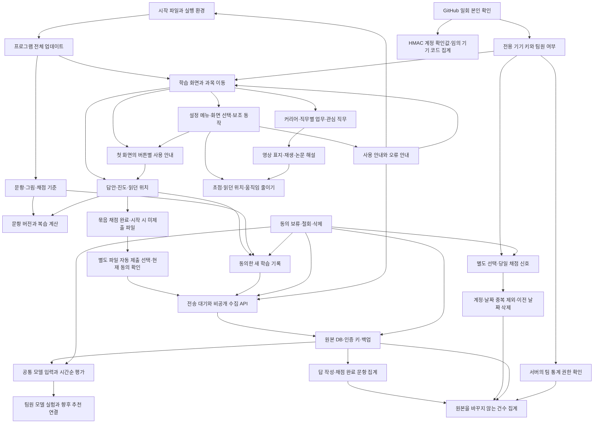

# 수정 전에 확인할 연결 관계

프로그램·문항·서버를 고칠 때 아래 지도에서 시작점을 찾습니다. 연결된 기능과 실제 사용 상황을 확인한 뒤 변경합니다. 새 연결이 생기면 이 지도도 갱신합니다.

화살표로 연결한 기능은 함께 영향을 확인합니다. 모델을 실험하는 단계와 실제 프로그램에서 추천하는 단계는 구분합니다. 현재 프로그램은 기존 규칙으로 문제를 고릅니다.

본인 확인 결과를 학습 기록과 연결하지 않습니다. GitHub 계정 번호 원문은 버리고 계정 중복 확인에는 HMAC 값만 보관합니다. 팀원 대조 목록도 운영 서버의 키로 만든 값을 사용합니다. 기기 확인 결과나 화면의 표시 상태만으로 통계 API를 허용하지 않습니다. 팀원 목록을 바꾸면 이전 통계 권한을 무효로 하고 다시 확인하며, 일반 학습자의 기기 키는 유지합니다.

## 수정 위치별 확인 항목

| 수정 위치 | 연결해서 확인할 곳 | 실제로 생길 수 있는 문제 |
| --- | --- | --- |
| 학습 코드 설명·이전 단계 연결 | 과정·페이지·단원·단계 제목, 공개 범위, 읽기 전용 창, 본문 검토 서명 | 단계 재정렬 뒤 다른 설명을 열거나 응용에서 개론 참고 창을 열며 현재 과정이 바뀔 수 있습니다. 대상 번호와 제목을 함께 확인하고, 닫은 뒤 답안·선택·스크롤·진도·수집 기록이 같은지 대조합니다. |
| 오늘 학습 계정 집계 | 파이썬·AI 채점, AI 모의고사 제출, 알고리즘 여행 채점, AI 과정 전환, 기기 인증, 한국 날짜, 팀 통계, `GET /v1/identity/today` | 새 채점 경로나 새로 만든 학습 세션에 표식 연결이 빠지면 그 과목에서 푼 계정이 집계에서 빠집니다. 채점 당시 기기 키 지문을 남기고 미응답·모름은 제외합니다. 학습 기록 제공 동의와 상관없이 세며 연구 참가자 번호와 연결하지 않습니다. 같은 계정은 과목·기기와 상관없이 하루 한 번 셉니다. `GET /v1/identity/today`는 팀원이 아닌 기기에도 오늘 날짜와 계정 수만 보냅니다. 이 응답에 다른 통계를 더하면 그 통계가 팀원 권한 확인 없이 나갑니다. |
| 과목 공개·숨김 | 메뉴·이어서 할 일·오답 노트·최근 7일 학습의 범례·막대·툴팁·합계·연속 학습일 | 숨긴 과목이 차트에 남거나 다른 과목의 색이 바뀔 수 있습니다. 같은 공개 과목 목록을 기준으로 표시와 집계를 맞추고 저장된 기록은 유지합니다. |
| 과목별 학습 기록 설정 | 파이썬·AI 공통 팝업, 동의·철회, 전체 과목 전송, 파일 저장, 희망 직무, 구역을 펼치고 접은 뒤 팝업 크기와 위치, 직무 선택 상자 위 휠 | 답안 포함 체크를 서버 전송 선택으로 오해하거나 배경 전송이 저장 전 직무 선택을 덮어쓸 수 있습니다. 파일 저장과 서버 전송을 구분하고 중단·미동의·삭제 대기·오류·재시도 상태를 대조합니다. 구역을 펼쳐도 팝업 높이가 그대로이면 본문이 좁은 영역 안에서만 스크롤되고, 초점이 없는 선택 상자가 휠을 받으면 본문은 스크롤되지 않고 직무 선택만 바뀝니다. 구역을 펼치고 접은 뒤 팝업이 학습 홈 화면과 모니터 작업 영역 안에 있는지, 상태 카드·구역·선택 상자 위에서 휠을 굴리면 본문이 스크롤되는지 확인합니다. |
| `gui/` 화면·공통 부품·테마 | 각 과목, 작은 창, 글자 확대, 초점과 스크롤, 창을 지운 뒤 남는 위젯 | 메뉴를 바꾼 뒤 답이 지워지거나 큰 글자의 버튼이 잘릴 수 있습니다. 부모 없이 만든 위젯은 창을 지운 뒤에도 남고 GC가 나중에 지웁니다. Qt가 색과 스타일을 다시 입히는 도중에 그 위젯이 지워지면 프로그램이 강제로 끝납니다. 그래서 위젯은 만들 때 부모를 줍니다. `gui/theme.py`의 `_style`도 스타일을 다시 입히는 동안 자동 GC를 멈춥니다. 스타일시트 규칙에 `min-height`나 `max-height`가 있으면 Qt가 스타일을 다시 입힐 때마다 위젯의 최소·최대 크기를 그 값으로 되돌립니다. 코드에서 `setFixedSize`로 정한 크기는 테마를 바꾸면 풀리므로 고정 크기는 스타일시트 규칙에 적습니다. Qt는 스타일시트를 처음 입힐 때의 위젯 글꼴도 저장해 두고 스타일을 다시 입힐 때마다 그 글꼴로 되돌립니다. 만든 뒤에 글꼴을 바꿀 때는 `setFont` 대신 `kit.set_font`나 `kit.typed`를 써서 저장된 글꼴도 같이 바꿉니다. |
| 파이썬 Round의 목록·패널·코드 입력 배치 | 목록 160px·작은 창 여백 0px·넓은 창 여백 8px, 가로 분할 복원, 지문·입력·실행 결과의 가용 공간 | 창을 좁히기 전의 가로 분할 크기를 보관하고 넓힐 때 목록 폭·지문·답안 비율을 복원하는지 확인합니다. 코드 입력·실행 결과는 기존 세로 분할을 사용하며 작은 창·큰 글자에서 안내·입력·실행 결과가 겹치지 않는지 대조합니다. 목록을 계속 표시하며 답안·커서·선택·저장·실행·제출 신호를 유지합니다. |
| AI 학습·연습·시험·결과의 공통 테마 | 기존 본문 카드·지문·입력·단계별 행동, 결과·해설과 재풀이 | 색·표면·버튼 변경을 적용하고 기존 구획을 유지합니다. 대표 캡처에서 구분을 확인한 결과와 모든 문항·상태의 실행 결과를 구분합니다. 불필요한 상자 추가로 가용 본문 폭과 입력 높이를 줄이지 않습니다. |
| `theme → kit → pattern → screens`의 책임 | 변경한 색·글자·컨트롤 값, 일반·학습용 역할, 실제 공통 부품 호출부 | 전체 앱 리디자인의 값은 `gui/theme.py`에 모읍니다. 30px 제목·18px 탐색·44px 기본 버튼과 새 표면색을 사용하는 화면을 확인합니다. 기존 글꼴·학습용 역할·간격 체계와 기능·정책·저장 형식은 유지합니다. |
| 공통 색·선택 사이드바·`NextCard` | 두 테마의 대비, 보조 버튼 외곽선, 선택·비활성·초점, 제목 확대·줄바꿈, 다음 행동 신호 | 공통 버튼 스타일이 선택 면을 덮거나 커진 제목이 행동 버튼을 밀어낼 수 있습니다. 사이드바에서 고른 항목은 옅은 파란 바탕과 파란 글자·아이콘·초점 테두리의 대비를, 파랑·청록 카드는 글자 대비를 확인합니다. 창·글자 크기 전환 뒤에도 같은 대상의 행동이 한 번만 실행되는지 대조합니다. |
| Hub 과목·오답·최근 7일 학습 카드 | `DashboardRow`, 카드 최소 폭과 본문 글자 크기, 과목 열과 오답·최근 7일 열의 66:34 두 열·세로 순서, 최근 채점 숨김·오답 이동 | 창 너비만으로 전환하면 긴 문구나 큰 글자가 카드 밖으로 나갈 수 있습니다. 두 열의 필요 폭과 20px 간격을 기준으로 두 열·한 열을 왕복하며 과목 카드·차트·최근 목록을 대조합니다. 카드 재배치로 과목별 집계나 오답 연결을 바꾸지 않습니다. |
| 촘촘한 배치(학습 현황·파이썬 홈·회차 풀이·결과·오답 노트, 알고리즘 지도·문제, AI 홈·차시 목록·단원 학습·연습·모의고사) | `density="dense"` 묶음의 8·6·4px 모서리, 56px 위 막대·64px 아래 막대·24px 여백, AI 단원 학습의 48px 단계 표시줄, 웹 학습·커리어의 64px 막대와의 차이, 결과 화면의 작은 배치 | 다른 화면과 같은 부품을 쓰므로 촘촘한 값이 다른 화면으로 번지거나 돌아가기 버튼 위치가 화면마다 달라질 수 있습니다. 결과 화면은 제출 알림이 보일 때만 알림 자리를 남기고 폭 944px 미만이나 높이 760px 미만에서 여백·목록 줄을 줄입니다. 알림을 띄우고 숨길 때 읽던 위치와 초점, 작은 창에서 [해설 보기]·[다시 풀기]가 알림에 가리지 않는지 확인합니다. |
| 번호 칩·꼬리표·붙은 칩 묶음(`kit.number_chip`·`kit.badge`·`kit.segmented`, `gui/theme.py` 의 badge·segmented 규칙) | 알고리즘 문제 줄·문제 화면 머리·풀이 언어, AI 홈 차시 줄·단원 줄, 파이썬 지난 회차·회차 지문 꼬리표, 오답 노트 과목 선택·갈래 머리·문항 줄, 글자 세 단계와 두 테마 | 칩이나 꼬리표가 자리를 더 차지하면 좁은 창과 가장 큰 글자에서 제목이 줄임표로 줄거나 아래로 밀립니다. 760×480과 1024×700 창의 가장 큰 글자에서 제목이 줄임표로 줄거나 아래로 밀리지 않는지 확인합니다. 숫자 꼬리표는 화면의 다른 수와 맞춥니다. [오답 노트] 버튼의 수는 학습 현황 오답 줄의 '틀린 문항 N개'와 같아야 합니다. 알고리즘 문제 줄의 접근 이름에 번호가 남는지, 힌트 탭의 `tabText`가 '힌트 n/m' 그대로인지 확인합니다. 붙은 칩 묶음은 고른 칩·초점·비활성 모양을 두 테마에서 봅니다. 키보드로 옮겨도 칩 하나만 골라지는지 확인합니다. |
| 작은 `NextCard`의 보조 글과 학습 현황 카드(`set_side`, `plain_next`) | 학습 현황·파이썬 홈·알고리즘 지도·AI 홈의 이어서 할 일 | 글 사이를 4px로 줄여서, 맥의 보통 글자에서 설명이 한 줄이면 카드가 최소 높이 108px 안에 듭니다. 리눅스처럼 굵은 글자의 줄 높이가 큰 환경에서는 내용이 108px를 넘어 카드가 내용만큼 커집니다. 간격을 바꾸면 네 화면의 카드 높이가 함께 바뀝니다. 좁은 창과 큰 글자에서 보조 글이 제목 아래로 내려가는지, 학습 현황의 과목 이름이 설명 줄의 첫 조각과 같은지 확인합니다. |
| 결과·회차·오답 노트의 문서 CSS(`theme.DOC_CSS` 의 `span.tag-*`·`table.verdict`·`td.callout`, `gui/round_page.py` 의 지문·실행 결과 규칙, `gui/wrong_page.py` 의 보기 표) | 파이썬 결과의 판정 표, 회차 지문의 코드 상자와 실행 결과, 오답 노트 보기 줄과 '내 답'·'정답' 꼬리표, 결과 화면 함수를 가져다 쓰는 오답 노트 | 코드 상자의 좌우 여백을 늘리면 760×480 가장 큰 글자에서 지문에 가로 스크롤이 생깁니다. `tests/test_gui_round_layout.py`가 이 경우를 봅니다. 보기 표의 꼬리표 열을 표 전체에 걸면 꼬리표가 없는 줄도 꼬리표 폭만큼 먼저 줄이 바뀝니다. 해설을 펴기 전에는 '정답' 꼬리표가 없어야 합니다. 결과 화면의 공용 함수 출력을 바꾸면 오답 노트도 함께 봅니다. |
| 판정한 입력칸 바탕 | AI 떠올리기 칸과 연습 칸, 알고리즘 테스트 추가 창의 틀린 칸 | `QLineEdit` 의 tone(danger·success) 규칙은 테두리를 칠하고, 채점한 뒤 읽기 전용으로 바꾼 칸에만 약한 바탕을 칠합니다. 테스트 추가 창의 틀린 칸처럼 아직 고칠 수 있는 칸은 테두리만 바뀝니다. 규칙을 바꾸면 세 곳을 두 테마에서 봅니다. |
| `ActionLayout` 공유 | `DialogLayout`, `BottomBar`, `SubmissionBar`, 로드맵 확대창, 표시·숨김·비활성·문구 변경 | 기존 소비자와 새 소비자의 여백·도구 간격·행동 순서가 달라질 수 있습니다. 표시 중인 항목의 폭·줄 높이만 공유하고 기능·동의·채점·전송 조건은 호출부에 남깁니다. |
| 공통 설정 진입 | `Workspace.overview_pages`, `SettingsMenu`, Hub 기존 버튼, 각 화면 상단 막대 오른쪽 끝 앵커, 공통 `refresh_actions` 잠금 | 홈·과목 홈·차시 목록·커리어 동적 페이지에만 추가합니다. 작은 창·최대 글자에서도 상단 오른쪽 위치와 이웃 버튼의 표시·정렬을 함께 확인합니다. 학습 본문·시험·코딩 작업에는 새 진입을 만들지 않습니다. 화면 이동이나 앵커 숨김 뒤 대기 동작이 실행될 수 있으므로 팝업과 예약 동작을 함께 취소합니다. 첫 화면 튜토리얼은 Hub로 이동한 뒤 재생하고 커리어 안내는 기존 직무 목록 진입을 유지합니다. |
| 상단·고정 하단·현재 작업의 배치 | `Workspace`, `TopBar`, 학습 하단, 조건부 제출 안내, 과정·분류 탭 | 고정 영역을 늘려 본문과 초점 요소를 가리거나 제출 안내를 학습 진행과 혼동할 수 있습니다. 각 영역의 목적과 기존 표시 조건을 유지하고 숨김·줄바꿈 전후의 본문 가용 높이를 확인합니다. |
| 비동기 표시와 배치 갱신 | 현재 학습자·과정·문항·요청, 취소·닫기·권한 변경, 수동 스크롤 | 늦은 응답이 다른 대상의 입력을 덮거나 취소한 창을 다시 열 수 있습니다. 같은 대기 상태는 버튼·초점을 반복 변경하지 않으며 복원 예약보다 사용자의 새 이동을 우선합니다. |
| 화면 등록과 허용 목록 | `overview_pages`, `submission_pages`, 커리어 지연 생성, 설정 앵커, 본문 끝 여백 | 탐색을 허용한 화면에 제출 알림이나 전송 권한까지 붙일 수 있습니다. 커리어 동적 등록과 제출 허용 목록은 별도로 유지하고 새 설정 진입도 확정한 목록만 따릅니다. |
| 공통 부품의 기존 호출 계약 | 행동 그룹·쌓는 순서, `addWidget`·`addSpacing`, 공개 속성, 버튼 객체·신호 | 계산을 옮기면서 기존 호출을 끊거나 대화상자와 학습 하단의 행동 순서를 같게 만들 수 있습니다. 왼쪽 그룹이 없는 경우, 간격 항목과 숨긴 항목, 재배치 뒤 한 번만 실행되는지를 확인합니다. |
| 작업 잠금과 상태 복원의 소유자 | 창 전체 작업·수집 배경 작업·영상 준비, 안내와 논문의 서로 다른 `ViewState` | 이름이 같은 상태를 합치면 관계없는 행동을 잠그거나 잘못된 입력·단계로 복원할 수 있습니다. 조작 금지 대상·취소·늦은 결과와 복원 시점을 각 소유자에 남깁니다. |
| 커리어·공개 자료·관심 직무 | 산업과 제품의 대응, 출처 확인일, 수업 범위, 기존 연구 목표와 선택 시각 | 일부 공통 기술이 있는 직무를 기존 목표와 같은 직무로 잘못 분류할 수 있습니다. 관심 직무는 기기 설정에만 저장하며 과거 풀이를 다시 분류하지 않습니다. 목록 필터·돌아갈 카드·상세에서 보는 직무·탭별 읽던 위치·저장 표시는 구분합니다. 상세에서 직무를 여러 번 바꾼 뒤 원래 목록으로 돌아가는지, 큰 창에서도 제목과 그림이 벌어지지 않는지 확인합니다. |
| 커리어 내용 카드·상세 탭·단계 그림 | 소개·직무 제목·업무 장면·팀·출처·영상의 부모 카드, `NavigationTabs`, 학습 순서 제목·확대, 단계 예시·연결선 | 부모 카드가 늘면 좁은 창의 본문 폭이 줄거나 접은 영역의 여백이 남을 수 있습니다. 접기·펼치기와 탭 전환 뒤 읽던 위치·직무 선택·관심 저장을 대조합니다. 단계 순서·수업 범위·확대 동작은 유지하며 작은 창과 큰 창에서 내용과 연결선을 확인합니다. |
| 커리어 사용법 안내·다시 보기 | 목록·상세·매거진의 각 두 단계, 첫 방문과 기기별 완료 기록, 건너뛰기·Esc·페이지 이탈, 상단 사용법·설정 다시 보기 | 페이지를 나간 것만으로 완료가 저장되거나 숨은 카드를 가리킬 수 있습니다. 상단 사용법은 현재 안내를 열고 설정 다시 보기는 목록부터 시작하는지 확인합니다. 상세와 매거진은 다음 진입 때 다시 안내하는지 대조합니다. |
| 전공·경험 기반 직무 추천 | 학위별 전공, 복수 경력, 활동·관심, 추천 근거, 기기 저장·수정·삭제·재실행 복원 | 학위만으로 실력을 단정하거나 중복 항목 수로 순위를 높이지 않으며, 미입력을 능력 부족으로 해석하지 않습니다. 선택값은 사용자별 기기 설정에만 저장하고 서버·로그·학습 기록·문의에는 넣지 않습니다. 닫기와 저장값 삭제를 구분하고 복원·위젯 정리·저장 실패에서 원본이 덮이거나 삭제되지 않는지 확인합니다. 선택지 키 변경의 읽기 호환을 확인하며, 관심 직무 저장에는 기존 ID만 전달합니다. |
| 영상 재생·선택형 부품 설치 | 기존 Qt 버전, 오프라인·취소·종료·재시도, 늦은 결과, 실제 재생 신호, 전체화면 진입·Esc·창 복원, 원본 열기 | 목록만 열어도 설치나 통신이 시작되거나 닫은 뒤 소리가 남을 수 있습니다. 실제 엔진의 전체화면 요청과 넓은 화면의 영상 영역을 확인합니다. 제목 줄은 스크롤 밖에 고정되고, 재생기가 없으면 상태 문장이 16:9 재생 영역 안에 나옵니다. 큰 글자와 작은 창에서 그 문장이 잘리지 않는지, 재생할 때와 멈췄을 때 영역 크기가 같은지 확인합니다. 준비·버퍼링을 재생 중으로 표시하지 않으며 부품 설치 실패가 학습 실행을 막지 않게 합니다. |
| 논문 그림·단계별 해설 | 원논문 아이디어와 단순화한 예의 차이, 축·모양·계산, 그림 이용 조건, 목록과 상세창의 글자 크기 | 학습 예를 논문 성능 재현으로 표현하거나 서로 다른 기법을 같은 그림으로 설명할 수 있습니다. 글자를 키웠을 때 행렬 칸·행 이름·화살표·설명 상자가 함께 다시 배치되는지 확인합니다. 단계를 오간 뒤 읽던 위치와 풀이 펼침 상태가 남는지도 확인합니다. 그림 속 숫자가 해설 글과 `small_examples()` 재계산 값과 같은지 대조합니다. |
| 매거진의 영상 정렬·고정 탐색 줄 | 제작자별 날짜순, 검색·목록 범위, 관련 영상 선택, 본문 너비, 탭별 스크롤, 영상 정지 | 정렬을 바꾼 뒤 검색 결과나 로드맵에서 연 영상이 빠질 수 있습니다. 날짜 미확인 영상이 같은 제작자의 끝에 오는지, 검색 조건 밖의 관련 영상도 선택할 수 있는지 확인합니다. 영상·논문 양쪽에서 스크롤 후 탭을 누르고 키보드로도 전환합니다. |
| 매거진 필터 카드·논문 대표 그림 | 검색·출처 선택, 그림 테두리·초점, 그림 설명 버튼 위치, 펼친 해설·원문·재생 연결, 논문 묶음 제목과 묶음 안 순서 | 대표 그림과 설명 버튼의 위치를 바꾸면서 접근 순서나 사용법 안내 대상이 어긋날 수 있습니다. 큰 제목과 카드 안쪽 여백을 포함해 가용 폭을 확인하고 탭별 읽던 위치·설명 펼침·영상 종료를 대조합니다. 묶음 제목 아래 첫 대표 그림이 사용법 안내 대상과 맞는지 확인합니다. |
| 설정 메뉴·보조 설명·등장 효과 | 실제 누를 위치, 사용 안내 대상, 키보드·바깥 클릭, 글자·테마 변경, 움직임 줄이기 | 메뉴 위치가 버튼에서 떨어지거나 설명이 숨은 버튼을 가리킬 수 있습니다. 닫는 효과가 끝나기 전에 동작을 중복 실행하지 않는지 확인합니다. |
| 답안 칸의 복사·붙여넣기 제한 | 학습 본문·심화·코드 빈칸·연습·모의고사·모의고사 코드 작성 칸, 직접 입력·한글 조합·되돌리기, 설명과 인증 코드 복사 | 읽기 화면의 복사 허용이 답안 칸까지 풀리거나 제한 안내가 답안·선택 범위·읽던 위치를 바꿀 수 있습니다. |
| 모의고사 코드 작성 문항(`aiprep/mock.py`·`aiprep/mock_code.py`, 여정 실행기 `journey/runner.py`·`harness.py`·`values.py`, `tools/verify_ai.py`) | 채울 줄 답안과 빈 답 판정, 제출 중 답 저장 거절, 마감 뒤 제출을 맡는 `aiprep/service.py` 의 `expire_mocks`, 실행 환경 실패와 결과 값 `ungraded`, 초안의 `env_failures`·`code_passed`, 수집 문항의 `code_runtime_revision`, 오답 노트의 읽기 전용 카드, `journey.yml` 이 실행하는 테스트 모듈, `verify_ai.py` 의 코드 작성 출제 검증과 재풀이 채점 | 실행기·하네스·값 비교를 고치면 모의고사 코드 채점 결과와 코드 작성 문항의 수집 문항 버전이 함께 바뀝니다. `journey.yml` 은 실행기를 고친 PR 에서도 `tests.test_journey_values`·`tests.test_journey_runner`·`tests.test_journey_service`·`tests.test_journey_tools` 네 모듈만 실행합니다. `tests.test_ai_mock_code` 는 `ci.yml` 의 전체 테스트에서만 실행됩니다. 실행기를 고쳤으면 `tests.test_ai_mock_code` 를 직접 실행합니다. 손대지 않은 답이 답한 것으로 수집되지 않는지, 숨은 테스트 입력이 채점 결과 문구·제출 기록·수집에 들어가지 않는지, 통과 수는 제출한 기기의 결과 화면에만 보이고 제출 기록·수집에 들어가지 않는지 확인합니다. 학습자 기기에서 실행하지 못한 문항은 `ungraded` 로 남고 학습 행·팀 채점 수·복습 기록에서 빠집니다. 결과 화면은 `ungraded` 를 번호 칸의 ? 기호, '이 기기에서 채점하지 못함' 툴팁과 문항 카드 제목, 요약 카드 문장, 코드 작성 유형 카드의 수로 표시합니다. 결과 값을 더하면 `gui/ai_text.py` 의 `RESULT_MARK` 와 `gui/ai_mock.py` 의 `RESULT_NAME` 에도 넣습니다. 코드 작성 회차는 마감 뒤 답 저장·문항 이동·[나중에 보기]·문항 열기와 `MockExam` 생성자에서 제출하지 않으므로 화면이 `expire_mocks` 를 불러야 제출됩니다. 모의고사 화면(`gui/ai_mock.py`)은 시계 tick 에서 `expire_mocks(code=False)` 를 부르고, 코드 작성 회차의 마감 채점과 직접 제출, [코드 실행](`MockExam.run_code`)은 `win.run_job` 의 작업 스레드에서 부릅니다. 마감 채점이 실행 환경 문제로 실패하면 60초 뒤 다시 시도합니다. `run_code` 는 채점과 같은 문항의 `limit_ms`·`tol` 로 공개 예시만 돌립니다. `verify_ai.py` 는 같은 채점 함수로 모범 답안, 시작 코드, 가짜 답 둘을 실행합니다. 실행기를 고치면 코드 작성 문항이 있는 회차를 `verify_ai.py` 로 다시 검사합니다. 검사 메시지에는 숨은 테스트 번호만 쓰고, 입력과 기대값은 출제자가 `--show-hidden-tests` 를 줄 때만 보입니다. 숨은 테스트 값은 stem·starter·conditions·sourcefacts 와 함께 explain·boundaries 에서도 찾습니다. |
| 제출 버튼·자동 연결·결과 안내 | 최신 동의·철회·파일 유무·대기 접수·기존 서버·작업 중 상태·파일 목록 | 이미 동의한 사용자에게 확인창을 반복하거나, 응답 유실 후 원래 파일로 되돌린 풀이의 접수를 놓칠 수 있습니다. 시험의 통신 대체가 빠지면 운영 서버로 시험 자료를 보낼 수 있으므로 외부 통신도 차단합니다. |
| 묶음 완료·시작 시 파일 자동 제출 | 별도 추가 선택·연구 동의 시작점·과목 수집 중단·철회·지연 응답·종료·수동 제출·이전 클라이언트 | 기존 동의를 파일 전송 동의로 확대하거나 같은 파일을 반복 전송할 수 있습니다. 전송 직전에 선택을 다시 대조하고 중복 작업을 막으며, 같은 파일의 크기·인증 오류를 반복하지 않습니다. 기존 연구 기록 전송은 유지합니다. |
| 개론·응용 전환과 자료 재사용 | 자료 파일 변경, 학습자·과정별 기록, 중단한 연습, 모의고사 마감, 탭 선택 표시, 모의고사 탭이 쓰는 개론 세션, 사용자별 `ai/tab` 설정, 학습 현황이 쓰는 마지막 과정 세션(`ai/course`, `MainWindow.course_ai`) | 이전 내용을 새 탭 아래에 표시하거나 바뀐 기록·자료를 놓칠 수 있습니다. 재진입하면서 시험 시간을 새로 시작해서도 안 됩니다. [모의고사] 탭을 고른 채 학습 현황을 열어도 진도와 이어서 할 일이 마지막으로 고른 과정을 따르는지 확인합니다. 응용 학습자의 시간이 끝난 개론 전용 회차는 [모의고사]·[AI 개론] 탭을 열어 개론 세션을 만들 때 auto 로 한 번 제출됩니다. |
| AI 홈의 분류 선택 (`gui/ai_home.py`·`gui/section_browser.py`) | 공통 과정 탭·분류 카드, 분류 영역 1100px·창 높이 700px 조건, 글자 폭과 3열·2열, 과정별 스크롤, 모의고사 탭에서 숨기는 분류 줄, 사용 안내 캡처·강조 좌표 | 너비·높이 조건을 모두 만족하면 아이콘·설명을 펼칩니다. 그 외에는 설명을 접고, 아이콘 때문에 줄 수가 늘지 않을 때만 이름 앞에 아이콘을 둡니다. 창 전체 너비와 분류 영역 너비를 구분하며 1099·1100px, 높이 699·700px 주변과 글자 확대·축소를 확인합니다. 표시 방식·열 수 전환 뒤 키보드 이동·선택·읽던 위치·안내 위치를 대조합니다. 안내·데이터 버튼은 학습 단원에만 두고 준비 중과 읽기 실패를 구분합니다. |
| 과정별 코딩 실습 무리(`index.json` patterns, `aiprep/skel.py`·`bank.py`·`service.py`, `tools/verify_ai.py`) | 무리의 `course`·`folder`, 뼈대 폴더(pc 는 `ai/patterns` 맨 위, apc 는 `ai/patterns/apc`)와 무리 서명 범위, 카드 id 머리(`pc-`, `apc-`), 세션의 과정 거르기, 문항 버전 해시, 미완료 묶음 fingerprint, `review_variants.json`, 오답 노트 묶음 | 응용 뼈대를 맨 위 폴더에 두면 pc 서명이 깨지고 두 과정의 미완료 묶음이 복원되지 않습니다. pc 항목이나 카드 dict 에 키를 더하면 개론 카드가 바뀐 문항으로 표시됩니다. 무리를 과정으로 거르지 않으면 응용 카드가 개론 세션에 실려 개론으로 수집됩니다. 뼈대 폴더를 나누기 전에 저장한 응용 미완료 묶음은 맨 위 뼈대로 한 번 더 대조해 복원합니다. 개론 카드 버전·pc 서명·두 과정 미완료 묶음 복원·용어 해시를 변경 전후로 대조합니다. |
| 뼈대 `note_only` 자리(`aiprep/skel.py` 의 `note_only`·`card_entries`·`card_skeleton`, `tools/verify_ai.py` 의 `skel_block`·`check_note_slots`) | 카드 목록과 순서, slot 카드의 점차 지우기, `meta.json` slot 수, 직전 커밋 id 대조(`retired.json`), 돌려 가며 빈칸 블록, 재풀이 문제지 채점 키, 겹침 검사 대상 | `note_only` 자리가 카드로 새면 노트에서 채운 자리가 연습에 같은 지문으로 다시 나오고 단원 카드 수가 meta.json 과 어긋납니다. 카드 목록에서 빼는 방식을 바꾸면 기존 카드의 `order` 가 밀려 문항 버전이 바뀝니다. 문항 버전 해시와 묶음 fingerprint 는 `skel.card_skeleton` 으로 `note_only` 자리를 뺀 뼈대를 넣으므로 `note_only` 글을 고쳐도 카드는 바뀐 문항이 되지 않고 미완료 묶음도 이어집니다. 이 빼기를 없애면 그 뼈대의 카드가 모두 바뀐 문항이 됩니다. 개론 카드 버전·pc 서명·미완료 묶음 복원·용어 해시·`verify_ai.py` 전체 출력을 변경 전후로 대조합니다. |
| 응용 코딩 실습 단원(`ai/learn/al18`, `ai/patterns/apc/S101.json`~`S104.json`, `ai/items/apc`) | 코드 예제와 자리, 노트의 `ai-rotate` 가 가리키는 `note_only` 자리, `index.json` apc 항목의 `after`·`name`, apc 서명, 응용 미완료 묶음, 학습 그림 계획 | apc 뼈대를 고치면 응용 미완료 묶음이 복원되지 않고 apc 를 다시 서명해야 합니다. 개론 뼈대·`l18`·`terms.json`·`review_variants.json` 은 건드리지 않습니다. 개론 카드와 응용 차시 카드의 문항 버전 해시가 바뀌지 않는지 변경 전후로 대조합니다. |
| 코딩으로 실전학습하기 명칭 | 홈·단원 제목·오답 묶음, 학습 안내·화면 사진, 기존 자료·기록 식별자 | 화면과 안내가 서로 다른 이름을 쓰거나 이름 변경으로 기존 풀이를 찾지 못할 수 있습니다. 표시 이름을 맞추고 기존 식별자와 기록은 유지합니다. |
| 모의고사 회차 공개(`ai/index.json` 회차 줄의 `hidden` 지우기)와 예전 회차 내리기(`legacy` 붙이기) | `ai/README.md` 「모든 차시 모의고사」의 회차 제목과 설명 줄 인용, 「AI 개론 모의고사」·「개론·응용 혼합 모의고사」 첫 문단의 목록 제목, `docs/GUIDE_INDEX.md` 의 모의고사 링크, `docs/AI_AUTHORING.md` 의 `hidden`·`legacy` 문단, `tests/test_ai_mock_visibility.py` 의 실제 은행 목록 검사, `tests/test_ai_mixed_mock.py` 의 새 사용자 목록 기대값과 `listing_legacy`·`submitted_before`, `tests/test_gui_ai_courses.py` 의 과정별 회차 집합, 예전 회차 문항을 실제 은행으로 보는 검사(`tests/test_ai_mock.py`·`tests/test_ai_mock_transfer.py`·`tests/test_gui_ai_mock.py`·`tests/test_gui_ai_mock_tab.py`·`tests/test_gui_ai_mixed_mock.py`) | 회차 제목이나 `aiprep/mixed_mock.py` 의 `description` 이 바뀌면 안내 문서의 인용이 화면과 달라집니다. 공개한 회차와 같은 제목의 회차가 목록에 함께 보이는지 확인합니다. 예전 회차에 `legacy` 를 붙이면 새 사용자는 그 회차를 열 수 없으므로, 그 회차의 문항이나 화면을 실제 은행으로 보는 검사는 `listing_legacy` 로 그 검사 안에서만 표시를 뺍니다. 개론 전용 회차는 `legacy` 일 때만 `window` 를 비울 수 있습니다(`tools/verify_ai.py` 의 `check_index`). |
| 빈칸 채점 모드(`aiprep/grade.py` 의 `norm`·`grade_blank`) | 모의고사 빈칸 아래 형식 줄과 입력 칸 접근성 설명(`gui/ai_text.py` 의 `MODE_FORMAT`) | 정규화 규칙을 바꾸면 형식 줄이 실제 채점과 달라집니다. 받는 꼴을 넓히거나 좁히면 `MODE_FORMAT` 문장도 함께 고칩니다. |
| 개론·응용 혼합 모의고사 | 회차 배분, 문항별 과정, 공통 답안·마감, 동의 기간, 채점 공개 시각, 오답 복습 | 탭마다 같은 시험을 새로 시작하거나 응용 답을 개론으로 수집할 수 있습니다. 모의고사 탭에서 열든 과정 탭의 이어서 할 일에서 열든 같은 응시 기록을 씁니다. 문항의 과정은 실제 지문과 대조합니다. 함께 공개된 채점 결과를 그보다 앞선 예측 입력에 넣지 않습니다. |
| 모의고사 회차 추가·오답 변형 연결 | 기존 회차 해시, 초안 복원, 문항별 과정, 복습 후보·간격, 생성 조건과 연습 기록, `index.json` 회차 줄의 `hidden`·`legacy`, `aiprep/mixed_mock.py` 의 `CONTRACTS`, `tools/ai_mock_rules.py` 의 `LESSON_SCORES`·`allocate`, 모든 차시 회차 `meta.json` 의 `round_set`, `summary()` 와 `mock_info()` 의 format별 수(화면은 아직 쓰지 않음), 시작 전 차시별 표가 쓰는 `mock_info()` 의 `lessons`(문항에서 센 차시별 수), 봉인 묶음의 `versions/<fingerprint>/`(`aiprep/mock.py` 의 `load_version`, `tools/ai_seal.py` 의 unseal·seal, `tools/verify_ai.py` 의 보존본 검사, `--sign` 이 review.json 에 적는 `version`) | 새 문항을 기존 답에 소급 적용하지 않습니다. 서명한 회차를 `tools/ai_seal.py unseal` 로 풀면 서명한 문항이 `versions/<fingerprint>/` 에 남고, 문항을 고쳐 seal 하면 함께 봉인됩니다. 그 버전으로 제출한 사람의 결과·해설·오답 복습은 이 보존본으로 열리고, 제출하지 않은 초안은 새 응시로 다시 시작합니다. unseal 은 서명 때 review.json 에 적은 회차 줄 값으로 fingerprint 를 다시 계산해 보존본 이름을 정합니다. 이 값이 없는 예전 서명(m1~m6)은 지금 회차 줄로 계산하므로 회차 줄을 unseal 뒤에 고칩니다. 보존본의 fingerprint 가 폴더 이름과 다르거나 직전 커밋의 봉인에 있던 보존본이 빠지면 `verify_ai.py` 가 실패하고, 이전 서명에 있던 보존본이 빠졌거나 서명한 버전의 보존본 없이 fingerprint 가 바뀌었으면 서명하지 않습니다. 출제 범위를 넓히면 혼합 회차는 회차별 배분 버전으로 검사하고 차시 배분을 유지합니다. 모든 차시 회차는 새 배분 버전으로 다시 출제합니다. 혼합 회차의 문항 수·시간·과정별 문항 수는 `CONTRACTS` 에 배분 버전마다 한 줄로 두며, 표에 없는 배분 버전의 회차는 학습자 목록에서 빠집니다. `hidden` 이나 `legacy` 가 참인 회차는 `record.json` 에 그 회차의 `mock_submit` 이 있는 사람에게만 보입니다. `legacy` 회차를 시작했지만 제출하지 않았고 시간이 남은 사람에게도 그 회차는 목록에서 빠집니다. 풀던 초안 파일은 지우지 않습니다. 시간이 이미 끝난 `legacy` 시도는 목록에 남겨 예전처럼 자동 제출합니다. 모든 차시 회차(`all44-v1`, `all46-v1`)의 blueprint 는 `allocate(LESSON_SCORES, 문항 수)` 결과와 같아야 하고, 공개된 개론·응용 차시가 blueprint 에 빠지거나 `round_set` 이 같은 회차끼리 같은 사실을 쓰면 `verify_ai.py` 가 실패합니다. `CONTRACTS` 의 문항 수가 `LESSON_SCORES` 의 차시 수로 계산한 `exam_size` 와 다르거나 코드 작성 4문항이 level 2 2개, level 3 2개가 아니어도 실패합니다. 새 차시를 공개하면 그 차시 값을 `LESSON_SCORES` 에 넣고 새 배분 버전을 `CONTRACTS` 와 `verify_ai.py` 의 `ALL_LESSON_RULES` 에 함께 등록합니다. 그 뒤 모든 차시 회차를 새 버전으로 다시 출제합니다. 응용 6차시에 쓸 `all46-v1`(46문항, 120분, 개론 32·응용 14)은 두 표에 미리 등록했습니다. 회차는 응용 6차시 값을 `LESSON_SCORES` 에 넣는 PR 에서 이 버전으로 옮깁니다. 다시 출제할 때 남는 문항의 ID는 바꾸지 않고, 뺀 문항의 ID는 회차 `meta.json` 의 `retired_items` 에 적고, 새 문항은 그 회차에서 가장 큰 번호 다음 번호를 씁니다. 쓰는 ID 와 `retired_items` 를 합쳐 빈 번호가 있거나 `retired_items` 의 ID 를 다시 쓰면 `verify_ai.py` 가 실패합니다. 회차를 새로 넣으면 `tests/test_ai_mixed_mock.py` 의 실제 문항 스냅샷 검사에 그 회차를 더합니다. `hidden`·`legacy` 회차는 이 검사 안에서만 그 표시를 빼고 검사합니다. 반환 기록과 답 기록의 수는 `CONTRACTS` 의 문항 수와 과정별 문항 수에 맞춰 셉니다. `hidden`·`legacy` 회차를 목록에 보일지는 `AiSession` 을 만들 때 이 기기의 `record.json` 으로 정합니다. 그래서 기록을 옮기지 않은 다른 기기에서는 제출한 회차도 보이지 않습니다. 원문항과 변형의 한 쌍이 문항군·생성기 상한에 걸려 빠지거나 다른 과정의 후보가 섞이는지 확인합니다. 변형을 푼 결과로 첫 모의고사 점수를 바꾸지 않습니다. |
| 일반 오답의 변형 연결 | 단원·근거, 열림 조건, 새 문항 상한, 심화 비교 짝, 출제 정책과 복원 | 태그만 같거나 아직 열리지 않은 문항이 끼어들지 않는지 확인합니다. 선택한 한 쌍만 문항군 제한의 예외로 두고 다른 중복은 유지하지 않습니다. 원래 오답과 변형의 채점·생성 시드를 나누며 기존 초안 순서를 유지합니다. |
| 묶음 안 같은 지문 상한·틀린 문항 뒤 변형 끼우기·오늘 마친 문항 미루기 (`aiprep/service.py` PracticeSet·build_set, `gui/ai_quiz.py`·`gui/ai_text.py`) | 답 기록과 again 번호, 오늘 다시 볼 문항(`plan.again_cards`), 복습 상자, 진행 중 묶음 저장과 [내 답도 맞음], 끝 요약·오답 노트, 선택 기록의 넘침 후보 `done`, 문항이 적은 차시의 짧은 묶음 | 같은 지문이 세 번 나오거나 바로 이어지지 않는지, 문장 고르기 문항은 오답 보기가 바뀌어도 같은 지문으로 세는지, 숫자가 바뀌는 문항이 네 번째로 틀릴 때까지 다시 나오는지 확인합니다. 끼운 변형이 묶음 저장에 남아 복원되고 [내 답도 맞음]으로 빠지는지, 원문항과 변형의 답·상자·오답 노트가 따로 계산되는지 대조합니다. 답 행에 키를 더하지 않으며 예전 코드로 저장한 묶음이 복원되는지 확인합니다. |
| 자동 복습의 변형 연결 | 20문항 상한, 미해결 오답·예정 복습·오늘 완료, 새 문항 상한, 연결 목록·출제 정책 | 이미 끝낸 문항을 다시 넣거나 변형 정답으로 원문항을 완료 처리하지 않습니다. 새 문항을 추가해도 기존 카드 순서와 저장된 묶음을 유지하는지 확인합니다. 꽉 찬 묶음과 다음 묶음, 심화 비교 짝, 이전 초안을 대조하며 후보가 없는 개념은 실제 내용을 확인한 뒤 최소 문항만 추가합니다. |
| 복습 날짜 계산과 시험 전 훑기 (`aiprep/review.py`) | 날짜 전 답 판정, 훑기로 당긴 날짜, 시험 전 확인 끝 표시, 자동 복습 완료 화면, 홈의 복습 수 | 화면에 보여 준 날짜와 일정 계산이 쓰는 날짜가 다르면 맞힌 문항이 같은 날 복습에 계속 남습니다. 훑기 기간의 답은 당겨 보여 준 날짜를 기준으로 날짜 전인지 가립니다. 당긴 날에 맞힌 경우, 그보다 먼저 맞힌 경우, 당긴 날에 틀린 경우를 `tests/test_ai_review.py`와 `tests/test_ai_review_completion.py`로 확인합니다. |
| 팝업의 제목·본문·하단 면과 여백 | `DialogLayout`, 고정 제목·하단, 본문 스크롤, 부모 창 맞춤, 두 테마·글자 확대, 코드 유효성·비동기 조회·초점 | 제목과 하단의 `surface_raised`, 본문의 `bg`, 경계선·새 위 여백을 함께 확인합니다. 긴 본문이 하단을 밀거나 배경 갱신이 입력·초점을 바꾸지 않는지 대조합니다. 확인·취소·저장·동의·철회·중복 방지와 닫은 뒤 콜백 처리는 기존 기능을 따릅니다. |
| 프레임 추적·광학 흐름 학습 자료 | 좌표 x·y와 배열 행·열, ROI 실제 크기, status 선별 뒤 reshape 시점, 변위·표시 배율, 고정 가중치 추론 | 같은 숫자도 좌표 순서나 배열 변환 시점에 따라 정답이 바뀔 수 있습니다. 문제에 순서·shape의 시점을 밝히고 본문·그림·채점 답을 대조합니다. 마스크 곱셈을 위치 선택으로 쓰거나 반복 추론을 가중치 학습으로 설명하지 않습니다. |
| 사전학습 CNN 학습 자료(응용 5차시 `ai/learn/al05`, `ai/items/a05`) | 나눗셈을 내림해 구한 공간 크기와 펼친 길이·fc 입력, 가중치를 복사할지 정하는 비교 기호(`>`·`>=`)와 0부터 센 에폭 번호, ImageFolder 번호(0~1)와 ImageNet 번호(0~999), block3 곱셈 수를 셀 때의 층 구성(1×1·3×3·3×3)과 bias 제외 조건, `review_variants.json` 의 a05 짝 | 입력 크기·비교 기호·번호 체계·층 구성 가운데 하나만 바꿔도 정답이 달라집니다. 조건을 바꿀 때는 지문·본문·그림·생성기·채점 답을 같이 고칩니다. block3 에서 1×1 층을 빼고 센 값은 1×1·5×5 구성의 값과 50,688 로 우연히 같으므로, 이 값을 block3 곱셈 수의 답으로 쓰지 않습니다. 공개한 뒤 `ai/items/a05/gens.py` 를 고치면 a05-g01~g03 세 카드의 문항 버전이 함께 바뀌고 그 카드가 든 미완료 묶음은 복원되지 않습니다. `review_variants.json` 짝을 바꾸면 선택 기록의 목록 버전만 바뀌고 묶음 복원에는 영향이 없는지 변경 전후로 대조합니다. |
| 스타일 전이 학습 자료(응용 6차시 `ai/learn/al06`, `ai/items/a06`) | Gram 행렬을 나누는 수(h\*w 와 c\*h\*w), 원 논문 E_l 과 MSELoss 평균의 상수 배, 층별 계수 1e3/n², 1부터 센 합성곱 번호(conv_indices)와 슬라이스의 +1, 128×170 입력에서 평균 풀링마다 내림한 특징 맵 크기, ImageNet 방식과 Caffe 방식의 평균·표준편차와 자르는 순서, Resize(정수)가 맞추는 짧은 변, LBFGS 의 max_iter 와 closure 호출 횟수, history_size, `review_variants.json` 의 a06 짝 | 나누는 수·번호를 세는 시작값·자르는 순서 가운데 하나만 바꿔도 정답이 달라집니다. 조건을 바꿀 때는 지문·본문·그림·생성기·채점 답을 같이 고칩니다. 그림은 `tools/ai_art/al06.py` 가 노트의 숫자를 assert 로 다시 계산해 그리므로, 본문 숫자를 고치면 그 스크립트의 assert 와 그림을 함께 고칩니다. 공개한 뒤 `ai/items/a06/gens.py` 를 고치면 a06-g01~g03 세 카드의 문항 버전이 함께 바뀌고 그 카드가 든 미완료 묶음은 복원되지 않습니다. |
| 생성 모델 학습 자료(응용 7차시 `ai/learn/al07`, `ai/items/a07`) | 판별기 손실을 진짜 쪽과 가짜 쪽 BCE 의 합으로 쓰는지 평균으로 쓰는지, 진짜·가짜 정답 레이블과 생성기 손실의 정답 1, 판별기와 생성기를 갱신하는 순서, 마지막 배치 96장과 current_batch_size, image_sz // 4 로 정한 view 모양, Upsample(nearest)과 ConvTranspose2d 의 출력 크기 식, BatchNorm2d 둘째 위치 인자(eps), ds_size 식의 지수(블록 수)와 Linear 앞의 마지막 채널 수, 로그 분산에서 표준편차를 구하는 0.5, KL 항의 부호와 복원 항의 reduction='sum', 에폭 평균을 나누는 수(len(dataset) 와 batch_idx × batch_size), U-Net 출력 채널과 파라미터 수, pix2pix 판별기가 채널 축으로 이어 받는 입력 쌍, `review_variants.json` 의 a07 짝 | 합과 평균·블록 수·나누는 수 가운데 하나만 바꿔도 정답이 달라집니다. 조건을 바꿀 때는 지문·본문·그림·생성기·채점 답을 같이 고칩니다. 그림은 `tools/ai_art/al07.py` 가 노트의 숫자를 assert 로 다시 계산해 그리므로, 본문 숫자를 고치면 그 스크립트의 assert 와 그림을 함께 고칩니다. a7g(U-Net·pix2pix) 단원을 빼면 `ai/index.json` 의 a07 units, `ai/learning-map.json` 의 a7g 줄, `review_variants.json` 의 a07-b25·b27 짝을 함께 고칩니다. 공개한 뒤 `ai/items/a07/gens.py` 를 고치면 a07-g01~g03 세 카드의 문항 버전이 함께 바뀌고 그 카드가 든 미완료 묶음은 복원되지 않습니다. |
| 이미지 캡셔닝 학습 자료(응용 8차시 `ai/learn/al08`, `ai/items/a08`) | 특수 토큰 번호(0 `<pad>`, 1 `<start>`, 2 `<end>`, 3 `<unk>`)와 어휘 크기 9,948, max_len 에서 시작·끝 토큰이 쓰는 두 자리, collate 의 길이 내림차순 정렬과 0 채우기, ResNet 종류별 특징 수(152·50 은 2048, 18 은 512), 학습 모드에서 no_grad 안이어도 바뀌는 BatchNorm 의 running_mean 과 momentum, weights 인자의 IMAGENET1K_V1 과 DEFAULT, 이미지 자리의 정답이 `<start>` 가 되는 한 칸 밀림과 outputs[:, :-1], pack_padded_sequence 의 batch_first·enforce_sorted 기본값, ignore_index 자리가 평균의 분모에서도 빠지는 것, LSTM 파라미터 식의 편향 두 벌, 한 에폭 스텝 수와 저장 시점, greedy 와 빔 크기, BLEU 의 짧은 길이 벌점·METEOR 의 9·CIDEr 의 IDF 를 세는 사진 수, `review_variants.json` 의 a08 짝 | 번호를 세는 시작값·정렬 순서·평균의 분모 가운데 하나만 바꿔도 정답이 달라집니다. 조건을 바꿀 때는 지문·본문·그림·생성기·채점 답을 같이 고칩니다. 그림은 `tools/ai_art/al08.py` 가 노트의 숫자를 assert 로 다시 계산해 그리므로, 본문 숫자를 고치면 그 스크립트의 assert 와 그림을 함께 고칩니다. 학습 기록에서 온 손실 값(첫 손실 9.2045)은 실행마다 달라서 채점 답으로 쓰지 않고, 식으로 다시 계산되는 값(ln 9948 = 9.2051, 한 에폭 3,236스텝)만 답으로 씁니다. 공개한 뒤 `ai/items/a08/gens.py` 를 고치면 a08-g01~g03 세 카드의 문항 버전이 함께 바뀌고 그 카드가 든 미완료 묶음은 복원되지 않습니다. |
| 문항·해설·채점 코드 | 문항 버전, 과거 답안, 현재 복습, 수집한 지문, 진행 중 연습의 전체 해시 | 같은 ID의 새 문항을 옛 답안으로 숙달했다고 표시하거나, 출처 위치만 고쳤는데 입력 중인 연습을 이어풀지 못할 수 있습니다. |
| 변형 문항·출제 분류 | 개념·유형, 생성 조건·시드·버전, 반환·입력·채점 기록, 공통 학습 입력 | 새 생성기는 기록에서 출제 조건을 복원할 수 있는지 확인한 뒤 공개합니다. 지문에 공개한 조건만 수집하고 정답·해설은 제외합니다. 옛 초안에 없는 조건은 현재 코드로 채우지 않으며 서버 호환을 먼저 확인합니다. 출제자가 정한 난이도와 실제 풀이로 측정한 난이도는 구분합니다. |
| 다음 회차·오답 재출제 | 일반 후보와 오답 후보, 간격·상한, 다시 맞힘·재오답, 문항 소진 | 일반 후보에서 오답을 다시 넣으면 간격과 상한을 우회할 수 있습니다. 반복을 줄인 뒤 새 회차가 영원히 만들어지지 않는 경우도 확인하며, 진행을 위한 예외 출제는 회차에 따로 기록합니다. 기존 회차와 첫 풀이 기록은 유지합니다. |
| 로컬 풀이 ID와 시작 순서 | ID 설정의 부재·손상, 명시적 환경변수, 공유 원본과 로컬 전용 풀이, 업데이트 전 중단과 다시 시도 | ID 설정을 잃으면 빈 진도를 열고 이전 풀이를 다른 폴더의 변경으로 분류할 수 있습니다. 새 ID를 저장하기 전에 기존 로컬 기록을 확인하며 여러 기록의 소유자를 추정하지 않습니다. |
| 답안·진도 저장 형식 | 이전 파일 읽기, 저장 실패, 이어보기, 공개 제출 제외 | 읽지 못한 기록을 빈 기록으로 덮어쓸 수 있습니다. |
| 수집·제출 API | 이전 프로그램, 재전송, 철회, 용량과 인증 | 응답 유실 뒤 같은 풀이가 중복되거나 철회한 기록이 다시 전송될 수 있습니다. |
| 풀이 건수와 전체 이벤트 집계 | 답 작성 여부·채점 결과·미응답·모름·재전송·시각 미확인·구형 통계 응답 | 입력이나 문제 열기를 풀이로 합산할 수 있습니다. 새 집계는 원본을 고치지 않고 만들며 새 색인·트리거가 철회와 함께 갱신되는지 확인합니다. |
| 열어 본 문항·열린 문제·입력한 답·채점 통계 | 기간 전체의 고유 문항, 이벤트 중복, 과목별 계측 시작, 저장·복원·재렌더 | 고유 문항의 일별 합을 기간 합계로 쓰거나 과거의 미측정을 0으로 표시할 수 있습니다. 원시 수집 기록의 합계는 별도로 표시합니다. |
| 동의 안내의 명칭·버전·해시 | 현재 표시 문구, 기존 영수증, 수집 활성 상태·시작점·기기 재시작, 서버 우선 배포 | 문구만 바뀌었는데 기존 사용자의 수집을 멈추거나 다시 동의받으며 시작점이 바뀔 수 있습니다. 확인한 이전 동의만 호환하고 원래 영수증은 유지합니다. |
| 서버 DB·백업 | 원본 해시, 인증 키, 삭제 이력, 새 경로 복구 | 코드만 되돌려도 새 저장 형식이나 철회 이력이 어긋날 수 있습니다. |
| 운영자 맥 외부 백업 (`tools/collector_backup.py`) | 콘솔 백업과 콘솔이 꺼져 412를 받았을 때의 직접 받기, `state.json`의 `latest`·`remote_latest`·`pending`·연속 실패·알림 기록, 서버의 이전 자동 사본 정리, 종료 코드 0·1·2, 맥 알림 | 쓰는 중에 직접 받은 DB가 검사를 통과해 사본으로 남거나, 직접 받은 번호를 서버 정리 기준으로 써서 서버 사본이 쌓일 수 있습니다. `tests/test_collector_backup.py`는 두 번 받은 해시와 키를 앞뒤로 대조하는지, `remote_latest`를 기준으로 서버 사본을 정리하는지, 확인하지 못한 `pending` 번호를 남기는지 봅니다. 같은 경고를 24시간 안에 다시 알리지 않는지, 실패한 실행에서 정상 복귀 알림을 보내지 않는지도 봅니다. 정기 실행은 맥의 별도 실행 폴더에 있는 코드 사본을 돌리므로 머지만으로 바뀌지 않습니다. 실행 폴더를 바꾸고 되돌리는 순서는 `docs/COLLECTOR_BACKUP.md`에 있습니다. |
| 모델 입력·자료 준비 | 문항 버전, 반환 기록을 잇는 문항 내용(`learning_server/dataset.py` 의 `shown_revision`, 프로그램 파일 해시 제외), 예측 시각 누락·제외 수, 정정 전후 이력, 공통 입력 버전 | 나중에 공개된 결과가 이전 예측 입력에 섞이거나, 정정한 답이 이후 이력과 집계에 오답으로 남을 수 있습니다. |
| 정답 없는 후보 입력(`input_example.candidate_batch`) | 학습·평가용 `batch()`와 공유하는 배열 변환, 후보 순서·고유번호·문항 버전·생성 조건, 추천 시각의 이력 | 호출자가 공개 시각·철회·정정을 반영한 이력을 준비해야 합니다. 과거 평가 예시를 최신 이력으로 쓰지 않습니다. 후보의 정답 혼입·중복 ID·미래 시각 거절, 빈 이력·UNK·이전 번호표 호환과 원본 보존을 `tests/test_learning_candidates.py`로 확인합니다. 앱의 모델 호출·추천 기록은 별도 연결 작업입니다. |
| 문항 번호표·채점 명령 (`learning_server/starter.py`, `input_example.py`, `score.py`) | 번호표 단위 `question_unit`, 드문 문항 기준 `question_min_count`, 버전 4~7 자료 읽기, 학습할 때만 문항을 UNK로 바꾸는 `hide_questions()`, 기준선·표준오차, 처음 보는 문제 표(`unseen`), 끼운 변형 행 표시, 가명 3개 미만 구간의 가명 수 가림 | 번호표를 화면에 낼 때마다 바뀌는 문항 버전 해시로 만들면 검증·평가 구간의 예측할 문제가 모두 UNK가 됩니다. 번호표 규칙을 바꾸면 자료 버전을 올리고, 이전 버전 자료가 같은 배열로 읽히는지 `tests/test_learning_question_tokens.py`로 확인합니다. 채점 출력을 바꾸면 실제 자료에서 가명이 1개·2개인 구간의 첫 줄·경고 줄·JSON `participants`가 같은 "3개 미만" 표시로 나오는지 확인합니다. 같은 구간에서 가명 묶음 표준오차가 "계산할 수 없음"으로 나오고 `per-participant` 줄이 "-"로 나오는지, 합성 자료의 출력이 바뀌지 않는지도 `tests/test_learning_score.py`로 확인합니다. 처음 보는 문제 표는 번호표에 없는 문제를 고르므로 번호표 규칙이나 기준 횟수를 바꾸면 이 표의 행도 달라집니다. 이 표의 가명 수 가림·경고·빈 표와 `hide_questions()`가 이번 문제와 이력에서 같은 문항을 1번으로 바꾸는지는 `tests/test_learning_unseen.py`로 확인합니다. 표를 바꾸면 [예측 파일 채점](LEARNING_STARTER.md#예측-파일-채점)의 출력 예도 같이 고칩니다. |
| 연습 묶음 선정 규칙 이름 (`aiprep/service.py`의 `policy`·`RETRY_POLICY`) | 수집 기록의 `selection`, 연습 문항 기록의 `retry_policy`·`queued_for`, 학습 자료의 `selection` | 묶음을 고르는 규칙이나 묶음 안에서 다시 내는 규칙을 바꾸고 이름을 그대로 두면 바뀌기 전후 기록을 나눌 수 없습니다. 이 파일을 고치면 AI 수집 실행 버전 해시도 바뀝니다. 학습 기록 행과 저장한 미완료 묶음 형식은 바꾸지 않습니다. 서버는 `data` 안의 키를 검사하지 않으므로 키를 더하는 데 서버 배포가 필요 없습니다. |
| 접근 권한·통계 | 서버에서 확인한 계정, 권한 해제, 집계 기준, `GET /v1/identity/today` | 화면만 숨기면 주소를 직접 호출해 통계를 읽을 수 있습니다. |
| 수집 통계의 카드·그래프·기간 선택 | 기간 그래프 다음의 전체 누적, 확대된 숫자와 지표 설명, 계정과 기기 구분, 늦은 응답·빈 기록·조회 실패 | 순서를 바꿔도 조회 기준·기간·누적의 의미를 유지합니다. 기간 버튼만 바뀌고 과목 합계는 이전 기간에 남거나 권한이 바뀐 뒤 수치를 다시 열지 않는지 확인합니다. |
| 전체 학습앱 리디자인 | 채택한 색·표면·글자·카드·탐색·팝업, 실제 버튼·상태·기본값·지표, 공통 부품 사용처, 안내 이미지·강조 좌표 | 시안의 시각 구성을 적용하면서 기존 기능·정책·저장·신호를 보존합니다. 시안에 없는 기존 조작을 누락하거나 예시 수치·새 수집 항목을 추가하지 않습니다. 작은 창과 큰 글자에서 사용법 말풍선도 실제 대상을 가리지 않는지 확인합니다. 코드 반영과 제품 검사 완료는 구분해 기록합니다. |
| 첫 화면 사용 안내 | 인증·동의 순서, 실제 버튼 위치, 화면 크기, 초점 복원 | 안내가 다른 팝업을 덮거나 숨겨진 버튼을 가리키고, 닫은 뒤 읽던 위치를 바꿀 수 있습니다. |
| 새 화면과 백그라운드 작업 | `set_busy`, 실행 도구 확인, 업데이트 조회, 성공·실패 후 조작 복원 | 화면 자체는 열려도 다른 메뉴로 이동하거나 업데이트를 확인할 때 오류가 날 수 있습니다. 새 화면에서 실제 작업을 시작하고 중복 실행 차단과 종료 후 복원을 확인합니다. |
| Windows 첫 실행 (`start.bat`) | 지원 Python·기존 실행 환경 탐색, Python 3.14.10 공식 설치 파일, 현재 사용자용 설치, 설치 동의·취소·재실행, PyQt6 준비와 바로가기 | Python이 없어도 시작 파일에서 동의를 받아 설치를 이어가는지 확인합니다. 지원하는 기존 Python과 실행 환경을 재사용하고 다운로드·설치 실패를 성공으로 처리하지 않습니다. 설치 취소 후 같은 파일로 다시 시작하는 경로와 설치 뒤 화면 도구·바로가기 연결을 대조합니다. Git 수동 준비 안내는 유지합니다. |
| Mac 첫 실행 (`start.command`, `ROKEY.app`) | 지원 Python·기존 실행 환경 탐색, 공식 3.14.10 universal2 pkg의 SHA-256·서명, UnixTools·ProfileChanges·Documentation 제외, 관리자 설치·인증서 준비·실패 기록과 재시도, PyQt6 준비, 터미널 종료 코드 | 사용할 Python이 없으면 앱이 기본 터미널에서 `start.command`를 여는지 확인합니다. pkg 확인 뒤 관리자 승인으로 Python 설치와 인증서 준비를 이어가며 실패 기록이 있으면 다음 실행에서 재시도하는지 대조합니다. Python의 시스템 설치와 PyQt6의 `~/.rokey-study/venv` 설치를 구분하고 Gatekeeper 실행 허용도 설치 동의와 따로 확인합니다. 셸 경로를 바꾸지 않고 지원 Python을 직접 찾아 기존 환경을 복구하며 검증 실패·취소·오류 후 대기·정상 종료를 구분합니다. |
| 업데이트·실행 파일 | 이전 프로그램, 기존 study 브랜치, main의 별도 커밋·다른 작업 폴더, 실행 중 답안, 파일 잠금, 오프라인 | 성공 뒤 로컬 main·HEAD·origin/main이 같은 커밋인지 확인합니다. 개인 답안으로 새 Git 커밋을 만들지 않고 추적·미추적·삭제 상태의 원본 파일을 보존합니다. 개발 브랜치와 main의 별도 작업은 갱신 전에 보호하며, 갱신 실패를 완료로 표시하지 않습니다. |
| 필요한 때만 나타나는 동작 | 조회 전·조회 실패·작업 중·새 변경·완료, 키보드 초점, 오류 안내 | 숨은 버튼이 계속 활성화되거나 사용 안내가 존재하지 않는 버튼을 누르라고 할 수 있습니다. 설정에서 업데이트 유무를 확인하고 재실행으로 파일을 복구하는 경로를 유지합니다. |
| 그림 압축·자료 재사용 | 생성 도구, 픽셀·크기·장면·설명, 기존 서명, 표시 시간·메모리 | 파일만 작아지고 그림의 글자나 재생이 달라질 수 있습니다. 작은 범위에서 원본과 대조하고 효과가 확인된 범위만 적용합니다. |
| 과목 메뉴·터미널 명령 | 첫 화면, 시작 안내, 폴더 목록, 터미널 도움말 | 한쪽에서 닫은 기능을 다른 안내에서 실행하라고 할 수 있습니다. 배포본에서 실제로 열 수 있는 경로를 확인합니다. |
| README·안내 문구 | 학습자·팀원 시작 안내, 전체 목록, 앱 도움말과 캡처, 운영 도구가 만드는 안내 파일 | 같은 버튼이나 선택을 서로 다르게 안내할 수 있습니다. 독자가 실제로 누를 메뉴와 도착 화면을 대조합니다. 팀원 안내에서 연결한 이슈와 PR은 열림·머지 상태도 확인합니다. |
| 검사 대상 경로·작업 이름 | 실제 워크플로, `tools/slack_summary.py`의 예정 경로·검사 이름, 필수 검사 | 기다릴 검사가 빠져 완료 알림이 먼저 나가거나 실행되지 않은 검사를 계속 기다릴 수 있습니다. |
| 여정 실행기의 재귀 처리(`journey/harness.py`의 한도 맞춤·`recursion_note`·`CACHE_NOTE`, `tools/verify_journey.py`의 `STYLE_TABLE`) | `docs/JOURNEY_AUTHORING.md`의 재귀 표, `docs/CRITERIA.md`의 재귀 깊이 규칙, `tests/test_journey_runner.py`의 `RecursionTest`, `journey.yml` runner 작업의 Windows 칸 | Python 3.12·3.13 은 C 로 만든 함수를 거치는 호출 깊이를 재귀 한도와 따로 막아서 `@cache` 재귀나 `max(f(m) for m in …)` 같은 재귀가 멈추는 깊이가 운영체제와 버전마다 다릅니다. Ubuntu 에서만 돌리면 Windows 에서만 갈리는 판정을 놓칩니다. 재귀 판정이나 안내 문구를 바꾸면 Windows 칸을 포함한 runner 작업이 모두 통과하는지 보고, 안내에 적은 깊이를 측정값과 대조합니다. |

본문의 펼치기·접기를 고칠 때는 `gui/disclosure.py`와 학습 질문·학습 맥락·커리어 출처·논문 해설·학습 기록 설정·본인 확인 안내의 호출부를 함께 확인합니다. 버튼 이름이 바뀌거나 줄바꿈해도 첫 글줄·화살표·본문의 시작점이 맞아야 합니다. 키보드 초점, 읽던 위치 복원, 숨긴 영역의 입력값, 읽기 전용 답 표시를 대조합니다. 스크롤 맨 아래에서 내용을 접으면 전체 높이가 줄어 스크롤 끝으로 보정될 수 있습니다. 이 보정을 새 단계 이동이나 답안 초기화로 처리하지 않습니다.

## 변경할 때 남길 판단

1. 어느 파일을 왜 바꾸는지와 영향을 받는 경로를 적습니다.
2. 기존 사용자·새 사용자·오프라인·재전송·철회 중 해당하는 상황을 고릅니다.
3. 기존 데이터와 진행 중 답안을 어떻게 지키는지 정합니다. 모르는 과거 값은 추정해서 채우지 않습니다.
4. 실패했을 때 기능을 닫거나 이전 코드로 복구할 방법을 정합니다. 데이터 변경이 있으면 백업과 복구 순서도 확인합니다.
5. 해당 경로의 기존 검사와 발견한 반례를 실행하고, 안내와 지도를 갱신합니다.

확인할 연결이 없다는 이유 없이 모든 검사를 반복하지 않습니다. 같은 코드·입력·환경에서 통과한 결과는 다시 사용하고, 변경하거나 실패한 범위만 재검사합니다. 최종 예정 검사는 PR CI에서 확인합니다.

운영 DB의 시험에는 구분한 합성 기록을 사용합니다. 시험 뒤에는 그 기록만 정리하고 기존 기록·용량 집계·백업을 대조합니다. 개발 환경의 성공과 실제 운영에서 확인한 결과는 따로 기록합니다.

## 변경별 검사 선택하기

화면 CI는 `tools/check_gui.py`에서 기존 모듈을 두 프로세스에 나눠 실행합니다. 묶음은 `SLOW` 표에 적은 모듈별 걸린 시간으로 나누고, 표에 없는 모듈은 테스트 수로 셉니다. 화면 테스트 모듈 하나가 20초 넘게 걸리게 되면 이 표에 더합니다. 나누기 전후의 검사 식별자와 개수가 다르면 중단하며 어느 한쪽이라도 실패하면 화면 검사를 통과시키지 않습니다. 화면 CI에는 시스템 나눔고딕을 깔지 않고 같이 배포하는 글꼴만 씁니다. 이름이 같은 글꼴이 둘이면 Qt가 실행 순서에 따라 다른 쪽을 골라 줄 높이가 달라집니다. 운영체제 화면을 저장하는 Windows 검사는 기존 절차로 실행합니다. 화면 검사가 결과 줄 없이 끝나면 로그에서 `Windows fatal exception` 아래의 호출 위치와 `종료 코드` 줄을 찾습니다. GitHub 러너는 접근 위반(0xC0000005)으로 끝난 단계도 `exit code 1`로 표시하므로, 실제 종료 이유는 `종료 코드` 줄의 값으로 확인합니다.

화면 검사는 같은 프로세스의 앞 검사가 남긴 글자 크기 단계에서 시작합니다. 창을 만드는 검사는 저장된 단계를 테마에 입히고, 가장 큰 글자를 확인하는 검사는 `larger`를 남깁니다. 글자 크기에 따라 값이 달라지는 검사는 `self.addCleanup(theme.set_text, theme.state["text"])`로 원래 단계를 되돌리게 한 다음 `theme.set_text("normal")`로 시작 단계를 정합니다. 화면을 `setUp`에서 만드는 검사는 화면을 만들기 전에 시작 단계를 정합니다.

화면 없는 플랫폼(`offscreen`)은 툴팁을 포함한 모든 최상위 창에 2px 테두리를 붙입니다. Windows 의 툴팁 창에는 테두리가 없습니다. Qt 는 테두리를 뺀 크기로 툴팁 자리를 정하므로, 툴팁이 화면 안에 놓였는지는 `frameGeometry()` 대신 `QRect(tip.pos(), tip.size())`로 확인합니다.

`guikit.pump`는 정해진 시간 동안 이벤트 루프를 돌린 뒤 쌓인 이벤트를 여러 차례 더 처리합니다. CI 처럼 부하가 걸린 환경에서는 프로세스가 늦게 깨어나 정해진 시간 안에 이벤트를 한 차례만 처리하기 때문입니다. 스레드나 뒤에서 도는 작업이 끝나야 하는 검사는 `guikit.wait_until`로 그 조건을 기다립니다. 창을 띄울 때 시작한 제출 확인이 남아 있으면 창 닫기는 취소되지 않고 그 작업 뒤로 미뤄집니다.

찍은 그림에서 화소를 읽는 검사는 `guikit.shot(위젯)`을 씁니다. 화면 배율이 1이 아니면 `grab()`이 돌려주는 그림의 화소 수가 위젯 크기보다 많아서, 위젯 좌표로 읽으면 다른 자리를 읽습니다. `guikit.shot`은 논리 화소마다 가운데 화소 하나를 골라 위젯 크기의 그림을 돌려줍니다. 부드럽게 그린 가는 테두리나 1px 밑줄은 배율에 따라 놓이는 화소가 달라지므로, `grab().toImage()`의 좌표에 `devicePixelRatio()`를 곱해 그 구간의 화소를 모두 확인합니다. 간격이나 정렬 값은 배율 1에서 1px, 0.5px 단위로만 재지고 다른 배율에서는 소수로 재집니다. 허용치는 `3 이하` 대신 `4 미만`처럼 소수 값에도 같은 범위가 되게 적습니다.

화면 배율을 바꿔 전체 화면 검사를 돌릴 때는 `python tools/check_gui.py --scale 1.5`처럼 배율을 줍니다. 화면 없는 플랫폼의 기본 화면은 800×800 화소라, `QT_SCALE_FACTOR=1.5`만 주면 논리 크기가 533×533으로 줄어 창이 요구한 크기를 받지 못합니다. `--scale`은 가상 화면을 800에 배율을 곱한 크기로 키우는 설정 파일을 만들어 `QT_QPA_PLATFORM=offscreen:configfile=<파일>`로 같이 넘깁니다. 검사 일부만 돌릴 때는 뒤에 이름을 적습니다. `python tools/check_gui.py --scale 1.5 tests.test_gui_kit tests.test_gui_docview.DocViewTest`는 그 둘만 한 프로세스에서 돌립니다. CI 는 배율 1로만 돌립니다.

[화면 적용표](UI_LAYOUT_PLAN.md)에서 바뀐 부품과 그 부품을 사용하는 화면을 고릅니다. 아래 파일은 관련 검사를 찾는 시작점이며 이번 문서 정리에서 실행한 결과를 뜻하지 않습니다. 기능 검사는 임시 기록과 통신 대체를 사용합니다.

2026년 11월 17일의 시각 변경은 기존 기능·정책·저장 형식·신호를 보존하는 범위로 검사합니다. 문서의 소스 대조·문체·링크 확인과 제품 QA·PR CI를 구분하며 후속 검사 통과를 미리 기록하지 않습니다.

| 변경 범위 | 먼저 확인할 기존 검사와 조건 | 추가 확인이 필요한 경우 |
| --- | --- | --- |
| 문서만 수정 | `tools/check_style.py`, 이전 링크·앵커·수치와 현재 구현의 대조 | 실행 동작이 바뀌지 않으면 화면·모델 검사를 새로 실행하지 않습니다. |
| 파이썬 Round의 반응형 분할·입력 배치 | `test_gui_round_layout.py`, `test_gui.py`의 `BankTest`·`ChoiceCardTest`·`HighlightRoundTest`·`FindTest`와 저장·제출 관련 검사 | 작은 창·최대 글자에서 지문·답안·실행 결과의 겹침과 조작 가능 여부를 확인합니다. 사용자가 바꾼 가로 분할에서 창을 줄였다가 넓히고 목록 폭·지문·답안 비율과 답안·선택·커서·저장·제출을 대조합니다. |
| 공통 색·글자·버튼·선택 탐색 | `test_gui.py`, `test_gui_kit.py`, `test_gui_navigation.py` | 기본 버튼 `m`의 44px 기준과 글자 확대 높이, 제목·탐색 역할, 선택·비활성·초점 조합과 두 테마의 대비를 확인합니다. 기존 40px 기대값은 새 기준과 대조하고 다른 크기·동작 검사는 유지합니다. |
| Hub 카드·팀 수집 현황 | `test_gui_hub.py`와 통계·과목 카드 관련 검사 | 과목 열과 오답·최근 7일 열의 2열·1열 전환, 빈 기록·최근 채점 숨김·글자 확대, 그래프·누적 순서와 지표·권한·기간을 확인합니다. |
| 커리어·매거진 카드 구성 | `test_gui_career.py`, `test_gui_career_navigation.py`, `test_gui_career_learning_path.py`, `test_gui_career_paper_preview.py`, `test_gui_career_onboarding.py` | 변경한 카드와 연결된 항목을 고릅니다. 목록 복귀·상세 탭·관심 저장·접기·펼치기·단계 연결선·논문 그림·검색·영상 종료·안내 위치를 확인합니다. |
| Python 없는 첫 실행·설치 연결 | `test_mac_start.py`, `test_bootstrap.py`, `test_gui_launcher.py`, `test_launcher_shortcut.py`와 변경한 실행 파일의 검사 | 기존 Python·전용 환경 재사용, Python 없음, 동의·취소 뒤 재실행, 다운로드·검증·설치 실패와 화면 도구 준비를 나눠 확인합니다. 설치를 대역으로 바꾼 검사와 실제 Windows·macOS 설치 결과를 구분하며 관리자 확인 창·앱·바로가기의 실사용 확인 범위를 남깁니다. 실행 파일·전용 검사만 바꾸면 관련 기능 검사를 먼저 실행하고 화면·공통 코드도 바꾸면 해당 검사를 함께 고릅니다. |
| 행동 줄 공유 | `test_gui_action_layout.py`, `test_gui_dialogs.py`, `test_gui_refresh.py`, `test_gui_alignment.py`, `test_gui_submission.py`, `test_gui_career_map_viewer.py` | 실제 변경에 맞는 항목을 고릅니다. 긴 버튼·숨긴 버튼·한 줄과 여러 줄·큰 글자·두 테마에서 대화상자와 두 하단 영역을 대조합니다. |
| 상단·탭·분류 | `test_gui_navigation.py`, `test_gui_section_browser.py`, `test_gui_ai_courses.py`, `test_gui_ai_mock_tab.py`, `test_gui_career_navigation.py` | AI 분류 영역의 1100px와 창 높이 700px 조건, 3열·2열 전환을 각각 확인합니다. 표시와 자료, 과정·학습자별 선택·스크롤, 아이콘·설명을 접은 상태의 키보드 순서를 대조합니다. |
| 설정 진입 추가 | `test_gui_settings_menu.py`, `test_gui_navigation.py`, `test_gui_learning_state.py`, `test_gui_ai_mock.py`와 변경한 화면 검사 | 허용한 `overview_pages`와 새 진입을 두지 않는 학습·시험·코딩 화면을 나눠 확인합니다. Hub 중복 숨김, 넓은 창·좁은 창의 앵커, 화면 이동·앵커 숨김의 취소, 공통 잠금과 첫 화면 안내의 Hub 이동을 대조합니다. 기존 답안·선택·마감도 보존하는지 확인합니다. |
| 비동기·제출·동의 표시 | `test_gui_dialogs.py`, `test_gui_submission.py`, `test_gui_privacy.py`, `test_gui_ai_data.py` | 반복 대기·실패·재시도·취소·닫기·늦은 응답에서 중복 전송과 입력 덮어쓰기를 확인합니다. |
| 학습 본문·그림·편집기 배치 | `test_gui_learning_readability.py`, `test_gui_learning_state.py`, `test_gui_docview.py`와 변경한 과목 검사 | 동적 입력과 심화 창, GIF 반복·일시 정지·화면 밖 타이머 정지, 조작부와 설명 순서, 조작부 가운데 정렬, 가장 큰 글자에서 크게 보기 창의 조작부 한 줄과 스크롤, 화면 높이에 맞춰 줄인 크게 보기 그림, 한글 입력·되돌리기·답안 복원을 확인합니다. 글 안의 코드 상자(`gui/docview.py` 의 `TextPiece`)를 고치면 AI·웹 학습 본문, 퀴즈와 모의고사의 해설과 모범 답안, 여정 문제·힌트·해설 칸, 여정 결과, 던전 지도의 던전 소개, 웹 연습 화면, 라이브 코딩 미션 화면의 안내 칸이 함께 바뀝니다. 760×480 가장 큰 글자에서 접힌 코드 줄이 그 줄의 들여쓰기보다 더 들인 자리에서 시작하는지 봅니다. |

배치나 글꼴이 바뀌면 Windows/macOS에서 실제 760×480 창과 글자 3단계·두 테마를 대조합니다. 작은 창과 큰 창을 왕복하고 글자를 키웠다가 줄인 뒤에도 같은 상태와 배치로 돌아오는지 확인합니다. 과목 탐색은 1119·1120px 주변뿐 아니라 실제 메뉴 글자 폭으로 계산한 전환점도 확인합니다. 물리 화면 배율과 Qt 배율 대체 시험은 따로 기록합니다.

초점·읽던 위치·답안·타이머·움직임 줄이기는 화면마다 보존할 값을 정하고 변경 전후를 비교합니다. 타이머 표시 횟수를 실제 경과 시간으로 세지 않으며 기존 시험 정책을 유지합니다. 글자 3단계와 작은 창 검사 통과를 WCAG 적합성이나 사람의 학습 효과로 확대하지 않습니다. 같은 코드·자료·환경의 통과한 검사는 재사용하며 공통 부품이 바뀌면 실제 소비자와 새 실패 범위만 넓혀 확인합니다.
