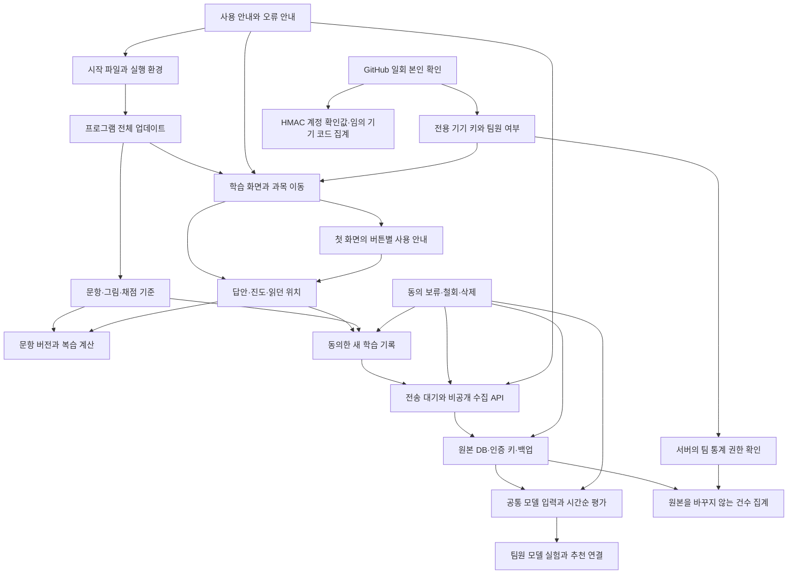

# 수정 전에 확인할 연결 관계

프로그램·문항·서버를 고칠 때 아래 지도에서 시작점을 찾습니다. 연결된 기능과 실제 사용 상황을 확인한 뒤 변경합니다. 새 연결이 생기면 이 지도도 갱신합니다.

화살표로 연결한 기능은 함께 영향을 확인합니다. 모델을 실험하는 단계와 실제 프로그램에서 추천하는 단계는 구분합니다. 현재 프로그램은 기존 규칙으로 문제를 고릅니다.

본인 확인 결과를 학습 기록과 연결하지 않습니다. GitHub 계정 번호 원문은 버리고 계정 중복 확인에는 HMAC 값만 보관합니다. 팀원 대조 목록도 운영 서버의 키로 만든 값을 사용합니다. 기기 확인 결과나 화면의 표시 상태만으로 통계 API를 허용하지 않습니다. 팀원 목록을 바꾸면 이전 통계 권한을 무효로 하고 다시 확인하며, 일반 학습자의 기기 키는 유지합니다.

## 수정 위치별 확인 항목

| 수정 위치 | 연결해서 확인할 곳 | 실제로 생길 수 있는 문제 |
| --- | --- | --- |
| `gui/` 화면·공통 부품·테마 | 각 과목, 작은 창, 글자 확대, 초점과 스크롤 | 메뉴를 바꾼 뒤 답이 지워지거나 큰 글자의 단추가 잘릴 수 있습니다. |
| 답안 칸의 복사·붙여넣기 제한 | 학습 본문·심화·코드 빈칸·연습·모의고사, 직접 입력·한글 조합·되돌리기, 설명과 인증 코드 복사 | 읽기 화면의 복사 허용이 답안 칸까지 풀리거나 제한 안내가 답안·선택 범위·읽던 위치를 바꿀 수 있습니다. |
| 개론·응용 전환과 자료 재사용 | 자료 파일 변경, 학습자·과정별 기록, 중단한 연습, 모의고사 마감, 탭 선택 표시 | 이전 내용을 새 탭 아래에 표시하거나 바뀐 기록·자료를 놓칠 수 있습니다. 재진입하면서 시험 시간을 새로 시작해서도 안 됩니다. |
| 팝업 본문·하단 동작·비동기 조회 | 코드 유효성, 중복 작업 방지, 취소 뒤 콜백, 키보드 초점 | 반복 조회가 버튼을 껐다 켜며 초점을 빼앗거나 만료된 코드를 계속 복사할 수 있습니다. 긴 본문이 하단 버튼을 밀어낼 수 있습니다. |
| 문항·해설·채점 코드 | 문항 버전, 과거 답안, 현재 복습, 수집한 지문 | 같은 ID의 새 문항을 옛 답안으로 숙달했다고 표시할 수 있습니다. |
| 답안·진도 저장 형식 | 이전 파일 읽기, 저장 실패, 이어보기, 공개 제출 제외 | 읽지 못한 기록을 빈 기록으로 덮어쓸 수 있습니다. |
| 수집·제출 API | 이전 프로그램, 재전송, 철회, 용량과 인증 | 응답 유실 뒤 같은 풀이가 중복되거나 철회한 기록이 다시 전송될 수 있습니다. |
| 서버 DB·백업 | 원본 해시, 인증 키, 삭제 이력, 새 경로 복구 | 코드만 되돌려도 새 저장 형식이나 철회 이력이 어긋날 수 있습니다. |
| 모델 입력·자료 준비 | 문항 버전, 누락값, 예측 시점, 공통 입력 버전 | 나중에 알게 된 정답이 이전 예측 입력에 섞일 수 있습니다. |
| 접근 권한·통계 | 서버에서 확인한 계정, 권한 해제, 집계 기준 | 화면만 숨기면 주소를 직접 호출해 통계를 읽을 수 있습니다. |
| 수집 통계의 카드·그래프·기간 선택 | 누적과 기간 합계, 계정과 기기 구분, 늦은 응답, 빈 기록과 조회 실패 | 기간 버튼만 바뀌고 과목 합계는 이전 기간에 남거나 권한이 바뀐 뒤 수치를 다시 열 수 있습니다. |
| 첫 화면 사용 안내 | 인증·동의 순서, 실제 버튼 위치, 화면 크기, 초점 복원 | 안내가 다른 팝업을 덮거나 숨겨진 버튼을 가리키고, 닫은 뒤 읽던 위치를 바꿀 수 있습니다. |
| 업데이트·실행 파일 | 이전 프로그램, 실행 중 답안, 파일 잠금, 오프라인 | 새 파일을 받은 뒤에도 이전 코드로 계속 실행할 수 있습니다. |
| README·안내 문구 | 실제 메뉴와 버튼, 오류 처리, 링크 | 사용자가 안내대로 눌러도 해당 화면을 찾지 못할 수 있습니다. |
| 검사 대상 경로·작업 이름 | 실제 워크플로, Slack 종합 알림의 예정 검사 목록, 필수 검사 | 기다릴 검사가 빠져 완료 알림이 먼저 나가거나 실행되지 않은 검사를 계속 기다릴 수 있습니다. |

## 변경할 때 남길 판단

1. 어느 파일을 왜 바꾸는지와 영향을 받는 경로를 적습니다.
2. 기존 사용자·새 사용자·오프라인·재전송·철회 중 해당하는 상황을 고릅니다.
3. 기존 데이터와 진행 중 답안을 어떻게 지키는지 정합니다. 모르는 과거 값은 추정해서 채우지 않습니다.
4. 실패했을 때 기능을 닫거나 이전 코드로 복구할 방법을 정합니다. 데이터 변경이 있으면 백업과 복구 순서도 확인합니다.
5. 해당 경로의 기존 검사와 발견한 반례를 실행하고, 안내와 지도를 갱신합니다.

확인할 연결이 없다는 이유 없이 모든 검사를 반복하지 않습니다. 같은 코드·입력·환경에서 통과한 결과는 다시 사용하고, 변경하거나 실패한 범위만 재검사합니다. 최종 예정 검사는 PR CI에서 확인합니다.

운영 DB의 시험에는 구분한 합성 기록을 사용합니다. 시험 뒤에는 그 기록만 정리하고 기존 기록·용량 집계·백업을 대조합니다. 개발 환경의 성공과 실제 운영에서 확인한 결과는 따로 기록합니다.
