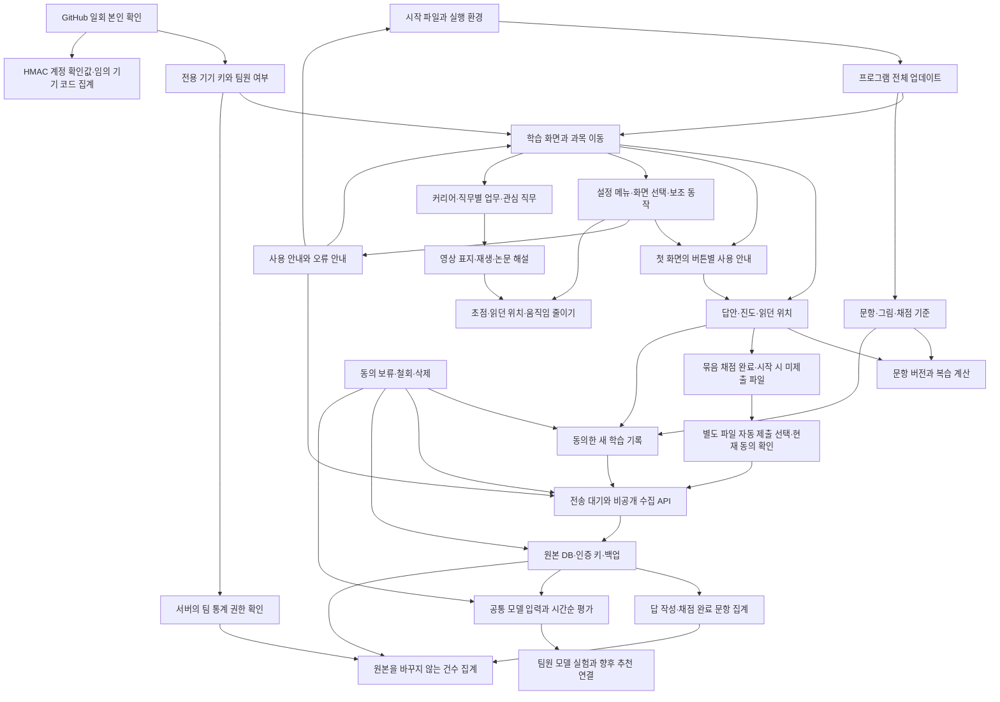

# 수정 전에 확인할 연결 관계

프로그램·문항·서버를 고칠 때 아래 지도에서 시작점을 찾습니다. 연결된 기능과 실제 사용 상황을 확인한 뒤 변경합니다. 새 연결이 생기면 이 지도도 갱신합니다.

화살표로 연결한 기능은 함께 영향을 확인합니다. 모델을 실험하는 단계와 실제 프로그램에서 추천하는 단계는 구분합니다. 현재 프로그램은 기존 규칙으로 문제를 고릅니다.

본인 확인 결과를 학습 기록과 연결하지 않습니다. GitHub 계정 번호 원문은 버리고 계정 중복 확인에는 HMAC 값만 보관합니다. 팀원 대조 목록도 운영 서버의 키로 만든 값을 사용합니다. 기기 확인 결과나 화면의 표시 상태만으로 통계 API를 허용하지 않습니다. 팀원 목록을 바꾸면 이전 통계 권한을 무효로 하고 다시 확인하며, 일반 학습자의 기기 키는 유지합니다.

## 수정 위치별 확인 항목

| 수정 위치 | 연결해서 확인할 곳 | 실제로 생길 수 있는 문제 |
| --- | --- | --- |
| `gui/` 화면·공통 부품·테마 | 각 과목, 작은 창, 글자 확대, 초점과 스크롤 | 메뉴를 바꾼 뒤 답이 지워지거나 큰 글자의 단추가 잘릴 수 있습니다. |
| 커리어·공개 자료·관심 직무 | 산업과 제품의 대응, 출처 확인일, 수업 범위, 기존 연구 목표와 선택 시각 | 일부 공통 기술이 있는 직무를 기존 목표와 같은 직무로 잘못 분류할 수 있습니다. 관심 직무는 기기 설정에만 저장하며 과거 풀이를 다시 분류하지 않습니다. 목록 필터·탭별 읽던 위치·저장 표시는 구분하고 상세에서 목록으로 돌아갈 때 확인합니다. |
| 영상 재생·선택형 부품 설치 | 기존 Qt 버전, 오프라인·취소·종료·재시도, 늦은 결과, 실제 재생 신호, 원본 열기 | 목록만 열어도 설치나 통신이 시작되거나 닫은 뒤 소리가 남을 수 있습니다. 준비·버퍼링을 재생 중으로 표시하지 않으며 부품 설치 실패가 학습 실행을 막지 않게 합니다. |
| 논문 그림·단계별 해설 | 원논문 아이디어와 단순화한 예의 차이, 축·모양·계산, 그림 이용 조건 | 학습 예를 논문 성능 재현으로 표현하거나 서로 다른 기법을 같은 그림으로 설명할 수 있습니다. 원문과 직접 그린 설명을 구분합니다. |
| 설정 메뉴·보조 설명·등장 효과 | 실제 누를 위치, 사용 안내 대상, 키보드·바깥 클릭, 글자·테마 변경, 움직임 줄이기 | 메뉴 위치가 버튼에서 떨어지거나 설명이 숨은 버튼을 가리킬 수 있습니다. 닫는 효과가 끝나기 전에 동작을 중복 실행하지 않는지 확인합니다. |
| 답안 칸의 복사·붙여넣기 제한 | 학습 본문·심화·코드 빈칸·연습·모의고사, 직접 입력·한글 조합·되돌리기, 설명과 인증 코드 복사 | 읽기 화면의 복사 허용이 답안 칸까지 풀리거나 제한 안내가 답안·선택 범위·읽던 위치를 바꿀 수 있습니다. |
| 제출 버튼·자동 연결·결과 안내 | 최신 동의·철회·파일 유무·대기 접수·기존 서버·작업 중 상태·파일 목록 | 이미 동의한 사용자에게 확인창을 반복하거나, 응답 유실 후 원래 파일로 되돌린 풀이의 접수를 놓칠 수 있습니다. 시험의 통신 대체가 빠지면 운영 서버로 시험 자료를 보낼 수 있으므로 외부 통신도 차단합니다. |
| 묶음 완료·시작 시 파일 자동 제출 | 별도 추가 선택·연구 동의 시작점·과목 수집 중단·철회·지연 응답·종료·수동 제출·이전 클라이언트 | 기존 동의를 파일 전송 동의로 확대하거나 같은 파일을 반복 전송할 수 있습니다. 전송 직전에 선택을 다시 대조하고 중복 작업을 막으며, 같은 파일의 크기·인증 오류를 반복하지 않습니다. 기존 연구 기록 전송은 유지합니다. |
| 개론·응용 전환과 자료 재사용 | 자료 파일 변경, 학습자·과정별 기록, 중단한 연습, 모의고사 마감, 탭 선택 표시 | 이전 내용을 새 탭 아래에 표시하거나 바뀐 기록·자료를 놓칠 수 있습니다. 재진입하면서 시험 시간을 새로 시작해서도 안 됩니다. |
| 개론·응용 혼합 모의고사 | 회차 배분, 문항별 과정, 공통 답안·마감, 동의 기간, 채점 공개 시각, 오답 복습 | 탭마다 같은 시험을 새로 시작하거나 응용 답을 개론으로 수집할 수 있습니다. 두 탭에서 같은 응시 기록을 쓰고 문항의 과정을 실제 지문과 대조합니다. 함께 공개된 채점 결과를 그보다 앞선 예측 입력에 넣지 않습니다. |
| 팝업 본문·하단 동작·비동기 조회 | 코드 유효성, 중복 작업 방지, 취소 뒤 콜백, 키보드 초점 | 반복 조회가 버튼을 껐다 켜며 초점을 빼앗거나 만료된 코드를 계속 복사할 수 있습니다. 긴 본문이 하단 버튼을 밀어낼 수 있습니다. |
| 문항·해설·채점 코드 | 문항 버전, 과거 답안, 현재 복습, 수집한 지문, 진행 중 연습의 전체 해시 | 같은 ID의 새 문항을 옛 답안으로 숙달했다고 표시하거나, 출처 위치만 고쳤는데 입력 중인 연습을 이어풀지 못할 수 있습니다. |
| 변형 문항·출제 분류 | 개념·유형, 생성 조건·시드·버전, 반환·입력·채점 기록, 공통 학습 입력 | 새 생성기는 기록에서 출제 조건을 복원할 수 있는지 확인한 뒤 공개합니다. 지문에 공개한 조건만 수집하고 정답·해설은 제외합니다. 옛 초안에 없는 조건은 현재 코드로 채우지 않으며 서버 호환을 먼저 확인합니다. 출제자가 정한 난이도와 실제 풀이로 측정한 난이도는 구분합니다. |
| 로컬 풀이 ID와 시작 순서 | ID 설정의 부재·손상, 명시적 환경변수, 공유 원본과 로컬 전용 풀이, 업데이트 전 중단과 다시 시도 | ID 설정을 잃으면 빈 진도를 열고 이전 풀이를 다른 폴더의 변경으로 분류할 수 있습니다. 새 ID를 저장하기 전에 기존 로컬 기록을 확인하며 여러 기록의 소유자를 추정하지 않습니다. |
| 답안·진도 저장 형식 | 이전 파일 읽기, 저장 실패, 이어보기, 공개 제출 제외 | 읽지 못한 기록을 빈 기록으로 덮어쓸 수 있습니다. |
| 수집·제출 API | 이전 프로그램, 재전송, 철회, 용량과 인증 | 응답 유실 뒤 같은 풀이가 중복되거나 철회한 기록이 다시 전송될 수 있습니다. |
| 풀이 건수와 전체 이벤트 집계 | 답 작성 여부·채점 결과·미응답·모름·재전송·시각 미확인·구형 통계 응답 | 입력이나 문제 열기를 풀이로 합산할 수 있습니다. 새 집계는 원본을 고치지 않고 만들며 새 색인·트리거가 철회와 함께 갱신되는지 확인합니다. |
| 문항·열기·입력·채점 통계 | 기간 전체의 고유 문항, 이벤트 중복, 과목별 계측 시작, 저장·복원·재렌더 | 고유 문항의 일별 합을 기간 합계로 쓰거나 과거의 미측정을 0으로 표시할 수 있습니다. 원시 수집 기록의 합계는 별도로 표시합니다. |
| 동의 안내의 명칭·버전·해시 | 현재 표시 문구, 기존 영수증, 수집 활성 상태·시작점·기기 재시작, 서버 우선 배포 | 문구만 바뀌었는데 기존 사용자의 수집을 멈추거나 다시 동의받으며 시작점이 바뀔 수 있습니다. 확인한 이전 동의만 호환하고 원래 영수증은 유지합니다. |
| 서버 DB·백업 | 원본 해시, 인증 키, 삭제 이력, 새 경로 복구 | 코드만 되돌려도 새 저장 형식이나 철회 이력이 어긋날 수 있습니다. |
| 모델 입력·자료 준비 | 문항 버전, 누락값, 예측 시점, 공통 입력 버전 | 나중에 알게 된 정답이 이전 예측 입력에 섞일 수 있습니다. |
| 접근 권한·통계 | 서버에서 확인한 계정, 권한 해제, 집계 기준 | 화면만 숨기면 주소를 직접 호출해 통계를 읽을 수 있습니다. |
| 수집 통계의 카드·그래프·기간 선택 | 누적과 기간 합계, 계정과 기기 구분, 늦은 응답, 빈 기록과 조회 실패 | 기간 버튼만 바뀌고 과목 합계는 이전 기간에 남거나 권한이 바뀐 뒤 수치를 다시 열 수 있습니다. |
| 첫 화면 사용 안내 | 인증·동의 순서, 실제 버튼 위치, 화면 크기, 초점 복원 | 안내가 다른 팝업을 덮거나 숨겨진 버튼을 가리키고, 닫은 뒤 읽던 위치를 바꿀 수 있습니다. |
| 업데이트·실행 파일 | 이전 프로그램, 실행 중 답안, 파일 잠금, 오프라인 | 새 파일을 받은 뒤에도 이전 코드로 계속 실행할 수 있습니다. |
| 필요한 때만 나타나는 동작 | 조회 전·조회 실패·작업 중·새 변경·완료, 키보드 초점, 오류 안내 | 숨은 버튼이 계속 활성화되거나 사용 안내가 존재하지 않는 버튼을 누르라고 할 수 있습니다. 설정에서 업데이트 유무를 확인하고 재실행으로 파일을 복구하는 경로를 유지합니다. |
| 그림 압축·자료 재사용 | 생성 도구, 픽셀·크기·장면·설명, 기존 서명, 표시 시간·메모리 | 파일만 작아지고 그림의 글자나 재생이 달라질 수 있습니다. 작은 범위에서 원본과 대조하고 효과가 확인된 범위만 적용합니다. |
| 과목 메뉴·터미널 명령 | 첫 화면, 시작 안내, 폴더 목록, 터미널 도움말 | 한쪽에서 닫은 기능을 다른 안내에서 실행하라고 할 수 있습니다. 배포본에서 실제로 열 수 있는 경로를 확인합니다. |
| README·안내 문구 | 학습자·팀원 시작 안내, 전체 목록, 앱 도움말과 캡처, 운영 도구가 만드는 안내 파일 | 같은 버튼이나 선택을 서로 다르게 안내할 수 있습니다. 독자가 실제로 누를 메뉴와 도착 화면을 대조합니다. 팀원 안내에서 연결한 이슈와 PR은 열림·머지 상태도 확인합니다. |
| 검사 대상 경로·작업 이름 | 실제 워크플로, `tools/slack_summary.py`의 예정 경로·검사 이름, 필수 검사 | 기다릴 검사가 빠져 완료 알림이 먼저 나가거나 실행되지 않은 검사를 계속 기다릴 수 있습니다. |

## 변경할 때 남길 판단

1. 어느 파일을 왜 바꾸는지와 영향을 받는 경로를 적습니다.
2. 기존 사용자·새 사용자·오프라인·재전송·철회 중 해당하는 상황을 고릅니다.
3. 기존 데이터와 진행 중 답안을 어떻게 지키는지 정합니다. 모르는 과거 값은 추정해서 채우지 않습니다.
4. 실패했을 때 기능을 닫거나 이전 코드로 복구할 방법을 정합니다. 데이터 변경이 있으면 백업과 복구 순서도 확인합니다.
5. 해당 경로의 기존 검사와 발견한 반례를 실행하고, 안내와 지도를 갱신합니다.

확인할 연결이 없다는 이유 없이 모든 검사를 반복하지 않습니다. 같은 코드·입력·환경에서 통과한 결과는 다시 사용하고, 변경하거나 실패한 범위만 재검사합니다. 최종 예정 검사는 PR CI에서 확인합니다.

운영 DB의 시험에는 구분한 합성 기록을 사용합니다. 시험 뒤에는 그 기록만 정리하고 기존 기록·용량 집계·백업을 대조합니다. 개발 환경의 성공과 실제 운영에서 확인한 결과는 따로 기록합니다.
