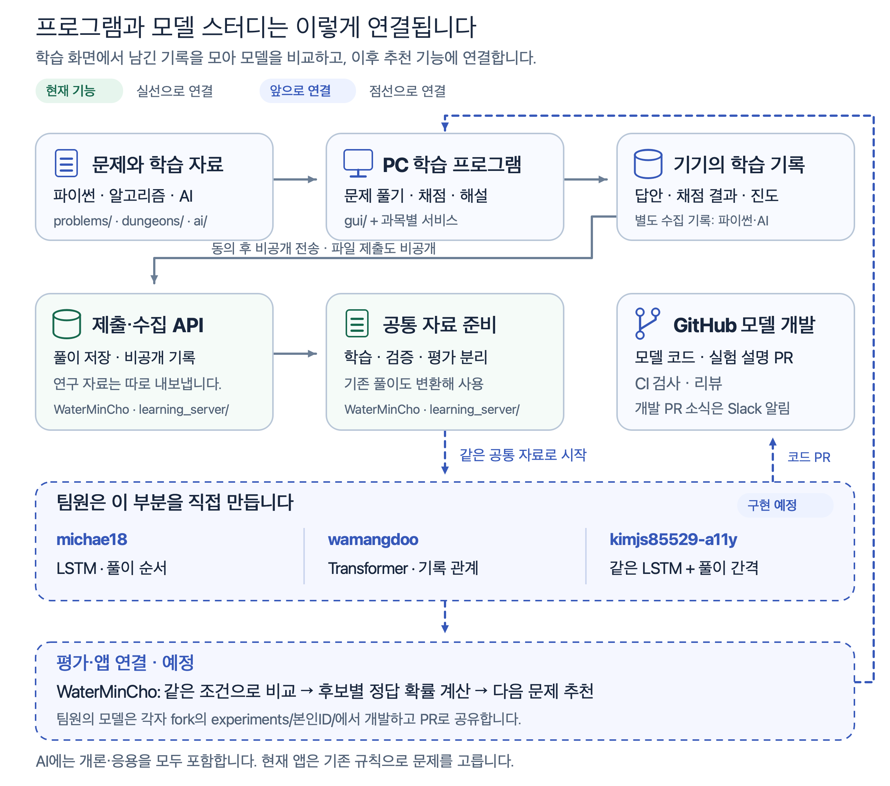
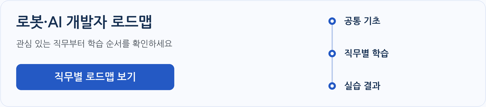

# 학습과 모델 개발 안내 목록

[학습 시작](LEARNER_START.md) · [스터디 개발 시작](STUDY_START.md)

## [프로젝트 구조와 팀원 역할](../docs/ARCHITECTURE.md)

문제 풀이 → 비공개 기록 수집 → 세 팀원의 모델 학습 → 비교·추천 순서로 읽는 그림입니다. 현재 기능은 실선, 모델 개발과 추천 연결은 점선으로 표시했습니다.

[그림 크게 보기](../docs/img/architecture/overview.png) · [담당별 입력·출력 확인하기](../docs/ARCHITECTURE.md#팀원별-모델과-역할)

---

## [커리어 · 직무별 업무와 영상·논문 해설](career/README.md)

앱의 [커리어]에서 [개발자 로드맵]과 [매거진]을 엽니다. 제품과 세부 직무의 관계를 그림으로 확인하고 관련 영상·논문 설명을 읽을 수 있습니다.

## [ROKEY 수업과 여섯 직무](../docs/roadmap/README.md#rokey-수업과-여섯-직무)

어떤 일을 하고 싶은지 골라 보세요. 직무별로 배울 순서, ROKEY 11기 수업에 포함된 범위, 직접 만들어 볼 결과물을 그림으로 확인합니다.

- [그림 읽는 법](../docs/roadmap/README.md#그림-읽는-법)
- [직무별 로드맵](../docs/roadmap/README.md#직무별-로드맵)

**아래 직무를 누르고 ‘로드맵 펼쳐보기’에서 학습 순서를 확인하세요.**

| 직무별 로드맵 | 하는 일과 배울 내용 |
| --- | --- |
| [**로봇 SW·제어 엔지니어**](../docs/roadmap/README.md#arm) | 로봇 팔과 장치를 제어합니다. C++·ROS2·장치 통신을 익힙니다. |
| [**자율주행 로봇 엔지니어**](../docs/roadmap/README.md#nav) | 이동 로봇이 목적지까지 주행하게 만듭니다. 지도 작성·위치 추정·경로 계획을 익힙니다. |
| [**비전 AI 엔지니어**](../docs/roadmap/README.md#vision) | 영상 모델을 학습하고 실패 원인을 분석합니다. PyTorch·OpenCV·모델 배포를 익힙니다. |
| [**로봇 현장·통합 엔지니어**](../docs/roadmap/README.md#field) | 로봇과 장비를 연결하고 현장 문제를 해결합니다. 설치·점검·통신·기술 문서를 익힙니다. |
| [**Physical AI 엔지니어**](../docs/roadmap/README.md#physical) | 로봇이 동작을 배우도록 학습시킵니다. 시뮬레이션·모방학습·강화학습을 익힙니다. |
| [**로봇 관제 개발자**](../docs/roadmap/README.md#platform) | 여러 로봇의 상태를 화면과 서버로 모읍니다. 웹 화면·API·데이터베이스·연결 복구를 익힙니다. |

- [프로그램에서 연습할 수 있는 과목과 범위](../docs/roadmap/README.md#프로그램에서-연습할-수-있는-과목과-범위)
- [로드맵에 참고한 수업 자료와 채용 공고](../docs/roadmap/README.md#로드맵에-참고한-수업-자료와-채용-공고)

---

## [파이썬 평가 범위와 채점 조건](../problems/README.md#파이썬-평가-범위와-채점-조건)

이 프로그램을 만들 때 준비한 파이썬 평가의 범위와 채점 조건입니다.

---

## [처음 설치할 때](../gui/README.md#처음-설치할-때)

Python과 Git을 설치하고 프로그램 폴더를 받는 방법입니다.

---

## [프로그램 실행과 학습 이어가기](../gui/README.md#프로그램-실행과-학습-이어가기)

프로그램을 켜고, 하던 학습을 이어 하고, 새 자료를 받는 방법입니다.

---

## [진단 테스트와 회차별 문제 풀이](../problems/README.md#진단-테스트와-회차별-문제-풀이)

진단 테스트와 회차 문제를 풀고 결과·해설·오답 노트를 확인합니다.

---

## 과목별 답안 작성법과 채점 기준

공부하는 과목과 풀이 화면에 맞는 안내를 고르세요. AI 개론과 응용은 같은 입력·채점 방식을 사용합니다.

- [파이썬 스터디](../problems/README.md#답-적는-법과-채점): 답은 자동 저장되며 [회차 제출]을 누르면 회차 전체를 채점합니다.
- [알고리즘 여행](../journey/README.md#코드-실행과-채점): [코드 실행]으로 예시를 확인하고 [채점하기]로 숨은 테스트까지 검사합니다.
- [AI 개론·응용 연습](../ai/README.md#답-적는-법과-채점): 빈칸을 적거나 보기를 고른 뒤 [확실함]·[긴가민가]로 한 문항씩 답을 확인합니다.
- [개론 모의고사 1~3회](../ai/README.md#ai-개론-모의고사)는 개론 탭에서 풉니다. [혼합 모의고사 4회](../ai/README.md#mixed-mock-exam)는 개론·응용 어느 탭에서 열어도 같은 답안과 남은 시간으로 이어집니다. [제출]을 누르거나 시간이 끝나면 채점합니다.

---

## [알고리즘 여행](../journey/README.md#알고리즘-여행)

문제를 고르고 Python·JavaScript로 실행·채점하는 방법입니다.

- [던전 지도](../journey/README.md#던전-지도)
- [언어 고르기](../journey/README.md#언어-고르기)
- [문제 화면](../journey/README.md#문제-화면)
- [코드 실행과 채점](../journey/README.md#코드-실행과-채점)
- [힌트와 해설](../journey/README.md#힌트와-해설)
- [생성 입력 캐시](../journey/README.md#생성-입력-캐시)
- [언어별 풀이 코드와 채점 기록](../journey/README.md#언어별-풀이-코드와-채점-기록)

---

웹 면접 준비의 기존 안내 · 현재 진입 중지

## [웹 면접 준비](../web/README.md#웹-면접-준비)

현재 진입을 중지한 기능입니다. 아래 안내는 기능을 다시 연 뒤 사용합니다.

- [라이브 코딩에 필요한 Node.js와 검사 도구](../web/README.md#라이브-코딩에-필요한-nodejs와-검사-도구)
- [라이브 코딩 미션](../web/README.md#라이브-코딩-미션)
- [꼬리 질문 사슬](../web/README.md#꼬리-질문-사슬)
- [학습 노트](../web/README.md#학습-노트)
- [웹 미션 코드와 학습 기록 저장 위치](../web/README.md#웹-미션-코드와-학습-기록-저장-위치)

---

## [AI 개론·응용](../ai/README.md#ai-개론응용)

개론과 응용을 나눠 읽고, 그림·확인 물음·연습·복습으로 이어갑니다.

- [AI 응용 1~3차시 학습 순서](../ai/README.md#ai-응용-13차시-학습-순서)
- [개론 모의고사](../ai/README.md#ai-개론-모의고사) · [개론·응용 혼합 모의고사](../ai/README.md#mixed-mock-exam)
- [학습 단원](../ai/README.md#학습-단원)
- [연습](../ai/README.md#연습)
- [복습 날짜와 복습 확인 기준](../ai/README.md#복습-날짜와-복습-확인-기준)
- [오답 노트](../ai/README.md#오답-노트)
- [AI 답안과 진도 저장 위치](../ai/README.md#ai-답안과-진도-저장-위치)

---

## [모델 학습용 자료와 팀원별 개발 절차](../learning_server/README.md#모델-학습용-자료와-팀원별-개발-절차)

[수집하는 항목과 전체 배포 전 확인할 조건](../docs/LEARNING_READINESS.md)을 확인할 수 있습니다.

풀이 기록을 모으고, 각자 모델을 만들어 같은 자료로 비교합니다. 모델 학습과 추천 연결은 앞으로 진행합니다.

팀원은 [실제 자료 받기·샘플링](LEARNING_DATA_ACCESS.md)과 [각자 fork에서 첫 PR까지](../docs/LEARNING_WORKFLOW.md)를 먼저 읽습니다. [담당별 미션](../docs/LEARNING_MISSIONS.md)에서 세 모델의 차이를, [모델 개발 로드맵](../docs/LEARNING_ROADMAP.md)에서 남길 산출물과 다음 학습을 확인합니다.

개발 PR의 검사와 리뷰 결과는 [Slack의 오늘의 PR 스레드](SLACK_NOTIFICATIONS.md#오늘의-pr-스레드와-상태-알림)에 모입니다. 자세한 피드백은 알림에 연결된 PR에서 확인하세요.

---

## [Node.js 설치](../tools/README.md#nodejs-설치)

알고리즘 여행을 JavaScript로 풀 때 필요한 실행 도구를 준비합니다.

---

## [풀이 파일 비공개 제출](API_SUBMISSIONS.md)

묶음 채점 뒤 자동 제출을 켜는 방법과 수동 제출, 저장 결과와 실패 후 재시도를 안내합니다.

---

## [문제를 고르는 방식](../problems/README.md#문제를-고르는-방식)

진단 결과와 이전 풀이에 따라 회차·레벨·복습 문항을 정하는 규칙입니다.

---

## [터미널에서 모의고사 풀기](../problems/README.md#터미널에서-모의고사-풀기)

터미널에서 파이썬 모의고사를 시작하고 채점하는 방법입니다.

---

## [폴더와 차시별 복습 자료](../docs/README.md#폴더와-차시별-복습-자료)

차시별 복습 자료와 과목·풀이·기록 파일이 있는 폴더를 찾습니다.

---

## [실행·업데이트·제출 오류 해결](../gui/README.md#실행업데이트제출-오류-해결)

아래에서 지금 겪는 문제를 골라 확인합니다.

- [창이 열리지 않을 때](../gui/README.md#창이-열리지-않을-때)
- [예전 버전을 받아 뒀거나 문제 받기가 계속 오류로 끝날 때](../gui/README.md#예전-버전을-받아-뒀거나-문제-받기가-계속-오류로-끝날-때)
- [ID를 잘못 입력했을 때](../gui/README.md#id를-잘못-입력했을-때)
- [제출이 안 될 때](../gui/README.md#제출이-안-될-때)
- [알고리즘 여행 줄에 기록을 읽을 수 없다고 나올 때](../gui/README.md#알고리즘-여행-줄에-기록을-읽을-수-없다고-나올-때)
- [그 밖에 불편하거나 이상할 때](../gui/README.md#그-밖에-불편하거나-이상할-때)

---

## [터미널 명령](../tools/README.md#터미널-명령)

창을 열거나 학습을 이어 하고 채점할 때 사용하는 명령입니다.

---
