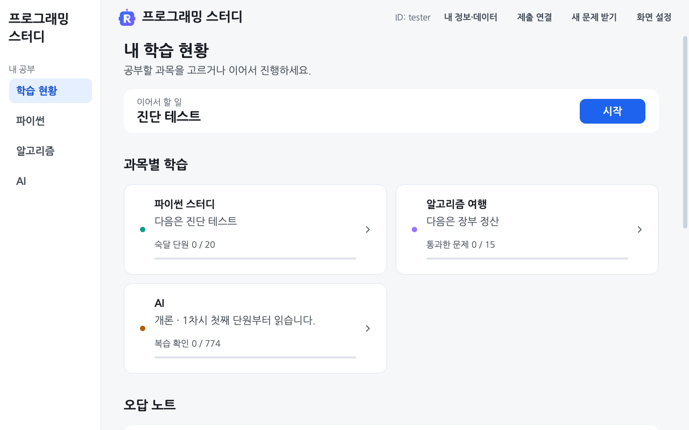

# 학습자 가이드 · 설치부터 첫 문제까지

<a id="설치하고-첫-문제를-풉니다"></a>

[처음 화면으로](../README.md)

처음 설치한다면 **아래 1번부터** 따라 하세요. 이미 프로그램 폴더가 있다면 [2. start 파일로 첫 실행](#2-start-파일을-엽니다)으로 넘어갑니다.

<a id="1-프로그램을-받습니다"></a>

## 1. Python과 Git 설치 후 프로그램 받기

[Python과 Git 설치 안내](../gui/README.md#python과-git을-설치합니다)에 따라 두 프로그램을 준비합니다. 저장소를 내 컴퓨터로 내려받는 과정을 복제(Clone)라고 합니다. **아래 두 방법 중 하나만 골라 펼치세요.** SourceTree에서는 변경한 파일, 커밋 이력, 현재 브랜치를 화면에서 확인할 수 있습니다.

<a id="sourcetree로-받기"></a>

<details>
<summary>SourceTree로 받는 방법</summary>

SourceTree가 없다면 [공식 설치 페이지](https://www.sourcetreeapp.com/)에서 받아 설치합니다.

1. SourceTree를 열고 **Clone(복제)** 또는 **Clone/New → Clone Repository**를 선택합니다. 버전에 따라 버튼 이름이 다를 수 있습니다.
2. **원본 주소**에 아래 주소를 붙여 넣습니다.

   ```text
   https://github.com/WaterMinCho/programming-study.git
   ```

3. **대상 경로**에 저장할 새 폴더를 지정합니다. Windows는 `C:\study\programming-study`, Mac은 문서 폴더 안의 `programming-study`처럼 정합니다.
4. **Clone(복제)**을 누르고 완료될 때까지 기다립니다.
5. 탐색기나 Finder에서 방금 지정한 폴더를 엽니다. `start.bat`, `start.command`, `study.py`, `README.md`가 있으면 내려받기가 끝났습니다. [2번으로 넘어가 실행](#2-start-파일을-엽니다)하세요.

버튼 위치는 [SourceTree 공식 복제 안내][sourcetree-clone]에서도 확인할 수 있습니다.

</details>

<a id="터미널로-받기"></a>

<details>
<summary>터미널로 받는 방법</summary>

1. 프로그램을 저장할 위치에서 터미널을 엽니다. Windows는 탐색기로 문서 같은 상위 폴더를 열고 주소 칸에 `cmd`를 입력한 뒤 Enter를 누릅니다. Mac은 터미널을 열고 `cd ~/Documents`를 입력하면 문서 폴더로 이동합니다.
2. 아래 두 줄을 순서대로 실행합니다.

   ```sh
   git clone https://github.com/WaterMinCho/programming-study.git
   cd programming-study
   ```

3. 방금 선택한 위치에 `programming-study` 폴더가 생깁니다. 탐색기나 Finder에서 이 폴더를 열어 `start.bat`, `start.command`, `study.py`, `README.md`가 있는지 확인합니다. [2번으로 넘어가 실행](#2-start-파일을-엽니다)하세요.

</details>

<a id="2-start-파일을-엽니다"></a>

## 2. start 파일로 첫 실행

Windows는 `start.bat`, macOS는 `start.command`를 엽니다. 화면 도구 설치 안내가 나오면 [설치]를 누릅니다.

다음부터는 start 파일이나 바로가기만 열면 됩니다. 실행할 때마다 프로그램 전체의 업데이트를 확인하고 문제·그림·코드 변경을 함께 받습니다. 필요한 경우 자동으로 다시 실행하며 답안과 진도는 유지합니다.

기기마다 처음 한 번 GitHub 계정을 확인합니다. 계정이 없다면 먼저 [GitHub에 가입](https://github.com/signup)하세요. 프로그램에서 [GitHub에서 확인하기]를 누르고 GitHub 화면에 확인 코드를 입력합니다. 팝업 하단의 [확인 코드 복사]를 사용할 수 있습니다. 확인 화면을 닫았다면 [확인 창 다시 열기]를 누릅니다. GitHub에서 확인을 마치면 프로그램이 자동으로 이어집니다. 다음 실행부터는 프로그램이 발급한 기기 키로 자동 확인합니다.

이름·이메일·사진·GitHub 계정 번호 원문·GitHub 토큰은 저장하지 않습니다. 같은 계정의 중복 인증은 서버 비밀키로 만든 계정 확인값(HMAC)으로 구분합니다. [기기 본인 확인과 저장 항목](DEVICE_IDENTITY.md)

연구에 풀이 기록을 제공할지는 별도로 선택합니다. 동의하지 않아도 학습하고 이 컴퓨터에서 채점할 수 있습니다. 풀이 ID는 자동으로 만들어집니다. [실행 화면과 동의 안내](../gui/README.md#첫-실행과-학습-데이터-수집-동의)

처음 받은 폴더에는 톱니바퀴 모양의 `start.bat`이 보입니다. Windows에서 이 파일을 실행하면 같은 폴더에 R 아이콘의 `프로그래밍 스터디.lnk` 바로가기가 생깁니다. 다음부터 이 바로가기를 더블클릭하세요. 바탕화면에서도 쓰려면 바로가기 파일을 직접 복사해 붙여 넣습니다. 바로가기가 없거나 열리지 않으면 `start.bat`으로 실행하세요. [같은 이름의 파일이 있거나 폴더를 옮긴 경우](../gui/README.md#프로그램-실행과-학습-이어가기)

<a id="3-공부할-과목을-고릅니다"></a>

## 3. 과목을 고르고 첫 문제 풀기

| 공부할 내용 | 첫 화면에서 할 행동 | 풀이 안내 |
|---|---|---|
| AI 개론·응용 | [AI] → [개론] 또는 [응용] → 차시·단원 선택 | [그림·설명 읽고 연습하기](../ai/README.md) |
| 파이썬 | [파이썬 스터디] → [진단 테스트 시작] | [답 입력과 회차 채점](../problems/README.md) |
| 알고리즘 | [알고리즘 여행] → 던전·문제 선택 | [코드 실행과 채점](../journey/README.md) |

원하는 과목부터 시작할 수 있습니다. 왼쪽 메뉴에서는 [파이썬]·[알고리즘]·[AI]로 이동합니다. 왼쪽 메뉴가 접혀 있으면 [메뉴 이동]을 여세요. AI 연습에서는 답한 뒤 [확실함]이나 [긴가민가]를 누릅니다. 답을 모르겠으면 [모르겠어요]로 해설을 확인하세요. 파이썬에서는 모르는 문제를 비워 두고 [회차 제출]로 회차 전체를 채점할 수 있습니다.

[](img/hub.png)

화면의 ID와 기록은 설명용 예시입니다. 다음에 켜면 **이어서 할 일**에서 저장된 학습 위치로 돌아갈 수 있습니다.

첫 화면 안내를 다시 보려면 [설정]에서 [첫 화면 튜토리얼 다시 보기]를 누르세요.

<a id="풀이와-기록은-비공개로-보관합니다"></a>

## 내 답안의 저장 위치와 서버 전송

답은 이 컴퓨터에 저장합니다. 연구에 동의하면 답안 본문을 뺀 새 파이썬·AI 풀이 기록을 자동으로 보냅니다. 이어서 답안 파일도 보낼지 한 번 묻습니다. [기록만 자동 전송]을 선택해도 [풀이 제출]로 파일을 직접 보낼 수 있습니다.

[답안 파일도 자동 제출]을 선택하면 프로그램을 켤 때와 문제 묶음을 채점한 뒤에 미제출 파일을 비공개 서버에 보냅니다. 선택 전에 작성한 파일도 제출 대상에 포함됩니다. [내 정보·데이터]에서 보낼 파일을 확인하거나 파일 자동 제출만 끌 수 있습니다. [제출 방법](API_SUBMISSIONS.md) · [수집 내용과 철회](LEARNING_PRIVACY.md)

<a id="글자를-키우거나-실행-문제를-해결합니다"></a>

## 글자 크기 설정과 실행·제출 오류 해결

[설정](../gui/README.md#글자-크기와-화면-테마)에서 글자 크기와 테마를 바꿉니다. 창이 열리지 않거나 제출이 실패하면 [오류 해결 안내](../gui/README.md#실행업데이트제출-오류-해결)를 확인하세요. 기기 본인 확인을 마친 뒤에는 인터넷 연결이 없어도 이미 받은 문제를 풀고 로컬 채점을 사용할 수 있습니다.

[설정] → [불편한 점 알리기]를 누르면 문의 양식에 프로그램 버전과 화면 설정이 채워집니다. 답안과 계정 정보는 넣지 않습니다. 내용을 확인하고 증상을 적은 뒤 제출하세요. 제출한 문의는 GitHub에 공개됩니다.

제출할 때 서버에 연결되지 않으면 [수집 서버 접속 상태](https://rokey-study.betteruptime.com)를 확인하세요. 최근 장애가 있었던 날짜도 표시됩니다.

[sourcetree-clone]: https://support.atlassian.com/sourcetree/kb/clone-a-repository-into-sourcetree/
