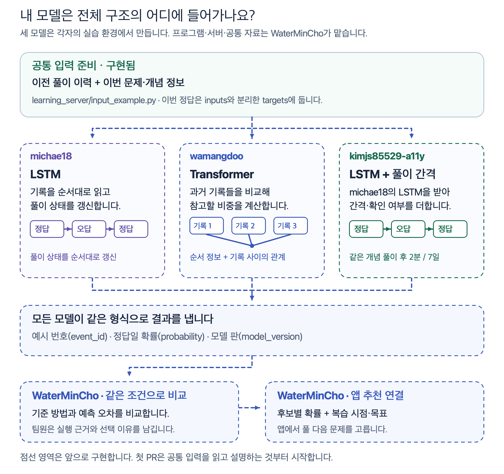
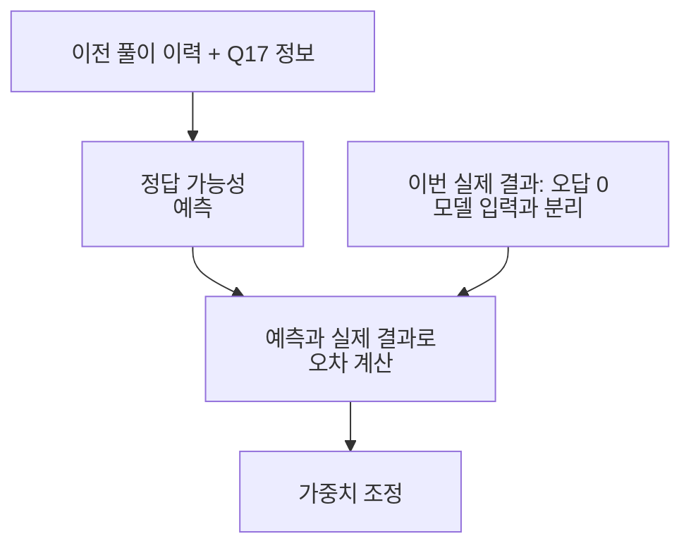
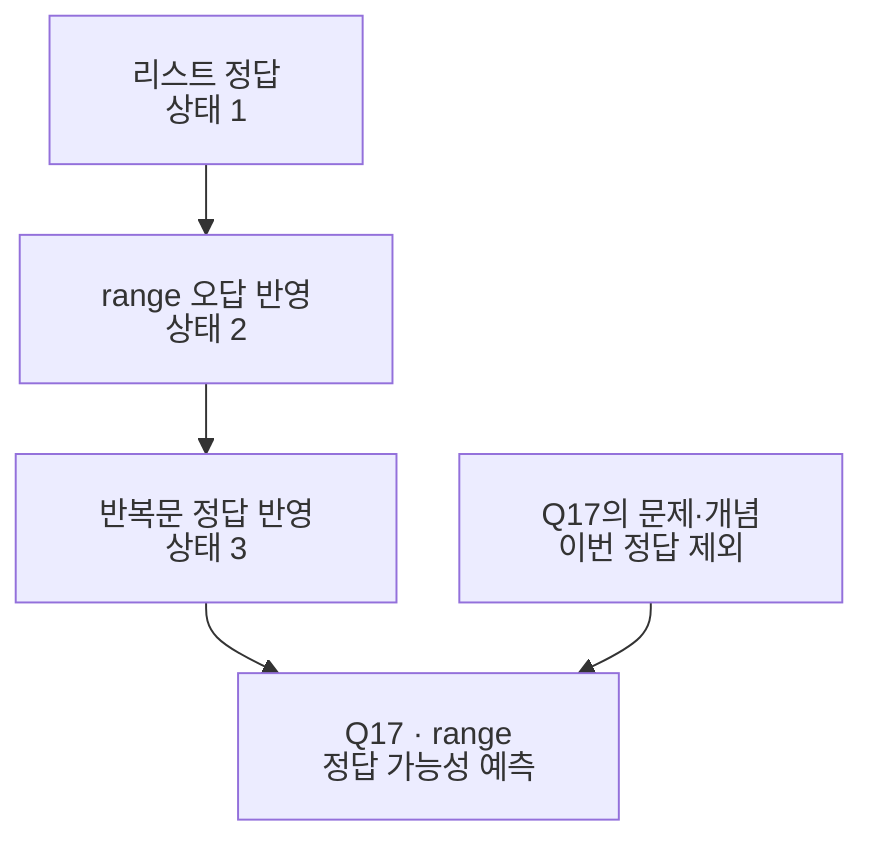
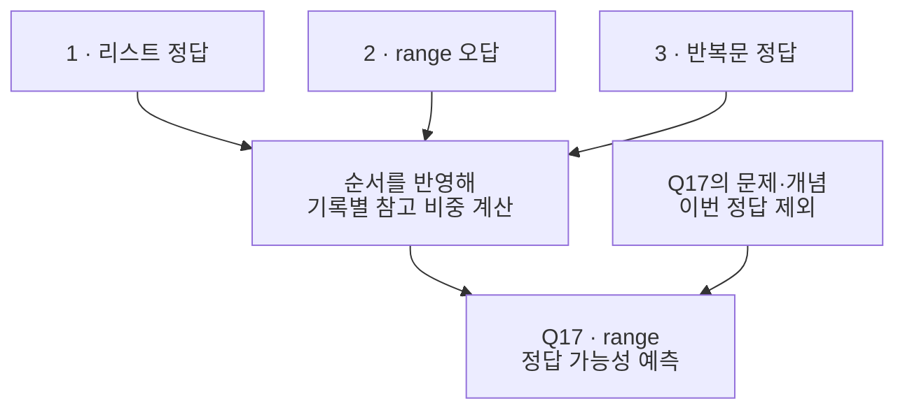
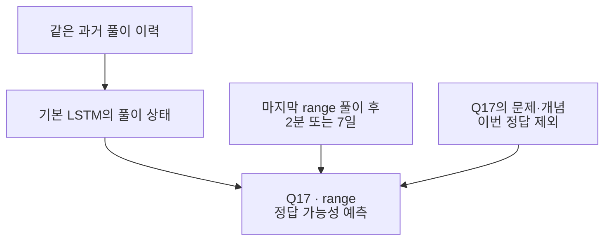

# 문제 추천 모델 개발 미션

<a id="풀이-기록으로-추천-모델을-만듭니다"></a>

파이썬과 AI의 풀이 기록으로 다음 문제를 맞힐 가능성을 예측합니다. 각자 입력과 학습 과정을 설명하고 다른 사람이 실행할 수 있는 코드를 남기는 프로젝트입니다. 본인 fork의 개발 PR에 코드·테스트·선택 이유를 함께 남깁니다. 입력·학습·저장·불러오기를 직접 연결하는 데 집중합니다.

WaterMinCho가 프로그램·서버·공통 자료와 앱 연결을 맡습니다. michae18, wamangdoo, kimjs85529-a11y는 공통 실습을 한 뒤 각자의 모델을 만듭니다. 역할은 서로 협의해 바꿀 수 있습니다.

[단계별 로드맵](LEARNING_ROADMAP.md)에서 앞으로 만들 산출물과 다음 단계로 넘어갈 기준을 확인합니다. 새 코드와 실행 결과에 따라 담당 이슈의 다음 미션을 조정합니다.

처음 참여했다면 [각자 fork에서 첫 PR까지](LEARNING_WORKFLOW.md)를 먼저 따라 합니다. [공통 입력 버전과 공유 자료](LEARNING_STARTER.md#세-팀원이-사용할-자료-버전을-맞춥니다)을 확인하고 같은 번호표로 시작합니다. [같은 실제 자료를 받아 샘플링·테스트](LEARNING_DATA_ACCESS.md)한 뒤 본인 폴더에서 모델을 만듭니다. 작업·질문·검토는 [GitHub 스터디 보드](https://github.com/users/WaterMinCho/projects/2/views/1)와 이슈·PR에서 이어갑니다.

| 담당 | 맡은 일 |
|---|---|
| WaterMinCho | 공통 자료·입력 설명·서버를 준비하고 팀원의 PR과 모델 연결을 검토합니다. |
| michae18 | 과거 문제와 정오답을 읽고 작은 LSTM으로 예측값 하나를 만듭니다. |
| wamangdoo | 같은 입력의 순서와 빈 자리를 확인하고 순서를 반영한 작은 Transformer를 만듭니다. |
| kimjs85529-a11y | 간격과 시간 확인 여부를 출력하고, 이후 공유받은 LSTM에 시간 입력을 더합니다. |

<a id="이번-pr에-만들고-확인할-것"></a>

<a id="담당-모델별-첫-pr과-확인-방법"></a>

## 입력 실습 뒤 모델별 개발 PR과 확인 방법

담당 이슈에는 GitHub에 올라온 코드와 PR을 기준으로 지금 할 일을 적습니다. 세 팀원이 `main`에 합친 입력 실습에서 [다음 작업](STUDY_START.md#담당과-이번-작업을-확인합니다)으로 이어갑니다. 입력 확인 문서의 승인이나 모델 전체 완성을 기다리지 않고 코드·확인 결과·설명을 같은 PR에 올립니다.

| 담당 이슈 | 지금 만들 것 | 직접 확인할 결과 | 다음 단계 |
|---|---|---|---|
| [michae18 · #119](https://github.com/WaterMinCho/programming-study/issues/119) | `model.py`에 과거 풀이와 현재 문제를 받아 확률을 내는 작은 LSTM을 만듭니다. | 합성 예제 4개에서 확률 4개가 나오고, 과거 풀이가 없는 예제도 오류 없이 처리합니다. | 학습·검증을 연결하고 저장·불러오기 후 같은 예측이 나오는지 확인합니다. 이후 기본 코드와 설정을 간격 담당자에게 공유합니다. |
| [wamangdoo · #120](https://github.com/WaterMinCho/programming-study/issues/120) | `model.py`에 순서 정보와 빈 자리 구분을 반영한 작은 Transformer를 만듭니다. | 합성 예제 4개에서 확률 4개가 나오고, 모든 과거 자리가 비어도 숫자가 유효합니다. 빈 자리에 넣은 값을 바꿔도 예측이 달라지지 않는지 확인합니다. | 학습·검증과 저장·불러오기를 연결한 뒤 같은 조건의 LSTM과 비교합니다. |
| [kimjs85529-a11y · #121](https://github.com/WaterMinCho/programming-study/issues/121) | `inspect_gaps.py`에 이번 문제의 개념에 해당하는 간격과 확인 여부를 고르는 함수를 만듭니다. | `query_concepts`로 필요한 칸을 고르고, 시간을 모르는 `0.0·False`를 0초 경과로 바꾸지 않습니다. | 공유받은 기본 LSTM의 커밋을 고정하고, 시간 입력을 넣고 뺀 경우를 같은 조건으로 비교합니다. |

파일 이름은 예시입니다. 이미 같은 역할의 코드가 있다면 이어서 고칩니다. 확률은 0부터 1 사이의 숫자여야 하며 `NaN`처럼 계산 결과를 알 수 없는 값이 나오면 처리 방법을 확인합니다. 첫 예측 확인에서는 학습 전 모델을 써도 됩니다. 예측값이 나온 사실과 실제로 학습한 결과는 나눠 적습니다.

빈 자리의 값만 바꿔 비교할 때는 [`model.eval()`][torch-eval]로 평가 모드를 켜고 같은 모델·입력으로 확인합니다. 바꿀 값은 번호표 안의 유효한 값으로 고릅니다. 학습 때 일부 값을 무작위로 빼는 Dropout이 비교 결과에 섞이지 않도록 합니다. 평가 모드를 켜는 것과 가중치를 학습하는 것은 구분합니다.

모델에 전달하는 함수에는 `inputs`만 넘깁니다. `targets`는 이번 정답이므로 예측을 마친 뒤 오차를 계산할 때 사용합니다. michae18과 wamangdoo의 기본 모델에는 시간 간격을 넣지 않습니다.

공통 자료에서는 같은 묶음에서 다시 푼 답과 부분 정답을 제외합니다. 그래서 표본 수와 대시보드의 채점 건수가 다를 수 있습니다.

AI 연습에서 답을 썼지만 틀린 경우와 [모르겠어요]를 누른 경우는 정답표에 모두 0으로 남습니다. 두 경우를 따로 실험하려면 자료 담당자에게 구분된 공통 자료를 요청하세요. 지금 자료로 실험할 때는 두 경우를 함께 셌다고 적으면 됩니다.

공통 입력 버전 5부터 이전 문제의 `difficulties`와 현재 문제의 `query_difficulty`도 제공합니다. 출제 난이도는 1~3이며 미확인 값은 0입니다. `difficulty_known`과 `query_difficulty_known`으로 값이 확인됐는지 구분합니다. 기존 버전 4 자료도 읽을 수 있고, 기록에 난이도가 없으면 미확인으로 남습니다. 풀이 시각을 모를 때도 현재 시각을 대신 넣지 않습니다.

새로 만드는 버전 6에는 변형 문항의 생성 조건이 별도 `question_provenance`로 연결됩니다. 기존 숫자 배열은 유지하므로 첫 모델에서 이 필드를 반드시 쓸 필요는 없습니다. 생성 조건을 쓰는 비교 실험은 [공통 입력 안내](LEARNING_STARTER.md)를 따라 같은 자료·항목으로 맞춥니다. 본인이 이미 실행한 버전과 결과는 당시 기록으로 남깁니다.

공유 ZIP의 버전 4 실제 파이썬 기록에는 출제 난이도가 없습니다. 난이도를 기록한 실제 자료를 받으면 같은 분할과 설정에서 난이도를 넣고 뺀 결과를 비교합니다. 세 모델을 비교할 때도 난이도 사용 여부를 맞춥니다. 실제 정답률로 난이도를 다시 정하는 작업은 별도 실험으로 남깁니다.

<details>
<summary>빈 이력과 PyTorch의 mask를 처리할 때</summary>

LSTM에 `pack_padded_sequence`를 쓰면 길이 0인 행을 그대로 넣을 수 없습니다. 빈 이력이 있는 행을 어떻게 따로 처리했는지 설명합니다. 이 함수의 [공식 구현][torch-packed]도 길이가 0보다 커야 하는지 검사합니다.

공통 입력의 `mask=True`는 실제 풀이 자리입니다. PyTorch Transformer의 `src_key_padding_mask=True`는 가릴 자리이므로 [함수에서 쓰는 뜻][torch-padding]에 맞춰 바꿉니다. 과거 풀이가 전혀 없는 경우의 처리도 따로 설명합니다. 확인할 조건과 힌트이며 모델 전체의 구현 방법을 고정하는 규칙은 아닙니다.

</details>

### 코드와 함께 올릴 확인 결과

1. 본인 폴더의 `test_model.py` 또는 `test_gaps.py`에 위 표의 정상 입력·빈 이력·시간 미확인 중 해당하는 경우를 확인하는 작은 테스트를 만듭니다.
2. 기존 README에 실행한 명령, 실제 나온 출력, 코드 선택 이유와 아직 실행하지 않은 부분을 적습니다. `Readme.md`처럼 이미 있는 파일은 이름을 유지하고 새 `README.md`를 중복 생성하지 않습니다.
3. 코드·테스트·설명을 같은 작업 브랜치에서 Commit·Push합니다. [열린 PR·머지된 PR·아직 없는 PR에 따라 이어가기](LEARNING_WORKFLOW.md#기존-작업에서-어디부터-이어가나요)를 확인합니다.

테스트와 출력은 공개해도 되는 합성 자료로 재현합니다. 실제 자료를 받기 전에도 [공통 입력 예제](LEARNING_WORKFLOW.md#4-공통-입력을-읽습니다)로 시작할 수 있습니다. 실제 자료와 개별 예측·가중치는 비공개로 전달합니다.

### 간격 담당자의 작은 확인 예시

칸 번호는 0부터 센 인덱스를 사용합니다. 한 예제의 `query_concepts`가 `[0, 0, 1, 0]`이면 이번 문제의 개념은 인덱스 2인 칸, 앞에서 세 번째 자리입니다. 간격이 `[0.0, 0.0, 86400.0, 172800.0]`이고 확인 여부가 `[False, False, True, True]`라면 인덱스 2의 `86400.0·True`를 고릅니다. 다른 개념인 인덱스 3의 시간까지 이번 문제의 시간으로 사용하지 않습니다.

인덱스 2도 `0.0·False`라면 그 시간을 모르는 상태로 유지합니다. 이번 문제에 개념이 여러 개면 해당하는 칸들을 함께 다룹니다. 위 배열은 확인 방법을 설명하는 예시이며 참가자의 기록이나 모델 출력이 아닙니다.

<a id="풀이에서-추천까지-이어집니다"></a>

## 풀이 기록에서 다음 문제 추천까지

수집·공통 자료 준비는 구현했습니다. 아래 그림은 각 모델이 들어갈 위치입니다. 모델 학습·비교·추천 연결은 앞으로 진행합니다. 실제 참가자의 등록·사용 결과는 [시범 운영 안내](LEARNING_PILOT.md)에서 구분합니다.

[](img/architecture/model-roles.png)

[프로젝트 구조와 팀원 역할](ARCHITECTURE.md)

추천을 연결하면 모델은 후보별 정답 가능성을 계산하고 추천 로직은 그 값과 복습 시점·학습 목표를 함께 보고 다음 문제를 고릅니다. 정답 예측이 잘 맞는지와 추천 뒤 학습에 도움이 되는지는 따로 확인합니다. 모델 학습 환경은 학습 프로그램·수집 서버와 분리합니다.

<a id="같은-문제로-저장과-학습을-이해합니다"></a>

## 파이썬 range 문제로 보는 기록과 모델 입력

아래 문제와 기록은 설명용 예시이며 실제 참가자의 자료가 아닙니다.

```python
print(list(range(1, 4)))
```

정답은 `[1, 2, 3]`입니다. `[1, 2, 3, 4]`라고 답해 틀렸다고 가정합니다. 채점 기록에는 아래 항목을 보관합니다. 문제 표시·입력·채점은 별도 기록으로 남을 수 있습니다.

| 항목 | 설명용 값 | 사용하는 이유 |
|---|---|---|
| 가명 참가자 | P07 | 같은 사람의 과거 풀이를 연결합니다. 실제 이름은 모델 입력으로 쓰지 않습니다. |
| 과목·문제·문항 버전 | 파이썬·Q17·문항 내용의 해시 | 문제와 수정 전후 버전을 구분합니다. 해시는 파일 내용을 구분하는 값입니다. |
| 개념 | 반복문·range | 다른 문제에서도 같은 개념을 다루는지 확인합니다. |
| 결과·시도 | 오답·이번 회차의 첫 답 | 정답표에서는 오답을 0, 정답을 1로 바꿉니다. |
| 저장 시각·순서 | 날짜·시각·시간대·기록 순번 | 과거와 미래를 구분합니다. 모르는 시각은 추정하지 않습니다. |
| 입력 답안 | `[1, 2, 3, 4]` | 로컬에 보관하며 서버 전송에서는 기본으로 제외합니다. |

Q17을 예측할 때 입력에는 이전 회차에서 이미 채점된 풀이와 Q17의 문제·개념 정보만 넣습니다. 이번 Q17의 오답은 예측을 채점할 정답표로 따로 둡니다. Q17의 결과가 공개된 뒤의 새 예측에서는 이 결과를 과거 이력으로 쓸 수 있습니다. 같은 회차에서 한꺼번에 채점·공개한 결과를 그 회차 앞 문제의 입력에 섞지 않습니다.



예를 들어 맞힐 가능성을 80%로 예상했는데 실제로 틀렸다면 오차가 생깁니다. 모델 내부에서 예측에 사용하는 숫자를 가중치라고 합니다. 여러 학습 기록의 오차를 줄이는 방향으로 가중치를 바꾸는 과정이 모델 학습입니다. 이 80%는 학습 결과가 아닌 설명용 숫자입니다.

<a id="공통-실습부터-시작합니다"></a>

## 첫 실습 · 모델 입력과 정답 분리

입력 한 묶음을 읽고 정답표와 나누는 것부터 시작합니다. 학습할 때 모델이 이번 정답을 미리 보지 않게 하려는 과정입니다. 첫 실행 명령은 [처음 참여하는 팀원의 실습](LEARNING_WORKFLOW.md#4-공통-예제에서-모델-입력과-정답-확인하기)에 있습니다.

[자료 받기·샘플링](LEARNING_DATA_ACCESS.md)에서 실제 자료를 확인합니다. 파일을 받기 전에는 [공통 입력 예제](LEARNING_STARTER.md)의 합성 자료로 시작합니다. 합성 자료는 실행 확인을 위해 만든 가상 기록입니다. 실제 학습자에게 잘 맞는다는 근거로 사용하지 않습니다. 초기에는 같은 작은 자료와 난수 시드로 실행합니다. 난수 시드는 초기 숫자를 다시 만들 때 사용하는 설정입니다.

| 순서 | 직접 해볼 일 | 남길 증거와 설명 |
|---|---|---|
| 입력 읽기 | 예제로 `inputs`와 `targets`를 출력합니다. | 문제·개념·정오답이 어느 칸인지 자기 말로 설명합니다. |
| 배열 모양 확인 | 한 번에 학습하는 예시 수인 batch 크기·풀이 이력 길이·개념 수를 확인합니다. 이 배열 모양을 shape라고 합니다. | 실제 풀이 자리인 `mask`와 길이 `lengths`를 출력합니다. 오답 0과 빈 자리를 구분합니다. |
| 작은 예측기 만들기 | 정답 1·오답 0을 예측하는 작은 모델을 먼저 만듭니다. 이를 이진 분류라고 합니다. | 입력 한 묶음에서 예측값과 정답표의 개수가 같은지 확인합니다. |
| 학습 연결 | 예측 오차를 수치로 만드는 손실 함수를 계산합니다. 오차가 각 가중치에 어떻게 연결되는지 계산하는 역전파를 실행합니다. | 이전 기울기 초기화·예측·손실 계산·역전파·가중치 갱신의 순서를 설명합니다. |
| 학습과 평가 구분 | 학습할 때만 가중치를 바꾸고 평가할 때는 예측만 합니다. | 학습 오차가 줄어도 새 자료의 오차가 줄지 않을 수 있는 이유를 적습니다. |
| 저장과 불러오기 | 설정과 모델을 저장하고 새 실행에서 불러옵니다. | 공통 첫 실습은 같은 CPU·설정·평가 모드에서 예측값의 최대 절대 차이가 0.000001 이하인지 확인합니다. 차이가 크면 실제 값을 함께 적습니다. |

위 실습과 모델 구현은 같은 fork의 `experiments/본인ID/`에서 이어갑니다. 한 작업의 입력 처리·모델 코드·테스트·설명은 같은 PR에 모읍니다.

모델 입력의 `mask`는 과거 이력의 실제 자리이고 `targets`는 이번 예시마다 하나씩 있는 정답표입니다. 손실을 계산할 때 이력용 `mask`를 이번 정답표에 그대로 곱하지 않습니다. LSTM에서는 `lengths`로 마지막 실제 풀이를 구분하고 이력 길이가 0인 경우도 다룹니다. Transformer에서는 사용하는 함수의 가림 값이 어떤 자리를 뜻하는지 확인하고 모든 과거 자리가 비어도 유효한 예측을 만들도록 처리합니다.

손실 함수로 `BCEWithLogitsLoss`를 선택했다면 확률로 바꾸기 전 점수인 로짓을 전달합니다. 예측 확률이 필요할 때 시그모이드로 바꾸며 같은 변환을 손실 앞에서 중복하지 않습니다. 이 함수를 선택한 이유와 출력 모양도 자기 설명에 적습니다.

처음 보는 용어가 막히면 그 실습에서 멈추고 작은 입력으로 확인합니다. 작은 코드와 테스트부터 Draft PR로 공유하고 같은 브랜치에 이어서 Push합니다. 아직 실행하지 않은 예측·학습은 미실행으로 적습니다.

## michae18은 LSTM으로 풀이 순서를 학습합니다

LSTM은 기록을 하나씩 읽으며 지금까지의 정보를 숫자로 유지하고 갱신하는 모델입니다. 어떤 과거 정보를 유지하고 새 풀이를 얼마나 반영할지도 학습합니다. 그림의 상태는 문장이 아닌 숫자 묶음입니다.



공통 입력의 풀이 순서로 기본 모델을 만듭니다. 저장·불러오기와 예측이 연결되면 kimjs85529-a11y와 코드·설정·커밋을 공유합니다. 이번 기본 모델에는 경과 시간을 넣지 않습니다.

자기 설명에는 순서를 바꿨을 때 어떤 계산이 달라지는지, 빈 자리를 가리지 않으면 무엇이 잘못되는지, 모델 상태와 학습한 가중치가 어떻게 다른지를 적습니다.

## wamangdoo는 Transformer로 기록 사이의 관계를 학습합니다

Transformer는 여러 기록을 숫자로 바꾸고 서로 얼마나 참고할지 계산합니다. 이 계산을 Attention이라고 합니다. 과거 풀이를 비교할 때 순서를 알 수 있도록 위치 정보도 사용합니다.



michae18과 같은 자료·입력 항목으로 구조를 바꾼 효과를 비교합니다. 현재 문제의 정답, 미래 풀이, 빈 자리를 참고하지 않도록 가립니다. 현재 문제 뒤의 정보를 가리는 처리를 미래 가림, 실제 풀이가 없는 자리를 가리는 처리를 빈 자리 가림으로 구분합니다. 이번 기본 비교에는 경과 시간을 넣지 않습니다.

자기 설명에는 위치 정보가 필요한 이유와 두 가림의 차이를 적습니다. 특정 기록의 참고 비중이 높았다는 사실만으로 그 기록이 예측의 원인이라고 확정하지 않습니다.

## kimjs85529-a11y는 같은 LSTM에 풀이 간격을 추가합니다

기본 LSTM과 같은 풀이 이력에, 같은 개념을 마지막으로 푼 뒤 지난 시간을 추가합니다. 모델 구조를 새로 경쟁시키는 대신 시간 정보의 효과를 비교하는 실험입니다.



풀이 내역·순서와 예측할 문제가 같아도 간격은 다를 수 있습니다. 기본 두 모델에는 이 시간을 넣지 않으므로 시간 차이를 직접 구별할 정보가 없습니다. 간격 추가 모델은 시간과 실제 정오답의 관계를 학습합니다. 7일이 지났다고 무조건 확률을 낮추는 규칙을 넣지 않습니다.

기본 LSTM을 기다리는 동안 입력 예제의 `query_gap_seconds`와 `query_gap_known`을 확인합니다. 전자는 개념별 간격이고 후자는 그 간격을 확인할 수 있는지 나타냅니다. Q17에 개념이 여러 개 붙으면 개념마다 간격과 확인 여부가 있습니다. 필요한 개념의 값을 어떻게 모델에 전달했는지 설명합니다. 시각이 없는 값의 숫자 0을 당일 복습으로 해석하지 않습니다. 서버에 업로드한 시각을 풀이 시각으로 대신 쓰지 않습니다.

이후 michae18의 기본 LSTM 커밋을 고정하고 간격을 넣은 경우와 뺀 경우를 비교합니다. 시간 단위와 변환 방법을 기록하며 변환에 필요한 기준값은 학습 자료에서만 구합니다. 자기 설명에는 다른 조건을 고정하는 이유와 시간 미확인 값을 처리한 방법을 적습니다.

<a id="같은-자료로-결과를-비교합니다"></a>

## 세 모델의 학습·검증·평가 기준

| 자료 | 사용하는 때 | 하지 않을 일 |
|---|---|---|
| 학습 | 가중치를 조정합니다. | 이후 기록을 과거 입력에 넣지 않습니다. |
| 검증 | 설정을 고르고 오류를 살펴봅니다. | 마지막 평가 점수를 보고 설정을 계속 고르지 않습니다. |
| 평가 | 정한 설정으로 최종 결과를 비교합니다. | 평가 정답으로 가중치를 학습하지 않습니다. |

공통 도구는 같은 참가자의 개념별 과거 기록으로 기준 예측을 만듭니다. 실제 기록을 바꾸지 않고 계산할 때만 정답과 오답을 한 번씩 더해 비율을 구합니다. range를 세 번 풀어 한 번 맞혔다면 2/5인 40%, 반복문을 두 번 모두 맞혔다면 3/4인 75%입니다. Q17에 이 두 개념이 붙으면 평균인 57.5%로 예측합니다. 기록이 없는 개념은 1/2인 50%입니다. `baseline.json`의 같은 과목·구간과 비교하며 기준 방법을 임의로 바꾸지 않습니다.

정답 확률의 오차는 Brier와 로그 손실로 확인하며 작을수록 좋습니다. 정답과 오답을 구분하는 정도는 ROC-AUC로 확인하며 클수록 좋습니다. 평가 자료에 정답 또는 오답 한쪽만 있으면 ROC-AUC를 계산할 수 없다고 남깁니다. 학습자 수·문항 수·기간과 예측 시간을 함께 적습니다.

팀원은 각자 PC나 Colab에서 작은 자료로 먼저 실행합니다. 모델 코드가 준비되면 WaterMinCho가 각 PR의 커밋과 설정을 고정해 운영자 맥에서 공통 학습과 최종 비교를 진행할 계획입니다. 이때 같은 자료·장비·난수 시드·설정 탐색 범위를 맞춥니다. 여유가 있으면 같은 여러 시드로 반복해 결과가 얼마나 흔들리는지 확인합니다. 복잡한 모델이나 간격 추가 모델이 더 좋을 것이라고 미리 정하지 않습니다. 실제 자료가 부족하면 실행 확인을 마친 범위와 평가하지 못한 범위를 나눠 적습니다.

<a id="ai-개론과-응용을-함께-학습합니다"></a>

## AI 개론·응용 기록을 모델에 넣는 방법

파이썬은 `python`, AI 개론·응용은 `ai` 자료로 준비합니다. AI 풀이마다 개론 `intro`와 응용 `app`을 `course`로 구분합니다. 같은 1차시라도 문항 고유번호가 다릅니다. 세 팀원의 모델 모두 두 과정을 학습 대상으로 삼습니다.

공통 자료 버전 3부터 과거 과정 번호 `courses`와 현재 문제의 과정 번호 `query_course`도 입력 예제에 포함합니다. 현재 버전은 [공통 자료 준비](LEARNING_STARTER.md)에서 확인합니다. 번호표는 학습 구간에서만 만듭니다. 관측하지 못한 과정과 학습 때 없던 값은 UNK로 처리하고 빈 칸 PAD와 구분합니다. 예전 누락값을 개론으로 채워 넣지 않습니다. 차시 번호에서 추정한 값은 `course_inferred`로 따로 남깁니다.

응용이 최근에 시작되어 평가 구간에만 나타날 수 있습니다. 전체 지표와 함께 개론·응용·과정 미기록 자료의 문항 수와 지표를 따로 보고, 학습 자료에 없던 응용 문항을 맞히는 능력을 이미 확보했다고 설명하지 않습니다. 이전 자료는 보존하고 새 버전으로 준비할 때 새 폴더를 사용합니다.

<a id="모델과-앱이-주고받을-형식을-맞춥니다"></a>

## 앱이 보낼 문제 후보와 모델이 돌려줄 예측값

팀원은 같은 평가 예시마다 `event_id`, `probability`, `model_version`을 남기는 형식으로 예측 코드를 만듭니다. 각각 예시 번호, 정답일 확률, 사용한 모델 버전입니다. 모든 평가 예시가 한 번씩 있는지 확인하고 같은 지표 계산으로 비교합니다. 확률은 0~1 사이의 유한한 값이어야 합니다. 자료 파일의 해시·과목·설정·학습 커밋도 함께 기록합니다. 최종 통합 검사는 WaterMinCho가 준비합니다.

현재 `batch()` 예제는 실제 결과가 있는 학습·평가 행을 받습니다. 아직 풀지 않은 후보 문제를 받는 앱 추론 입력은 다음 연결 작업입니다. 이때 가짜 정답을 넣지 않고 최신 공개 이력·후보 문제·추천 시각만으로 같은 번호표와 입력 처리를 사용하도록 연결합니다. 팀원은 `predict.py`가 묶음 안의 후보 문항마다 확률 하나를 반환하는 부분까지 구현합니다.

실험 전에는 자료가 비교할 조건을 갖췄는지도 확인합니다.

| 확인할 조건 | 현재 기준과 다음 행동 |
|---|---|
| 풀이 간격 | 파이썬과 반환 기록을 연결한 AI 자료를 사용합니다. 예측 시각이 없는 행은 미확인입니다. 시간 확인 여부와 연결 근거를 확인한 뒤 같은 조건으로 비교합니다. |
| 문항 번호 | 현재 번호표는 문제 ID와 전체 문항 버전을 함께 사용합니다. 보기 순서·시드가 바뀌어 미확인 번호가 많아지는지 확인합니다. 문항 버전을 임의로 합치지 않으며 개념만 사용하는 실험도 구분합니다. |
| 과거 이력 | 모델의 순서 입력은 최근 128개까지이고 예제의 기본 길이는 32입니다. 기준 방법의 개념 집계는 예측 전에 공개된 전체 기록을 사용합니다. 두 입력 범위를 같다고 설명하지 않습니다. |
| 평가 대상 | 현재 분리는 UTC 날짜 경계로 같은 참가자의 미래 풀이를 시간순으로 나눕니다. 새 사람·처음 보는 문제의 성능은 별도 평가입니다. |

추천을 연결할 때는 후보 목록·선택한 문제·모델과 정책 버전·선택 시각을 추가로 기록할 계획입니다. 직접 고른 풀이와 추천받은 풀이를 구분한 뒤 추천 효과를 살펴봅니다. 이 기록과 후보 입력 연결은 아직 구현한 기능으로 세지 않습니다.

<a id="작은-pr부터-산출물을-쌓습니다"></a>

## 단계별 PR에 담을 코드와 실행 결과

각자 `WaterMinCho/programming-study`를 fork하고 그 안의 `experiments/본인GitHubID/`에서 모델을 만듭니다. 별도 모델 저장소를 만들지 않고 코드·실험 기록을 같은 fork에 커밋해 공통 프로젝트로 PR을 보냅니다. [fork에서 모델 개발과 첫 PR까지](LEARNING_WORKFLOW.md)에서 SourceTree와 터미널 절차를 확인합니다. [실험 기록 양식](LEARNING_EXPERIMENT_TEMPLATE.md)은 본인 폴더의 README나 실험 노트에 복사합니다.

모델 코드·설정·공개 설명을 모두 `experiments/<GitHub ID>/`에 모읍니다. 아래는 앞으로 만들 파일의 예시이며 아직 실행 가능한 공통 모델 코드는 아닙니다.

```text
programming-study/experiments/<GitHub ID>/
  README.md          실행 순서와 본인이 설명할 수 있는 내용
  train.py           모델 학습
  evaluate.py        같은 평가 자료로 비교
  predict.py         저장한 모델을 불러와 예측
  requirements.txt   사용한 라이브러리 버전
  configs/           설정과 난수 시드
  figures/           합성 자료로 만든 학습곡선
  REVIEW_NOTES.md    받은 질문, 반영 여부와 이유
```

공통 입력을 읽는 PR, 작은 모델을 학습하는 PR, 저장·평가를 연결하는 PR로 나눠도 됩니다. 최신 `main`에서 `model/본인ID-작업명` 같은 브랜치를 만들어 개발합니다. PR 작성 시점은 팀원이 정합니다.

포트폴리오에는 본인 모델 폴더, 직접 작성한 커밋과 대표 PR, 실험 결과·재현 방법을 연결합니다. 기존 별도 모델 저장소의 작업은 지우지 않고 fork로 옮긴 코드의 원래 저장소·전체 커밋 SHA를 기록합니다.

PR에는 이번에 직접 구현한 부분, 실행 명령과 결과, 막힌 점이나 검토받을 질문을 적습니다. 학습곡선은 학습 중 손실이 어떻게 변했는지 그린 그림입니다. 곡선만 붙이지 않고 손실이 줄었는지와 검증 결과가 달랐는지를 설명합니다. 오류 사례는 확인한 현상과 원인 추정을 구분합니다.

공개 저장소에는 합성 자료로 재현한 코드·설정·그림·설명을 남깁니다. 실제 풀이 원본·입력 답안·가명 구분값·인증 값·실제 자료로 학습한 모델 파일과 개별 예측 결과는 비공개로 전달합니다. 공유할 집계 결과의 범위도 담당자와 먼저 확인합니다.

<a id="코드-피드백을-받고-직접-고칩니다"></a>

## 코드 리뷰와 수정 기록

등록한 세 팀원의 개발 PR은 로컬 검토기가 코드를 읽고 댓글·승인·수정 요청을 남깁니다. 실행하지 않은 코드는 실행 확인이 필요하다고 표시합니다. WaterMinCho가 실제 실행 근거와 지적 반영을 확인한 뒤 머지하며, 팀원 PR을 자동 머지하지 않습니다. 동작 조건과 기준은 [모델 코드 검토](LEARNING_REVIEW.md)를 따릅니다.

피드백에서는 현재 변경의 결론과 수정할 부분을 먼저 확인합니다. 선택 제안은 접힌 영역에서 필요할 때 읽습니다. 질문은 현재 PR의 판단에 필요한 경우에만 남깁니다. 모델 구조와 구현 방법은 각자 정하고, 이번 수정에서 바꾼 판단·직접 실행한 결과를 `REVIEW_NOTES.md`에 기록합니다.

개발 PR에서는 입력 항목과 이번 정답표를 어떻게 나눴는지 자기 말로 설명하는지 확인합니다. 학습 코드를 제출할 때는 가림, 손실·역전파, 학습과 평가, 저장과 불러오기를 설명할 수 있는지 확인합니다. 후속 제출에서는 같은 기준으로 비교한 결과와 오류 사례, 피드백을 받고 바꾼 판단을 남깁니다.

[torch-eval]: https://docs.pytorch.org/docs/2.15/generated/torch.nn.Module.html#torch.nn.Module.eval
[torch-packed]: https://github.com/pytorch/pytorch/blob/main/aten/src/ATen/native/PackedSequence.cpp
[torch-padding]: https://docs.pytorch.org/docs/stable/generated/torch.nn.modules.transformer.Transformer.html
