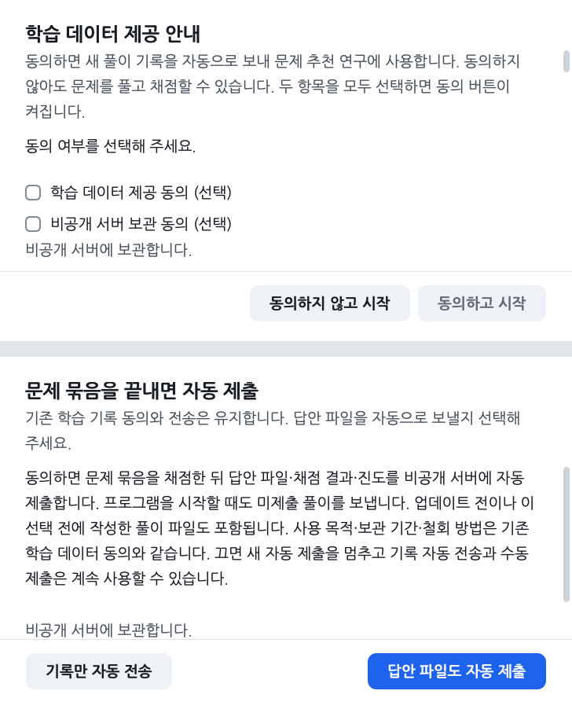

# 학습 데이터 수집 동의와 철회

[프로그램 사용준비](../gui/README.md) · [비공개 풀이 제출](API_SUBMISSIONS.md)

기기마다 처음 한 번 GitHub 계정을 확인하고, 이후에는 프로그램의 기기 키로 자동 확인합니다. [기기 인증](DEVICE_IDENTITY.md)에 쓰는 계정 확인값은 연구 참가자의 가명 ID나 풀이 데이터와 연결하지 않습니다.

연구에 풀이 기록을 제공할지는 [학습 데이터 제공 안내]에서 별도로 선택합니다. [학습 데이터 제공 동의 (선택)]와 [비공개 서버 보관 동의 (선택)]는 각각 선택 항목입니다. 서버 항목 아래에는 ‘비공개 서버에 보관합니다.’를 표시합니다. 풀이 ID는 자동으로 만듭니다. 동의하지 않아도 학습과 로컬 채점을 사용할 수 있습니다.

두 항목을 모두 선택하면 [동의하고 시작]을 누를 수 있습니다. 일부 항목만 선택한 상태에서는 수집을 시작하지 않습니다. 수집 없이 사용하려면 [동의하지 않고 시작]을 누릅니다.

연구에 동의한 분에게는 답안 파일 자동 제출 여부를 한 번 따로 묻습니다. [답안 파일도 자동 제출]을 선택하면 업데이트 전이나 선택 전에 이 컴퓨터에 작성한 제출 대상 파일도 보냅니다. [기록만 자동 전송]을 선택하면 새 연구 기록은 계속 전송하고 파일은 [풀이 제출]을 눌렀을 때 보냅니다. [내 정보·데이터]의 [보낼 풀이 파일 보기]에서 대상 파일을 확인할 수 있습니다.

## 수집 항목과 보관 기간

| 항목 | 내용 |
|---|---|
| 운영자·문의 | 조민수 · whalstn9@gmail.com |
| 목적 | 파이썬·AI 개론·응용 문제 추천 모델 개발과 선택한 희망 직무별 풀이 경향 연구 |
| 기기의 추가 기록 | 동의 뒤의 입력 변경·답안·문항·채점과 학습 과정. 기존 풀이·진도 파일과 별도로 저장합니다. |
| 비공개 전송 | 가명 구분값, 문항·개념·문항 버전, 정오답, 순서·시각·응답 시간, 확신 여부, 선택한 희망 직무·로드맵 버전, 동의서 버전·선택 시각 |
| 연구 기록 전송에서 제외하는 항목 | 입력 답안 본문, 이름·이메일·GitHub 로그인 정보 |
| 제출한 파일 | 직접 제출하거나 파일 자동 제출로 보낸 답안 파일·채점 결과·진도를 같은 목적과 기간으로 비공개 보관합니다. |
| 보관 기간 | 수집일부터 동의 철회 전까지 |
| 서버 보관 | PythonAnywhere LLP의 비공개 서버. 동의 뒤 HTTPS로 자동 전송하며 위 목적과 기간을 적용합니다. 호스팅 문의: support@pythonanywhere.com |

수집·이용과 비공개 서버 보관은 선택 항목입니다. 동의한 경우에만 새 기록을 약 1분 간격으로 전송합니다. 인터넷 연결이 끊기면 이 기기에 남겼다가 재연결 뒤 보냅니다. 연구 기록에는 동의 전 풀이를 추가하거나 기록에 없던 시각을 추정해 넣지 않습니다. 희망 직무도 고르지 않아도 됩니다.

## 내 정보·데이터에서 동의 변경하기

첫 화면의 [내 정보·데이터]에서 동의 내용·선택 시각·전송 상태를 확인합니다. 처음에 동의하지 않았더라도 두 선택 항목에 표시하고 [동의하고 수집 시작]을 누르면 그때부터 수집합니다. 과목별 [학습 데이터]에는 추가 기록 내보내기와 수집 중단 같은 세부 기능이 있습니다.

첫 실행이나 동의서가 바뀌어 선택을 다시 묻는 화면에서는 [동의하지 않고 시작]을 누르거나 창을 닫으면 수집과 전송을 멈춥니다. [내 정보·데이터]의 [닫기]는 현재 동의 상태로 학습 화면에 돌아갑니다. 과목별 [학습 데이터]에서 수집을 중단하면 해당 과목의 전송도 멈춥니다. 과목 수집을 다시 켜면 중단 전에 수집했지만 아직 보내지 않은 기록이 전송될 수 있습니다. 반면 [내 정보·데이터]에서 연구에 새로 동의하면 그 시점 이후의 기록부터 보냅니다. 추가 기록을 삭제하려면 아래의 철회 버튼을 사용합니다.

파일 자동 제출만 끄려면 [답안 파일 자동 제출: 사용 중 · 설정]을 열고 [기록만 자동 전송]을 누르세요. 이미 제출한 파일은 서버에 남습니다. 과목별 수집을 하나라도 중단하면 파일 자동 제출도 멈춥니다.

[동의 철회·비공개 기록 삭제]를 누른 뒤 [철회하고 삭제]로 확인하면 모든 수집 과목을 멈추고 기기의 추가 기록, 서버에 전송한 연구 기록과 수동·자동으로 제출한 비공개 파일을 삭제합니다. 서버 삭제와 로컬 삭제를 확인하기 전에는 처리 대기로 남깁니다. 인터넷이나 파일 잠금 때문에 실패하면 다시 시도하며 완료한 것으로 표시하지 않습니다. 처리가 끝나면 다시 동의할 수 있습니다.

철회는 연구 기록 제공에 적용하며 프로그램의 기기 인증에는 영향을 주지 않습니다. 기존 학습의 답안·진도와 이미 공개한 GitHub 이력은 유지합니다. 이전에 내보내거나 팀에 전달한 연구 사본·백업은 운영자가 철회 기록과 대조해 삭제합니다. 연구 기록 전송 권한의 폐기 상태와 처리 시각은 재전송 차단에만 쓰며 모델 학습 자료로 사용하지 않습니다. 전달 사본 삭제나 이용 관련 문의는 위 이메일로 보냅니다.

## 동의·철회 시 남는 기록

동의서 버전·내용 해시·선택 여부·선택 시각과 철회 처리 상태를 공개 저장소 밖에 보관합니다. 새 동의서가 필요한 경우 이전 학습 기록을 보존하고 다시 선택받습니다. 파일 자동 제출은 별도 안내의 버전·내용 해시·선택 여부·선택 시각을 기록합니다. 이 선택을 바꿔도 기존 연구 동의의 원문과 해시, 동의 시각과 과목별 기록 전송 시작점은 유지합니다. 서버 명칭을 다듬은 안내는 v3로 구분하며 이전 v2 동의도 계속 사용합니다.

파이썬 회차와 AI 혼합 모의고사는 답을 입력했을 때의 수집 상태를 확인합니다. 수집을 시작하기 전이나 중단하기 전에 작성한 답을 그대로 채점하면 로컬 점수에는 반영하지만 새 수집 기간의 답으로 보내지 않습니다. 새 기간에 답을 바꾸면 변경한 답부터 수집 대상이 됩니다.

수집·이용 안내 항목은 [동의 고지 항목][consent]을 참고했습니다. 호스팅 정보는 [PythonAnywhere 서비스 안내][hosting]에서 확인할 수 있습니다.

[consent]: https://law.go.kr/LSW/lsLinkCommonInfo.do?chrClsCd=010202&lsJoLnkSeq=1020398563
[hosting]: https://help.pythonanywhere.com/pages/KindsOfDatabases
