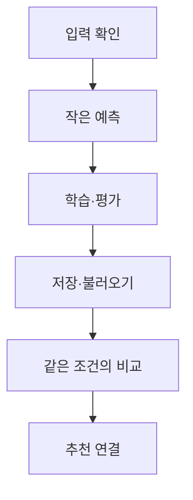

# 모델 개발 단계와 팀원별 다음 미션

각자 fork의 `experiments/본인GitHubID/`에서 모델을 만들고 작은 PR로 공유합니다. 아래는 앞으로 진행할 순서이며 팀원이 이미 완료했다는 표시가 아닙니다. 실제 진행 상태와 다음 할 일은 [스터디 보드](https://github.com/users/WaterMinCho/projects/2/views/1)의 담당 이슈에서 확인합니다.

이번 PR의 범위는 [담당별 코드와 확인 결과](LEARNING_MISSIONS.md#이번-pr에-만들고-확인할-것)로 좁힙니다. 코드·작은 테스트·실행 결과와 설명을 함께 올립니다. 전체 모델이 완성될 때까지 PR을 미루거나 입력 확인 문서만 따로 먼저 통과할 필요는 없습니다. 열린 PR에는 추가 커밋을 올리고, 이전 PR이 머지됐다면 [다음 작업용 브랜치와 PR](LEARNING_WORKFLOW.md#기존-작업에서-어디부터-이어가나요)을 만듭니다.

## 개발 단계별 코드와 실행 결과

| 단계 | 남길 산출물 | 다음 단계 전에 확인할 내용 |
|---|---|---|
| 입력 확인 | 실행한 명령, 출력에서 읽은 항목, 개발 PR의 코드·테스트와 설명 | 이전 풀이와 이번 정답표, 오답과 빈 자리를 구분해 설명합니다. |
| 작은 예측 | 본인 모델 코드와 입력 한 묶음의 예측 | 현재 문제마다 예측값이 하나씩 나오고 빈 이력에서도 계산이 이어집니다. |
| 학습·평가 | 학습 코드, 손실 변화와 검증 결과 | 이번 정답을 입력에 섞지 않고 학습할 때만 가중치를 바꿉니다. 코드의 선택 이유도 설명합니다. |
| 저장·불러오기 | 저장·예측 코드, 새 실행에서 확인한 결과 | 같은 CPU·설정·평가 모드에서 저장 전후 예측의 최대 절대 차이가 0.000001 이하인지 확인합니다. 차이가 크면 실제 값을 적습니다. |
| 같은 조건의 비교 | 기준 방법과의 점수, 오류 사례, 재현 명령 | 같은 자료·분할·평가 방법으로 비교하고 달랐던 조건을 밝힙니다. |
| 추천 연결 | 후보 문제용 입력과 모델 호출, 추천 기록 | 실제 정답 없이 예측하고 예측 품질과 추천 뒤 학습 효과를 구분합니다. WaterMinCho가 연결을 맡습니다. |

한 단계에서 여러 PR을 올려도 됩니다. 코드 파일이 생겼거나 README에 완료라고 적었다는 이유만으로 다음 단계로 넘어가지는 않습니다. 작성자의 실행 기록과 검토자가 직접 재현한 결과를 구분합니다. 필요한 동작과 본인의 설명을 확인한 뒤 담당 이슈의 완료 항목을 갱신합니다.

## 모델별 다음 작업

| 담당 | 입력 실습 뒤 할 일 | 그다음에 만들고 확인할 것 |
|---|---|---|
| michae18 · LSTM | 합성 입력 4개를 작은 LSTM에 넣어 확률 4개를 내고 빈 이력도 확인합니다. | 기존 `Readme.md`에 실제 출력 보완 → 학습·검증 → 저장·불러오기 → 기본 코드의 커밋과 설정 공유 |
| wamangdoo · Transformer | 같은 입력 4개를 작은 Transformer에 넣고 빈 자리가 예측에 섞이지 않는지 확인합니다. | 순서 정보·이번 정답 제외 확인 → 학습·검증 → 저장·불러오기 → LSTM·기준 방법과 비교 |
| kimjs85529-a11y · LSTM + 간격 | 이번 문제의 개념에 해당하는 간격과 확인 여부를 고르는 코드를 만듭니다. | 시간 미확인 값 처리 → 기본 LSTM 커밋 고정 → 시간 입력 추가 → 같은 LSTM에서 시간 유무만 바꿔 비교 |
| WaterMinCho | 공통 자료 버전·입력·비교 조건을 관리합니다. | PR 검토와 다음 미션 조정 → 운영자 맥에서 같은 조건으로 학습·비교 → 후보 입력·추천 정책·앱 연결 |

간격 담당자는 기본 LSTM이 준비되기 전에도 시간 입력과 변환을 실습할 수 있습니다. 실제 시간 효과 비교는 기본 코드와 설정을 고정한 뒤 진행합니다. 파이썬과 반환 시각을 연결한 AI 자료를 사용하고 시각을 확인하지 못한 행은 따로 구분합니다.

세 모델 모두 파이썬과 AI 개론·응용을 대상으로 합니다. 자료가 부족한 구간은 미확인으로 남깁니다. 복잡한 모델이나 시간 추가 모델이 반드시 더 높은 점수를 내야 완료되는 과제는 아닙니다. 같은 조건에서 어떤 결과가 나왔고 왜 그 코드를 골랐는지 설명하는 것이 필요합니다.

## PR 검토 후 다음 미션을 정하는 기준

세 담당자의 개발 PR은 이 맥의 로컬 검토기가 확인합니다. 수정 요청·댓글·조건에 맞는 승인을 남기며, 필요한 검사와 검토가 끝나면 Slack에 종합 결과를 알립니다. 자동 머지는 하지 않으며 WaterMinCho가 최종 확인합니다. 맥의 실행·로그인과 구독이 유효해야 동작합니다. [검토 조건](LEARNING_REVIEW.md)을 함께 확인하세요. 아직 push하지 않은 컴퓨터 안의 코드나 접근 권한이 없는 저장소는 확인 범위에 넣지 않습니다. 확인한 코드·실행 근거로 피드백을 정리하며, 변경이 없는 코드와 이미 해결한 지적을 반복해서 검토하지 않습니다.

산출물을 확인하면 담당 이슈에 아래 내용을 남깁니다.

- 확인한 PR·브랜치·전체 커밋 SHA와 실행 기록을 적습니다.
- 현재 어느 단계까지 동작을 확인했는지, 아직 확인하지 못한 것은 무엇인지 나눕니다.
- 다음 미션은 우선 한 가지로 좁히고 바꿀 파일·확인할 출력·설명할 질문을 적습니다.
- 원래 계획을 바꾼 경우에는 산출물의 어떤 결과 때문에 바꿨는지 남깁니다.

예를 들어 LSTM이 예측값을 내더라도 빈 이력에서 오류가 나면 다음 미션은 그 입력을 처리하는 것입니다. 정상 이력과 빈 이력의 결과를 비교하고 처리한 이유를 설명한 뒤 학습으로 이어갑니다. 간격을 넣어도 점수가 좋아지지 않았다면 시간을 뺀 경우와 비교 조건을 확인하고 오류 사례를 분석합니다. 점수를 높이려고 마지막 평가 자료에 맞춰 설정을 반복해서 고르지 않습니다.

검토는 이번 변경과 관련된 코드와 조건에 한정합니다. 모델 전체를 대신 구현하지 않고 작은 입력과 수정 힌트를 제시합니다. 팀원은 `REVIEW_NOTES.md`에 받은 질문, 바꾼 이유와 다시 확인한 결과를 남깁니다. 자세한 절차는 [모델 코드 검토](LEARNING_REVIEW.md), 처음 시작하는 순서는 [fork에서 첫 PR까지](LEARNING_WORKFLOW.md)를 따릅니다.
