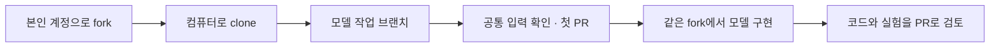

# 각자 fork에서 모델을 만들고 PR을 보냅니다

공통 프로젝트를 본인 GitHub 계정으로 fork하고, 그 안의 `experiments/본인ID/`에서 모델을 만듭니다. 코드·설정·실험 기록을 같은 fork에 쌓고 공통 프로젝트로 PR을 보냅니다. 별도의 모델 저장소를 새로 만들 필요는 없습니다.

Git 작업은 SourceTree 또는 터미널 중 편한 방법으로 진행합니다. 파일은 컴퓨터의 편집기에서 고칩니다. SourceTree에서는 변경 확인·브랜치·커밋·푸시를 하고, fork와 PR은 GitHub 웹에서 만듭니다.



## 어디에 무엇을 남기나요

| 공간 | 남기는 내용 |
|---|---|
| `본인ID/programming-study` | 공통 프로젝트를 fork한 본인의 작업 저장소입니다. |
| 그 안의 `experiments/본인ID/` | 직접 만든 모델, 실행 방법, 실험 결과와 피드백 반영 기록을 모읍니다. |
| `WaterMinCho/programming-study`의 PR | 본인이 바꾼 코드와 설명을 검토하고 공통 프로젝트에 합칩니다. |
| [스터디 보드](https://github.com/users/WaterMinCho/projects/2/views/1)와 담당 이슈 | 진행 상태, 질문과 관련 PR 주소를 남깁니다. |

이 문서의 `본인ID`는 실제 GitHub ID로 바꿉니다. `origin`은 clone한 본인 fork의 주소 이름입니다. 프로그램으로 문제를 풀던 기존 폴더는 별도로 두고 모델 작업용 폴더를 준비합니다.

## 1. 본인 카드부터 엽니다

[스터디 보드](https://github.com/users/WaterMinCho/projects/2/views/1)의 **내 작업**에서 본인 카드를 엽니다. 보드를 열 수 없거나 카드가 없으면 WaterMinCho에게 GitHub ID를 알려주세요.

| 담당 | 모델과 작업 폴더 |
|---|---|
| WaterMinCho | 프로그램·수집 서버·공통 자료·검토와 앱 연결 |
| [michae18 · 기본 LSTM](https://github.com/WaterMinCho/programming-study/issues/119) | `experiments/michae18/` |
| [wamangdoo · Transformer](https://github.com/WaterMinCho/programming-study/issues/120) | `experiments/wamangdoo/` |
| [kimjs85529-a11y · LSTM + 풀이 간격](https://github.com/WaterMinCho/programming-study/issues/121) | `experiments/kimjs85529-a11y/` |

작업을 시작하면 카드를 **진행**, 검토받을 PR을 올리면 **검토**로 옮깁니다. 첫 입력 확인 PR이 합쳐져도 모델 구현이 남아 있으면 **진행**으로 돌아갑니다.

<a id="2-개인-모델-저장소를-만듭니다"></a>

## 2. 공통 프로젝트를 fork하고 컴퓨터로 받습니다

1. GitHub에서 [공통 저장소](https://github.com/WaterMinCho/programming-study)를 열고 **Fork → Create fork**로 본인 계정에 복사합니다. 이미 fork가 있다면 그 저장소를 사용합니다.
2. 화면 왼쪽 위가 `본인ID/programming-study`인지 확인합니다. 기존 fork는 `main`에서 **Sync fork**를 열고 받을 변경이 있으면 **Update branch**로 반영합니다. 충돌 안내가 나오면 담당 이슈에 남깁니다.
3. **Code → HTTPS**에서 본인 fork 주소를 복사합니다.
4. 컴퓨터에 `model-study` 같은 빈 폴더를 만듭니다. SourceTree의 **Clone(복제)**에서 복사한 주소를 넣고 `model-study/programming-study`로 받습니다. 이미 모델 작업용으로 받은 폴더가 있으면 그 폴더를 엽니다.
5. SourceTree의 저장소 설정에서 `origin`이 `본인ID/programming-study` 주소인지 확인합니다.

터미널을 쓴다면 빈 `model-study` 폴더에서 실행합니다. SourceTree로 이미 받았다면 clone을 반복하지 않고 받은 `programming-study` 폴더에서 터미널을 엽니다.

```sh
git clone https://github.com/본인ID/programming-study.git
cd programming-study
git remote -v
```

GitHub 저장소를 컴퓨터로 받는 작업이 clone입니다. 같은 이름의 기존 폴더가 있으면 지우지 않고 다른 빈 위치를 사용합니다. SourceTree의 메뉴 위치와 번역은 Windows·Mac 및 버전에 따라 다를 수 있습니다.

첫 커밋 전에는 SourceTree의 설정·옵션에서 작성자 이름과 이메일, 계정 설정에서 본인 GitHub 연결을 확인합니다. 이메일은 GitHub에 등록한 주소나 **GitHub Settings → Emails**의 본인 `noreply` 주소를 사용합니다. 터미널에서는 `git config user.name`과 `git config user.email`로 확인합니다. 설정이 없거나 본인 정보가 아니면 현재 저장소에서 실제 값을 넣습니다.

```sh
git config user.name "본인 이름"
git config user.email "본인 커밋 이메일"
```

HTTPS 인증이 준비되지 않았다면 [GitHub의 Git 인증 안내][git-setup]를 따라 연결합니다.

## 3. 모델 작업 브랜치를 만듭니다

SourceTree에서 본인 fork를 열고 커밋하지 않은 변경이 없는지 확인합니다. 왼쪽 **Branches(브랜치)**의 `main`을 더블클릭하고 **Pull(풀)**에서 `origin/main`을 받습니다. 기존 변경이나 충돌이 있으면 먼저 확인합니다. 위쪽 **Branch(브랜치)**에서 `model/본인ID-first-input`을 만들고 새 브랜치로 전환합니다.

터미널에서는 `programming-study` 폴더에서 실행합니다. 상태에 기존 변경이 보이면 브랜치를 바꾸기 전에 확인합니다. Pull이 오류로 멈추면 그 내용을 담당 이슈에 남깁니다.

```sh
git status --short --branch
git switch main
git pull --ff-only origin main
git switch -c model/본인ID-first-input
```

브랜치는 수정 작업을 따로 관리하는 공간입니다. 이미 만든 작업 브랜치를 이어갈 때는 SourceTree에서 해당 브랜치를 더블클릭하거나 `git switch model/본인ID-first-input`으로 전환합니다. `git switch -c`로 다시 만들지 않습니다. 프로그램이 풀이를 제출하는 `study/본인ID` 브랜치는 모델 개발에 사용하지 않습니다.

<a id="3-공통-연습-자료를-읽습니다"></a>

## 4. 공통 입력을 읽습니다

컴퓨터에 Git과 Python을 준비한 뒤 진행합니다. 처음 설치한다면 [프로그램 준비](../gui/README.md#최초-한번-준비해야할-것)를 확인합니다. 이번 입력 실습은 PyTorch나 GPU 없이 실행합니다.

현재 `programming-study` 안에 `study.py`와 `learning_server`가 보이는지 확인합니다. SourceTree를 쓰는 사람도 이 폴더에서 터미널을 열고 다음 Python 명령을 실행합니다.

```sh
python -m learning_server.starter --synthetic --out ../learning-demo-v3
python -m learning_server.input_example --dataset ../learning-demo-v3 --track python --batch-size 4 --length 4
```

첫 명령은 가상 풀이 자료를 만들고 두 번째 명령은 입력 예시 4개를 읽습니다. 각 예시의 과거 풀이를 최대 4개까지 확인하며 모델을 학습하지는 않습니다. `inputs`와 이번 정답표인 `targets`, 과거 풀이의 실제 자리인 `mask`, 실제 길이인 `lengths`를 [공통 입력 설명](LEARNING_STARTER.md#세-모델이-같은-입력을-사용합니다)과 대조합니다. 오답 0과 빈 자리를 구분해보세요. `--track python`을 `--track ai`로 바꾸면 AI 개론·응용 예제를 읽습니다.

`python`을 찾지 못하면 Windows는 `py`, Mac은 `python3`로 바꿉니다. `No module named learning_server`가 나오면 현재 폴더부터 확인합니다. `learning-demo-v3`가 이미 있으면 두 번째 명령으로 읽습니다. 새 자료를 만들 때는 `--out`과 `--dataset`에 같은 새 폴더 이름을 쓰며 기존 자료는 덮어쓰지 않습니다.

<a id="4-본인이-이해한-내용을-저장합니다"></a>
<a id="5-공통-프로젝트로-보낼-첫-변경을-만듭니다"></a>

## 5. 본인 폴더에 첫 실습 기록을 적습니다

편집기에서 `programming-study/experiments/본인ID/README.md`를 만듭니다. 없는 폴더는 함께 만듭니다. 일반 텍스트로 저장하고 파일 이름이 `README.md.txt`가 되지 않았는지 확인합니다. 공통 프로젝트 맨 위의 README 대신 본인 폴더의 README를 수정합니다.

첫 PR에서는 입력을 읽고 이해한 내용을 공유합니다. 모델 전체가 완성될 때까지 기다릴 필요는 없습니다. 아래 틀에 실제 실행한 명령과 관측한 결과를 적습니다. 오류가 나면 성공으로 적지 않고 오류와 질문을 남깁니다.

```markdown
# 본인ID 모델 실습

담당 모델과 이슈 주소를 적습니다.

## 실행한 명령과 결과

## 입력과 이번 정답을 구분한 방법

## 빈 이력과 빈 자리를 확인한 내용

## 막힌 부분과 질문
```

예를 들어 michae18은 본인 fork의 `experiments/michae18/README.md`에 기본 LSTM을 맡았다고 적고, 출력에서 과거 오답과 이번 정답표를 어떻게 구분했는지 설명합니다. 모델 학습을 아직 하지 않았다면 그 단계는 미실행으로 적습니다. 상세 기록에는 [실험 기록 양식](LEARNING_EXPERIMENT_TEMPLATE.md)을 사용해도 됩니다.

## 6. 커밋·푸시하고 첫 PR을 엽니다

SourceTree에서 다음 순서로 진행합니다.

1. 현재 저장소가 본인 fork이고 브랜치가 `model/본인ID-first-input`인지 확인합니다.
2. **File Status(파일 상태)**에서 `experiments/본인ID/README.md`의 변경 내용을 읽습니다.
3. 그 파일만 **Stage(스테이지에 올리기)** 합니다. 이번 커밋에 담을 파일을 고르는 과정입니다.
4. **Commit(커밋)**에 `docs: 본인ID 입력 확인 기록`을 적고 기록합니다.
5. **Push(푸시)**에서 `origin`을 고르고 이번 브랜치를 원격의 같은 이름으로 보냅니다.

커밋은 컴퓨터에 변경 기록을 남기고 푸시는 그 기록을 GitHub에 보냅니다. 터미널에서는 같은 fork 폴더에서 실행합니다.

```sh
git add experiments/본인ID/README.md
git --no-pager diff --cached
git commit -m "docs: 본인ID 입력 확인 기록"
git push -u origin model/본인ID-first-input
```

푸시 후 GitHub의 본인 fork에서 **Compare & pull request**를 누릅니다. 보이지 않으면 [공통 프로젝트의 Pull requests](https://github.com/WaterMinCho/programming-study/pulls)에서 **New pull request → compare across forks**를 누릅니다.

| GitHub 항목 | 고를 값 |
|---|---|
| base repository | `WaterMinCho/programming-study` |
| base | `main` |
| head repository 또는 head fork | `본인ID/programming-study` |
| compare | `model/본인ID-first-input` |

변경 목록에 본인의 `experiments/본인ID/README.md`만 있는지 확인합니다. 제목과 본문에 담당 이슈, 직접 확인한 내용, 실행 결과와 질문을 적고 **Create pull request**를 누릅니다. PR 주소를 담당 이슈에 붙이고 카드를 **검토**로 옮깁니다. PR은 내가 바꾼 내용을 검토하고 공통 프로젝트에 합쳐 달라는 요청입니다.

## 7. 같은 fork에서 모델을 개발합니다

첫 PR이 합쳐지면 GitHub에서 fork의 `main`을 **Sync fork → Update branch**로 갱신합니다. SourceTree에서 로컬 `main`으로 전환하고 `origin/main`을 Pull한 뒤 `model/본인ID-model` 같은 새 작업 브랜치를 만듭니다. 터미널에서는 3단계의 순서를 따라 새 브랜치 이름을 사용합니다.

모델 코드도 같은 `experiments/본인ID/` 안에 작성합니다. 아래는 앞으로 만들 파일의 예시이며 완성된 모델 코드가 들어 있다는 뜻은 아닙니다.

```text
model-study/
  programming-study/             본인 fork를 clone한 폴더
    learning_server/             기존 공통 입력 도구
    experiments/
      본인ID/
        README.md                실행 방법과 본인의 설명
        train.py                 모델 학습
        evaluate.py              평가
        predict.py               저장한 모델로 예측
        requirements.txt         사용한 라이브러리 버전
        configs/                 설정과 난수 시드
        figures/                 합성 자료의 학습곡선
        REVIEW_NOTES.md          피드백과 수정 이유
  learning-demo-v3/              가상 자료 · 저장소 밖에 보관
```

코드를 바꾸면 본인 폴더의 변경만 골라 Stage → Commit → Push하고 공통 프로젝트로 PR을 보냅니다. 공통 입력 도구나 다른 팀원의 폴더를 바꿔야 한다면 먼저 담당 이슈에서 이유를 공유합니다. 작은 예측, 학습, 저장·불러오기, 평가를 작은 PR로 나눠도 됩니다. 구체적인 목표는 [담당별 미션](LEARNING_MISSIONS.md)을 따릅니다.

공개 재현에는 합성 자료를 사용합니다. 실제 풀이 원본·입력 답안·가명 구분값·인증 값·실제 자료로 학습한 가중치와 개별 예측은 올리지 않습니다. 로컬 자료·가중치·출력 폴더는 본인 모델 폴더의 `.gitignore`로 제외합니다.

<a id="7-받은-질문에-답하고-이어갑니다"></a>

## 받은 질문에 답하고 이어갑니다

WaterMinCho가 PR 변경과 실행 근거를 검토합니다. 같은 fork의 같은 작업 브랜치에서 파일을 고친 뒤 바꾼 파일만 커밋하고 같은 원격 브랜치로 푸시하면 기존 PR에 반영됩니다. 수정할 때마다 새 PR을 만들지 않습니다. 무엇을 고쳤고 어떤 결과를 다시 확인했는지 답합니다. 팀원 PR은 자동 머지하지 않습니다.

본인이 직접 만든 코드·설정·실험·수정 이유는 본인 폴더와 커밋·PR에 남깁니다. 포트폴리오에는 모델 폴더, 대표 PR, 실험 결과와 재현 방법을 연결합니다. fork를 만들거나 README만 추가한 일을 모델 구현 완료로 적지 않습니다. 모델 제출에는 실행 방법과 전체 커밋 SHA를 남깁니다. 상세 검토 기준은 [코드 검토 방법](LEARNING_REVIEW.md)에 있습니다.

<a id="첫-pr-뒤에-개인-모델-폴더를-준비합니다"></a>

## 기존에 별도 모델 저장소를 만들었다면

기존 코드와 커밋을 지우지 않습니다. 본인 fork의 새 브랜치에 필요한 코드와 설명을 옮기고 `REVIEW_NOTES.md`에 원래 저장소·전체 커밋 SHA·가져온 부분을 적습니다. 다른 사람이 만든 부분과 직접 바꾼 부분을 구분합니다. 아직 시작하지 않았다면 fork 안의 본인 폴더에서 시작하면 됩니다.

## 사용 방법을 확인한 자료입니다

2026년 11월 12일 GitHub와 Atlassian 공식 안내에서 fork, clone, 브랜치, 커밋·푸시, PR 대상을 확인했습니다. SourceTree의 공통 동작으로 설명했으며 메뉴 위치와 이름은 운영체제·버전·언어에 따라 다를 수 있습니다.

- [공통 프로젝트 fork하기][fork]
- [fork 갱신하기][sync]
- [fork에서 PR 보내기][pr]
- [SourceTree에서 저장소 받기][st-clone]
- [SourceTree에서 브랜치를 만들고 보내기][st-branch]
- [SourceTree에서 커밋과 푸시하기][st-commit]

[fork]: https://docs.github.com/en/pull-requests/how-tos/work-with-forks/fork-a-repo
[sync]: https://docs.github.com/en/pull-requests/how-tos/work-with-forks/syncing-a-fork
[pr]: https://docs.github.com/en/pull-requests/how-tos/create-pull-requests/creating-a-pull-request-from-a-fork
[st-clone]: https://confluence.atlassian.com/get-started-with-sourcetree/clone-a-remote-repository-847359098.html
[st-branch]: https://confluence.atlassian.com/get-started-with-sourcetree/create-and-push-a-branch-to-the-remote-repository-git-847359118.html
[st-commit]: https://confluence.atlassian.com/get-started-with-sourcetree/commit-and-push-a-change-git-847359114.html
[git-setup]: https://docs.github.com/en/get-started/git-basics/set-up-git
