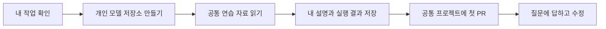

# 개인 저장소를 만들고 첫 PR을 올립니다

이 문서는 모델을 만드는 세 팀원이 처음 참여할 때 따라 하는 순서입니다. 할 일은 [스터디 보드](https://github.com/users/WaterMinCho/projects/2/views/1)에서 확인하고, 코드와 실험 기록은 각자의 GitHub 저장소에 남깁니다. 처음에는 입력을 읽고 이해한 내용을 공유합니다. 모델 학습과 프로그램 연결은 그다음에 진행합니다.



## 어디에 무엇을 남기나요

저장소는 코드와 문서를 모아두는 공간입니다. 아래 두 저장소는 맡은 일이 다릅니다.

| 공간 | 남기는 내용 |
|---|---|
| 내 계정의 `learning-lstm` 같은 개인 모델 저장소 | 직접 만든 모델, 실행 방법, 선택 이유, 실험 결과와 수정 기록 |
| `WaterMinCho/programming-study` 공통 프로젝트 | 프로그램·서버·공통 입력 도구, 각자의 학습 기록과 모델을 연결하는 변경 |
| 스터디 보드의 담당 카드 | 지금 할 일, 진행 상태, 질문, 관련 PR 주소 |

첫 PR을 보낼 때는 공통 프로젝트를 내 계정에 복사합니다. GitHub에서 만든 이 복사본을 fork라고 합니다. 개인 모델 저장소와 fork는 별도 저장소입니다. 개인 모델 저장소에서 공통 프로젝트로 바로 PR을 보내지는 않습니다.

## 1. 본인 카드부터 엽니다

1. 본인 GitHub 계정으로 로그인하고 [스터디 보드](https://github.com/users/WaterMinCho/projects/2/views/1)를 엽니다.
2. 위쪽의 **내 작업**을 누릅니다. 본인에게 배정된 카드가 나옵니다.
3. 카드를 눌러 이번에 만들 것과 확인할 동작을 읽습니다. 이런 할 일과 질문을 적는 글을 이슈라고 합니다.
4. 보드를 열 수 없거나 카드가 없으면 WaterMinCho에게 사용 중인 GitHub ID를 알려주세요. 보드는 팀원에게 편집 권한을 주어 사용합니다.

| 담당 | 먼저 열 카드 |
|---|---|
| WaterMinCho | [공통 입력과 전달 자료](https://github.com/WaterMinCho/programming-study/issues/118), [제출물 확인과 앱 연결](https://github.com/WaterMinCho/programming-study/issues/122) |
| michae18 | [기본 LSTM](https://github.com/WaterMinCho/programming-study/issues/119) |
| wamangdoo | [Transformer](https://github.com/WaterMinCho/programming-study/issues/120) |
| kimjs85529-a11y | [같은 LSTM에 풀이 간격 추가](https://github.com/WaterMinCho/programming-study/issues/121) |

WaterMinCho가 공통 자료를 확인하면 카드를 `시작 가능`으로 바꿉니다. 팀원은 직접 작업을 시작하면 `진행`, 검토가 필요하면 `검토`로 옮깁니다. 카드 안의 완료 조건을 모두 확인한 뒤 `완료`로 바꿉니다. 처음에는 작업 보드와 내 작업만 사용해도 됩니다.

## 2. 개인 모델 저장소를 만듭니다

아래는 웹 브라우저의 GitHub 화면에서 진행합니다.

1. 오른쪽 위 **+ → New repository**를 누릅니다.
2. **Owner**가 본인 계정인지 확인합니다.
3. **Repository name**에 맡은 모델을 알아볼 수 있는 이름을 적습니다. `learning-lstm`, `learning-transformer`, `learning-gap-lstm`은 이름의 예시입니다.
4. 공개할 코드와 설명을 모을 저장소는 **Public**으로 고릅니다. 비공개로 시작하면 검토자가 읽을 수 있도록 따로 초대합니다.
5. **Add README**를 켜고 **Create repository**를 누릅니다.
6. 만들어진 저장소에서 `README.md`를 누르고 연필 모양의 편집 버튼을 누릅니다. 맡은 모델, 이번에 해볼 일, 아직 모르는 부분을 본인의 말로 적습니다. [실험 기록 양식](LEARNING_EXPERIMENT_TEMPLATE.md)을 복사해 채워도 됩니다.
7. **Commit changes…**를 눌러 바꾼 내용을 설명하는 짧은 문장을 적고 저장합니다. 커밋은 그때의 파일과 변경 설명을 함께 남기는 기록입니다. 개인 저장소의 첫 소개는 본인 `main`에 저장해도 됩니다.

실제 풀이 원본·개인을 구분하는 값·개별 예측·실제 자료로 학습한 가중치는 공개 저장소에 올리지 않습니다. 첫 공개 예시는 아래에서 만드는 가상 자료를 사용합니다. 참고한 코드가 있다면 원본 주소·사용한 판·가져온 부분과 직접 바꾼 부분을 적고 원본의 LICENSE와 저작권 표시를 보존합니다.

## 3. 공통 연습 자료를 읽습니다

Git과 Python이 필요합니다. 처음 설치하는 사람은 [프로그램 준비](../gui/README.md#최초-한번-준비해야할-것)의 준비물부터 확인합니다. 이 실습은 화면 프로그램이나 PyTorch를 설치하지 않고 실행합니다.

문제를 풀던 `programming-study` 폴더에 `study.py`와 `learning_server` 폴더가 보이면 그 폴더에서 터미널을 엽니다. `learning_server`가 없거나 처음 받는 사람은 기존 프로그램을 둔 곳과 다른 위치에 `model-study` 같은 빈 폴더를 만듭니다. 그 빈 폴더의 터미널에서 다음 두 줄을 입력합니다. 같은 위치에 `programming-study`가 이미 있으면 `already exists` 오류가 납니다. 이때 기존 폴더를 지우지 않고 다른 빈 위치를 사용합니다.

```sh
git clone https://github.com/WaterMinCho/programming-study.git
cd programming-study
```

그다음 같은 터미널에서 가상 풀이 자료를 만들고 입력을 확인합니다.

```sh
python -m learning_server.starter --synthetic --out ../learning-demo-v3
python -m learning_server.input_example --dataset ../learning-demo-v3 --track python --batch-size 4 --length 4
```

이 예시는 문항 4개를 한 묶음으로 읽고, 각 문항의 이전 풀이를 최대 4개까지 보여 줍니다. `--batch-size 4`는 한 묶음의 문항 수, `--length 4`는 확인할 과거 풀이 수를 정합니다.

`python`을 찾지 못하면 Windows에서는 `py`, macOS에서는 `python3`로 바꿔 입력합니다. `No module named learning_server`가 나오면 현재 폴더에 `study.py`와 `learning_server`가 있는지 먼저 확인합니다.

`learning-demo-v3` 폴더가 이미 있으면 다시 만들지 않고 두 번째 명령으로 읽습니다. 자료를 새로 만들 때는 `--out`과 `--dataset`에 같은 새 폴더 이름을 사용합니다. 기존 자료를 지우거나 덮어쓰지 않습니다.

이 명령은 자료 모양을 확인하며 모델을 학습하지 않습니다. 출력에서 **이전 문제와 정오답**, **비어 있는 자리**, **이번 문제의 정답표**를 찾아본 뒤 [공통 입력 설명](LEARNING_STARTER.md#세-모델이-같은-입력을-사용합니다)과 대조합니다. 같은 명령의 `--track python`을 `--track ai`로 바꾸면 AI 개론·응용의 예제도 읽습니다.

## 4. 본인이 이해한 내용을 저장합니다

개인 모델 저장소의 README는 2단계처럼 GitHub 웹 화면에서 연필 버튼을 눌러 고칩니다. 실제 실행한 명령, 출력에서 이해한 내용, 헷갈린 부분을 적고 **Commit changes…**로 저장합니다. 실행하지 않은 내용은 실행했다고 적지 않습니다. 실행 결과의 숫자를 붙였다면 무엇을 센 값인지 설명합니다.

입력 항목을 이해했으면 5단계에서 첫 PR을 올립니다. 작은 예측은 첫 PR 뒤에 [담당별 미션](LEARNING_MISSIONS.md#공통-실습부터-시작합니다)에서 시작합니다.

## 5. 공통 프로젝트로 보낼 첫 변경을 만듭니다

첫 PR에서는 **입력을 읽고 본인이 이해한 내용을 공유**합니다. 모델 구현과 앱 연결을 마쳤다는 제출이 아닙니다. 아래 작업은 GitHub 웹 화면에서 하므로 fork를 컴퓨터에 다시 받을 필요는 없습니다. 프로그램으로 문제를 풀던 폴더도 바꾸지 않습니다.

1. [공통 저장소](https://github.com/WaterMinCho/programming-study)를 열고 오른쪽 위 **Fork**를 누릅니다. **Owner**를 본인 계정으로 고르고 **Create fork**를 누릅니다. 이미 본인 fork가 있다면 그 저장소를 사용합니다.
2. 화면 왼쪽 위가 `본인ID/programming-study`인지 확인합니다. `WaterMinCho/programming-study` 원본에서 직접 작업하지 않습니다.
3. 파일 목록 위의 `main` 선택란을 열어 `model/본인ID-first-input`처럼 새 브랜치 이름을 입력하고 **Create branch**를 누릅니다. 브랜치는 수정 중인 파일을 따로 관리하는 작업 공간입니다. `본인ID`는 실제 GitHub ID로 바꿉니다.
4. 선택란이 방금 만든 브랜치인지 확인하고 **Add file → Create new file**을 누릅니다.
5. 파일 이름을 `experiments/본인ID/README.md`로 적습니다. 본인 ID 폴더만 사용합니다. `/`를 입력하면 앞부분이 폴더 이름으로 바뀌어 보입니다. 아직 없는 폴더는 파일을 저장할 때 함께 만들어집니다.
6. 아래 틀을 본문에 복사합니다. 첫 줄의 `본인ID`를 실제 ID로 바꾸고, 그 아래 두 안내 문장을 담당 모델·이슈 주소와 개인 저장소 주소·고정 주소로 바꿉니다. `##`로 시작하는 제목 줄은 지우지 않고 바로 아래에 내용을 적습니다. 자세히 적는 방법은 이어지는 표를 확인합니다. 명령이 오류로 끝났다면 입력한 명령과 오류의 마지막 줄을 적고 질문에 남깁니다. 오류에 비밀 값이나 개인 경로가 있다면 지우고 필요한 문구만 공유합니다.
7. **Commit changes…**를 누릅니다. 제목은 `docs: 본인ID 입력 확인 기록`처럼 적고, 방금 만든 브랜치에 저장하는지 확인한 뒤 커밋합니다.

```markdown
# 본인ID 입력 확인 기록

담당 모델과 이슈 주소를 적습니다.

개인 모델 저장소 주소와 README의 고정 주소를 붙입니다.

## 실제로 실행한 명령을 적습니다

## 출력에서 이해한 내용이나 오류를 적습니다

## 입력과 이번 정답을 어떻게 나눴는지 설명합니다

## 막힌 부분과 질문을 적습니다
```

| 첫 변경에 적을 내용 | 적는 방법 |
|---|---|
| 담당 모델과 미션 | LSTM·Transformer·간격 모델 중 맡은 역할과 본인 이슈 주소를 적습니다. |
| 개인 저장소 | 본인이 만든 모델 저장소 주소를 붙입니다. |
| README의 고정 주소 | 개인 저장소의 파일 목록에서 `README.md`를 눌러 파일 하나만 보이는 화면을 엽니다. 편집을 마친 뒤 입력 칸 밖을 누르고 키보드 `y`를 누릅니다. 주소창의 `/blob/main/README.md`에서 `main`이 긴 영문·숫자 문자열로 바뀌면 주소를 복사합니다. 이 고정 주소는 나중에 README를 고쳐도 지금 내용을 보여 줍니다. |
| 실제 실행 | 공통 입력을 읽은 명령과 관측한 결과를 적습니다. |
| 본인의 설명과 질문 | 입력과 이번 정답을 어떻게 구분했는지 설명하고, 막힌 부분을 적습니다. |

`study/본인ID`는 프로그램이 풀이를 제출할 때 쓰는 브랜치입니다. 모델 개발에는 위에서 만든 별도 브랜치를 사용하고 다른 사람의 `experiments` 폴더와 `submissions` 기록은 수정하지 않습니다.

## 6. 첫 PR을 엽니다

PR은 내가 바꾼 내용을 검토한 뒤 공통 프로젝트에 합쳐 달라는 요청입니다.

1. 변경을 저장한 뒤 나오는 **Compare & pull request**를 누릅니다. 보이지 않으면 [공통 저장소의 Pull requests](https://github.com/WaterMinCho/programming-study/pulls)에서 **New pull request → compare across forks**를 누릅니다.
2. 아래 표처럼 **받을 곳과 보낼 곳**을 맞춥니다. 비교할 변경이 없다고 나오면 선택한 저장소와 브랜치부터 다시 확인합니다.
3. 아래 변경 목록에서 `experiments/본인ID/README.md`만 바뀌었는지 확인합니다.
4. 제목에 이번에 확인한 일을 적습니다. 본문에는 담당 이슈 주소, 5단계 표에서 복사한 고정 주소, 실행 명령과 결과, 검토받고 싶은 질문을 한두 문단으로 적습니다.
5. **Create pull request**를 누르고 만들어진 PR 주소를 본인 담당 이슈의 댓글에 붙입니다. 카드 상태를 **검토**로 바꿉니다.

| GitHub 화면의 항목 | 고를 값 |
|---|---|
| base repository | `WaterMinCho/programming-study` |
| base | `main` |
| head repository 또는 head fork | `본인ID/programming-study` |
| compare | 방금 변경을 저장한 `model/본인ID-first-input` 브랜치 |

개인 모델 저장소인 `learning-lstm`을 head로 고르지 않습니다. 공통 프로젝트를 복사한 `programming-study`에서 수정안을 보내는 과정입니다.

## 7. 받은 질문에 답하고 이어갑니다

WaterMinCho가 실행 근거와 설명을 검토하고 피드백을 남깁니다. 수정이 필요하면 본인 fork를 열고 파일 목록 위의 브랜치 선택란을 `model/본인ID-first-input`으로 바꿉니다. `experiments/본인ID/README.md`를 열어 연필 버튼으로 고친 뒤 **Commit changes…** 창에서 같은 브랜치에 저장하는지 확인합니다. 열린 PR의 변경 목록에 수정이 이어서 반영되므로 새 PR을 만들지 않습니다. 무엇을 고쳤고 어떤 결과를 다시 확인했는지 댓글로 답합니다.

공통 프로젝트의 머지는 WaterMinCho가 판단합니다. 개인 저장소의 머지는 소유자가 결정합니다. 첫 PR이 합쳐지면 담당 이슈에서 입력 확인 항목을 체크하고 다음 구현으로 이어갑니다. 모델 학습·저장·평가 같은 할 일이 남았다면 카드 전체를 완료하지 않고 **진행**으로 돌립니다.

모델을 만들면서 예측 하나, 작은 학습, 저장과 불러오기, 같은 자료의 평가를 나눠 공유합니다. 앱 연결 단계에서는 개인 저장소의 전체 커밋 ID와 실행 방법, 모델을 호출하는 연결 코드와 검사를 함께 제출합니다. 저장소 주소만 추가한 일을 모델 통합 완료로 세지 않습니다. 구체적인 검토 항목은 [코드 검토 방법](LEARNING_REVIEW.md)을 따릅니다.

## 첫 PR 뒤에 개인 모델 폴더를 준비합니다

첫 PR까지는 GitHub 웹 화면에서 개인 README를 고치므로 개인 모델 폴더를 컴퓨터에 받지 않아도 됩니다. 모델 코드를 작성할 때는 개인 모델 저장소의 **Code → HTTPS**에서 주소를 복사합니다. 터미널은 `programming-study` 바로 바깥 폴더에서 엽니다. 3단계에서 `model-study`를 만들었다면 `model-study`에서 엽니다. 기존 프로그램을 사용했다면 `programming-study`가 들어 있는 바깥 폴더에서 엽니다. 터미널이 아직 `programming-study` 안에 있으면 `cd ..`를 입력해 한 단계 바깥으로 나갑니다. `git clone `까지 입력한 뒤 복사한 주소를 붙여 넣고 Enter를 누르면 `programming-study` 옆에 개인 모델 폴더가 생깁니다.

```text
model-study/
  programming-study/    공통 입력 도구를 실행하는 폴더
  learning-lstm/        본인이 모델을 만드는 폴더 · 이름은 예시
  learning-demo-v3/     공통 도구가 만든 가상 풀이 자료
```

세 폴더를 서로 안에 넣지 않고 나란히 둡니다. 공통 입력 처리는 `programming-study`의 기존 도구를 사용하고, 자료와 모델 출력 폴더는 개인 저장소의 `.gitignore`에 적어 커밋에서 제외합니다.

## GitHub 화면과 사용 방법을 확인한 자료입니다

2026년 11월 11일 GitHub 공식 안내에서 저장소 만들기, fork, PR의 받을 곳·보낼 곳, 고정된 파일 주소를 확인했습니다. 화면의 버튼 이름은 언어 설정에 따라 다르게 보일 수 있습니다.

- [새 저장소와 첫 변경][create]
- [공통 프로젝트를 fork하기][fork]
- [fork에서 PR 보내기][pr]
- [특정 시점의 파일 주소 만들기][permalink]

[create]: https://docs.github.com/en/repositories/creating-and-managing-repositories/quickstart-for-repositories
[fork]: https://docs.github.com/en/pull-requests/how-tos/work-with-forks/fork-a-repo
[pr]: https://docs.github.com/en/pull-requests/how-tos/create-pull-requests/creating-a-pull-request-from-a-fork
[permalink]: https://docs.github.com/en/repositories/working-with-files/using-files/getting-permanent-links-to-files
