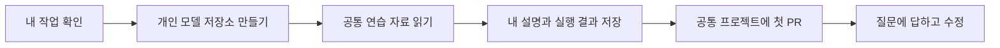

# 개인 저장소를 만들고 첫 PR을 올립니다

이 문서는 모델을 만드는 세 팀원이 처음 참여할 때 따라 하는 순서입니다. 할 일은 [스터디 보드](https://github.com/users/WaterMinCho/projects/2/views/1)에서 확인하고, 코드와 실험 기록은 각자의 GitHub 저장소에 남깁니다. 처음에는 입력을 읽고 이해한 내용을 공유합니다. 모델 학습과 프로그램 연결은 그다음에 진행합니다.

Git 작업은 SourceTree 또는 터미널로 진행합니다. 같은 작업을 두 번 할 필요는 없습니다. 파일 내용은 컴퓨터의 편집기에서 고치고 SourceTree에서는 변경 확인·커밋·푸시를 합니다. 저장소 만들기·fork·PR 열기는 GitHub 웹에서 진행합니다.



## 어디에 무엇을 남기나요

저장소는 코드와 문서를 모아두는 공간입니다. 아래 두 저장소는 맡은 일이 다릅니다.

| 공간 | 남기는 내용 |
|---|---|
| 내 계정의 `learning-lstm` 같은 개인 모델 저장소 | 직접 만든 모델, 실행 방법, 선택 이유, 실험 결과와 수정 기록 |
| `WaterMinCho/programming-study` 공통 프로젝트 | 프로그램·서버·공통 입력 도구, 각자의 학습 기록과 모델을 연결하는 변경 |
| 스터디 보드의 담당 카드 | 지금 할 일, 진행 상태, 질문, 관련 PR 주소 |

첫 PR을 보낼 때는 공통 프로젝트를 내 계정에 복사합니다. GitHub에서 만든 이 복사본을 fork라고 합니다. 개인 모델 저장소와 fork는 별도 저장소입니다. 개인 모델 저장소에서 공통 프로젝트로 바로 PR을 보내지는 않습니다.

## 1. 본인 카드부터 엽니다

1. 본인 GitHub 계정으로 로그인하고 [스터디 보드](https://github.com/users/WaterMinCho/projects/2/views/1)를 엽니다.
2. 위쪽의 **내 작업**을 누릅니다. 본인에게 배정된 카드가 나옵니다.
3. 카드를 눌러 이번에 만들 것과 확인할 동작을 읽습니다. 이런 할 일과 질문을 적는 글을 이슈라고 합니다.
4. 보드를 열 수 없거나 카드가 없으면 WaterMinCho에게 사용 중인 GitHub ID를 알려주세요. 보드는 팀원에게 편집 권한을 주어 사용합니다.

| 담당 | 먼저 열 카드 |
|---|---|
| WaterMinCho | [공통 입력과 전달 자료](https://github.com/WaterMinCho/programming-study/issues/118), [제출물 확인과 앱 연결](https://github.com/WaterMinCho/programming-study/issues/122) |
| michae18 | [기본 LSTM](https://github.com/WaterMinCho/programming-study/issues/119) |
| wamangdoo | [Transformer](https://github.com/WaterMinCho/programming-study/issues/120) |
| kimjs85529-a11y | [같은 LSTM에 풀이 간격 추가](https://github.com/WaterMinCho/programming-study/issues/121) |

WaterMinCho가 공통 자료를 확인하면 카드를 `시작 가능`으로 바꿉니다. 팀원은 직접 작업을 시작하면 `진행`, 검토가 필요하면 `검토`로 옮깁니다. 카드 안의 완료 조건을 모두 확인한 뒤 `완료`로 바꿉니다. 처음에는 작업 보드와 내 작업만 사용해도 됩니다.

## 2. 개인 모델 저장소를 만듭니다

아래는 웹 브라우저의 GitHub 화면에서 진행합니다.

1. 오른쪽 위 **+ → New repository**를 누릅니다.
2. **Owner**가 본인 계정인지 확인합니다.
3. **Repository name**에 맡은 모델을 알아볼 수 있는 이름을 적습니다. `learning-lstm`, `learning-transformer`, `learning-gap-lstm`은 이름의 예시입니다.
4. 공개할 코드와 설명을 모을 저장소는 **Public**으로 고릅니다. 비공개로 시작하면 검토자가 읽을 수 있도록 따로 초대합니다.
5. **Add README**를 켜고 **Create repository**를 누릅니다.
6. 만들어진 저장소의 **Code → HTTPS**에서 주소를 복사합니다. 컴퓨터에 `model-study` 같은 빈 폴더를 만들고 그 안으로 저장소를 받습니다. GitHub의 저장소를 컴퓨터에 받는 작업을 clone이라고 합니다.

SourceTree에서는 저장소 목록의 **Clone(복제)**을 열고 복사한 주소와 비어 있는 저장 위치를 지정합니다. 기본 LSTM의 예라면 주소는 `https://github.com/본인ID/learning-lstm.git`, 저장 위치는 `model-study/learning-lstm`입니다. 받은 뒤 로컬 저장소를 엽니다. 메뉴 위치와 번역은 Windows·Mac 및 버전에 따라 다를 수 있습니다.

터미널을 사용한다면 빈 `model-study` 폴더에서 다음 명령을 실행합니다. 이 문서의 `본인ID`는 실제 GitHub ID로, `learning-lstm`은 실제로 만든 저장소 이름으로 바꿉니다.

```sh
git clone https://github.com/본인ID/learning-lstm.git
```

개인 소개는 4단계에서 로컬의 `README.md`를 고쳐 커밋합니다. 커밋은 그때의 파일과 변경 설명을 함께 남기는 기록입니다. 개인 저장소의 첫 소개는 본인 `main`에 저장해도 됩니다.

첫 커밋 전에는 SourceTree의 설정·옵션에서 작성자 이름과 이메일을 확인하고 계정 설정에서 본인 GitHub 연결을 확인합니다. 커밋 이메일은 GitHub에 등록한 주소나 **GitHub Settings → Emails**에 표시된 본인의 `noreply` 주소를 사용합니다. 그래야 올린 커밋을 본인 계정에 연결할 수 있습니다.

터미널에서는 각 로컬 저장소에서 `git config user.name`과 `git config user.email`로 확인합니다. 설정이 없거나 본인 정보가 아니면 아래 값을 실제 이름과 주소로 바꿔 실행합니다. 이 명령은 현재 저장소에만 적용하므로 개인 모델 폴더와 fork 폴더에서 각각 확인합니다. HTTPS 인증이 준비되지 않았다면 [GitHub의 Git 인증 안내][git-setup]를 따라 연결한 뒤 푸시합니다.

```sh
git config user.name "본인 이름"
git config user.email "본인 커밋 이메일"
```

실제 풀이 원본·개인을 구분하는 값·개별 예측·실제 자료로 학습한 가중치는 공개 저장소에 올리지 않습니다. 첫 공개 예시는 아래에서 만드는 가상 자료를 사용합니다. 참고한 코드가 있다면 원본 주소·사용한 판·가져온 부분과 직접 바꾼 부분을 적고 원본의 LICENSE와 저작권 표시를 보존합니다.

## 3. 공통 연습 자료를 읽습니다

Git과 Python이 필요합니다. 처음 설치하는 사람은 [프로그램 준비](../gui/README.md#최초-한번-준비해야할-것)의 준비물부터 확인합니다. 이 실습은 화면 프로그램이나 PyTorch를 설치하지 않고 실행합니다.

공통 입력은 **본인 계정의 fork를 받은 폴더**에서 읽습니다. 이 폴더는 첫 PR에서도 사용합니다. 프로그램으로 문제를 풀던 기존 폴더는 별도로 두고, 2단계의 `model-study` 안에 준비합니다.

1. GitHub에서 [공통 저장소](https://github.com/WaterMinCho/programming-study)를 열고 **Fork → Create fork**로 본인 계정에 복사합니다. 이미 fork가 있으면 그 저장소를 사용합니다.
2. 화면 왼쪽 위가 `본인ID/programming-study`인지 확인하고 **Code → HTTPS** 주소를 복사합니다. 기존 fork는 `main`에서 **Sync fork**를 열어 원본의 변경을 확인하고, 받을 변경이 있으면 **Update branch**로 반영합니다. 충돌 안내가 나오면 내용을 지우거나 강제로 맞추지 않고 담당 이슈에 남깁니다.
3. SourceTree의 **Clone(복제)**에서 본인 fork 주소를 넣고 `model-study/programming-study`로 받습니다. 이미 모델 작업용으로 받은 폴더가 있으면 다시 받지 않고 그 폴더를 엽니다.

터미널에서는 `model-study` 폴더에서 다음 두 줄을 실행합니다. SourceTree로 이미 받았다면 `git clone`을 반복하지 않습니다.

```sh
git clone https://github.com/본인ID/programming-study.git
cd programming-study
```

`programming-study` 안에 `study.py`와 `learning_server`가 보이는지 확인합니다.

기존 로컬 fork를 재사용한다면 입력 실습 전에 최신 내용을 받습니다. SourceTree에서 커밋하지 않은 변경이 없는지 확인한 뒤 `main`으로 전환하고 `origin/main`을 **Pull** 합니다. 터미널에서는 아래 순서로 진행합니다. 상태에 기존 변경이 있거나 Pull이 충돌·분기 오류로 멈추면 그 내용을 담당 이슈에 남기고 먼저 해결합니다.

```sh
git status --short --branch
git switch main
git pull --ff-only origin main
```

SourceTree 사용자는 이 `programming-study` 폴더에서 터미널을 엽니다. 다음 Python 명령은 자료를 만들고 읽는 작업이어서 SourceTree 버튼 대신 터미널에서 실행합니다.

```sh
python -m learning_server.starter --synthetic --out ../learning-demo-v3
python -m learning_server.input_example --dataset ../learning-demo-v3 --track python --batch-size 4 --length 4
```

이 예시는 문항 4개를 한 묶음으로 읽고, 각 문항의 이전 풀이를 최대 4개까지 보여 줍니다. `--batch-size 4`는 한 묶음의 문항 수, `--length 4`는 확인할 과거 풀이 수를 정합니다.

`python`을 찾지 못하면 Windows에서는 `py`, macOS에서는 `python3`로 바꿔 입력합니다. `No module named learning_server`가 나오면 현재 폴더에 `study.py`와 `learning_server`가 있는지 먼저 확인합니다.

`learning-demo-v3` 폴더가 이미 있으면 다시 만들지 않고 두 번째 명령으로 읽습니다. 자료를 새로 만들 때는 `--out`과 `--dataset`에 같은 새 폴더 이름을 사용합니다. 기존 자료를 지우거나 덮어쓰지 않습니다.

이 명령은 자료 모양을 확인하며 모델을 학습하지 않습니다. 출력에서 **이전 문제와 정오답**, **비어 있는 자리**, **이번 문제의 정답표**를 찾아본 뒤 [공통 입력 설명](LEARNING_STARTER.md#세-모델이-같은-입력을-사용합니다)과 대조합니다. 같은 명령의 `--track python`을 `--track ai`로 바꾸면 AI 개론·응용의 예제도 읽습니다.

## 4. 본인이 이해한 내용을 저장합니다

컴퓨터의 **개인 모델 폴더**인 `model-study/learning-lstm`을 엽니다. 저장소 이름이 다르면 본인이 받은 모델 폴더를 사용합니다. 편집기로 `README.md`를 열어 담당 모델, 실제 실행한 명령, 출력에서 이해한 내용, 헷갈린 부분을 적고 저장합니다. [실험 기록 양식](LEARNING_EXPERIMENT_TEMPLATE.md)을 참고해도 됩니다. 실행하지 않은 내용은 실행했다고 적지 않습니다. 숫자를 붙였다면 무엇을 센 값인지 설명합니다.

SourceTree에서는 다음 순서로 저장하고 GitHub에 올립니다.

1. 개인 모델 저장소를 열고 현재 브랜치가 `main`인지 확인합니다.
2. **File Status(파일 상태)**에서 `README.md`의 변경 내용을 읽습니다.
3. 이번에 바꾼 `README.md`만 **Stage(스테이지에 올리기)** 합니다. 스테이지는 이번 커밋에 담을 파일을 고르는 과정입니다.
4. **Commit(커밋)**을 누르고 `docs: 공통 입력 확인 기록` 같은 설명을 적어 커밋합니다.
5. **Push(푸시)**에서 원격 `origin`의 `main`으로 보냅니다. `origin`은 이 폴더를 clone한 개인 저장소의 주소 이름입니다. 커밋은 컴퓨터에 남기는 기록이고 푸시는 그 기록을 GitHub에 보내는 작업입니다.

터미널로 한다면 개인 모델 폴더에서 실행합니다. `git --no-pager diff --cached`의 내용이 이번에 올릴 README인지 확인한 뒤 커밋합니다.

```sh
git status --short --branch
git add README.md
git --no-pager diff --cached
git commit -m "docs: 공통 입력 확인 기록"
git push origin main
```

GitHub의 개인 저장소를 새로고침해 수정한 README와 커밋이 보이는지 확인합니다.

입력 항목을 이해했으면 5단계에서 첫 PR을 올립니다. 작은 예측은 첫 PR 뒤에 [담당별 미션](LEARNING_MISSIONS.md#공통-실습부터-시작합니다)에서 시작합니다.

## 5. 공통 프로젝트로 보낼 첫 변경을 만듭니다

첫 PR에서는 **입력을 읽고 본인이 이해한 내용을 공유**합니다. 모델 구현과 앱 연결을 마쳤다는 제출이 아닙니다. 여기서는 개인 모델 폴더에서 나와, 3단계에서 받은 **fork 폴더 `model-study/programming-study`**를 엽니다.

SourceTree에서는 다음 순서로 진행합니다.

1. 저장소 설정의 원격 목록에서 `origin`이 `본인ID/programming-study` 주소인지 확인합니다. 개인 모델 저장소나 `WaterMinCho/programming-study` 원본으로 보내지 않습니다.
2. 커밋하지 않은 변경이 없는지 확인하고 왼쪽 **Branches(브랜치)**의 `main`을 더블클릭합니다. **Pull(풀)**에서 `origin/main`의 변경을 받습니다. 충돌이나 예상하지 못한 변경이 나오면 그 상태를 담당 이슈에 남깁니다.
3. 위쪽 **Branch(브랜치)**를 누르고 `model/본인ID-first-input`을 입력해 만듭니다. 새 브랜치로 전환했는지 확인합니다. 브랜치는 수정 중인 파일을 따로 관리하는 작업 공간입니다.
4. 편집기에서 `programming-study/experiments/본인ID/README.md`를 새로 만듭니다. 없는 폴더는 함께 만듭니다. 본인 ID 폴더만 사용하고 아래 틀을 채워 저장합니다. 일반 텍스트 파일로 저장해 파일 이름 뒤에 `.txt`가 붙지 않았는지 확인합니다.
5. **File Status**에서 해당 README의 변경 내용을 읽고 그 파일만 **Stage** 합니다.
6. **Commit**에 `docs: 본인ID 입력 확인 기록`을 적고 커밋합니다.
7. **Push**에서 `origin`을 고르고 로컬 `model/본인ID-first-input`을 원격의 같은 이름으로 보냅니다. 이번 브랜치만 선택하며 `main`을 보내는 것은 아닙니다.

터미널로 한다면 fork 폴더에서 아래 순서로 실행합니다. 상태에 기존 변경이 보이면 먼저 확인하고 브랜치를 바꾸지 않습니다. 새 브랜치를 만든 뒤에는 아래 틀로 파일을 작성하고 저장합니다.

```sh
git remote -v
git status --short --branch
git switch main
git pull --ff-only origin main
git switch -c model/본인ID-first-input
```

파일 작성 뒤 같은 fork 폴더에서 실행합니다.

```sh
git add experiments/본인ID/README.md
git --no-pager diff --cached
git commit -m "docs: 본인ID 입력 확인 기록"
git push -u origin model/본인ID-first-input
```

틀의 안내 문장은 담당 모델·이슈와 개인 저장소 주소·고정 주소로 바꿉니다. 제목 바로 아래에 실제 내용을 적습니다. 명령이 오류로 끝났다면 입력한 명령과 오류의 마지막 줄을 적고 질문에 남깁니다. 오류에 비밀 값이나 개인 경로가 있으면 지우고 필요한 문구만 공유합니다.

```markdown
# 본인ID 입력 확인 기록

담당 모델과 이슈 주소를 적습니다.

개인 모델 저장소 주소와 README의 고정 주소를 붙입니다.

## 실제로 실행한 명령을 적습니다

## 출력에서 이해한 내용이나 오류를 적습니다

## 입력과 이번 정답을 어떻게 나눴는지 설명합니다

## 막힌 부분과 질문을 적습니다
```

| 첫 변경에 적을 내용 | 적는 방법 |
|---|---|
| 담당 모델과 미션 | LSTM·Transformer·간격 모델 중 맡은 역할과 본인 이슈 주소를 적습니다. |
| 개인 저장소 | 본인이 만든 모델 저장소 주소를 붙입니다. |
| README의 고정 주소 | 개인 저장소의 파일 목록에서 `README.md`를 눌러 파일 하나만 보이는 화면을 엽니다. 편집을 마친 뒤 입력 칸 밖을 누르고 키보드 `y`를 누릅니다. 주소창의 `/blob/main/README.md`에서 `main`이 긴 영문·숫자 문자열로 바뀌면 주소를 복사합니다. 이 고정 주소는 나중에 README를 고쳐도 지금 내용을 보여 줍니다. |
| 실제 실행 | 공통 입력을 읽은 명령과 관측한 결과를 적습니다. |
| 본인의 설명과 질문 | 입력과 이번 정답을 어떻게 구분했는지 설명하고, 막힌 부분을 적습니다. |

`study/본인ID`는 프로그램이 풀이를 제출할 때 쓰는 브랜치입니다. 모델 개발에는 위에서 만든 별도 브랜치를 사용하고 다른 사람의 `experiments` 폴더와 `submissions` 기록은 수정하지 않습니다.

## 6. 첫 PR을 엽니다

PR은 내가 바꾼 내용을 검토한 뒤 공통 프로젝트에 합쳐 달라는 요청입니다.

1. SourceTree나 터미널에서 푸시를 마친 뒤 GitHub의 본인 fork를 엽니다. **Compare & pull request**를 누릅니다. 보이지 않으면 [공통 저장소의 Pull requests](https://github.com/WaterMinCho/programming-study/pulls)에서 **New pull request → compare across forks**를 누릅니다.
2. 아래 표처럼 **받을 곳과 보낼 곳**을 맞춥니다. 비교할 변경이 없다고 나오면 선택한 저장소와 브랜치부터 다시 확인합니다.
3. 아래 변경 목록에서 `experiments/본인ID/README.md`만 바뀌었는지 확인합니다.
4. 제목에 이번에 확인한 일을 적습니다. 본문에는 담당 이슈 주소, 5단계 표에서 복사한 고정 주소, 실행 명령과 결과, 검토받고 싶은 질문을 한두 문단으로 적습니다.
5. **Create pull request**를 누르고 만들어진 PR 주소를 본인 담당 이슈의 댓글에 붙입니다. 카드 상태를 **검토**로 바꿉니다.

| GitHub 화면의 항목 | 고를 값 |
|---|---|
| base repository | `WaterMinCho/programming-study` |
| base | `main` |
| head repository 또는 head fork | `본인ID/programming-study` |
| compare | 방금 변경을 저장한 `model/본인ID-first-input` 브랜치 |

개인 모델 저장소인 `learning-lstm`을 head로 고르지 않습니다. 공통 프로젝트를 복사한 `programming-study`에서 수정안을 보내는 과정입니다.

## 7. 받은 질문에 답하고 이어갑니다

WaterMinCho가 실행 근거와 설명을 검토하고 피드백을 남깁니다. 수정이 필요하면 SourceTree에서 **fork 저장소의 `model/본인ID-first-input`**으로 전환합니다. 편집기로 해당 README를 고쳐 저장한 뒤, 바꾼 파일만 Stage → Commit → 같은 원격 브랜치로 Push 합니다. 열린 PR의 변경 목록에 수정이 이어서 반영되므로 새 PR을 만들지 않습니다. 무엇을 고쳤고 어떤 결과를 다시 확인했는지 댓글로 답합니다.

터미널에서는 fork 폴더에서 아래 명령으로 같은 브랜치를 고른 뒤 파일을 수정합니다. 저장 후 나머지 명령을 실행합니다.

```sh
git switch model/본인ID-first-input
git add experiments/본인ID/README.md
git --no-pager diff --cached
git commit -m "docs: 입력 확인 피드백 반영"
git push origin model/본인ID-first-input
```

공통 프로젝트의 머지는 WaterMinCho가 판단합니다. 개인 저장소의 머지는 소유자가 결정합니다. 첫 PR이 합쳐지면 담당 이슈에서 입력 확인 항목을 체크하고 다음 구현으로 이어갑니다. 모델 학습·저장·평가 같은 할 일이 남았다면 카드 전체를 완료하지 않고 **진행**으로 돌립니다.

모델을 만들면서 예측 하나, 작은 학습, 저장과 불러오기, 같은 자료의 평가를 나눠 공유합니다. 앱 연결 단계에서는 개인 저장소의 전체 커밋 ID와 실행 방법, 모델을 호출하는 연결 코드와 검사를 함께 제출합니다. 저장소 주소만 추가한 일을 모델 통합 완료로 세지 않습니다. 구체적인 검토 항목은 [코드 검토 방법](LEARNING_REVIEW.md)을 따릅니다.

<a id="첫-pr-뒤에-개인-모델-폴더를-준비합니다"></a>

## 개인 모델 폴더와 fork 폴더를 확인합니다

2단계에서 개인 모델 폴더를 이미 받았다면 다시 clone하지 않습니다. 모델 코드는 그 폴더에서 작성합니다. 아직 받지 않았다면 2단계의 SourceTree 또는 터미널 방법으로 개인 저장소를 `programming-study` 옆에 받습니다.

```text
model-study/
  programming-study/    본인 fork · 공통 입력 확인과 PR 기록 폴더
  learning-lstm/        본인이 모델을 만드는 폴더 · 이름은 예시
  learning-demo-v3/     공통 도구가 만든 가상 풀이 자료
```

세 폴더를 서로 안에 넣지 않고 나란히 둡니다. 공통 입력 처리는 `programming-study`의 기존 도구를 사용하고, 자료와 모델 출력 폴더는 개인 저장소의 `.gitignore`에 적어 커밋에서 제외합니다.

SourceTree의 두 로컬 저장소를 번갈아 열 때는 저장소 이름과 현재 브랜치를 확인합니다. **Clone은 컴퓨터로 받기, Commit은 로컬 변경 기록, Push는 GitHub로 보내기, Pull은 원격 변경 받기**입니다. PR은 푸시 후 GitHub에서 검토를 요청하는 별도 작업입니다.

## GitHub 화면과 사용 방법을 확인한 자료입니다

2026년 11월 12일 GitHub와 Atlassian 공식 안내에서 저장소 만들기, clone·브랜치·커밋·푸시, fork의 PR 대상과 파일 고정 주소를 확인했습니다. SourceTree의 공통 동작을 기준으로 설명했으며 운영체제·버전·언어에 따라 메뉴 위치와 이름은 다를 수 있습니다.

- [새 저장소와 첫 변경][create]
- [공통 프로젝트를 fork하기][fork]
- [fork에서 PR 보내기][pr]
- [특정 시점의 파일 주소 만들기][permalink]
- [SourceTree에서 저장소 받기][st-clone]
- [SourceTree에서 브랜치를 만들고 보내기][st-branch]
- [SourceTree에서 커밋과 푸시하기][st-commit]

[create]: https://docs.github.com/en/repositories/creating-and-managing-repositories/quickstart-for-repositories
[fork]: https://docs.github.com/en/pull-requests/how-tos/work-with-forks/fork-a-repo
[pr]: https://docs.github.com/en/pull-requests/how-tos/create-pull-requests/creating-a-pull-request-from-a-fork
[permalink]: https://docs.github.com/en/repositories/working-with-files/using-files/getting-permanent-links-to-files
[st-clone]: https://confluence.atlassian.com/get-started-with-sourcetree/clone-a-remote-repository-847359098.html
[st-branch]: https://confluence.atlassian.com/get-started-with-sourcetree/create-and-push-a-branch-to-the-remote-repository-git-847359118.html
[st-commit]: https://confluence.atlassian.com/get-started-with-sourcetree/commit-and-push-a-change-git-847359114.html
[git-setup]: https://docs.github.com/en/get-started/git-basics/set-up-git
