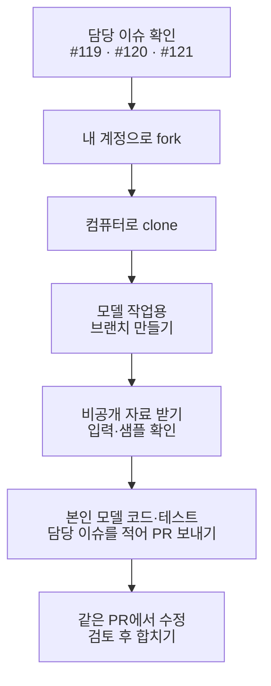

# 내 fork에서 모델을 개발하고 PR 보내기

<a id="각자-fork에서-모델을-만들고-pr을-보냅니다"></a>

공통 프로젝트를 본인 GitHub 계정으로 fork하고, 그 안의 `experiments/본인ID/`에서 모델을 만듭니다. 코드·설정·실험 기록을 같은 fork에 쌓고 공통 프로젝트로 PR을 보냅니다. 별도의 모델 저장소를 새로 만들 필요는 없습니다.

Git 작업은 SourceTree 또는 터미널 중 편한 방법으로 진행합니다. 파일은 컴퓨터의 편집기에서 고칩니다. SourceTree에서는 변경 확인·브랜치·커밋·푸시를 하고, fork와 PR은 GitHub 웹에서 만듭니다.

<a id="기존-작업에서-어디부터-이어가나요"></a>

## 기존 작업에서 어디부터 이어가나요?

[담당 이슈](STUDY_START.md#담당과-이번-작업을-확인합니다)의 지금 할 일과 기존 PR 상태를 확인합니다. 이미 받은 저장소와 작업을 지우거나 같은 작업용 fork를 다시 만들지 않습니다.

| 현재 상태 | 이어갈 방법 |
|---|---|
| 같은 작업의 PR이 열려 있습니다. | 그 PR의 브랜치에서 파일을 고치고 추가 커밋을 Push합니다. 새 PR 없이 기존 PR이 갱신됩니다. |
| 이전 PR이 Merged로 표시됩니다. | 이전 작업은 공통 프로젝트에 합쳐졌습니다. 본인 fork의 `main`을 Sync fork로 갱신합니다. SourceTree에서 로컬 `main`을 더블클릭해 전환하고 Pull로 `origin/main`을 받은 뒤 `main`에서 다음 작업 브랜치와 새 PR을 만듭니다. |
| 작업 브랜치는 있고 PR은 없습니다. | 기존 브랜치에서 이어서 작업하고 그 브랜치로 첫 PR을 만듭니다. 구현 중이면 Draft PR로 공유합니다. |
| 아직 fork나 로컬 저장소가 없습니다. | 아래 1~3절부터 시작합니다. |

열린 PR에서 보완하는 커밋과 머지 후 다음 작업을 시작하는 새 PR은 구분합니다. 입력 실습 PR #150·#158·#189는 모두 머지됐습니다. [팀원별 다음 작업](STUDY_START.md#담당과-이번-작업을-확인합니다)은 갱신한 `main`에서 새 브랜치를 만들어 진행합니다. 실제 출력이 빠졌다면 다음 코드 PR의 README에 함께 채웁니다.

기존 작업 브랜치에 최신 공통 변경이 필요하면 [작업 브랜치에 공통 변경 받기](#작업-브랜치에-공통-변경-받기)를 따릅니다. 새 명령이 없다는 오류가 나도 작업 파일이나 자료를 지우지 않습니다.



<a id="어디에-무엇을-남기나요"></a>

## GitHub 보드·이슈·PR에 남길 내용

| 공간 | 남기는 내용 |
|---|---|
| `본인ID/programming-study` | 공통 프로젝트를 fork한 본인의 작업 저장소입니다. |
| 그 안의 `experiments/본인ID/` | 직접 만든 모델, 실행 방법, 실험 결과와 피드백 반영 기록을 모읍니다. |
| `WaterMinCho/programming-study`의 PR | 본인이 바꾼 코드와 설명을 검토하고 공통 프로젝트에 합칩니다. |
| [스터디 보드](https://github.com/users/WaterMinCho/projects/2/views/1)와 담당 이슈 | 진행 상태, 질문과 관련 PR 주소를 남깁니다. |

이 문서의 `본인ID`는 실제 GitHub ID로 바꿉니다. `origin`은 clone한 본인 fork의 주소 이름입니다. 프로그램으로 문제를 풀던 기존 폴더는 별도로 두고 모델 작업용 폴더를 준비합니다.

<a id="1-본인-카드부터-엽니다"></a>

## 1. GitHub 보드에서 내 담당 이슈 열기

[스터디 보드](https://github.com/users/WaterMinCho/projects/2/views/1)의 **내 작업**에서 본인 카드를 엽니다. 보드를 열 수 없거나 카드가 없으면 WaterMinCho에게 GitHub ID를 알려주세요.

| 담당 | 모델과 작업 폴더 |
|---|---|
| WaterMinCho | 프로그램·수집 서버·공통 자료·검토와 앱 연결 |
| [michae18 · 기본 LSTM](https://github.com/WaterMinCho/programming-study/issues/119) | `experiments/michae18/` |
| [wamangdoo · Transformer](https://github.com/WaterMinCho/programming-study/issues/120) | `experiments/wamangdoo/` |
| [kimjs85529-a11y · LSTM + 풀이 간격](https://github.com/WaterMinCho/programming-study/issues/121) | `experiments/kimjs85529-a11y/` |

작업을 시작하면 카드를 **진행**, 검토받을 PR을 올리면 **검토**로 옮깁니다.

아직 구현 중이면 PR을 Draft로 열고 카드는 진행에 둡니다. 자동 코드 리뷰를 받을 때 **Ready for review**로 바꾸고 카드를 **검토**로 옮깁니다.

<a id="2-개인-모델-저장소를-만듭니다"></a>

<a id="2-공통-프로젝트를-fork하고-컴퓨터로-받습니다"></a>

## 2. 프로젝트를 fork하고 내 컴퓨터로 받기

1. GitHub에서 [공통 저장소](https://github.com/WaterMinCho/programming-study)를 열고 **Fork → Create fork**로 본인 계정에 복사합니다. 이미 fork가 있다면 그 저장소를 사용합니다.
2. 화면 왼쪽 위가 `본인ID/programming-study`인지 확인합니다. 기존 fork는 `main`에서 **Sync fork**를 열고 받을 변경이 있으면 **Update branch**로 반영합니다. 충돌 안내가 나오면 담당 이슈에 남깁니다.
3. **Code → HTTPS**에서 본인 fork 주소를 복사합니다.
4. 컴퓨터에 `model-study` 같은 빈 폴더를 만듭니다. SourceTree의 **Clone(복제)**에서 복사한 주소를 넣고 `model-study/programming-study`로 받습니다. 이미 모델 작업용으로 받은 폴더가 있으면 그 폴더를 엽니다.
5. SourceTree의 저장소 설정에서 `origin`이 `본인ID/programming-study` 주소인지 확인합니다.

터미널을 쓴다면 빈 `model-study` 폴더에서 실행합니다. SourceTree로 이미 받았다면 clone을 반복하지 않고 받은 `programming-study` 폴더에서 터미널을 엽니다.

```sh
git clone https://github.com/본인ID/programming-study.git
cd programming-study
git remote -v
```

GitHub 저장소를 컴퓨터로 받는 작업이 clone입니다. 같은 이름의 기존 폴더가 있으면 지우지 않고 다른 빈 위치를 사용합니다. SourceTree의 메뉴 위치와 번역은 Windows·Mac 및 버전에 따라 다를 수 있습니다.

첫 커밋 전에는 SourceTree의 설정·옵션에서 작성자 이름과 이메일, 계정 설정에서 본인 GitHub 연결을 확인합니다. 이메일은 GitHub에 등록한 주소나 **GitHub Settings → Emails**의 본인 `noreply` 주소를 사용합니다. 터미널에서는 `git config user.name`과 `git config user.email`로 확인합니다. 설정이 없거나 본인 정보가 아니면 현재 저장소에서 실제 값을 넣습니다.

```sh
git config user.name "본인 이름"
git config user.email "본인 커밋 이메일"
```

HTTPS 인증이 준비되지 않았다면 [GitHub의 Git 인증 안내][git-setup]를 따라 연결합니다.

<a id="3-모델-작업-브랜치를-만듭니다"></a>

## 3. 모델 개발 브랜치 만들기

SourceTree에서 본인 fork를 열고 커밋하지 않은 변경이 없는지 확인합니다. 왼쪽 **Branches(브랜치)**의 `main`을 더블클릭하고 **Pull(풀)**에서 `origin/main`을 받습니다. 기존 변경이나 충돌이 있으면 먼저 확인합니다. 위쪽 **Branch(브랜치)**에서 `model/본인ID-model`을 만들고 새 브랜치로 전환합니다.

터미널에서는 `programming-study` 폴더에서 실행합니다. 상태에 기존 변경이 보이면 브랜치를 바꾸기 전에 확인합니다. Pull이 오류로 멈추면 그 내용을 담당 이슈에 남깁니다.

```sh
git status --short --branch
git switch main
git pull --ff-only origin main
git switch -c model/본인ID-model
```

브랜치는 수정 작업을 따로 관리하는 공간입니다. 이미 만든 작업 브랜치를 이어갈 때는 SourceTree에서 해당 브랜치를 더블클릭하거나 `git switch model/본인ID-model`으로 전환합니다. `git switch -c`로 다시 만들지 않습니다. 예전 풀이 제출용 `study/본인ID` 브랜치는 모델 개발에 사용하지 않습니다.

<a id="작업-브랜치에-공통-변경-받기"></a>

### 기존 작업 브랜치에 최신 공통 코드 반영하기

이미 작업한 브랜치를 유지하면서 최신 입력 도구와 안내를 받는 절차입니다. SourceTree 또는 터미널 중 한 방법만 사용합니다.

1. 지금 브랜치에서 본인 변경을 먼저 Commit하고 파일 상태에 미커밋 변경이 없는지 확인합니다. 실제 자료와 가중치는 Stage에 넣지 않습니다.
2. GitHub의 본인 fork에서 `main`을 열고 **Sync fork → Update branch**로 공통 프로젝트의 변경을 받습니다. 충돌 안내가 나오면 여기서 멈추고 담당 이슈에 남깁니다.
3. SourceTree에서 **Fetch**를 눌러 본인 fork의 최신 브랜치를 받습니다. 현재 선택한 브랜치가 본인의 기존 작업 브랜치인지 확인합니다.
4. **Merge**에서 원격 브랜치 `origin/main`을 선택해 현재 작업 브랜치에 합칩니다. 새 브랜치를 만들거나 기존 커밋을 고치지 않습니다.
5. 충돌이 없다면 입력 확인 명령을 다시 실행하고 같은 작업 브랜치로 Push합니다. 충돌이 생기면 어느 쪽 파일을 버릴지 임의로 고르지 말고 파일 이름과 오류를 담당 이슈에 남깁니다.

터미널은 위 1~2번을 마친 뒤 **기존 작업 브랜치에서** 아래처럼 진행합니다. `git branch --show-current`에 `main`이 나오면 본인의 기존 작업 브랜치로 먼저 이동합니다.

```sh
git status --short
git branch --show-current
git fetch origin
git merge origin/main
```

충돌 없이 합쳐지고 입력 확인도 끝난 뒤 `git push origin HEAD`로 현재 브랜치를 보냅니다. 충돌이 나면 강제 푸시나 파일 삭제로 해결하지 않습니다.

<a id="3-공통-연습-자료를-읽습니다"></a>

<a id="4-공통-입력을-읽습니다"></a>

## 4. 공통 예제에서 모델 입력과 정답 확인하기

[실제 자료 받기·샘플링 안내](LEARNING_DATA_ACCESS.md)를 따라 같은 자료 묶음의 비공개 파일을 받고 입력을 확인합니다. 입력 확인 문서만 먼저 PR로 보내고 머지를 기다릴 필요는 없습니다. 아직 자료를 받지 못했다면 아래 합성 예제로 시작합니다.

컴퓨터에 Git과 Python을 준비한 뒤 진행합니다. 처음 설치한다면 [프로그램 준비](../gui/README.md#처음-설치할-때)를 확인합니다. 이번 입력 실습은 PyTorch나 GPU 없이 실행합니다.

현재 `programming-study` 안에 `study.py`와 `learning_server`가 보이는지 확인합니다. SourceTree를 쓰는 사람도 이 폴더에서 터미널을 열고 다음 Python 명령을 실행합니다.

```sh
python -m learning_server.starter --synthetic --out ../learning-demo-f5
python -m learning_server.input_example --dataset ../learning-demo-f5 --track python --batch-size 4 --length 4
```

첫 명령은 가상 풀이 자료를 만들고 두 번째 명령은 입력 예시 4개를 읽습니다. 각 예시의 과거 풀이를 최대 4개까지 확인하며 모델을 학습하지는 않습니다. `inputs`와 이번 정답표인 `targets`, 과거 풀이의 실제 자리인 `mask`, 실제 길이인 `lengths`를 [공통 입력 설명](LEARNING_STARTER.md#세-모델의-공통-입력-형식)과 대조합니다. 오답 0과 빈 자리를 구분해보세요. `--track python`을 `--track ai`로 바꾸면 AI 과목의 합성 예제를 읽습니다. 이 예제의 과정은 미기록입니다.

`python`을 찾지 못하면 Windows는 `py`, Mac은 `python3`로 바꿉니다. `No module named learning_server`가 나오면 현재 폴더부터 확인합니다. `learning-demo-f5`가 이미 있으면 두 번째 명령으로 읽습니다. 새 자료를 만들 때는 `--out`과 `--dataset`에 같은 새 폴더 이름을 쓰며 기존 자료는 덮어쓰지 않습니다.

<a id="4-본인이-이해한-내용을-저장합니다"></a>
<a id="5-공통-프로젝트로-보낼-첫-변경을-만듭니다"></a>

<a id="5-본인-폴더에-첫-실습-기록을-적습니다"></a>

<a id="5-본인-폴더에서-코드와-테스트를-만듭니다"></a>

## 5. 내 실험 폴더에 코드와 테스트 작성하기

편집기에서 `programming-study/experiments/본인ID/`의 기존 `Readme.md`나 `README.md`를 열어 고칩니다. README가 없을 때만 `README.md`를 만듭니다. 대소문자만 다른 README를 하나 더 만들지 않습니다. 없는 폴더는 함께 만듭니다. 일반 텍스트로 저장하고 파일 이름이 `README.md.txt`가 되지 않았는지 확인합니다. 공통 프로젝트 맨 위의 README 대신 본인 폴더의 README를 수정합니다.

같은 폴더에 모델 코드와 작은 입력을 확인하는 테스트를 만듭니다. README에는 아래 틀로 실제 실행한 명령과 관측한 결과를 적습니다. 입력 읽기부터 예측·학습·저장 순서로 개발하며 지금 검토받을 코드와 질문을 PR에 담습니다. 모델 전체가 완성되기 전에도 Draft PR로 공유할 수 있습니다. 오류가 나면 오류와 질문을 남깁니다.

학습 중 만든 가중치·출력 폴더는 본인 모델 폴더의 `.gitignore`로 제외하고 실제 자료는 저장소 밖에 둡니다. Stage 전에 파일 목록을 확인하세요.

```markdown
# 본인ID 모델 실습

담당 모델과 이슈 주소를 적습니다.

## 실행한 명령과 결과

## 입력과 이번 정답을 구분한 방법

## 빈 이력과 빈 자리를 확인한 내용

## 막힌 부분과 질문
```

예를 들어 michae18은 본인 fork의 `experiments/michae18/Readme.md`에 기본 LSTM을 맡았다고 적고, 출력에서 과거 오답과 이번 정답표를 어떻게 구분했는지 설명합니다. 모델 학습을 아직 하지 않았다면 그 단계는 미실행으로 적습니다. 상세 기록에는 [실험 기록 양식](LEARNING_EXPERIMENT_TEMPLATE.md)을 사용해도 됩니다.

<a id="6-커밋푸시하고-첫-pr을-엽니다"></a>

## 6. 커밋하고 GitHub에 첫 PR 열기

SourceTree에서 다음 순서로 진행합니다.

1. 현재 저장소가 본인 fork이고 브랜치가 `model/본인ID-model`인지 확인합니다.
2. **File Status(파일 상태)**에서 본인 폴더의 코드·테스트·README 변경을 읽습니다.
3. 이번 작업의 코드·테스트·README만 **Stage(스테이지에 올리기)** 합니다. 실제 자료와 샘플 파일은 제외합니다.
4. **Commit(커밋)**에 `feat(model): 본인ID 입력과 예측 코드 추가`를 적고 기록합니다.
5. **Push(푸시)**에서 `origin`을 고르고 이번 브랜치를 원격의 같은 이름으로 보냅니다.

커밋은 컴퓨터에 변경 기록을 남기고 푸시는 그 기록을 GitHub에 보냅니다. 터미널에서는 같은 fork 폴더에서 실행합니다.

```sh
git add experiments/본인ID/
git --no-pager diff --cached
git commit -m "feat(model): 본인ID 입력과 예측 코드 추가"
git push -u origin model/본인ID-model
```

Stage 목록에 실제 자료나 가중치가 보이면 커밋 전에 SourceTree의 **Unstage(스테이지 해제)**로 뺍니다. 터미널에서는 `git restore --staged 파일경로`를 실행해 해당 파일을 Stage 목록에서 뺍니다.

푸시 후 GitHub의 본인 fork에서 **Compare & pull request**를 누릅니다. 보이지 않으면 [공통 프로젝트의 Pull requests](https://github.com/WaterMinCho/programming-study/pulls)에서 **New pull request → compare across forks**를 누릅니다.

| GitHub 항목 | 고를 값 |
|---|---|
| base repository | `WaterMinCho/programming-study` |
| base | `main` |
| head repository 또는 head fork | `본인ID/programming-study` |
| compare | `model/본인ID-model` |

변경 목록이 본인 폴더의 코드·테스트·설명인지 확인합니다. 실제 자료와 가중치가 Stage되지 않았는지도 확인합니다. 제목은 실제 변경에 맞춰 [PR 제목 규칙](PR_GUIDE.md)을 따릅니다.

본문에 아래 안내대로 담당 이슈와 실행 결과를 적고 **Create pull request**를 누릅니다. 아직 작업 중이면 옆 메뉴의 **Create draft pull request**를 선택합니다. PR은 내가 바꾼 내용을 검토하고 공통 프로젝트에 합쳐 달라는 요청입니다.

PR 주소를 담당 이슈에 붙입니다. 검토를 요청할 때 카드를 **검토**로 옮기고 Draft 작업은 진행에 둡니다.

<a id="이슈와-pr-연결"></a>

### 담당 이슈와 PR 연결하기

예를 들어 michae18이 [LSTM 담당 이슈 #119](https://github.com/WaterMinCho/programming-study/issues/119)의 입력 처리부터 구현했다면, PR 본문에 아래처럼 적습니다. 코드와 결과 설명은 본인이 실제로 한 작업으로 바꾸세요.

```text
관련 이슈 WaterMinCho/programming-study#119

LSTM에 넣을 입력과 빈 이력 처리 코드를 추가했음. 합성 자료로 입력 크기와 빈 이력 처리를 확인했음. 모델 학습은 다음 작업에서 진행함.
```

1. **Write(작성)** 탭에 본문을 입력하고 **Preview(미리 보기)**에서 이슈 번호가 링크로 바뀌는지 확인합니다.
2. 링크를 새 탭으로 열어 공통 저장소의 본인 담당 이슈인지 확인합니다. 본인 fork와 구별할 수 있도록 `WaterMinCho/programming-study#119`처럼 저장소 이름까지 적습니다.
3. PR을 만든 뒤 담당 이슈에 PR 주소와 이번에 구현한 내용을 댓글로 남깁니다. 이슈에서 관련 코드와 검토 결과를 찾아갈 수 있습니다.

wamangdoo는 `WaterMinCho/programming-study#120`, kimjs85529-a11y는 `WaterMinCho/programming-study#121`을 사용합니다. 담당 이슈 전체가 끝날 때까지는 위처럼 번호를 참조하며 여러 PR을 이어갈 수 있습니다.

### 이슈의 작업을 모두 끝냈을 때

담당 이슈의 완료 조건을 모두 채운 마지막 PR에서는 관련 이슈 줄을 아래처럼 바꿉니다.

```text
Closes WaterMinCho/programming-study#119
```

PR의 base가 공통 저장소의 기본 브랜치 `main`인지 확인합니다. PR을 만든 뒤 오른쪽 **Development**에서 해당 이슈가 연결됐는지 확인하세요. 이 PR이 `main`에 머지되면 이슈도 자동으로 닫힙니다. 아직 남은 작업이 있는 PR에 `Closes`를 적었다면 PR 본문의 **Edit**에서 위의 ‘관련 이슈’ 형식으로 고칩니다.

<a id="7-같은-fork에서-모델을-개발합니다"></a>

<a id="7-같은-pr에서-모델-개발과-수정을-이어갑니다"></a>

## 7. 같은 PR에 모델 코드와 수정 사항 추가하기

진행 중인 작업은 같은 브랜치와 PR에서 이어갑니다. README만 올린 PR이 아직 열려 있다면 그 브랜치에 코드를 추가해도 됩니다. 이미 합쳐진 PR과 기존 커밋은 지우지 않습니다. 다음 작업을 시작할 때는 GitHub에서 fork의 `main`을 **Sync fork → Update branch**로 갱신하고 로컬 `main`을 Pull한 뒤 새 브랜치를 만듭니다. 새 이름은 `model/본인ID-train`처럼 이번 작업에 맞춰 정합니다.

모델 코드도 같은 `experiments/본인ID/` 안에 작성합니다. 아래는 앞으로 만들 파일의 예시이며 완성된 모델 코드가 들어 있다는 뜻은 아닙니다.

```text
model-study/
  programming-study/             본인 fork를 clone한 폴더
    learning_server/             기존 공통 입력 도구
    experiments/
      본인ID/
        README.md                실행 방법과 본인의 설명
        train.py                 모델 학습
        evaluate.py              평가
        predict.py               저장한 모델로 예측
        requirements.txt         사용한 라이브러리 버전
        configs/                 설정과 난수 시드
        figures/                 합성 자료의 학습곡선
        REVIEW_NOTES.md          피드백과 수정 이유
  study-data/                   비공개 실제 자료와 샘플 · 저장소 밖에 보관
  learning-demo-f5/              가상 자료 · 저장소 밖에 보관
```

공통 `learning_server`를 불러오는 모델은 `programming-study` 폴더에서 `python -m experiments.본인ID.train`처럼 실행합니다. 예를 들어 `python -m experiments.kimjs85529-a11y.train`입니다. 아직 `train.py`를 만들지 않았다면 실행할 수 없으며 파일 이름과 명령을 본인 README에 맞춰 적습니다.

폴더 이름에 붙임표가 들어 있으면 같은 모델 폴더의 파일은 `from .model import Model`처럼 상대 경로로 불러옵니다. 이 예시의 `model.py`와 `Model`은 본인이 만든 파일·클래스 이름으로 바꿉니다. 표준 `unittest`로 `test_model.py`를 만들었다면 저장소 루트에서 `python -m unittest experiments.본인ID.test_model`을 실행합니다. 간격 테스트 파일이 `test_gaps.py`라면 마지막 이름을 `test_gaps`로 바꾸세요.

코드를 바꾸면 본인 폴더의 변경만 골라 Stage → Commit → Push합니다. 같은 브랜치에 Push하면 열린 PR이 갱신됩니다. 공통 입력 도구나 다른 팀원의 폴더를 바꿔야 한다면 먼저 담당 이슈에서 이유를 공유합니다. 이번 작업을 머지한 뒤 다음 목표는 새 PR로 나눠도 됩니다. 입력 확인만 별도 PR로 먼저 통과할 필요는 없습니다. 구체적인 목표는 [담당별 미션](LEARNING_MISSIONS.md)을 따릅니다.

공개 재현에는 합성 자료를 사용합니다. 실제 풀이 원본·입력 답안·가명 구분값·인증 값·실제 자료로 학습한 가중치와 개별 예측은 올리지 않습니다.

<a id="7-받은-질문에-답하고-이어갑니다"></a>

<a id="받은-질문에-답하고-이어갑니다"></a>

## 리뷰 질문에 답하고 수정한 커밋 남기기

로컬 검토기가 열린 개발 PR에 피드백을 남기면 WaterMinCho가 실행 근거와 남은 지적을 확인합니다. 「수정 필요」는 지금 고칠 결함이고 「선택 제안」은 반영할지 판단할 보완입니다. 선택 제안은 접힌 영역에서 필요할 때 읽습니다. 확인 질문은 댓글로 답하고, 파일을 고쳤을 때 아래 순서로 커밋을 추가합니다.

파일을 고칠 때는 PR을 올렸던 같은 작업 브랜치에 새 커밋을 추가합니다. 커밋은 컴퓨터에 남기는 수정 기록이고 Push는 그 커밋을 본인 GitHub fork로 보내는 작업입니다. 같은 브랜치로 Push하면 기존 PR에 새 커밋이 붙습니다. 수정할 때마다 새 PR을 만들지 않습니다.

### SourceTree에서 파일 수정부터 추가 커밋까지

1. 수정할 PR이 열려 있는지 확인하고 PR 위쪽에서 `본인ID:작업브랜치`를 읽습니다.
2. SourceTree에서 본인 fork의 로컬 저장소를 엽니다. 왼쪽 **Branches(브랜치)**에서 위 작업 브랜치를 선택합니다. 이미 해당 브랜치라면 이동하지 않습니다. 커밋하지 않은 다른 작업이 있거나 전환 오류가 나면 파일을 지우지 말고 PR에 질문을 남깁니다.
3. 편집기에서 피드백에 표시된 파일을 고쳐 저장합니다. SourceTree의 **File Status(파일 상태)**에서 수정한 파일을 선택해 차이를 읽습니다.
4. 이번에 고친 파일만 **Stage(스테이지에 추가)**합니다. Stage는 다음 커밋에 넣을 파일을 선택하는 작업입니다.
5. **Commit(커밋)**에 `docs(model): 입력 설명 보완`처럼 수정 내용을 적어 저장합니다. 기존 커밋은 남기고 새 커밋을 추가합니다.
6. **Push(푸시)**에서 원격 저장소가 본인 fork의 `origin`인지, 보낼 브랜치가 이 PR의 작업 브랜치인지 확인하고 전송합니다.
7. GitHub에서 기존 PR을 새로고침합니다. **Commits**에 새 커밋이 있고 **Files changed**에 고친 내용이 보이면 반영된 것입니다. 고친 내용과 다시 확인한 결과를 댓글로 남깁니다.

파일을 저장하거나 Commit만 하면 GitHub에는 아직 반영되지 않습니다. Push까지 마친 뒤 PR에서 확인합니다. 기존 기록을 바꾸는 **Amend(커밋 수정)**나 **Force push(강제 푸시)**는 이 과정에 필요하지 않습니다.

<details>
<summary>터미널에서 열린 개발 PR에 수정 커밋 추가하기</summary>

SourceTree로 Commit·Push했다면 아래 명령을 반복하지 않습니다. 아래 `작업브랜치`와 `수정한파일경로`는 현재 열린 PR의 브랜치 이름과 고친 파일 경로로 바꿉니다. 먼저 받은 프로젝트 폴더에서 현재 상태를 확인합니다.

```sh
git status --short
git branch --show-current
git remote -v
```

현재 브랜치가 수정할 PR의 작업 브랜치이고 `origin`이 본인 fork인지 확인합니다. 다른 브랜치라면 커밋하지 않은 변경을 먼저 확인한 뒤 기존 작업 브랜치로 이동합니다. 새 브랜치를 만드는 `-c` 옵션은 붙이지 않습니다.

```sh
git switch 작업브랜치
```

파일을 고쳐 저장한 뒤 실행합니다. `git diff --cached`에서 이번에 고친 파일만 들어갔는지 읽고, 다른 파일이 보이면 커밋 전에 Stage 목록에서 뺍니다.

```sh
git add -- 수정한파일경로
git diff --cached
git commit -m "docs(model): 입력 설명 보완"
git push origin HEAD
```

</details>

### PR 설명글 수정과 파일 수정 구분하기

PR 위쪽의 설명글만 고칠 때는 GitHub에서 설명글 오른쪽의 **… → Edit**를 누릅니다. 내용을 고치고 **Update comment**로 저장합니다. 이 작업에는 파일 커밋이나 Push가 필요하지 않습니다. **Files changed**에 있는 README나 코드를 바꾸려면 위의 Commit·Push 순서로 진행합니다.

댓글에는 `README의 간격 설명을 고쳤고 같은 예제에서 query_gap_known 출력도 확인했습니다. 추가 커밋: 커밋 주소`처럼 바꾼 부분과 실제 확인한 결과를 적습니다. 실행하지 않은 단계는 실행하지 않았다고 남깁니다. 팀원 PR은 자동 머지하지 않습니다.

본인이 직접 만든 코드·설정·실험·수정 이유는 본인 폴더와 커밋·PR에 남깁니다. 포트폴리오에는 모델 폴더, 대표 PR, 실험 결과와 재현 방법을 연결합니다. fork를 만들거나 README만 추가한 일을 모델 구현 완료로 적지 않습니다. 모델 제출에는 실행 방법과 전체 커밋 SHA를 남깁니다. 상세 검토 기준은 [코드 검토 방법](LEARNING_REVIEW.md)에 있습니다.

<a id="첫-pr-뒤에-개인-모델-폴더를-준비합니다"></a>

## 기존에 별도 모델 저장소를 만들었다면

기존 코드와 커밋을 지우지 않습니다. 본인 fork의 새 브랜치에 필요한 코드와 설명을 옮기고 `REVIEW_NOTES.md`에 원래 저장소·전체 커밋 SHA·가져온 부분을 적습니다. 다른 사람이 만든 부분과 직접 바꾼 부분을 구분합니다. 아직 시작하지 않았다면 fork 안의 본인 폴더에서 시작하면 됩니다.

<a id="사용-방법을-확인한-자료입니다"></a>

## GitHub와 SourceTree 공식 안내

2026년 11월 12일 GitHub와 Atlassian 공식 안내에서 fork, clone, 브랜치, 커밋·푸시, PR 대상을 확인했습니다. 11월 13일에는 이슈 연결·자동 종료 조건과 같은 PR 브랜치에 수정 커밋을 추가하는 절차를 확인했습니다. SourceTree의 공통 동작으로 설명했으며 메뉴 위치와 이름은 운영체제·버전·언어에 따라 다를 수 있습니다.

- [공통 프로젝트 fork하기][fork]
- [fork 갱신하기][sync]
- [fork에서 PR 보내기][pr]
- [이슈와 PR 연결 및 자동 종료][issue-pr]
- [같은 PR 브랜치에 수정 커밋 추가하기][pr-commit]
- [SourceTree에서 저장소 받기][st-clone]
- [SourceTree에서 브랜치를 만들고 보내기][st-branch]
- [SourceTree에서 커밋과 푸시하기][st-commit]

[fork]: https://docs.github.com/en/pull-requests/how-tos/work-with-forks/fork-a-repo
[sync]: https://docs.github.com/en/pull-requests/how-tos/work-with-forks/syncing-a-fork
[pr]: https://docs.github.com/en/pull-requests/how-tos/create-pull-requests/creating-a-pull-request-from-a-fork
[st-clone]: https://confluence.atlassian.com/get-started-with-sourcetree/clone-a-remote-repository-847359098.html
[st-branch]: https://confluence.atlassian.com/get-started-with-sourcetree/create-and-push-a-branch-to-the-remote-repository-git-847359118.html
[st-commit]: https://confluence.atlassian.com/get-started-with-sourcetree/commit-and-push-a-change-git-847359114.html
[git-setup]: https://docs.github.com/en/get-started/git-basics/set-up-git
[issue-pr]: https://docs.github.com/en/issues/tracking-your-work-with-issues/using-issues/linking-a-pull-request-to-an-issue
[pr-commit]: https://docs.github.com/en/pull-requests/how-tos/commit-changes/committing-changes-to-a-pull-request-branch-created-from-a-fork
