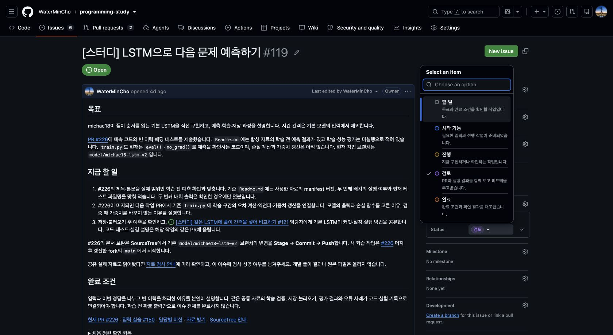
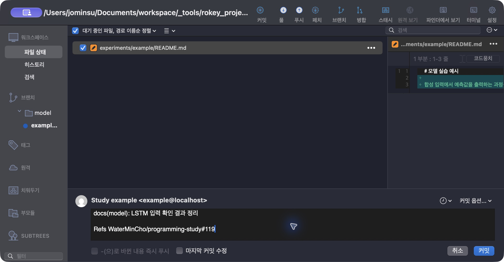
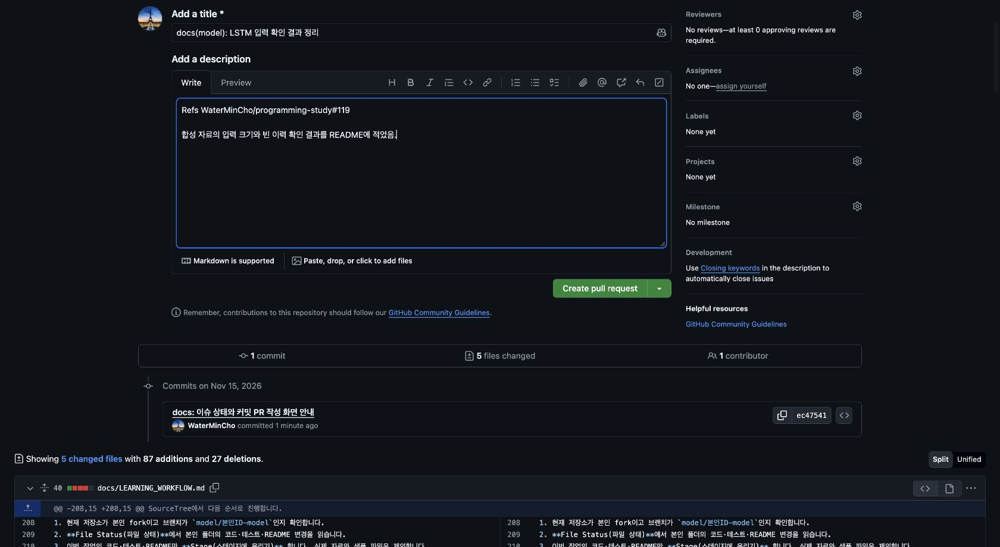
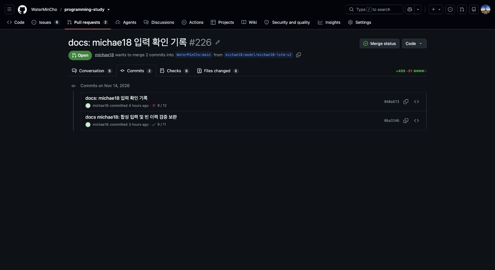

# 이슈 상태를 바꾸고 커밋·PR 보내기

작업할 브랜치는 [기존 작업에서 이어가기](LEARNING_WORKFLOW.md#기존-작업에서-어디부터-이어가나요)에서 확인하세요. 아래는 민혁의 입력 확인 결과를 README에 적는 상황을 가정한 예시입니다. 제목과 설명은 실제로 만든 내용으로 바꿔 적으세요.

SourceTree 화면은 Mac에서 작성한 예시입니다. Windows에서는 메뉴 위치와 이름이 다를 수 있습니다. 커밋·PR 입력 예시는 게시하지 않고 촬영했습니다. 이미지를 누르면 크게 볼 수 있습니다.

## 1. 담당 이슈를 진행으로 바꾸기

| 담당 | 담당 이슈 | 복사할 문장 |
|---|---|---|
| 민혁 · michae18 | [#119](https://github.com/WaterMinCho/programming-study/issues/119) | `Refs WaterMinCho/programming-study#119` |
| 정규 · wamangdoo | [#120](https://github.com/WaterMinCho/programming-study/issues/120) | `Refs WaterMinCho/programming-study#120` |
| 준성 · kimjs85529-a11y | [#121](https://github.com/WaterMinCho/programming-study/issues/121) | `Refs WaterMinCho/programming-study#121` |

본인 담당 이슈를 열고 오른쪽 **Projects → Status → 진행**을 선택하세요.

[](img/study-issue-status.png)

## 2. SourceTree에서 커밋하고 Push하기

본인 fork의 작업 브랜치에서 고친 파일만 **Stage**하세요. **Commit**의 메시지 입력 칸에 아래 글을 넣으세요. 제목 뒤의 빈 줄을 유지하고 `Refs` 줄은 위 표의 본인 문장으로 바꾸세요.

```text
docs(model): LSTM 입력 확인 결과 정리

Refs WaterMinCho/programming-study#119
```

[](img/study-sourcetree-commit.png)

제목이 실제 변경 내용과 맞는지 확인하고 **Commit**을 누르세요. 이어서 **Push**에서 본인 fork인 `origin`과 현재 작업 브랜치를 선택해 보내세요. Commit은 컴퓨터에 변경을 기록하고 Push는 그 기록을 GitHub에 보냅니다.

## 3. GitHub에서 PR 설명 쓰기

본인 fork에서 **Compare & pull request**를 누르세요. 받는 저장소인 `base repository`는 `WaterMinCho/programming-study`, `base`는 `main`으로 고르세요. `head repository`는 본인 fork, `compare`는 방금 Push한 작업 브랜치로 고르세요.

PR 제목에는 실제 변경 내용을 적으세요. 제목 아래 **설명 입력 칸**에는 커밋에 넣은 것과 같은 `Refs` 줄, 실제 만든 내용, 확인 결과를 적으세요. 아래는 입력 확인 결과를 README에 적은 경우의 예시입니다.

```text
Refs WaterMinCho/programming-study#119

합성 자료의 입력 크기와 빈 이력 확인 결과를 README에 적었음.
```

[](img/study-pr-description.png)

복사한 뒤 본인의 이슈 번호와 작업 내용으로 바꾸세요. **Preview**에서 이슈 링크를 눌러 본인 담당 이슈가 열리는지 확인하세요. `Refs` 뒤의 주소는 이 작업이 어느 담당 이슈에 해당하는지 알려줍니다. 보드 상태는 1번의 **Status**에서 바꿉니다.

- 검토받을 준비가 됐다면 **Create pull request**를 누르고 담당 이슈의 `Status`를 `검토`로 바꾸세요.
- 아직 작업 중이면 **Create draft pull request**를 선택하고 `Status`는 `진행`으로 두세요. 검토받을 때 **Ready for review**를 누르고 `Status`를 `검토`로 바꾸세요.

이슈 댓글은 진행이 막혔거나 팀원에게 따로 알릴 내용이 있을 때 남기세요. PR 설명을 그대로 다시 적을 필요는 없습니다.

## 4. 같은 브랜치에서 리뷰 수정하기

PR 위쪽의 작업 브랜치 이름을 확인하세요. SourceTree에서 같은 브랜치를 열고 파일을 고친 뒤 **Stage → Commit → Push**하세요. 커밋 메시지에는 실제 수정 제목과 본인 `Refs` 줄을 넣으세요.

```text
fix(model): 빈 이력 처리 수정

Refs WaterMinCho/programming-study#119
```

[](img/study-pr-followup.png)

위 화면은 민혁의 #226 PR에 커밋 두 개가 들어간 실제 예시입니다. 기존 PR을 새로고침하고 **Commits**에서 추가 커밋을 확인하세요. 고친 내용과 다시 확인한 결과를 PR 댓글에 남기세요. 같은 작업의 수정은 새 PR을 만들지 않습니다. 자세한 조작은 [리뷰 수정 순서](LEARNING_WORKFLOW.md#리뷰-질문에-답하고-수정한-커밋-남기기)를 참고하세요.

담당 이슈의 완료 조건을 모두 채운 마지막 PR에서만 **PR 설명의 `Refs` 줄**을 아래처럼 바꾸세요. 정규는 `#120`, 준성은 `#121`을 사용하세요.

```text
Closes WaterMinCho/programming-study#119
```

이 PR이 공통 저장소의 기본 브랜치 `main`에 머지되면 담당 이슈가 닫힙니다. 남은 작업이 있으면 `Refs`를 유지하세요. 실수로 `Closes`를 적었다면 PR 설명의 **… → Edit**에서 `Refs`로 고치고 **Update comment**로 저장하세요.
