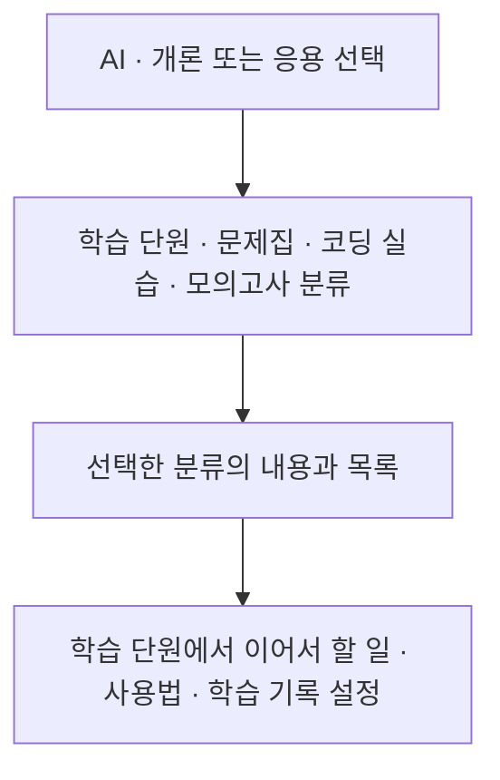

<a id="학습-화면을-읽는-순서에-맞춰-다듬습니다"></a>

# 공통 부품을 화면별로 적용하기

[화면 사용 안내로 돌아갑니다](../gui/README.md)

2026년 11월 17일의 전체 학습앱 리디자인에 맞춰 적용 범위를 갱신했습니다. 채택한 시안의 색·글자 위계·표면·카드·탐색·팝업 구성을 기존 공통 부품과 화면에 반영합니다. 기존 기능·정책·저장 형식·신호 연결은 보존하며 아래 표에서 코드에 반영한 내용과 후속 확인을 구분합니다. 프로그램 담당은 WaterMinCho입니다.

과목에 들어오면 하던 공부를 먼저 찾습니다. 설명을 읽을 때는 큰 그림 속 현재 위치를 확인하고 문제를 풀 때는 지문과 답안에 집중하도록 구성합니다. 글자와 그림을 줄여 공간을 맞추기보다 덜 쓰는 안내를 접고 화면 폭에 맞춰 배치를 바꿉니다.

## 현재 화면과 적용 범위 대조하기

소스 기준 `18a2d6274687f12b367d62dd8ed565c22b3a9fc2` 위의 현재 변경을 대조했습니다. 적용 범위는 아래 파일표를 기준으로 적으며 직접 수정한 파일과 공통 부품의 사용처를 구분합니다. 코드 반영·대표 화면 캡처·기능 검사의 확인 범위도 나눕니다. 구조는 [theme·kit·반복 배치·화면의 책임](UI_DESIGN.md#값과-기본-부품-반복-배치의-책임-구분하기)에 맞춥니다.

| 화면과 현재 진입 | 현행 부품·동작 | 공유 부품 사용과 유지하는 예외 |
| --- | --- | --- |
| 시작 `StartPage` | 준비·오류·재시도, 본인 확인과 첫 동의 순서 | 준비 상태를 유지합니다. 학습 메뉴나 공통 설정을 추가하지 않습니다. |
| 학습 현황 `HubPage` | `HubBar`, 강조한 `NextCard`, 과목 카드, 오답·최근 7일 학습의 반응형 카드, 팀 통계 | 설정은 기존 위치만 유지합니다. 카드 배치와 별도로 집계·이동·권한·기간·늦은 통계 응답·조건부 제출 안내를 유지합니다. |
| 파이썬 `HomePage`, 알고리즘 `JourneyMapPage` | `TopBar`, 다음 회차·문제, 기록 설정 또는 언어·실행 준비 | `overview_pages`의 공통 설정을 사용합니다. 기록 설정과 언어 선택은 현재 대상의 행동으로 유지합니다. |
| AI `AiHomePage`, 차시 `AiLessonPage` | `AI` 상단 제목, 과정 `NavigationTabs`, 반응형 분류 카드 `SectionBrowser`, 차시 목록의 `TopBar`·`BottomBar` | 과정·분류·차시의 위계를 유지합니다. 공통 설정을 사용하며 학습 기록 설정은 학습 단원의 기존 위치를 따릅니다. |
| 파이썬 `RoundPage` | 목록·지문·답안 분할, 코드 입력·실행 결과, `BottomBar` | 작은 창의 목록 폭·패널 여백을 줄이고 넓은 창으로 돌아오면 이전 분할 크기를 복원합니다. 목록을 계속 표시하며 입력·저장·실행·제출 연결을 유지합니다. |
| 알고리즘 `JourneyPage` | 문제·힌트·해설 탭, 코드 입력·실행 결과와 `BottomBar` | 공통 테마와 기존 구획을 사용합니다. 코드 실행·중지, 한글 입력과 이탈 확인은 기존 화면이 소유하며 새 설정 진입은 두지 않습니다. |
| 단원 `AiLearnPage`, 다시 읽기 `RevisitPage`, 노트 `AiNotePage` | 읽기·그림·회상 입력, 단계 이동 또는 노트 읽기 | 학습용 글자·그림 조작을 유지합니다. 노트에는 채점 하단을 강제하지 않으며 새 설정 진입을 추가하지 않습니다. |
| 연습 `PracticePage`, 시험 `MockPage` | 답안·피드백·단계별 행동, 시험 마감과 검토 표시 | 하단 배치를 공유하되 채점·확신·복습과 시험 정책은 합치지 않습니다. 화면 이탈로 시험 시간을 새로 시작하거나 멈추지 않습니다. 새 설정 진입은 두지 않습니다. |
| 결과 `ResultPage`, 오답 `WrongPage` | 결과·문항·해설·재풀이와 `BottomBar` | 선택·필터·분할 위치를 유지합니다. 결과 화면의 기존 제출 안내 허용과 공통 설정 허용 목록을 혼동하지 않습니다. |
| 커리어 `CareerRoadmapPage`, `CareerMagazinePage` | `ReadingPage`, 내용별 카드, 상세 `NavigationTabs`, 단계 카드와 논문 대표 그림 | 동적 생성 뒤 `overview_pages`에 등록한 페이지에서 공통 설정을 사용합니다. 직무 저장·추천·목록 복귀와 영상 종료·전체화면은 별도로 유지합니다. 제출 안내 허용 목록에는 자동 추가하지 않습니다. |
| 확인·동의·기록 설정·추천·논문 팝업 | 제목·본문·하단의 면을 나눈 `DialogLayout`, 기존 `ActionLayout` | 고정 제목·하단과 본문 스크롤을 유지합니다. 입력 저장·관심 직무 저장·동의·파일 전송은 각각의 기존 정책을 따릅니다. |
| 그림·영상·확대 로드맵·튜토리얼 | 확대·이동·재생·전체화면·원래 위치 복원 | 공통 글자와 행동 줄을 사용하되 캔버스·미디어·실제 위젯 안내를 같은 고정 폭 폼으로 합치지 않습니다. |

웹 면접 화면은 등록 코드가 남아 있지만 현재 공개 메뉴에서 제외합니다. 이번 공통화가 공개 범위를 넓히지는 않습니다. 이름이 같은 `ViewState`도 안내의 부모 입력·초점 복원과 논문의 단계별 위치·펼침처럼 소유한 상태가 다르면 합치지 않습니다.

## 행동 줄과 설정의 공통 계약 적용하기

`DialogLayout`·`BottomBar`·`SubmissionBar`는 공통 `ActionLayout`을 사용합니다. 위젯·신호·기존 호출 계약과 영역별 여백·행동 순서는 [행동 줄 배치](UI_DESIGN.md#행동-줄의-배치-계산-공유하기)를 따릅니다. 공통 설정의 허용 화면·잠금·취소·동의·초점은 [설정 동작 계약](UI_DESIGN.md#상단과-현재-작업-하단의-역할-구분하기)에 모아 관리합니다.

전체 앱의 시각 구성을 바꾸면서 기존 `ReadingPage`·`SectionBrowser`·행동 줄을 재사용합니다. 답안 폼·채점·저장·시간 정책은 각 화면이 계속 소유합니다. 안쪽 여백·본문 높이·스크롤 소유자와 `stretch`·`sizePolicy`·`heightForWidth`를 함께 정하며 남는 높이가 제목과 본문 사이에 쌓이지 않게 합니다.

## 시각 변경을 실제 사용처에 연결하기

| 변경 파일·공통 부품 사용처 | 현재 반영 범위 | 보존할 동작 |
| --- | --- | --- |
| `gui/theme.py`, `gui/kit.py` | 청회색·남색 바탕, 파란 주 행동, 얇은 카드 선, 30px 제목·18px 탐색·44px 기본 버튼, 파랑·청록 배경의 `NextCard` | 글자 3단계·두 테마, 학습용 글자·간격, 다음 행동 선택·클릭 신호 |
| `gui/navigation.py` | 선택한 사이드바 항목을 파란색으로 채우고 글자·아이콘을 흰색으로 표시 | 현재 선택·커리어 펼침·키보드 이동·기존 탐색 허용 조건 |
| `gui/ai_home.py`, `gui/section_browser.py` | `AI` 상단 제목, 넓고 높은 화면의 아이콘·설명 카드, 작은 화면의 이름 중심 분류 | 과정·분류별 내용·읽던 위치, 안내·기록 설정의 표시 조건 |
| `gui/hub_page.py`, `gui/team_dashboard.py` | 오답·최근 7일 학습의 2열·1열 전환, 팀 지표 숫자 확대, 기간 그래프를 전체 누적 앞에 배치 | 개인·팀 지표 구분, 기간·권한·이동·최근 채점 목록의 표시 조건 |
| `gui/career_roadmap.py`, `gui/career_learning_path.py` | 소개·직무 제목·장면·접는 내용을 카드로 묶고 상세 탭·학습 단계·연결선을 정리 | 직무 목록 필터·상세 변경·목록 복귀·관심 저장·수업 범위·확대 |
| `gui/career_magazine.py`, `gui/career_paper_preview.py` | 큰 페이지 제목, 검색·출처 필터 카드, 논문 대표 그림 강조와 그림 설명 버튼 이동 | 검색·출처·탭별 위치·원문 열기·그림 설명·영상 재생 |
| `gui/dialog_layout.py` | 제목 위 24px·본문 위 16px 여백, 제목·본문·하단의 면과 경계선 분리 | 고정 제목·하단, 본문 스크롤, 부모 창 맞춤·초점·확인·닫기 |
| `gui/round_page.py` | 작은 창의 목록 160px·패널 좌우 여백 0px, 넓은 창의 여백 8px, 제목·내용 12px와 답안 패널 내부 16px 간격, 분할 크기 복원 코드 반영 | 목록·지문·답안 순서, 선택·답안·저장·코드 실행·제출·기존 신호 |
| `gui/ai_learn.py`, `gui/ai_quiz.py`, `gui/ai_mock.py`, `gui/result_page.py`, `gui/journey_page.py`의 공통 부품 사용처 | 공통 색·표면·버튼을 반영하며 기존 본문·입력·행동·결과 구획 유지 | 학습 단계·그림 조작·답안·채점·시험 마감·결과·재풀이 |

색과 크기의 실제 값은 [공통 색·글자 역할](UI_DESIGN.md#색과-글자-역할-적용하기)을 따릅니다. 공통 부품 사용처로 적은 화면에는 구획을 감싸는 상자를 추가하지 않습니다. Round의 목록 폭·패널 여백·분할 복원은 아래 적용표에서 현재 반영과 확인할 조건을 구분합니다.

<a id="과목-홈에서-하던-공부를-먼저-찾습니다"></a>

## 과목 홈에서 하던 공부 먼저 찾기

현재 AI 홈은 과정 탭 아래에서 학습 단원·문제집·코딩으로 실전학습하기·모의고사를 고릅니다. 선택한 분류만 본문에 표시하며 과정 설명·이어서 할 일·안내·학습 기록 설정은 학습 단원에만 둡니다. 분류별 읽던 위치는 학습자·과정별로 보존합니다.

개론·응용 탭과 하위 분류를 다른 위계로 유지합니다. 이미 있는 과목 메뉴와 데이터 관리 진입도 보존합니다. 과정은 테두리와 선택 배경으로 구분합니다. 하위 분류는 분류 영역 너비 1100px 이상·창 높이 700px 이상에서 아이콘·이름·설명을 담은 카드로 펼칩니다. 그보다 좁거나 낮으면 이름만 표시합니다. 이 너비는 사이드바·본문 여백을 포함한 창 너비와 구분합니다.

분류 버튼은 같은 폭으로 나누며 실제 글자 폭과 가장 긴 단어의 폭으로 3열·2열을 결정합니다. 펼친 카드와 이름만 보이는 상태 모두 긴 이름은 줄바꿈하고 높이를 맞춥니다. 선택한 분류는 파란 테두리와 배경으로, 키보드 초점은 점선으로 구분합니다. 차시 제목도 줄바꿈해 끝까지 표시합니다.



학습 단원 분류는 760×480 창에서 이어서 할 일의 제목·버튼과 목록 접근을 확인합니다. 다른 분류에는 이 카드를 넣지 않습니다. 과정·분류 탐색이 본문 공간을 과도하게 차지하지 않는지도 함께 확인합니다. 읽음·연습 완료·날짜를 띄운 복습은 각각 표시하며 하나의 숙련도 수치로 합치지 않습니다. 제출 안내는 제출하지 않은 변경이나 받을 자료가 있을 때만 나타나게 유지합니다.

<a id="설명을-읽다가-큰-그림을-잃지-않게-합니다"></a>

## 현재 학습 단계와 전체 과정 연결하기

AI 학습 화면은 제목·단계 탐색, 본문 카드 안의 설명·그림·회상 입력, 고정 하단의 이전·다음으로 구성합니다. 기존 `ai/learning-map.json`의 연결 정보와 명칭, 그림 확대·재생, 심화 설명 진입을 유지합니다. 현재 구획에 공통 테마를 반영하며 별도 진도 체계나 본문 바깥 상자를 추가하지 않습니다.

본문과 그림은 기존 학습용 글자·행간·읽기 폭을 사용합니다. 그림 재생·장 넘김·확대는 그림 가까이에 두고 학습 이전·다음은 하단에서 구분합니다. AI 연습과 시험도 기존 문항 카드 안에 지문·입력을 두며 채점·이동·제출은 단계별 행동 영역에 표시합니다.

임시 자료로 만든 1440×900·보통 글자·밝은 테마의 캡처에서 AI 학습·연습·시험의 내용·입력·행동 구분을 확인했습니다. 파이썬 결과에서도 점수·문항 목록·해설·하단 행동의 기존 구획을 확인했습니다. AI 연습 결과와 시험 해설은 현재 코드에서 같은 카드와 단계별 행동을 재사용합니다. 이 확인을 모든 상태의 실행이나 단계 왕복·답안·시험 시간 보존 검사의 완료로 확대하지 않습니다.

<a id="문제-종류에-맞춰-지문과-답안을-놓습니다"></a>

## 문제 종류에 맞춰 지문과 답안 놓기

현재 `gui/round_page.py`는 문제 목록·지문·답안의 분할 구조를 유지합니다. 페이지 너비가 `2 * kit.PANE_MIN + 245 + 2 * kit.MARGIN`보다 작으면 목록 폭을 160px로 배분하고 지문·답안 패널의 좌우 여백을 0px로 줄입니다. 넓은 창에서는 패널 좌우 여백을 8px로 둡니다. 제목과 내용은 12px, 답안 패널 안의 안내와 입력은 16px 간격을 사용합니다.

창을 좁히기 전에 목록·지문·답안의 가로 분할 크기를 보관합니다. 작은 창에서는 목록을 제외한 폭에 기존 지문·답안 비율을 적용하며 넓히면 보관한 목록 폭과 지문·답안 비율을 복원합니다. 목록은 계속 표시하며 코드 입력·실행 결과는 기존 세로 분할을 사용합니다.

라디오 버튼과 라벨은 첫 글줄에 맞춥니다. 긴 선택지, 여러 줄 해설, 빈칸 입력, 긴 버튼 이름을 실제 자료로 확인합니다. 선택지와 답안 영역을 재배치한 뒤 작성한 답·선택·커서 위치가 보존되는지 확인합니다.

Round의 배치 검사는 작은 창·최대 글자에서 코드 입력 높이와 실행 결과 영역을 함께 확인합니다. 넓은 창으로 돌아올 때 기존 분할 비율과 답안·선택·커서·읽던 위치를 대조합니다. 임시 기록을 사용하며 코드 반영만으로 기능 보존 검사를 완료 처리하지 않습니다.

<a id="단계마다-바뀐-화면만-확인합니다"></a>

## 단계마다 바뀐 화면만 확인하기

| 적용 범위 | 현재 상태 | 변경 시 확인 |
| --- | --- | --- |
| 공통 색·글자·탐색·다음 행동 | 새 토큰, 선택 사이드바, 강조한 `NextCard` 적용 | 대비·선택과 초점·기본 버튼 44px·글자 확대·카드 줄바꿈을 실제 사용처에서 확인합니다. |
| 행동 줄·팝업 | 공통 행동 줄 유지, 팝업의 제목·본문·하단 면과 여백 변경 | 줄바꿈·순서·숨김·글꼴 변경·신호 중복·부모 창 맞춤과 기존 확대창을 확인합니다. |
| 공통 설정 진입 | 허용한 `overview_pages`의 기존 연결 유지 | 각 화면 상단 오른쪽 끝의 같은 크기 설정을 사용합니다. 작은 창·최대 글자에서 이웃 도구와의 폭·정렬, 앵커·화면 이탈·잠금·취소·동의·초점을 확인합니다. |
| AI 홈 | 과정 탭과 반응형 분류 카드, 이어서 할 일, 차시 제목 줄바꿈 적용 | 분류 영역 너비 1099·1100px와 창 높이 699·700px 주변에서 표시 전환을 확인합니다. 과정·분류·읽던 위치·긴 차시명·예습·키보드 이동을 대조합니다. |
| 학습 현황·팀 통계 | 과목 3열·2열·1열과 오답·최근 7일 학습의 2열·1열, 기간 그래프·누적 순서 적용 | 두 카드의 필요 폭으로 전환되는지 확인합니다. 빈 기록·최근 채점 숨김·글자 확대·지표·이동·기간·권한을 대조합니다. |
| 커리어·매거진 | 내용별 카드, 상세 탐색 탭, 단계·논문 그림 강조 적용 | 직무 변경·목록 복귀·관심 저장·접기·펼치기·검색·탭별 위치·영상 종료·확대를 확인합니다. |
| 학습 기록 설정 | 상태 카드에 기록 수 표시, 세 설정을 테두리 있는 접기 영역으로 구분 | 파이썬·AI의 동의·철회·전송·파일 저장·희망 직무와 초점·스크롤을 확인합니다. |
| AI 학습·다시 읽기·노트 | 공통 테마 반영, 기존 본문·그림·회상 입력·하단 구획 유지 | 대표 학습 캡처에서 구획을 확인했습니다. 단계 왕복·그림 확대와 재생·심화 창·읽던 위치·답안은 관련 기능 검사로 대조합니다. |
| AI 연습·시험 | 공통 테마 반영, 기존 지문·입력 카드와 단계별 하단 행동 유지 | 대표 풀이 캡처에서 구획을 확인했습니다. 채점 전후·중단 복원·문항 전환·시험 마감은 별도로 확인합니다. |
| 결과·해설 | 공통 테마 반영, 기존 점수·문항·해설·재풀이 구획 유지 | 파이썬 결과 캡처와 AI 결과 처리 코드를 대조했습니다. 첫 점수·재채점·오답 연결·허용된 제출 동작을 기능 검사에서 확인합니다. |
| 파이썬 Round | 작은 창의 목록 160px·패널 여백 0px, 넓은 창의 여백 8px와 분할 복원 코드 반영 | 작은 창·최대 글자의 지문·입력·실행 결과 겹침, 창 왕복의 분할 비율·답안·선택·초점과 실행·저장·제출을 확인합니다. |
| 알고리즘 문제 | 공통 테마 반영, 기존 문제·코드·결과·행동 구획 유지 | 대표 캡처의 구획 확인과 실행·중지·언어 선택·저장·이탈 검사를 구분합니다. |

이 표는 코드 반영·대표 캡처 확인과 별도로 검사할 조건을 구분하며 전체 제품 QA·PR CI의 완료를 뜻하지 않습니다. 각 단계에서 760×480 창과 글자 3단계, 밝고 어두운 테마를 확인합니다. 과목 메뉴는 1119·1120px 주변과 실제 글자 폭으로 계산한 전환점에서 확인합니다. AI 분류 카드의 너비·높이 조건과 Hub 카드의 필요 폭은 각각 따로 대조합니다. 배치에 영향을 주는 변경은 Windows 실제 창에서도 확인합니다. 기존 테스트는 유지하고 변경한 기능과 발견한 반례만 먼저 검사합니다. 코드·입력·환경이 같으면 통과한 전체 검사와 캡처는 반복하지 않으며 최종 전체 검사는 PR의 CI 결과를 사용합니다.

## 공통 부품 예시 저장하기

저장소 루트에서 PyQt6가 설치된 Python으로 [공통 부품 예시 도구](../tools/preview_design_system.py)를 실행합니다. 아래 명령은 offscreen으로만 저장하며 사용 중인 창을 열지 않습니다.

```sh
QT_QPA_PLATFORM=offscreen python3 tools/preview_design_system.py --out /tmp/rokey-design-system-preview
```

도구는 실제 `TopBar`·`NavigationTabs`·`BottomBar`·`DialogLayout`을 사용합니다. 최대 글자와 두 테마에서 760×480·1280×800 페이지 예시를 저장하며 대화상자는 별도 PNG로 저장합니다. 현재 코드의 출력 이름은 `components-light-760.png`, `components-dark-1280.png` 같은 페이지 파일과 `dialog-light.png`·`dialog-dark.png`입니다. 학습 기록과 서버에 접근하지 않습니다.

예시의 버튼과 본문은 부품 배치 확인용이며 실제 기능 노출 범위를 정하지 않습니다. 이전에 저장한 예시는 새 토큰과 화면 배치의 검증 결과로 사용하지 않습니다. 현재 코드로 생성한 결과와 키보드·답안·타이머·비동기 응답·Windows 실제 창의 확인을 구분합니다. 동작 검사는 [변경별 검사 선택](CHANGE_IMPACT.md#변경별-검사-선택하기)을 따릅니다.

<a id="참고-자료에서-구조를-가져옵니다"></a>

## 참고 자료에서 구조 가져오기

| 자료 | 적용할 부분 | 적용할 때 구분할 점 |
| --- | --- | --- |
| [프로그래머스 캠퍼스](https://campus.programmers.co.kr/intro) | 과정 선택과 목록·목차의 구분 | 확인한 것은 공개 소개와 과정 목록·목차 구조이며 강의 내부 전체의 사용성은 확인하지 않았습니다. |
| [E-Learning Dashboard](https://dribbble.com/shots/26999344-E-Learning-Dashboard) | 제목·본문·보조 정보의 위계 | Product SAAS for Cansaas의 디자인 시안입니다. 실제 학습 효과의 근거로 사용하지 않습니다. |
| [Course Detail View](https://dribbble.com/shots/22667629-Course-Detail-View) | 강의 정보와 단원 목록의 구분 | Paresh Khatri의 디자인 시안입니다. 브랜드·이미지를 복사하지 않습니다. |
| [W3C Reflow](https://www.w3.org/WAI/WCAG22/Understanding/reflow.html) | 좁은 폭에서 내용의 순서와 접근 유지 | 웹 접근성 설명을 Qt 배치 검토에 참고하며 이 계획만으로 적합성을 선언하지 않습니다. |
| [W3C Text Spacing](https://www.w3.org/WAI/WCAG22/Understanding/text-spacing.html) | 글자·행간을 늘려도 내용과 조작 유지 | 글자를 줄여 잘림을 숨기지 않고 실제 큰 글자 설정으로 확인합니다. |

간격·글꼴·너비의 공통값은 [UI 설계 기준](UI_DESIGN.md)을 따릅니다. 시각적 완성도, 실제 조작 가능 여부, 사람의 이해·기억은 각각 확인한 범위로 기록합니다.
