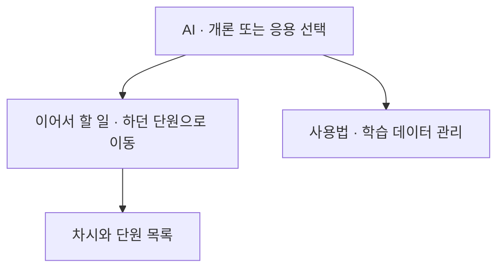

# 학습 화면을 읽는 순서에 맞춰 다듬습니다

[화면 사용 안내로 돌아갑니다](../gui/README.md)

이 문서는 2026년 11월 11일 확인한 화면과 디자인 참고 자료를 바탕으로 작성한 적용 계획입니다. 화면 개편은 아직 적용하지 않았습니다. 프로그램 담당은 WaterMinCho입니다.

과목에 들어오면 하던 공부를 먼저 찾습니다. 설명을 읽을 때는 큰 그림 속 현재 위치를 확인하고 문제를 풀 때는 지문과 답안에 집중하도록 구성합니다. 글자와 그림을 줄여 공간을 맞추기보다 덜 쓰는 안내를 접고 화면 폭에 맞춰 배치를 바꿉니다.

## 과목 홈에서 하던 공부를 먼저 찾습니다

현재 AI 홈에는 제목, 사용 안내·학습 데이터 버튼, 과정 선택, 소개와 현황, 이어서 할 일, 단원 목록이 차례로 놓입니다. 좁고 낮은 창에서는 단원을 보기까지 내려가는 거리가 깁니다.

제목 아래에서 개론·응용을 고르고 바로 이어서 할 일을 확인하도록 배치합니다. 이미 있는 과목 메뉴는 유지합니다. 반복되는 소개는 짧게 줄이고 자세한 사용법은 기존 안내 버튼으로 엽니다. 학습 데이터 관리도 찾을 수 있는 이름과 위치를 유지합니다.

완료 기준은 760×480 창에서 스크롤 없이 이어서 할 일의 제목·버튼을 보는 것입니다. 단원 목록은 이어서 할 일 아래에 배치합니다. 읽음·연습 완료·날짜를 띄운 복습은 각각 표시하며 하나의 숙련도 수치로 합치지 않습니다. 제출 안내는 제출하지 않은 변경이나 받을 자료가 있을 때만 나타나게 유지합니다.

## 설명을 읽다가 큰 그림을 잃지 않게 합니다

현재 학습 화면의 제목, 단계 이동, 그림 확대와 재생 기능을 바탕으로 다듬습니다. 기존 전체 과정 안내와 그림 안의 과정 표시를 함께 비교해 중복을 줄입니다. 개념이 바뀌는 지점과 되짚는 질문에서 지금 다루는 부분을 확인하도록 시안을 만듭니다. 기존 `ai/learning-map.json`의 연결 정보와 명칭을 대조하며 별도 진도 체계나 높은 상단 안내를 더 쌓지 않습니다.

본문은 넉넉한 글자와 행간을 유지합니다. 긴 문장을 읽는 폭과 그림·표·코드를 보는 폭은 구분해 시안을 비교합니다. 그림은 가로 공간을 충분히 쓰고 확대 경로를 남깁니다. 그림 재생 버튼은 하나의 조작 묶음으로, 학습 이전·다음은 별도 이동 영역으로 구분합니다.

760×480·1120×720 창에서 차시·단계 이름과 학습 이전·다음 버튼이 보이는지 확인합니다. 그림을 스크롤해 가져왔을 때 재생 버튼이 학습 이동과 다른 묶음에 놓이는지 캡처로 확인합니다. 심화 설명을 닫거나 단계를 왕복한 뒤에도 읽던 위치·입력·초점을 유지합니다. 처음 보는 사람의 이해 여부는 별도 사용 관찰 전까지 미확인으로 남깁니다.

## 문제 종류에 맞춰 지문과 답안을 놓습니다

현재 `gui/round_page.py`에서 확인한 파이썬 문제 화면의 목록·지문·답안 세 영역을 모든 창 크기에서 그대로 좁히지 않습니다. 넓은 창에서는 지문과 답안을 함께 봅니다. 좁은 창에서는 문제 목록을 접거나 열어 사용하도록 시안을 만듭니다. 코드 문제는 코드 입력 공간을 확보합니다. AI 연습의 한 문항 카드는 별도로 살펴 객관식·짧은 빈칸에서 읽기와 선택이 가까운 배치를 비교합니다.

라디오 버튼과 라벨은 첫 글줄에 맞춥니다. 긴 선택지, 여러 줄 해설, 빈칸 입력, 긴 버튼 이름을 실제 자료로 확인합니다. 선택지와 답안 영역을 재배치한 뒤 작성한 답·선택·커서 위치가 보존되는지 확인합니다.

완료 기준은 가로 스크롤 없이 문제와 답안을 사용할 수 있고 버튼 글자가 잘리지 않는 것입니다. 임시 기록으로 전환·복원 경로를 확인하며 실제 풀이 기록은 검사에 쓰지 않습니다.

## 단계마다 바뀐 화면만 확인합니다

| 적용 순서 | 먼저 만드는 결과 | 필요한 확인 |
| --- | --- | --- |
| 과목 홈 | AI 홈의 정보 순서와 이어서 할 일 배치 | 과정 전환, 학습 데이터 진입, 조건부 제출 안내, 기존 진도 표시 |
| 학습 화면 | 읽기 폭·그림 조작·전체 과정 연결 시안 | 단계 왕복, 그림 확대·재생, 심화 창, 읽던 위치와 답안 복원 |
| 문제 화면 | 창 폭과 문제 종류에 따른 배치 | 긴 선택지 정렬, 코드 입력, 문제 전환, 선택·초점 복원 |

각 단계에서 760×480 창, 가장 큰 글자, 밝고 어두운 테마를 확인합니다. 과목 메뉴가 전환되는 폭 1119·1120px도 확인합니다. 배치에 영향을 주는 변경은 Windows 실제 창에서도 확인합니다. 기존 테스트는 유지하고 변경한 기능과 발견한 반례만 먼저 검사합니다. 코드·입력·환경이 같으면 통과한 전체 검사와 캡처는 반복하지 않으며 최종 전체 검사는 PR의 CI 결과를 사용합니다.

## 참고 자료에서 구조를 가져옵니다

| 자료 | 적용할 부분 | 적용할 때 구분할 점 |
| --- | --- | --- |
| [프로그래머스 캠퍼스](https://campus.programmers.co.kr/intro) | 과정 선택과 목록·목차의 구분 | 확인한 것은 공개 소개와 과정 목록·목차 구조이며 강의 내부 전체의 사용성은 확인하지 않았습니다. |
| [E-Learning Dashboard](https://dribbble.com/shots/26999344-E-Learning-Dashboard) | 제목·본문·보조 정보의 위계 | Product SAAS for Cansaas의 디자인 시안입니다. 실제 학습 효과의 근거로 사용하지 않습니다. |
| [Course Detail View](https://dribbble.com/shots/22667629-Course-Detail-View) | 강의 정보와 단원 목록의 구분 | Paresh Khatri의 디자인 시안입니다. 브랜드·이미지를 복사하지 않습니다. |
| [W3C Reflow](https://www.w3.org/WAI/WCAG22/Understanding/reflow.html) | 좁은 폭에서 내용의 순서와 접근 유지 | 웹 접근성 설명을 Qt 배치 검토에 참고하며 이 계획만으로 적합성을 선언하지 않습니다. |
| [W3C Text Spacing](https://www.w3.org/WAI/WCAG22/Understanding/text-spacing.html) | 글자·행간을 늘려도 내용과 조작 유지 | 글자를 줄여 잘림을 숨기지 않고 실제 큰 글자 설정으로 확인합니다. |

간격·글꼴·너비의 공통값은 [UI 설계 기준](UI_DESIGN.md)을 따릅니다. 시각적 완성도, 실제 조작 가능 여부, 사람의 이해·기억은 각각 확인한 범위로 기록합니다.
