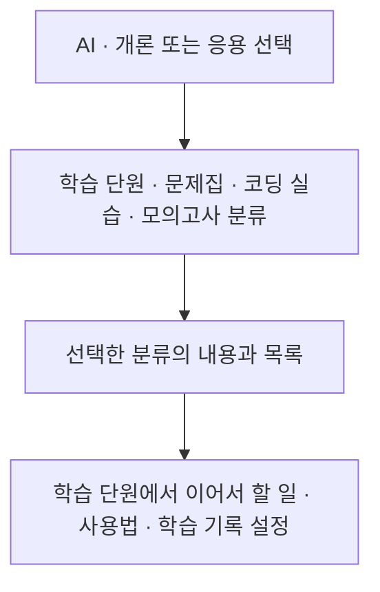

<a id="학습-화면을-읽는-순서에-맞춰-다듬습니다"></a>

# 공통 부품을 화면별로 적용하기

[화면 사용 안내로 돌아갑니다](../gui/README.md)

2026년 11월 11일의 화면 계획을 11월 16일 구현에 맞춰 갱신했습니다. 기존 토큰을 유지하며 행동 줄 공유와 허용한 화면의 공통 설정 진입을 적용했습니다. 관련 부품 검사와 예시 PNG를 확인했습니다. 화면별 적용 범위와 후속 작업은 아래 표에서 구분합니다. 프로그램 담당은 WaterMinCho입니다.

과목에 들어오면 하던 공부를 먼저 찾습니다. 설명을 읽을 때는 큰 그림 속 현재 위치를 확인하고 문제를 풀 때는 지문과 답안에 집중하도록 구성합니다. 글자와 그림을 줄여 공간을 맞추기보다 덜 쓰는 안내를 접고 화면 폭에 맞춰 배치를 바꿉니다.

## 현재 화면과 적용 범위 대조하기

소스 기준 `0b7c5d0b714972a800b6dfc057009516496692fa`에서 공개 진입과 연결된 페이지·팝업을 대조했습니다. 화면 목록은 이 소스 대조를 기준으로 유지하고 공통 부품 사용 상태는 이번 구현에 맞춰 갱신했습니다. 표 전체를 전수 실행·캡처한 결과는 아닙니다. 새 구조는 [theme·kit·반복 배치·화면의 책임](UI_DESIGN.md#값과-기본-부품-반복-배치의-책임-구분하기)에 맞춥니다.

| 화면과 현재 진입 | 현행 부품·동작 | 공유 부품 사용과 유지하는 예외 |
| --- | --- | --- |
| 시작 `StartPage` | 준비·오류·재시도, 본인 확인과 첫 동의 순서 | 준비 상태를 유지합니다. 학습 메뉴나 공통 설정을 추가하지 않습니다. |
| 학습 현황 `HubPage` | `HubBar`, 현재 설정 메뉴, 다음 학습·최근 기록·팀 통계, 조건부 제출 안내 | 설정은 기존 위치만 유지합니다. 새 공통 버튼은 숨기고 권한·기간·늦은 통계 응답을 따로 처리합니다. |
| 파이썬 `HomePage`, 알고리즘 `JourneyMapPage` | `TopBar`, 다음 회차·문제, 기록 설정 또는 언어·실행 준비 | `overview_pages`의 공통 설정을 사용합니다. 기록 설정과 언어 선택은 현재 대상의 행동으로 유지합니다. |
| AI `AiHomePage`, 차시 `AiLessonPage` | 과정 `NavigationTabs`, 분류 `SectionBrowser`, 차시 목록의 `TopBar`·`BottomBar` | 과정·분류·차시의 위계를 유지합니다. 공통 설정을 사용하며 학습 기록 설정은 학습 단원의 기존 위치를 따릅니다. |
| 파이썬 `RoundPage`, 알고리즘 `JourneyPage` | 목록·지문·입력·실행 결과와 `BottomBar` | `BottomBar`의 행동 줄 배치를 공유합니다. 회차 저장과 코드 실행·중지, 한글 입력과 이탈 확인은 각 화면이 소유합니다. 새 설정 진입은 두지 않습니다. |
| 단원 `AiLearnPage`, 다시 읽기 `RevisitPage`, 노트 `AiNotePage` | 읽기·그림·회상 입력, 단계 이동 또는 노트 읽기 | 학습용 글자·그림 조작을 유지합니다. 노트에는 채점 하단을 강제하지 않으며 새 설정 진입을 추가하지 않습니다. |
| 연습 `PracticePage`, 시험 `MockPage` | 답안·피드백·단계별 행동, 시험 마감과 검토 표시 | 하단 배치를 공유하되 채점·확신·복습과 시험 정책은 합치지 않습니다. 화면 이탈로 시험 시간을 새로 시작하거나 멈추지 않습니다. 새 설정 진입은 두지 않습니다. |
| 결과 `ResultPage`, 오답 `WrongPage` | 결과·문항·해설·재풀이와 `BottomBar` | 선택·필터·분할 위치를 유지합니다. 결과 화면의 기존 제출 안내 허용과 공통 설정 허용 목록을 혼동하지 않습니다. |
| 커리어 `CareerRoadmapPage`, `CareerMagazinePage` | `ReadingPage`, 직무 목록·상세·탭, 영상·논문 탐색 | 동적 생성 뒤 `overview_pages`에 등록한 페이지에서 공통 설정을 사용합니다. 직무 저장·추천과 영상 종료·전체화면은 별도로 유지합니다. 제출 안내 허용 목록에는 자동 추가하지 않습니다. |
| 확인·동의·기록 설정·추천·논문 팝업 | `DialogLayout`, 기존 `ActionLayout`, 각 호출의 확인·취소·저장 | 공통 행동 줄을 유지합니다. 입력 저장·관심 직무 저장·동의·파일 전송은 각각의 기존 정책을 따릅니다. |
| 그림·영상·확대 로드맵·튜토리얼 | 확대·이동·재생·전체화면·원래 위치 복원 | 공통 글자와 행동 줄을 사용하되 캔버스·미디어·실제 위젯 안내를 같은 고정 폭 폼으로 합치지 않습니다. |

웹 면접 화면은 등록 코드가 남아 있지만 현재 공개 메뉴에서 제외합니다. 이번 공통화가 공개 범위를 넓히지는 않습니다. 이름이 같은 `ViewState`도 안내의 부모 입력·초점 복원과 논문의 단계별 위치·펼침처럼 소유한 상태가 다르면 합치지 않습니다.

## 행동 줄과 설정의 공통 계약 적용하기

`DialogLayout`·`BottomBar`·`SubmissionBar`는 공통 `ActionLayout`을 사용합니다. 위젯·신호·기존 호출 계약과 영역별 여백·행동 순서는 [행동 줄 배치](UI_DESIGN.md#행동-줄의-배치-계산-공유하기)를 따릅니다. 공통 설정의 허용 화면·잠금·취소·동의·초점은 [설정 동작 계약](UI_DESIGN.md#상단과-현재-작업-하단의-역할-구분하기)에 모아 관리합니다.

화면 틀 전체 교체와 답안 폼·채점 상태의 통합은 이번 범위에 넣지 않습니다. 홈·목록·읽기 화면은 기존 `ReadingPage`와 `SectionBrowser`를 유지한 채 같은 내용으로 배치를 비교합니다. 안쪽 여백·본문 높이·스크롤 소유자와 `stretch`·`sizePolicy`·`heightForWidth`를 함께 정하며 남는 높이가 제목과 본문 사이에 쌓이지 않게 합니다.

<a id="과목-홈에서-하던-공부를-먼저-찾습니다"></a>

## 과목 홈에서 하던 공부 먼저 찾기

현재 AI 홈은 과정 탭 아래에서 학습 단원·문제집·코딩으로 실전학습하기·모의고사를 고릅니다. 선택한 분류만 본문에 표시하며 과정 설명·이어서 할 일·안내·학습 기록 설정은 학습 단원에만 둡니다. 분류별 읽던 위치는 학습자·과정별로 보존합니다.

개론·응용 탭과 하위 분류를 다른 위계로 유지합니다. 이미 있는 과목 메뉴와 데이터 관리 진입도 보존합니다. 반복되는 소개를 더 줄일 때는 실제 분류의 내용과 다음 행동이 남는지 확인합니다. 긴 메뉴는 이름을 자르지 않고 기존 두 열 배치를 사용합니다.



학습 단원 분류는 760×480 창에서 이어서 할 일의 제목·버튼과 목록 접근을 확인합니다. 다른 분류에는 이 카드를 넣지 않습니다. 과정·분류 탐색이 본문 공간을 과도하게 차지하지 않는지도 함께 확인합니다. 읽음·연습 완료·날짜를 띄운 복습은 각각 표시하며 하나의 숙련도 수치로 합치지 않습니다. 제출 안내는 제출하지 않은 변경이나 받을 자료가 있을 때만 나타나게 유지합니다.

<a id="설명을-읽다가-큰-그림을-잃지-않게-합니다"></a>

## 현재 학습 단계와 전체 과정 연결하기

현재 학습 화면의 제목, 단계 이동, 그림 확대와 재생 기능을 바탕으로 다듬습니다. 기존 전체 과정 안내와 그림 안의 과정 표시를 함께 비교해 중복을 줄입니다. 개념이 바뀌는 지점과 되짚는 질문에서 지금 다루는 부분을 확인하도록 시안을 만듭니다. 기존 `ai/learning-map.json`의 연결 정보와 명칭을 대조하며 별도 진도 체계나 높은 상단 안내를 더 쌓지 않습니다.

본문은 넉넉한 글자와 행간을 유지합니다. 긴 문장을 읽는 폭과 그림·표·코드를 보는 폭은 구분해 시안을 비교합니다. 그림은 가로 공간을 충분히 쓰고 확대 경로를 남깁니다. 그림 재생 버튼은 하나의 조작 묶음으로, 학습 이전·다음은 별도 이동 영역으로 구분합니다.

760×480·1120×720 창에서 차시·단계 이름과 학습 이전·다음 버튼이 보이는지 확인합니다. 그림을 스크롤해 가져왔을 때 재생 버튼이 학습 이동과 다른 묶음에 놓이는지 캡처로 확인합니다. 심화 설명을 닫거나 단계를 왕복한 뒤에도 읽던 위치·입력·초점을 유지합니다. 처음 보는 사람의 이해 여부는 별도 사용 관찰 전까지 미확인으로 남깁니다.

<a id="문제-종류에-맞춰-지문과-답안을-놓습니다"></a>

## 문제 종류에 맞춰 지문과 답안 놓기

현재 `gui/round_page.py`에서 확인한 파이썬 문제 화면의 목록·지문·답안 세 영역을 모든 창 크기에서 그대로 좁히지 않습니다. 넓은 창에서는 지문과 답안을 함께 봅니다. 좁은 창에서는 문제 목록을 접거나 열어 사용하도록 시안을 만듭니다. 코드 문제는 코드 입력 공간을 확보합니다. AI 연습의 한 문항 카드는 별도로 살펴 객관식·짧은 빈칸에서 읽기와 선택이 가까운 배치를 비교합니다.

라디오 버튼과 라벨은 첫 글줄에 맞춥니다. 긴 선택지, 여러 줄 해설, 빈칸 입력, 긴 버튼 이름을 실제 자료로 확인합니다. 선택지와 답안 영역을 재배치한 뒤 작성한 답·선택·커서 위치가 보존되는지 확인합니다.

완료 기준은 가로 스크롤 없이 문제와 답안을 사용할 수 있고 버튼 글자가 잘리지 않는 것입니다. 임시 기록으로 전환·복원 경로를 확인하며 실제 풀이 기록은 검사에 쓰지 않습니다.

<a id="단계마다-바뀐-화면만-확인합니다"></a>

## 단계마다 바뀐 화면만 확인하기

| 적용 범위 | 현재 상태 | 변경 시 확인 |
| --- | --- | --- |
| 행동 줄 공유 | 대화상자·학습 하단·제출 안내에 적용, 관련 검사 통과 | 줄바꿈·순서·숨김·글꼴 변경·신호 중복과 기존 확대창을 확인합니다. |
| 공통 설정 진입 | 허용한 `overview_pages`에 적용, 관련 검사 통과 | Hub 중복 숨김·앵커·화면 이탈·잠금·취소·동의·초점 계약을 확인합니다. |
| 과목 홈 | 현행 과정·분류와 이어서 할 일의 정보 위계 | 후속 비교 범위입니다. 과정 전환·학습 기록 설정·조건부 제출 안내·기존 진도를 유지합니다. |
| 학습 화면 | 읽기 폭·그림 조작·전체 과정 연결 시안 | 후속 비교 범위입니다. 단계 왕복·그림 확대와 재생·심화 창·읽던 위치와 답안을 확인합니다. |
| 문제 화면 | 창 폭과 문제 종류에 따른 배치 | 후속 비교 범위입니다. 긴 선택지·코드 입력·문제 전환·선택과 초점 복원을 확인합니다. |

각 단계에서 760×480 창과 글자 3단계, 밝고 어두운 테마를 확인합니다. 과목 메뉴는 1119·1120px 주변과 실제 글자 폭으로 계산한 전환점에서 확인합니다. 배치에 영향을 주는 변경은 Windows 실제 창에서도 확인합니다. 기존 테스트는 유지하고 변경한 기능과 발견한 반례만 먼저 검사합니다. 코드·입력·환경이 같으면 통과한 전체 검사와 캡처는 반복하지 않으며 최종 전체 검사는 PR의 CI 결과를 사용합니다.

## 공통 부품 예시 저장하기

저장소 루트에서 PyQt6가 설치된 Python으로 [공통 부품 예시 도구](../tools/preview_design_system.py)를 실행합니다. 아래 명령은 offscreen으로만 저장하며 사용 중인 창을 열지 않습니다.

```sh
QT_QPA_PLATFORM=offscreen python3 tools/preview_design_system.py --out /tmp/rokey-design-system-preview
```

도구는 실제 `TopBar`·`NavigationTabs`·`BottomBar`·`DialogLayout`을 사용합니다. 최대 글자와 두 테마에서 760×480·1280×800 페이지 예시를 저장하며 대화상자는 별도 PNG로 저장합니다. 현재 코드의 출력 이름은 `components-light-760.png`, `components-dark-1280.png` 같은 페이지 파일과 `dialog-light.png`·`dialog-dark.png`입니다. 학습 기록과 서버에 접근하지 않습니다.

페이지 4개와 대화상자 2개의 PNG를 저장하고 확인했습니다. 예시의 버튼과 본문은 부품 배치 확인용이며 실제 기능 노출 범위를 정하지 않습니다. 키보드·답안·타이머·비동기 응답이나 Windows 실제 창의 검증을 대신하지 않습니다. 동작 검사는 [변경별 검사 선택](CHANGE_IMPACT.md#변경별-검사-선택하기)을 따릅니다.

<a id="참고-자료에서-구조를-가져옵니다"></a>

## 참고 자료에서 구조 가져오기

| 자료 | 적용할 부분 | 적용할 때 구분할 점 |
| --- | --- | --- |
| [프로그래머스 캠퍼스](https://campus.programmers.co.kr/intro) | 과정 선택과 목록·목차의 구분 | 확인한 것은 공개 소개와 과정 목록·목차 구조이며 강의 내부 전체의 사용성은 확인하지 않았습니다. |
| [E-Learning Dashboard](https://dribbble.com/shots/26999344-E-Learning-Dashboard) | 제목·본문·보조 정보의 위계 | Product SAAS for Cansaas의 디자인 시안입니다. 실제 학습 효과의 근거로 사용하지 않습니다. |
| [Course Detail View](https://dribbble.com/shots/22667629-Course-Detail-View) | 강의 정보와 단원 목록의 구분 | Paresh Khatri의 디자인 시안입니다. 브랜드·이미지를 복사하지 않습니다. |
| [W3C Reflow](https://www.w3.org/WAI/WCAG22/Understanding/reflow.html) | 좁은 폭에서 내용의 순서와 접근 유지 | 웹 접근성 설명을 Qt 배치 검토에 참고하며 이 계획만으로 적합성을 선언하지 않습니다. |
| [W3C Text Spacing](https://www.w3.org/WAI/WCAG22/Understanding/text-spacing.html) | 글자·행간을 늘려도 내용과 조작 유지 | 글자를 줄여 잘림을 숨기지 않고 실제 큰 글자 설정으로 확인합니다. |

간격·글꼴·너비의 공통값은 [UI 설계 기준](UI_DESIGN.md)을 따릅니다. 시각적 완성도, 실제 조작 가능 여부, 사람의 이해·기억은 각각 확인한 범위로 기록합니다.
