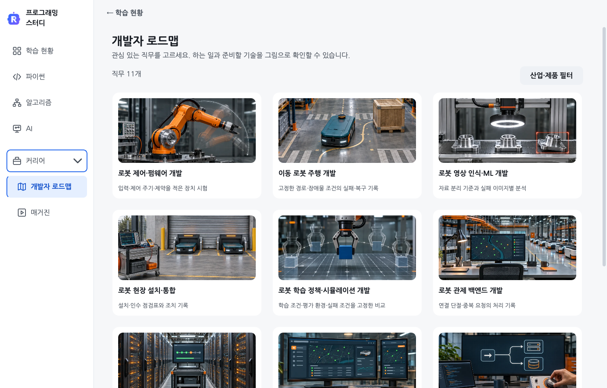
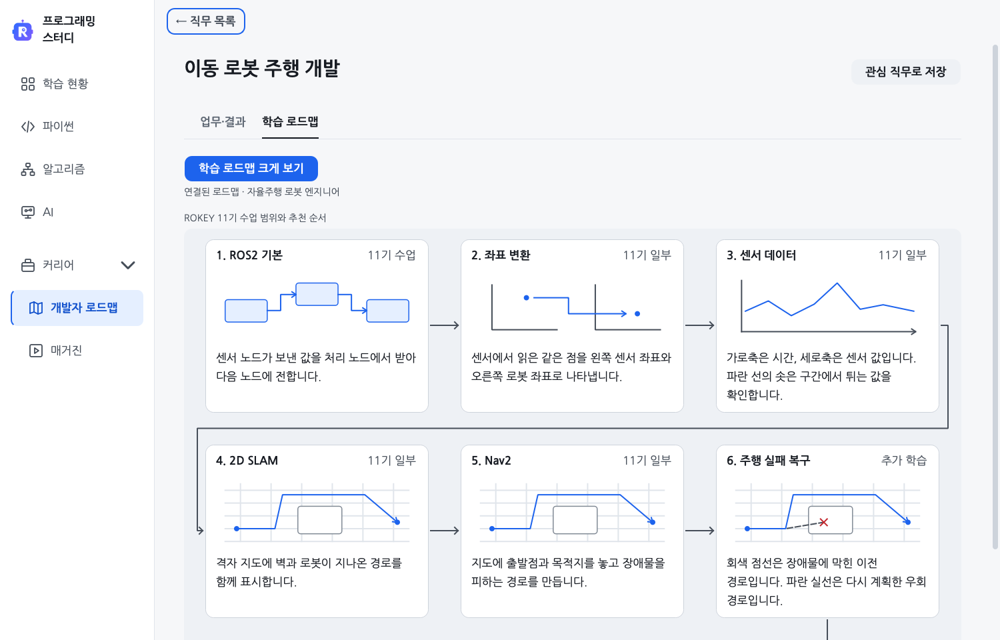
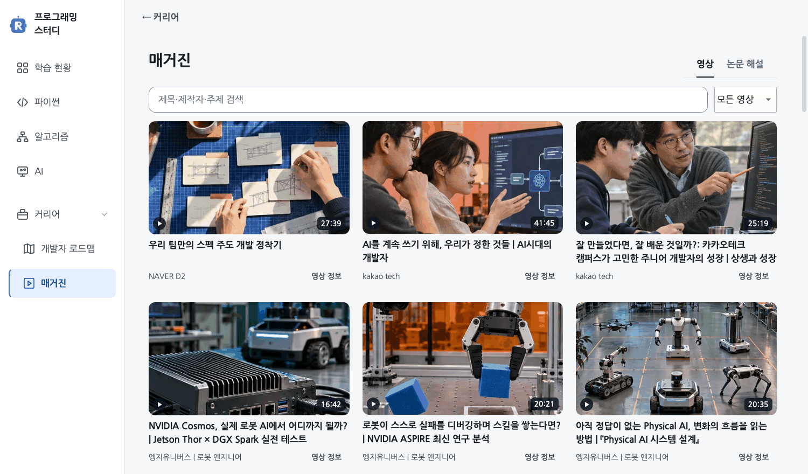
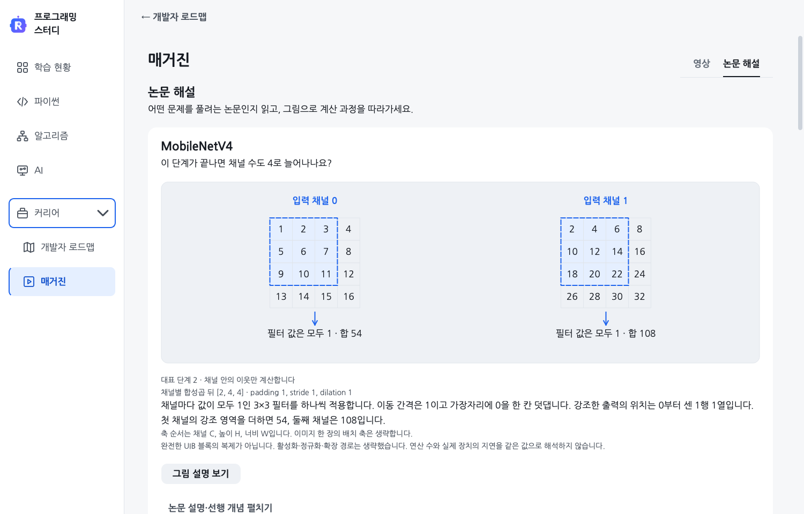

# 커리어 · 직무별 업무와 학습 로드맵

왼쪽 **커리어** 메뉴를 펼쳐 [개발자 로드맵]이나 [매거진]을 고르세요. 작은 창에서는 위쪽 선택란에 두 메뉴가 있습니다.

## 어떤 일을 할지 고르기

[개발자 로드맵]의 그림 목록에서 궁금한 직무를 누르세요. 직무 이름 아래에는 그 일을 하며 만드는 결과가 적혀 있습니다. 특정 분야만 찾으려면 [산업·제품 필터]를 펼치세요. 상세 화면의 [직무 목록]을 누르면 고르던 목록으로 돌아갑니다.

[업무·결과] 탭에서는 업무 장면과 결과 예시를 비교합니다. 넓은 창에서는 두 그림을 나란히, 작은 창에서는 [업무 장면]과 [결과 예시]를 눌러 볼 수 있습니다. 예를 들어 로봇 주행에는 통로를 지나는 운반 로봇과 장애물을 피하는 경로가 나옵니다. [팀과 담당 업무 펼치기]에서는 어떤 입력을 받아 무엇을 만드는지 확인할 수 있습니다. 그림과 수치는 직무를 설명하려고 만든 예시입니다.

[업무·결과 화면](../img/career-role-detail.png)

[학습 로드맵] 탭에서는 주제별 그림과 ROKEY 11기 수업 범위를 확인합니다. 단계 번호를 따라 읽고 [학습 로드맵 크게 보기]를 눌러 전체 지도를 여세요. [+]로 글씨를 키운 뒤 그림을 드래그해 다음 단계를 따라갈 수 있습니다. [폭에 맞추기]를 누르면 지도의 가로 전체가 다시 보입니다. [창 크기 복원]을 누르면 원하는 너비와 높이로 조절할 수 있습니다.

로드맵에서 관련 영상을 고르면 매거진에서 해당 표지를 바로 찾을 수 있습니다.

[확대 로드맵 화면](../img/career-roadmap-zoom.png)

[관심 직무로 저장]을 누르면 목록에 표시가 남아 다음 실행에도 찾을 수 있습니다. 직무를 둘러보는 것만으로는 저장하지 않습니다. 이 선택은 이 기기에만 저장합니다. 연구용 희망 직무나 과거 풀이 기록은 바꾸지 않습니다.

부서·팀과 업무는 공개 자료의 사례이며 회사마다 구성이 다릅니다. 그림의 입력·산출물은 업무를 이해하기 위한 예입니다. 수업에 포함됐다는 표시는 실무 능력이나 채용 조건을 충족했다는 뜻이 아닙니다.

## 영상 보기

[매거진]의 [영상] 탭에서 제목·제작자·주제로 찾습니다. 영상 38개를 업로드 날짜순으로 정리했습니다. 날짜가 확인되지 않은 영상은 맨 뒤에 놓습니다.

**보고 싶은 영상의 표지를 누르세요.** 앱 안에서 재생할 수 있는 환경이면 바로 재생을 시도합니다. 앱 내 재생기가 없거나 제작자가 앱 내 재생을 제한한 영상은 기본 브라우저에서 YouTube로 열립니다. 자동 재생이 차단되면 플레이어의 재생 버튼을 한 번 눌러 주세요.

[영상 정보]에는 어떤 내용을 다루는지, 보고 나서 무엇을 해볼 수 있는지, 원본을 어디까지 확인했는지 담았습니다. 영상 표지는 스터디에서 주제별로 그려 넣었습니다. 인터넷 연결이 없어도 표지와 설명을 볼 수 있습니다.

## 논문을 그림으로 읽기

[논문 해설] 탭에서는 MobileNetV4, ConvNeXt V2, DINOv2, SAM 2, DoRA를 소개합니다. 목록에서 대표 계산 그림과 입력 모양을 먼저 확인하세요. 그림이나 [그림 설명 보기]를 누르면 단계별 설명이 열립니다. [이전 단계]·[다음 단계]로 입력·처리·출력을 따라갑니다. 확인 물음의 답은 충분히 생각한 뒤 [풀이 펼치기]로 확인하세요.

그림은 원리를 설명하려고 직접 만든 예입니다. 원논문 그림을 복제하거나 논문 성능을 재현한 결과가 아닙니다. 그림 아래에 계산 조건과 단순화한 부분을 표시합니다. 긴 설명과 필요한 선수 개념은 [논문 설명·선행 개념 펼치기]에서 읽을 수 있습니다. DoRA는 벡터·행렬과 모델 가중치를 익힌 뒤 읽는 심화 자료입니다.

[논문 원문 열기]로 원문을, [출처·검토 범위 펼치기]로 확인한 버전과 이용 조건을 볼 수 있습니다. 코드·가중치와 논문 그림의 이용 조건은 따로 확인합니다.

## 자료가 열리지 않을 때

목록이 비어 있거나 파일을 읽지 못했다면 [설정]의 [업데이트 확인]으로 새 버전을 확인하세요. 새 버전이 있으면 [프로그램 업데이트]를 눌러 적용한 뒤 목록을 다시 여세요. 로드맵 그림만 읽지 못해도 직무별 설명과 학습 순서는 볼 수 있습니다. 영상은 연결 상태나 제작자의 재생 허용에 따라 앱 안에서 열리지 않을 수 있습니다. 이때는 [영상 정보]의 [YouTube 원본]으로도 열 수 있습니다.

개발자는 [코드와 연결 계약](DEVELOPMENT.md), [변경 영향 지도](../CHANGE_IMPACT.md)를 참고하세요.
