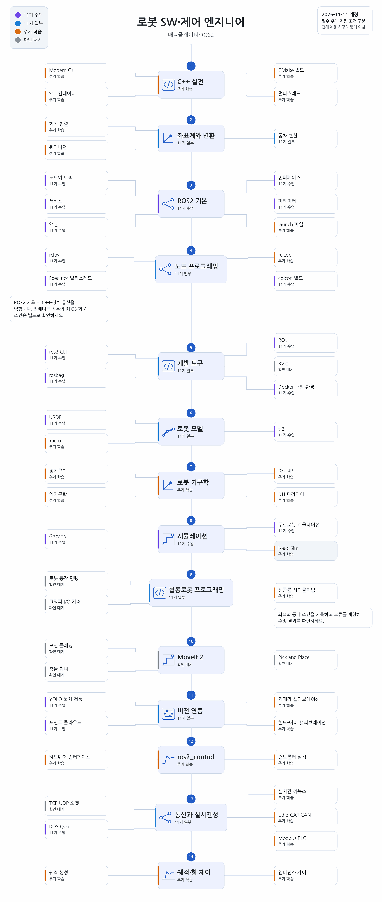
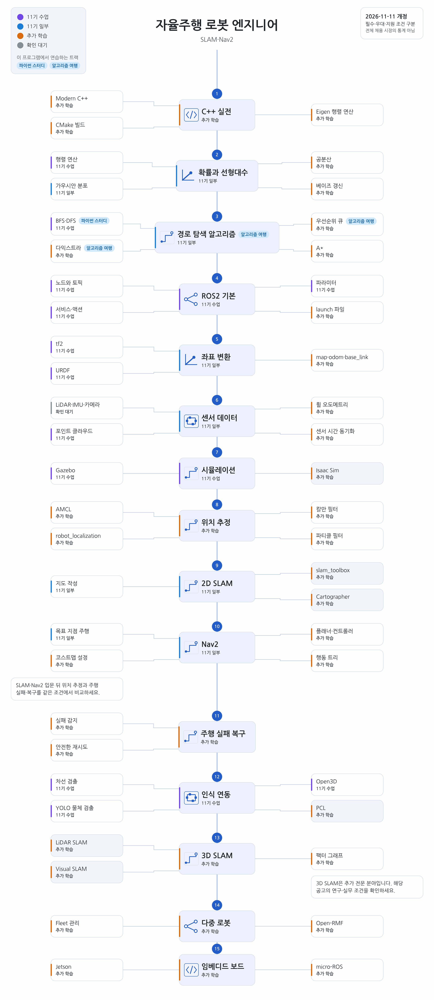
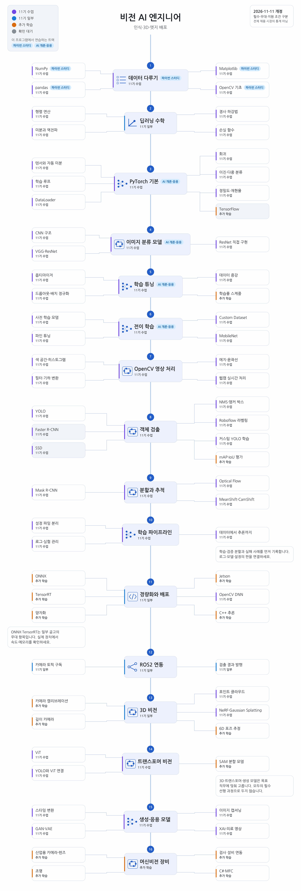
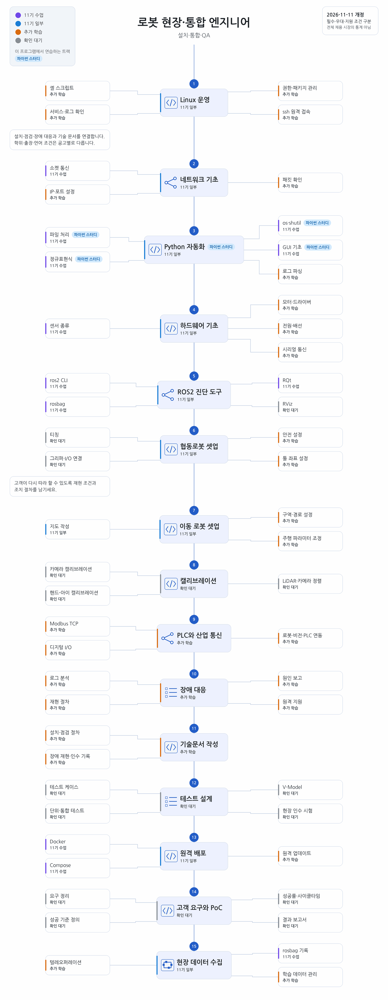
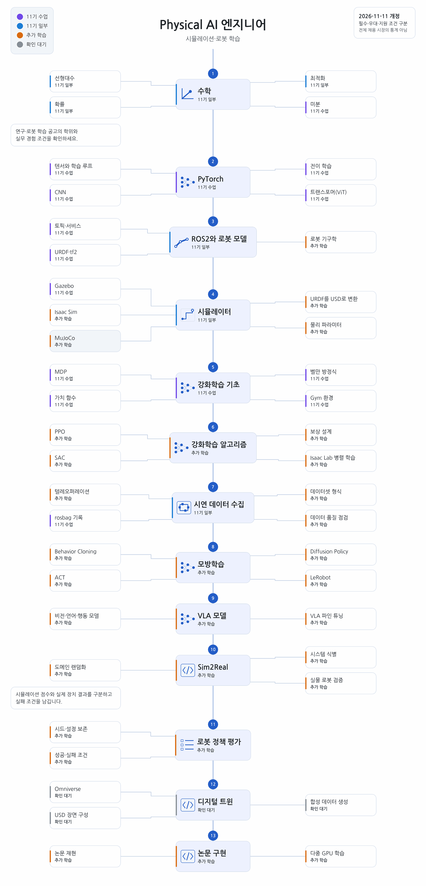
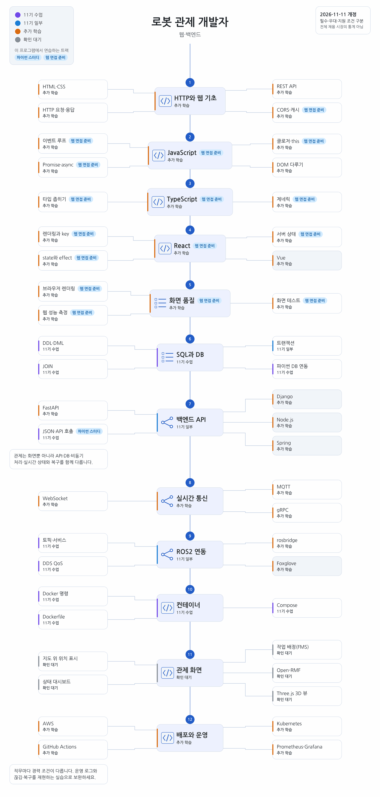
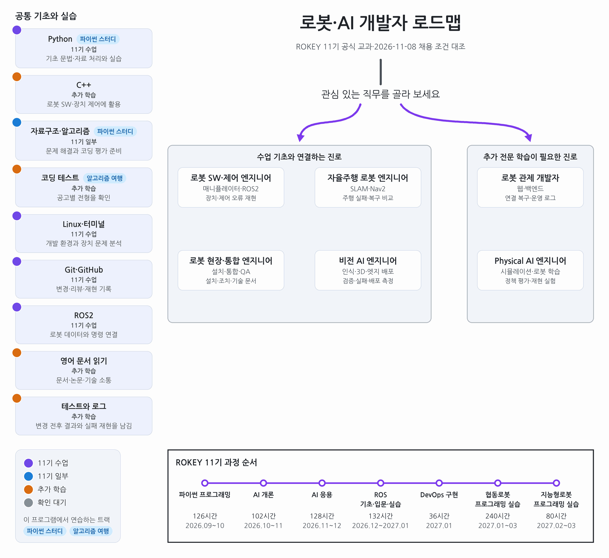

# 직무별 학습 로드맵

[처음 안내로 돌아갑니다](../../README.md)

## ROKEY 수업과 여섯 직무

관심 있는 직무에서 무엇을 배우고 만들어 볼지 확인합니다. 각 그림에는 **학습 순서**, **ROKEY 11기 수업에 포함된 범위**, **실습에서 남길 결과**를 담았습니다.

아래 직무의 **로드맵 펼쳐보기**를 누르세요. 그림을 더 크게 보려면 펼친 항목 안의 ‘큰 그림으로 보기’를 누릅니다.

직무별 학위·경력·필수·우대 조건은 [확인한 공고의 지원 조건](../ROADMAP_EVIDENCE.md#공식-공고에서-조건을-구분합니다)에서 따로 확인합니다.

### 직무별 로드맵

<strong>로봇 SW·제어 엔지니어</strong> · 로봇 팔과 장치 제어 · <strong>로드맵 펼쳐보기</strong>

로봇 팔의 동작과 장치 통신을 구현합니다. 실제 장비에서 오류를 재현하고 원인을 찾는 일을 다룹니다.

C++와 좌표 변환에서 ROS2, 로봇 기구학, 장치 통신과 제어로 이어집니다. **실습 결과로** 장치·제어 오류의 재현 로그와 수정 전후의 확인 기록을 남깁니다.

[큰 그림으로 보기](arm.png?raw=true) · [수업 포함 표시 읽기](#그림-읽는-법)

<strong>자율주행 로봇 엔지니어</strong> · 지도 작성과 주행 · <strong>로드맵 펼쳐보기</strong>

이동 로봇이 지도를 만들고 현재 위치를 추정해 목적지까지 주행하도록 구현합니다.

C++·확률·경로 탐색과 ROS2·좌표 변환을 익힌 뒤 위치 추정, 지도 작성인 SLAM, 주행 도구인 Nav2와 실패 복구로 이어집니다. **실습 결과로** 같은 경로를 주행하며 겪은 실패·복구와 설정별 비교 기록을 남깁니다.

[큰 그림으로 보기](nav.png?raw=true) · [수업 포함 표시 읽기](#그림-읽는-법)

<strong>비전 AI 엔지니어</strong> · 영상 인식과 모델 적용 · <strong>로드맵 펼쳐보기</strong>

영상 모델을 학습하고 어떤 입력에서 틀리는지 분석합니다. 학습한 모델을 실제 장비에 적용하는 과정도 다룹니다.

Python·데이터 처리에서 PyTorch·영상 처리, 객체 검출, 모델 배포로 이어집니다. **실습 결과로** 학습·검증 자료를 나눈 기준, 실패 사례, 저장한 모델과 배포 장치의 측정 기록을 남깁니다.

[큰 그림으로 보기](vision.png?raw=true) · [수업 포함 표시 읽기](#그림-읽는-법)

<strong>로봇 현장·통합 엔지니어</strong> · 장비 연결과 현장 대응 · <strong>로드맵 펼쳐보기</strong>

로봇과 주변 장비를 연결합니다. 설치·점검 중 생긴 문제를 해결하고 조치 내용을 다른 사람에게 설명합니다.

로봇·통신 기초에서 설치와 시스템 통합, 장애 분석, 기술 문서 작성으로 이어집니다. **실습 결과로** 설치·점검 절차와 장애 재현·조치 기록, 고객에게 전달할 설명을 남깁니다.

[큰 그림으로 보기](field.png?raw=true) · [수업 포함 표시 읽기](#그림-읽는-법)

<strong>Physical AI 엔지니어</strong> · 로봇 동작 학습과 평가 · <strong>로드맵 펼쳐보기</strong>

로봇이 동작을 배우도록 모델을 학습시키고 평가합니다. 시뮬레이터에서 배운 동작을 실제 로봇에 옮길 때 생기는 차이도 다룹니다.

로봇·딥러닝 기초에서 시뮬레이션, 모방학습·강화학습, 실제 장치 평가로 이어집니다. **실습 결과로** 데이터와 학습 설정, 동작 평가 결과, 시뮬레이션과 실제 장치의 차이를 남깁니다.

[큰 그림으로 보기](physical.png?raw=true) · [수업 포함 표시 읽기](#그림-읽는-법)

<strong>로봇 관제 개발자</strong> · 여러 로봇의 상태 관리 · <strong>로드맵 펼쳐보기</strong>

여러 로봇의 위치와 상태를 웹 화면과 서버로 모아 보여 줍니다. 연결이 끊기거나 상태가 늦게 도착할 때의 처리도 다룹니다.

웹 화면·API·데이터베이스에서 실시간 상태 처리와 운영으로 이어집니다. **실습 결과로** 상태를 모아 보는 화면, 연결 복구와 운영 로그를 남깁니다.

[큰 그림으로 보기](platform.png?raw=true) · [수업 포함 표시 읽기](#그림-읽는-법)

### 그림 읽는 법

가운데 번호를 따라 위에서 아래로 읽고, 양옆에서 같은 단계의 세부 주제를 확인합니다. 작은 선 그림은 좌표·데이터·노드 연결처럼 해당 주제의 구조를 나타냅니다. 회색 상자는 같은 자리에 고를 수 있는 도구입니다. 교과 포함 여부는 상자의 짧은 글자와 왼쪽 색선을 함께 읽습니다.

| 표시 | 뜻 |
| --- | --- |
| 보라·11기 수업 | 공식 교과 목차에 해당 주제나 도구가 있습니다. |
| 파랑·11기 일부 | 관련 기초는 배우며 상자 전체 내용은 더 익힙니다. |
| 주황·추가 학습 | 확인한 교과 목차에 없어 별도로 익힙니다. |
| 회색·확인 대기 | 프로젝트 이름만으로 포함 여부를 정하지 않습니다. |

하늘색 꼬리표가 붙은 상자는 이 프로그램에서 연습합니다. 흰 글상자에는 실습에서 확인할 결과와 공고의 조건을 적었습니다. 수업 포함 표시는 실무 역량을 갖췄다는 판단과 구분합니다. 선택 도구나 추가 전문 분야까지 모두 배운 뒤 지원해야 한다는 뜻은 아닙니다.

<strong>공통 기초와 직무 연결 그림 펼쳐보기</strong>

[큰 그림으로 보기](intro.png?raw=true)

### 프로그램에서 연습할 수 있는 과목과 범위

| 프로그램 | 연습할 내용과 현재 범위 |
| --- | --- |
| [파이썬 스터디](../../problems/README.md#진단-테스트와-회차별-문제-풀이) | 공통 기초인 Python·자료구조·알고리즘, 데이터 처리, 파일 처리·정규표현식을 문제로 연습합니다. |
| [알고리즘 여행](../../journey/README.md#알고리즘-여행) | 던전 1~3의 해시·투 포인터, 누적합·차분, 이분 탐색을 Python·JavaScript로 풉니다. 나머지 던전은 아직 공개하지 않았습니다. |
| [AI 개론·응용](../../ai/README.md#ai-개론응용) | 개론은 1차시부터 17차시까지 데이터·모델·학습·평가를 다룹니다. 응용은 1·2·3차시의 영상 입력·색 공간·필터·윤곽선 등을 그림과 코드 문제로 연습합니다. |
| [웹 면접 준비의 기존 안내](../../web/README.md) | JavaScript·TypeScript·React·브라우저 동작을 다룹니다. 현재 프로그램 진입은 중지했습니다. |

이 프로그램의 AI 코드는 실행하지 않고 빈칸·고르기 문제로 익힙니다. 실제 모델 학습과 C++·ROS2의 실물 로봇 실습은 앱 밖에서 진행합니다.

파이썬이나 AI의 [학습 데이터]에서 기록을 수집하는 동안 희망 직무를 선택할 수 있습니다. [희망 직무 저장]을 누르면 이후 수집하는 풀이에 목표와 로드맵 버전이 함께 남습니다. 직무 선택은 건너뛸 수 있습니다. 목표를 바꿔도 이전 풀이의 분류는 바꾸지 않습니다. [수집 안내](../LEARNING_DATA.md)를 확인하세요.

### 로드맵에 참고한 수업 자료와 채용 공고

교과 표시는 11기 공식 교과별 커리큘럼과 Life Guide를 대조했습니다. 채용 조건의 근거는 **2026년 11월 8일에 확인한 네이버랩스·레인보우로보틱스 공식 공고 13건**입니다. 전체 시장의 채용 비율이나 순위를 나타내는 조사는 아닙니다. 공고 목록과 교과 판정 기준은 [로드맵 근거](../ROADMAP_EVIDENCE.md)에 있습니다.

2026년 11월 11일에는 직무 안내와 그림의 표현, 프로그램에서 연습할 수 있는 범위를 갱신했습니다. 채용 공고를 새로 조사한 날짜와 구분합니다. 지원 조건은 각 공고의 원문에서 다시 확인하세요.

로드맵을 고칠 때는 `tools/roadmap/roadmap.json`을 수정하고 `tools/roadmap/draw.py`로 그림을 다시 생성합니다. 10월 20일 공고 집계는 당시 버전의 기록으로 남기고 현재 채용 수치로 표시하지 않습니다.
