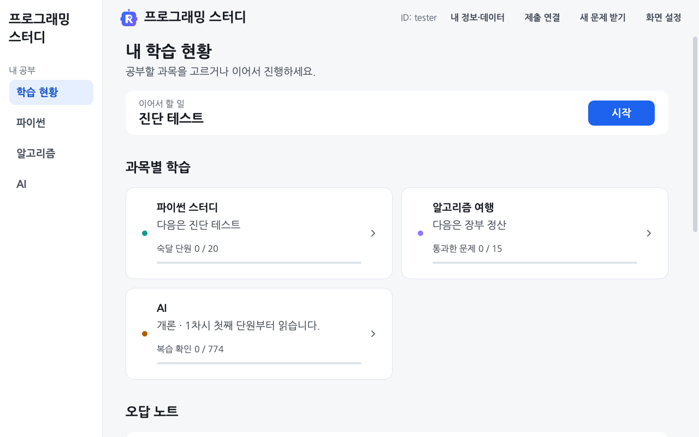
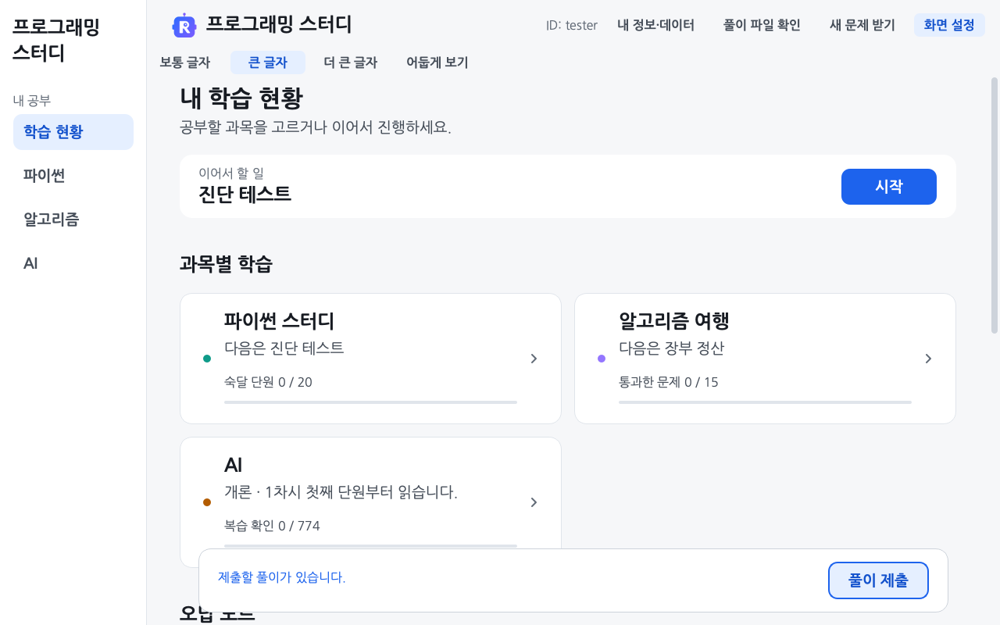

# 스터디 프로그램 사용준비

<a id="프로그램을-준비하고-화면을-사용합니다"></a>

[처음 안내로 돌아갑니다](../README.md)

이 안내는 Windows를 기준으로 설명하며 macOS 실행 방법도 함께 적었습니다. 프로그램을 받아 실행한 뒤 원하는 과목부터 공부하면 됩니다. [풀이 제출 안내](../docs/API_SUBMISSIONS.md)에서 비공개 서버로 보내는 파일과 제출 방법을 확인할 수 있습니다.

<a id="최초-한번-준비해야할-것"></a>

<a id="설치에-필요한-프로그램을-준비합니다"></a>

## 처음 설치할 때

<a id="python과-git을-설치합니다"></a>

### Python과 Git 설치

이미 설치했다면 터미널에서 `python --version`과 `git --version`으로 확인합니다. Windows에서 `python`을 찾지 못하면 `py --version`, macOS에서는 `python3 --version`을 사용합니다.

- 화면 도구를 새로 설치할 때 이 프로그램이 지원하는 Python은 **3.10\~3.14, 64비트**입니다. Windows ARM64는 3.11 이상이 필요합니다. 새로 준비한다면 [Python 3.14 공식 설치 페이지](https://www.python.org/downloads/latest/python3.14/)에서 운영체제에 맞는 설치 파일을 받습니다. Windows에서는 페이지의 `Python install manager`를 설치하고 새 터미널에서 `py install 3.14`를 실행합니다. 끝나면 `py -3.14 --version`으로 확인합니다. 이미 지원 버전이 있으면 새로 설치하지 않아도 됩니다. macOS는 `macOS 64-bit universal2 installer`를 고릅니다.
- Windows에는 [Git for Windows](https://git-scm.com/install/windows)를 설치합니다. 설치 중 PATH 선택 화면에서는 명령줄과 다른 프로그램에서 Git을 쓰는 항목을 고릅니다. macOS는 터미널에서 `git --version`을 입력하고 설치 안내가 나오면 진행합니다.

설치가 끝나면 열어 둔 터미널과 프로그램을 닫았다 다시 엽니다.

<a id="프로그램-폴더를-받습니다"></a>

### GitHub에서 프로그램 받기

<a id="sourcetree로-받는-경우"></a>
<a id="터미널로-받는-경우"></a>

[학습자 가이드의 프로그램 받기](../docs/LEARNER_START.md#1-프로그램을-받습니다)에서 SourceTree 또는 터미널로 복제하는 순서를 따라 합니다. 저장소 주소·저장할 폴더·내려받기 완료 후 확인할 파일을 함께 안내합니다.

이미 프로그램 폴더가 있다면 start 파일을 열어 업데이트합니다. [프로그램과 문제 업데이트](#프로그램과-문제-업데이트)

<a id="프로그램을-켜고-id를-입력합니다"></a>

<a id="프로그램을-켜고-동의-여부를-선택합니다"></a>

### 첫 실행과 학습 데이터 수집 동의

1. Windows는 받은 폴더의 `start.bat`을 더블클릭합니다. 확장자가 안 보이면 탐색기에서 파일 확장명 표시를 켜서 확인합니다. macOS는 `start.command`를 엽니다.
2. ‘프로그래밍 스터디 준비’ 창이 나오면 [설치]를 누릅니다. 화면 도구인 PyQt6를 인터넷으로 내려받아 설치합니다.
3. 기존 사용자도 기기마다 처음 한 번 [GitHub에서 확인하기]를 누르고 열린 GitHub 화면에 확인 코드를 입력합니다. 다음 실행부터는 프로그램의 기기 키로 자동 확인합니다. [기기 본인 확인과 계정·기기 집계 기준](../docs/DEVICE_IDENTITY.md)
4. [학습 데이터 제공 안내]를 읽습니다. 새 풀이 기록을 제공하려면 [학습 데이터 제공 동의 (선택)]와 [비공개 서버 보관 동의 (선택)]에 모두 표시하고 [동의하고 시작]을 누르세요. [동의하지 않고 시작]을 선택해도 학습할 수 있습니다. 풀이 ID는 자동 생성하며 기존 설치의 ID와 기록은 유지합니다.
5. 연구에 동의하면 답안 파일 자동 제출 여부를 한 번 더 묻습니다. 업데이트 전이나 지금 선택하기 전에 작성한 풀이 파일도 보내려면 [답안 파일도 자동 제출]을 누르세요. [기록만 자동 전송]을 선택하면 파일은 [풀이 제출]로 직접 보낼 수 있습니다.
6. **학습 현황** 화면이 열리면 아래 안내에 따라 과목을 고릅니다. AI나 알고리즘부터 시작해도 됩니다.

터미널 설치 안내에 `설치할까요? [y/N]`이 나오면 설치할 때 `y`를 입력하고 Enter를 누릅니다. macOS의 `start.command`로 연 터미널은 프로그램을 쓰는 동안 열어 둡니다.

<a id="켜기와-첫-화면"></a>

## 프로그램 실행과 학습 이어가기

처음 받은 Windows 폴더에서는 톱니바퀴 모양의 `start.bat`을 더블클릭합니다. 실행하면 같은 폴더에 R 아이콘의 **프로그래밍 스터디** 바로가기가 생깁니다. 파일 이름은 `프로그래밍 스터디.lnk`이며 탐색기에서는 확장명 없이 보일 수 있습니다. 다음부터는 이 바로가기를 더블클릭합니다. 바탕화면에서도 쓰고 싶으면 바로가기 파일을 복사해 바탕화면에 붙여 넣으세요. 바탕화면에는 자동으로 만들지 않습니다.

`start.bat`은 Windows의 배치 파일 아이콘으로 남습니다. 바로가기가 없거나 열리지 않으면 `start.bat`으로 다시 실행하세요. 같은 이름의 파일은 덮어쓰지 않습니다.

프로그램 폴더나 Python 위치를 옮겨 바로가기가 열리지 않으면 폴더 안의 `프로그래밍 스터디.lnk`만 지우고 `start.bat`을 다시 실행하세요. 답안과 학습 기록은 지우지 않습니다. 바탕화면에 복사한 바로가기도 새 파일로 바꿉니다.

macOS는 `start.command` 등을 엽니다. 왼쪽 메뉴에서 [학습 현황]·[파이썬]·[알고리즘]·[AI]를 선택합니다. 창이 좁거나 낮아 왼쪽 메뉴가 접히면 위쪽의 [메뉴 이동]을 사용하세요.

[](../docs/img/hub.png)

**이어서 할 일**은 저장된 학습 위치와 복습 상태를 바탕으로 다음 행동을 안내합니다. 과목 메뉴에서는 원하는 학습으로 직접 이동할 수 있습니다. 화면 사진의 ID와 기록은 설명용 예시입니다.

- **AI**를 고르고 [개론]·[응용] 중 공부할 과정을 선택합니다. 처음에는 [학습·사용 안내]에서 표시된 버튼을 따라가 보세요. 단원을 열어 설명과 그림을 읽고 마지막의 [연습 시작]을 누릅니다. 답을 적은 뒤 [확실함] 또는 [긴가민가]를 누르면 채점과 해설이 나옵니다. [AI 학습 안내](../ai/README.md#ai-개론응용)
- **파이썬**을 고르면 파이썬 홈이 열립니다. 처음에는 [진단 테스트 시작]으로 현재 알고 있는 내용을 확인하고 이후에는 **다음 회차**의 시작 버튼으로 이어갑니다. 모르는 문항은 비워 둬도 됩니다. 답은 자동 저장되며 [회차 제출]을 눌러 채점합니다. [파이썬 풀이 안내](../problems/README.md#진단-테스트와-회차별-문제-풀이)
- **알고리즘**을 고르면 던전 지도가 열립니다. 문제를 고르고 `solution` 함수를 완성합니다. [코드 실행]으로 예시를 확인하고 [채점하기]로 숨은 테스트까지 검사합니다. [알고리즘 여행 안내](../journey/README.md#알고리즘-여행)

[커리어]의 [개발자 로드맵]에서 직무별 업무와 학습 순서를 확인하세요. [매거진]에서는 표지를 눌러 영상을 재생하거나 [논문 해설]에서 그림으로 원리를 익힐 수 있습니다. 앱 내 재생기가 없으면 기본 브라우저에서 YouTube가 열립니다. [커리어 사용 안내](../docs/career/README.md)

오답 노트에서는 틀린 문항·미응답 문항·다시 맞힌 문항을 나눠 봅니다. 읽기 완료와 복습 확인은 서로 다른 기록이며 읽은 표시만으로 문항을 외운 것으로 세지 않습니다.

과목의 현황 화면에서 [학습 현황]이나 [← 처음 화면]을 누르면 첫 화면으로 돌아옵니다. 학습·풀이 화면에서는 위쪽의 돌아가기 버튼으로 해당 과목의 현황 화면을 먼저 엽니다.

<a id="글자-크기와-테마를-바꿉니다"></a>

### 글자 크기와 화면 테마

첫 화면 오른쪽 위의 [설정]을 엽니다. **보통 글자·큰 글자·더 큰 글자** 중 읽기 편한 크기를 고릅니다. 화면 테마는 [시스템 따르기]·[밝게]·[어둡게] 중에서 고릅니다. [시스템 따르기]는 운영체제의 테마에 맞춰 바뀝니다. 글자 크기는 Ctrl과 `+`, `-`, `0`으로도 바꿉니다. macOS는 Ctrl 대신 Cmd를 사용합니다.

[](../docs/img/screen-settings.png)

AI 그림은 [크게 보기]로 열 수 있습니다. 움직이는 그림은 재생·일시 정지하거나 장면을 직접 고릅니다. 좁은 창에서는 본문을 스크롤해 아래 내용도 확인하세요.

<a id="새-자료를-받습니다"></a>

### 프로그램과 문제 업데이트

프로그램을 켤 때마다 업데이트를 확인합니다. 변경이 있으면 **문제·해설·그림·프로그램 코드와 안내 문서까지 함께 받습니다.** 시작 중 코드가 바뀌면 보통 학습 화면을 열기 전에 자동으로 다시 실행합니다. 수정한 파일의 보관 사본이 생기면 안내를 확인하고 [다시 시작]을 누르세요.

학습 중에는 첫 화면인 [학습 현황]으로 돌아가 [설정] → [업데이트 확인]을 누르세요. 새 버전이 있으면 [프로그램 업데이트]를 눌러 받습니다. 코드가 바뀌어 ‘프로그램 갱신’ 창이 열리면 [다시 시작]을 누르세요.

답안·진도·풀이 ID와 화면 설정은 유지합니다. 업데이트 오류가 나오면 [오류 해결 안내](#예전-버전을-받아-뒀거나-문제-받기가-계속-오류로-끝날-때)를 확인하세요.

현황 화면 아래에는 보낼 파일이 있으면 [풀이 제출], 새 자료가 있으면 [프로그램 업데이트]가 나타납니다. 제출 뒤에는 같은 자리에 처리 결과가 남습니다.

기기 인증을 마친 뒤에는 이미 받은 자료로 인터넷 없이도 학습하고 채점할 수 있습니다. 새 자료 받기와 서버 전송에는 인터넷이 필요합니다. 자료가 수정되어 저장한 AI 연습 묶음과 맞지 않으면 이어풀기 대신 새 묶음을 시작하도록 안내할 수 있습니다.

<a id="저장한-풀이를-공유합니다"></a>

<a id="저장한-풀이를-비공개로-제출합니다"></a>
<a id="풀이-파일-확인과-비공개-제출"></a>

### 풀이 제출과 보낼 파일 목록

제출할 풀이가 있으면 첫 화면 상단과 [내 학습 현황] 하단에 [풀이 제출] 버튼이 나타납니다. 상단은 글자색으로, 하단은 파란 채움 버튼으로 강조합니다. 유효한 동의가 있으면 버튼을 한 번 눌러 바로 제출합니다. 완료·실패 안내는 같은 하단 영역에 표시합니다. 보낼 파일 목록은 [내 정보·데이터]의 [보낼 풀이 파일 보기]에서 확인할 수 있습니다. [실패 후 재시도 안내](../docs/API_SUBMISSIONS.md)

파일 자동 제출을 켜면 시작할 때와 문제 묶음을 채점한 뒤에 미제출 파일을 보냅니다. 파일 자동 제출만 끄려면 [내 정보·데이터](../docs/LEARNING_PRIVACY.md)에서 파일 자동 제출 설정을 열고 [기록만 자동 전송]을 선택하세요. 이미 보낸 자료도 삭제하려면 [동의 철회·비공개 기록 삭제]를 누르세요. 파이썬·AI 홈에서 [학습 데이터]를 열면 해당 과목의 수집을 중단하거나 [파일로 내보내기]로 추가 기록을 저장할 수 있습니다. [수집 항목과 전송 방법](../learning_server/README.md#풀이-데이터-수집)

<a id="컴퓨터를-바꾸거나-사본을-보관합니다"></a>

### 풀이 백업과 새 컴퓨터로 옮기기

프로그램을 닫고 아래 파일과 폴더를 함께 보관하세요.

- 프로그램 폴더에서 풀이 ID 파일 `.study_user`와 답안·진도가 든 `submissions/<내 ID>/`를 복사합니다.
- 사용자 홈에서 `.rokey-study/ai/<내 ID>/`와 `.rokey-study/python/<내 ID>/`를 복사합니다. 이곳에 AI에서 보던 위치, 미완료 연습·모의고사 초안과 과목별 추가 수집 기록이 있습니다.

Windows의 사용자 홈은 보통 `C:\Users\계정명`, macOS는 `/Users/계정명`입니다. `.rokey-study` 아래의 `venv`는 실행 환경이므로 다른 PC에 복사해 설치를 대신하지 않습니다.

서버 [풀이 제출]에는 `.rokey-study`가 통째로 포함되지 않으므로 다른 PC에서 같은 ID로 켜는 것만으로 모든 상태가 옮겨지지는 않습니다. 새 폴더를 처음 실행하기 전에 `.study_user`도 함께 옮겨 같은 풀이 ID를 사용합니다. 새 폴더에서 이미 공부했다면 덮어쓰기 전에 스터디장에게 문의하세요. 백업에는 답안과 비공개 서버 연결 정보가 들어갈 수 있으므로 본인만 접근할 수 있는 곳에 보관하세요.

새 컴퓨터에서는 GitHub 본인 확인을 다시 진행합니다. 기기 키가 들어 있는 `.rokey-study/identity/`는 원래 컴퓨터에 두세요. 글자 크기·테마·창 크기와 알고리즘의 언어·마지막 문제는 운영체제별 설정에 저장합니다. 새 컴퓨터에서 원하는 글자 크기와 테마를 다시 고르세요. 기록 제공을 계속하려면 [내 정보·데이터]의 동의 상태와 파이썬·AI의 [학습 데이터]에 표시된 수집 상태도 확인하세요.

<a id="안-될-때"></a>

## 실행·업데이트·제출 오류 해결

[설정] → [불편한 점 알리기]를 누르면 GitHub의 불편 신고 양식이 열립니다. 운영체제, Python·PyQt·Qt 버전, 프로그램 커밋, 화면 키, 창 크기, 화면 배율·DPI, 글자 크기와 테마를 환경 칸에 채웁니다. 확인하지 못한 값은 `미확인`으로 표시합니다. GitHub 양식에서 내용을 확인하고 수정하거나 지운 뒤 직접 제출하세요.

오류 창의 신고 링크에서도 환경정보를 채웁니다. 예외 객체가 있으면 종류·HTTP 상태 코드·허용한 프로그램 소스의 상대경로와 줄 번호를 넣고 오류를 감지한 시각을 UTC로 표시합니다. GitHub의 문의 접수 시각은 직접 제출한 시각입니다.

계정 정보·인증값·답안·문제 입력·전체 파일 경로·오류 원문과 로그는 자동으로 넣지 않습니다. 오류 창의 [오류 내용 복사]를 사용했다면 붙여넣기 전에 개인정보와 인증값을 빼 주세요. 다른 내용은 오류 창의 [다른 문의 양식]에서 선택할 수 있습니다.

### 창이 열리지 않을 때

아래 명령은 **`study.py`가 있는 `programming-study` 폴더**에서 실행합니다. Windows는 탐색기로 그 폴더를 열고 주소 칸에 `cmd`를 입력합니다.

```bash
python study.py
```

Windows에서 Python을 못 찾으면 `py -3.14 study.py`, macOS는 `python3 study.py`로 실행합니다. 설치한 Python 버전이 다르면 `-3.14`도 그 버전에 맞춥니다. 오류가 표시되면 내용을 복사해 문의합니다. 창 없이 실행하다 실패한 기록은 `~/.rokey-study/launch.log`에 있습니다.

macOS가 `ROKEY.app` 실행을 막으면 `start.command`나 위 터미널 명령을 사용합니다.

### 예전 버전을 받아 뒀거나 문제 받기가 계속 오류로 끝날 때

파일을 다른 프로그램에서 열어 업데이트가 막혔다면 안내 창과 해당 프로그램을 닫은 뒤 다시 실행합니다. 삭제하지 못한 이전 프로그램 파일도 다음 실행에서 다시 처리합니다. 직접 고친 프로그램 파일이 있으면 안내에 나온 위치에서 보관한 사본을 확인합니다.

같은 폴더에서 아래 명령으로 업데이트합니다. `python`을 찾지 못하면 위 안내대로 바꿔 입력합니다.

```bash
python study.py update
```

계속 실패하면 오류 내용을 복사해 문의하세요. 이미 답을 적은 폴더를 지우거나 새로 받은 폴더로 덮어쓰지 말고 원래 폴더를 보관합니다. ZIP으로 받은 경우에는 [저장소 복제](#github에서-프로그램-받기)로 새 폴더를 준비합니다. 두 프로그램을 닫고 기존 `submissions/<내 ID>/`를 새 폴더의 `submissions/` 아래에 복사하고 `.study_user`도 새 프로그램 폴더로 옮긴 뒤 실행합니다. 같은 ID 폴더가 이미 있다면 덮어쓰기 전에 문의하세요. 사용자 홈의 AI 위치·추가 수집 기록은 기존 PC에 남습니다.

<a id="id-를-잘못-넣었을-때"></a>

### ID를 잘못 입력했을 때

예전 설치에서 직접 입력한 ID를 바꾸려면 프로그램을 닫고 기존 ID와 사용할 풀이 ID를 스터디장에게 알려 주세요. 새 설치는 ID를 입력하지 않아도 됩니다. 저장소의 풀이 폴더뿐 아니라 이 기기의 AI 위치·수집 기록에도 ID를 사용하므로 폴더 이름만 바꾸면 모든 기록이 옮겨지지 않습니다.

### 기존 풀이 기록 찾기

풀이 ID를 확인하지 못하면 업데이트를 멈추고 시작 화면에 이유를 표시합니다. `.study_user` 설정이 없어도 기록 파일은 남아 있을 수 있습니다. 먼저 프로그램을 닫고 기존 프로그램 폴더와 사용자 홈의 `.rokey-study/`를 별도 위치에 복사해 보관하세요. 폴더를 지우거나 다시 복제하기 전에 `.git` 보관함까지 포함한 폴더 전체를 복사합니다. 원본을 새 설치본으로 덮어쓰지 않습니다.

숨김 파일 표시를 켜고 프로그램 폴더의 `.study_user`를 확인합니다. 파일에는 이전에 쓰던 풀이 ID 한 줄이 들어 있습니다. `STUDY_USER` 환경변수를 설정했다면 그 값이 파일보다 우선합니다. 잘못된 환경변수를 지우거나 고친 뒤 다시 실행하세요. ID 파일을 읽지 못한 경우에는 접근 권한과 파일 내용을 확인하고 빈 파일이나 새 임의 ID로 바꾸지 않습니다.

기존 백업에 `.study_user`가 있으면 그 내용과 `submissions/<ID>/`의 기록이 같은 설치본에서 보관한 것인지 확인합니다. 확인한 ID 파일을 원본 사본과 함께 보관한 뒤 실행 폴더로 복원하세요. 기록 폴더만 있거나 ID가 여러 개라면 임의로 고르거나 합치지 말고 스터디장에게 문의하세요. 내려받은 프로그램에 포함된 팀원 기록을 본인 기록으로 선택하지 않습니다.

업데이트 뒤 풀이가 보이지 않으면 안내받은 보관 사본도 확인합니다. 일반 설치의 경로는 `.git/study-backup/<시각>/outside/submissions/<ID>/`이며 교체 전 기록은 같은 시각 폴더의 `replaced/` 아래에 있을 수 있습니다. Git worktree를 쓰는 경우 실제 Git 폴더는 `git rev-parse --absolute-git-dir`로 확인합니다. 찾은 사본은 먼저 별도 위치로 복사하고 원래 답안·진도와 대조한 뒤 복원 여부를 문의하세요. 서버 연결이나 GitHub 본인 확인으로 이전 풀이 ID를 자동으로 찾아 복원하지는 않습니다.

기록 파일도 찾지 못했다면 이전 설치 폴더·다른 기기·보관 사본을 확인하세요. 파일을 찾지 못한 상태를 빈 새 기록으로 덮어쓰지 않습니다. 공개 문의에는 오류 문구와 실행 환경을 적고 개인 풀이 ID 목록이나 답안 파일을 문의 주소에 넣지 마세요. 설정을 복원한 뒤 시작 화면의 [다시 시도]를 누르면 ID와 기록을 다시 확인합니다.

### 제출이 안 될 때

제출에 실패해도 이 컴퓨터에 저장한 답은 남습니다. 오류 내용을 확인하고 [제출 재시도 안내](../docs/API_SUBMISSIONS.md#서버-저장을-확인하지-못했을-때)를 따릅니다.

### 알고리즘 여행 줄에 기록을 읽을 수 없다고 나올 때

오류 창의 문구와 표시된 파일 경로를 복사해 문의하세요. `submissions/<내 ID>/journey/progress.json`을 읽지 못하면 알고리즘 화면을 열거나 보낼 파일 목록을 준비하는 과정이 멈출 수 있습니다. 파이썬은 첫 화면에서 따로 열 수 있습니다. 기록 파일을 지워서 해결하려 하지 말고 원본을 보관합니다.

### 그 밖에 불편하거나 이상할 때

첫 화면의 [설정] → [불편한 점 알리기] 또는 [GitHub Issues → New issue](https://github.com/WaterMinCho/programming-study/issues/new/choose)에서 양식을 고릅니다. 사용한 운영체제와 어떤 화면의 어느 버튼에서 문제가 생겼는지 적어 주세요. 오류 창의 [오류 내용 복사]가 보이면 복사한 내용을 붙입니다. 로그인 정보나 개인 초대 코드는 제외합니다.

- ‘사용이 불편하거나 오류가 납니다’에는 화면과 오류 문구를 적습니다.
- ‘문제나 정답이 이상합니다’에는 문항 번호나 화면에서 본 제목을 적고, 어떤 보기나 해설이 이상한지 알려주세요. 예: 파이썬 `s03_Q4`, 알고리즘 `1-3`.
- ‘문제를 더 만들어 주세요’에는 더 연습하고 싶은 단원이나 개념을 적습니다.
