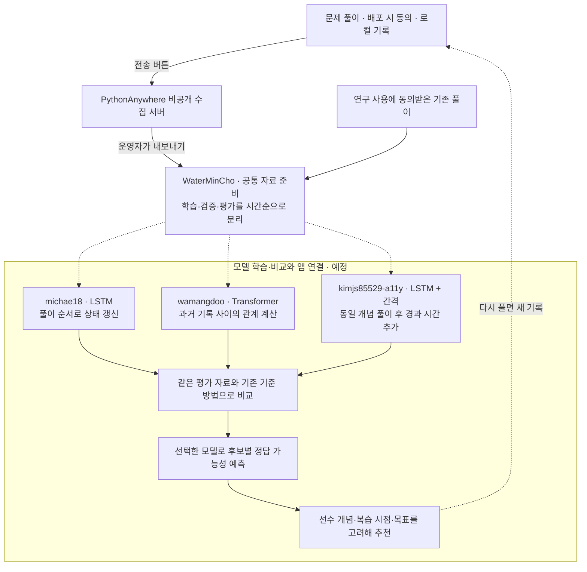

# 풀이 기록으로 추천 모델을 준비합니다

[처음 안내로 돌아갑니다](../README.md)

처음 참여하는 팀원은 [개인 저장소부터 첫 PR까지](../docs/LEARNING_WORKFLOW.md)를 먼저 읽습니다. 모델의 역할과 비교할 조건은 [담당별 미션](../docs/LEARNING_MISSIONS.md)에 있습니다.

## 풀이 데이터 수집

배포 시 풀이 데이터 수집 동의를 받은 참가자를 대상으로 운영합니다. 앱 안에서 동의를 다시 묻지 않고 새 수집부를 시작합니다. 파이썬과 AI 개론·응용의 새 답안·채점 결과·문항 판·시간을 이 기기에 보관합니다. 기존 풀이 제출에 추가 답안을 섞지 않습니다. 수집 중단·파일 내보내기·이 기기의 추가 데이터 삭제를 같은 화면에서 할 수 있습니다.

개인 초대 코드와 수집 서버 주소가 있으면 [서버에 보내기]로 비공개 서버로 보낼 수 있습니다. 단추를 누를 때만 전송하며 입력 답안 전송은 기본으로 꺼져 있습니다. 같은 기록을 다시 보내도 중복 저장하지 않습니다. 서버의 내 풀이를 삭제하고 인증을 폐기할 수도 있습니다. 2026년 11월 10일 무료 서버에 배포하고 합성 계정으로 HTTPS 전송·재전송·삭제를 확인했습니다. 네 명의 개인 초대 파일도 준비했으며, 주소와 코드는 각자 비공개로 받습니다. 실제 참가자의 사용 확인은 [시범 운영 절차](../docs/LEARNING_PILOT.md)를 따릅니다.

| 찾는 내용 | 안내 |
|---|---|
| 수집 항목·시작·중단·내보내기·삭제 | [풀이 데이터 안내](../docs/LEARNING_DATA.md) |
| 서버 실행·초대 발급·다른 수강생 배포 계획 | [수집 서버 운영](../docs/LEARNING_SERVER.md) |
| 네 명의 외부 무료 호스팅 시범 운영 | [초대·점검·백업·복구](../docs/LEARNING_PILOT.md) |
| 파이썬·AI 개론·응용 데이터 준비와 세 팀원의 딥러닝 미션 | [개발 분담](../docs/LEARNING_MISSIONS.md) |
| 기존 풀이 기록 변환과 모델 입력 예제 | [공통 학습 자료 준비](../docs/LEARNING_STARTER.md) |

현재 앱의 수집은 파이썬과 AI 개론·응용에 연결했습니다. 웹 면접 준비와 알고리즘 여행은 모델 학습 대상에 넣지 않습니다. 모델 학습과 새로운 추천 알고리즘은 아직 앱에 적용하지 않았습니다.

## 풀이 기록으로 추천 모델을 만듭니다

목적은 각자 모델의 입력·학습·평가를 익히고 재현 가능한 코드와 설명을 남기는 것입니다. 파이썬과 AI 자료를 구분하고 AI 안에서도 개론·응용의 결과를 따로 비교합니다. 수집과 자료 준비는 구현했으며 딥러닝 모델 학습과 앱 연결은 앞으로 진행합니다.

설명용 예로 `list(range(1, 4))`의 답은 `[1, 2, 3]`입니다. `[1, 2, 3, 4]`라고 답했다면 문제·개념·문항 판·오답·시각을 기록합니다. 이 문제를 예측할 때는 이전에 알려진 풀이만 입력으로 쓰고 이번 오답은 예측을 채점할 정답표로 분리합니다. 입력 답안 본문은 기본 서버 전송에서 제외합니다.

| 모델 | 같은 풀이 이력을 사용하는 방법 |
|---|---|
| LSTM | 풀이를 하나씩 읽으며 지금까지의 상태를 숫자로 갱신합니다. |
| Transformer | 순서 정보를 사용하며 여러 과거 기록을 서로 얼마나 참고할지 계산합니다. |
| LSTM + 간격 | 같은 LSTM에 동일 개념을 마지막으로 푼 뒤 지난 시간을 더해 효과를 비교합니다. |

모델 학습은 여러 기록의 예측 오차를 줄이도록 내부 숫자인 가중치를 조정하는 과정입니다. 추천할 때는 저장한 모델에 최신 이력과 후보 문제를 넣습니다. 모델이 계산한 정답 가능성과 복습 시점을 함께 보고 추천할 문제를 고릅니다.

작업과 검토 상태는 [GitHub 스터디 보드](https://github.com/users/WaterMinCho/projects/2)에서 관리합니다. 코드·실험·받은 질문과 수정 기록은 각자의 GitHub 저장소에 남깁니다. 각자 모델 저장소를 만들고 고정 커밋과 실행 근거를 공통 PR에 연결합니다. [개인 저장소와 기여 방법](../docs/LEARNING_WORKFLOW.md), [실험 기록 양식](../docs/LEARNING_EXPERIMENT_TEMPLATE.md)에서 시작하세요.

팀원은 공통 입력을 읽는 작은 실습부터 시작합니다. 코드·설정·합성 자료의 학습곡선·자기 설명·피드백 반영 기록을 PR로 남깁니다. WaterMinCho가 변경 내용과 실행 근거를 검토한 뒤 피드백을 게시합니다. PR 자동 검토·자동 머지는 설정하지 않습니다. [실습 순서와 담당별 산출물](../docs/LEARNING_MISSIONS.md), [코드 검토 방법](../docs/LEARNING_REVIEW.md)을 참고하세요.
