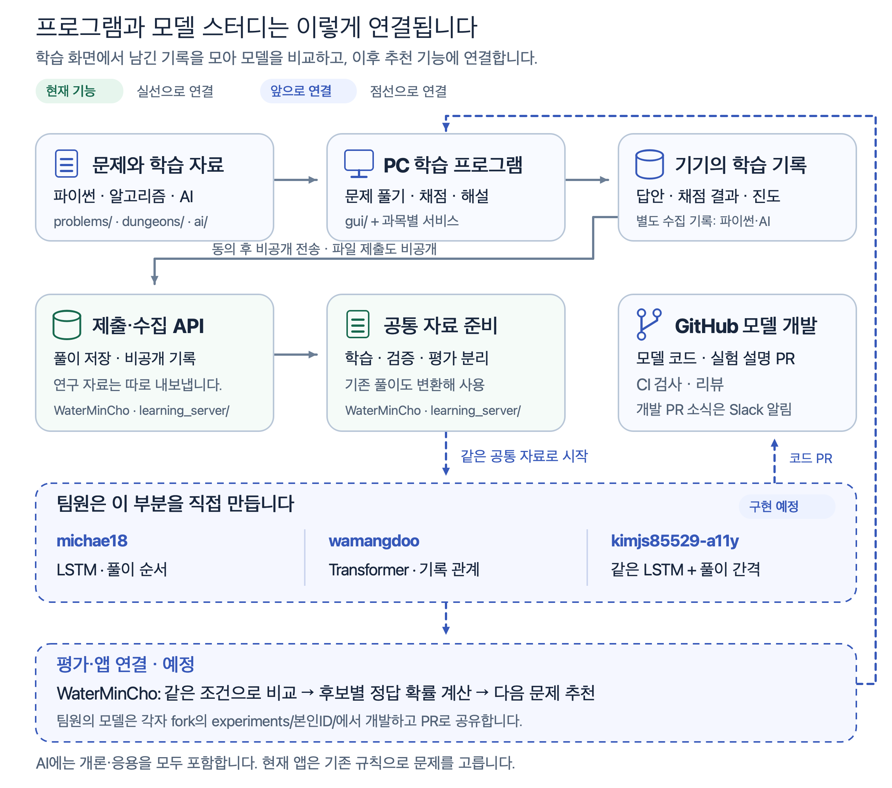

# 풀이 기록으로 추천 모델을 준비합니다

[처음 안내로 돌아갑니다](../README.md)

## 풀이 데이터 수집

파이썬과 AI 개론·응용의 풀이 과정을 문제 추천 연구에 사용합니다. 배포 시 수집에 동의한 참가자를 대상으로 하며 프로그램에서 별도 동의를 다시 묻지는 않습니다. 수집을 시작한 뒤 새로 기록한 풀이만 보관하고 과거 답안을 자동으로 가져오지 않습니다. 알고리즘 여행은 수집 대상이 아닙니다.

### 내 기록을 서버에 보냅니다

1. 첫 화면에서 **파이썬** 또는 **AI**로 들어가 홈의 [학습 데이터]를 엽니다. 두 과목은 별도의 추가 기록을 사용하므로 필요한 과목에서 각각 전송합니다. AI 개론·응용은 AI 쪽에서 함께 보냅니다. 상태가 ‘수집 중’이고 저장 오류가 없는지 확인합니다. ‘수집 안 함’이면 [수집 다시 시작]을 누른 뒤 새로 학습합니다.
2. ‘팀에 데이터 보내기’에서 비공개로 받은 **수집 서버 주소**와 **개인 초대 코드**를 입력합니다. GitHub ID나 이메일로 대신 로그인하는 칸이 아닙니다. 초대 코드를 받지 않았다면 스터디장에게 요청하세요.
3. [서버에 보내기]를 누르고 완료 또는 오류 안내를 확인합니다. 자동 전송하지 않으므로 이후 새로 푼 기록도 이 버튼으로 보냅니다. 같은 기록을 다시 보내도 중복 저장하지 않습니다.

기본 전송에는 문항과 개념, 채점 결과, 시각, 가명 구분값 등이 들어가며 **직접 입력한 답안 본문은 제외**합니다. 답안까지 보내려면 **처음 전송하기 전에** [서버에 입력 답안도 보내기]를 선택합니다. 첫 연결 뒤에는 이 설정을 바꿀 수 없습니다. 바꾸려면 아래 서버 삭제·재등록 절차가 필요합니다. 희망 직무는 고르지 않아도 됩니다. 고른 뒤 [희망 직무 저장]을 누르면 선택한 목표와 당시 로드맵 판을 함께 기록합니다.

GitHub [풀이 제출]로 이 추가 데이터가 전송되지는 않습니다. 서버 주소와 개인 초대 코드는 공개 이슈·PR·화면 사진에 올리지 않습니다. GitHub 저장소 쓰기 권한과 서버의 개인 초대는 별도입니다.

### 수집을 중단하거나 삭제합니다

- [수집 중단]은 이후의 추가 저장을 멈춥니다. 기존 학습 기능은 계속 사용할 수 있고 이미 모은 추가 데이터는 남습니다. 수집을 중단한 동안에는 서버 전송도 할 수 없습니다.
- [파일로 내보내기]는 이 기기의 추가 데이터를 JSONL 파일로 저장합니다. [내보낼 때 입력 답안 포함]을 선택하지 않으면 입력 답안은 제외합니다.
- [추가 데이터 삭제]는 이 기기에 모은 추가 데이터를 삭제하고 수집을 중단합니다. 기존 학습의 진도와 풀이 기록은 유지합니다.
- [서버의 내 풀이 삭제]는 서버에 보낸 기록을 삭제하고 해당 인증을 폐기합니다. 이 기기의 추가 데이터 삭제와는 별도입니다. 다시 참여하려면 이 기기의 추가 데이터도 삭제한 뒤 새 개인 초대로 등록합니다.

수집 항목과 기록 위치는 [풀이 데이터 안내](../docs/LEARNING_DATA.md)에 있습니다. 오류가 나오면 안내 문구를 확인하고 다시 시도하세요. 전송 여부만으로 학습이나 채점 기록을 지우지 않습니다.

서버 운영과 모델 개발 안내 펼쳐보기

- [수집 서버 운영·초대 발급](../docs/LEARNING_SERVER.md)
- [시범 운영·백업·복구](../docs/LEARNING_PILOT.md)
- [전체 수강생 배포 전 수집 범위·용량·접근 조건](../docs/LEARNING_READINESS.md)
- [공통 학습 자료 준비](../docs/LEARNING_STARTER.md)
- [각자 fork에서 첫 PR까지](../docs/LEARNING_WORKFLOW.md)
- [세 팀원의 담당별 미션](../docs/LEARNING_MISSIONS.md)

## 풀이 기록으로 추천 모델을 만듭니다

목적은 각자 모델의 입력·학습·평가를 익히고 재현 가능한 코드와 설명을 남기는 것입니다. 파이썬과 AI 자료를 구분하고 AI 안에서도 개론·응용의 결과를 따로 비교합니다. 수집과 자료 준비는 구현했으며 딥러닝 모델 학습과 앱 연결은 앞으로 진행합니다.

[프로젝트 전체 구조와 담당별 연결 설명](../docs/ARCHITECTURE.md)

설명용 예로 `list(range(1, 4))`의 답은 `[1, 2, 3]`입니다. `[1, 2, 3, 4]`라고 답했다면 문제·개념·문항 판·오답·시각을 기록합니다. 이 문제를 예측할 때는 이전에 알려진 풀이만 입력으로 쓰고 이번 오답은 예측을 채점할 정답표로 분리합니다. 입력 답안 본문은 기본 서버 전송에서 제외합니다.

| 모델 | 같은 풀이 이력을 사용하는 방법 |
|---|---|
| LSTM | 풀이를 하나씩 읽으며 지금까지의 상태를 숫자로 갱신합니다. |
| Transformer | 순서 정보를 사용하며 여러 과거 기록을 서로 얼마나 참고할지 계산합니다. |
| LSTM + 간격 | 같은 LSTM에 동일 개념을 마지막으로 푼 뒤 지난 시간을 더해 효과를 비교합니다. |

모델 학습은 여러 기록의 예측 오차를 줄이도록 내부 숫자인 가중치를 조정하는 과정입니다. 추천을 연결하면 저장한 모델에 최신 이력과 후보 문제를 넣을 계획입니다. 그때 모델이 계산한 정답 가능성과 복습 시점을 함께 보고 추천할 문제를 고릅니다.

작업과 검토 상태는 [GitHub 스터디 보드](https://github.com/users/WaterMinCho/projects/2)에서 관리합니다. 각자 공통 프로젝트를 fork하고 그 안의 `experiments/본인GitHubID/`에서 모델을 개발합니다. 코드·실험·받은 질문과 수정 기록을 같은 fork에 남기고 공통 프로젝트로 PR을 보냅니다. [fork에서 개발하고 기여하는 방법](../docs/LEARNING_WORKFLOW.md), [실험 기록 양식](../docs/LEARNING_EXPERIMENT_TEMPLATE.md)에서 시작하세요.

팀원은 공통 입력을 읽는 작은 실습부터 시작합니다. 코드·설정·합성 자료의 학습곡선·자기 설명·피드백 반영 기록을 PR로 남깁니다. WaterMinCho가 변경 내용과 실행 근거를 검토한 뒤 피드백을 게시합니다. PR 자동 검토·자동 머지는 설정하지 않습니다. [실습 순서와 담당별 산출물](../docs/LEARNING_MISSIONS.md), [코드 검토 방법](../docs/LEARNING_REVIEW.md)을 참고하세요.
