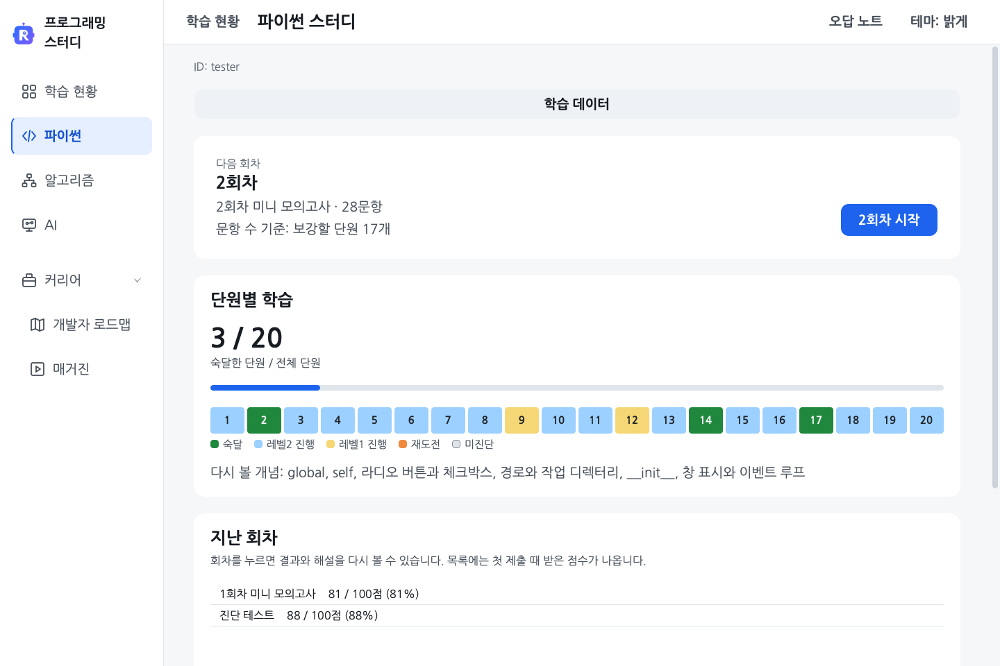
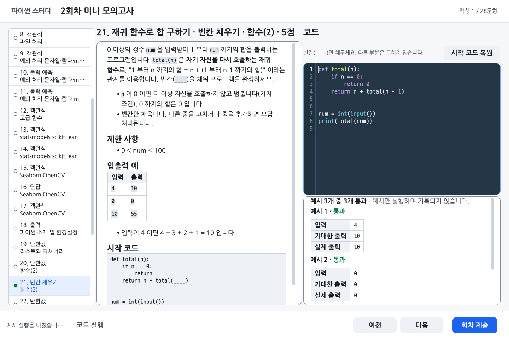
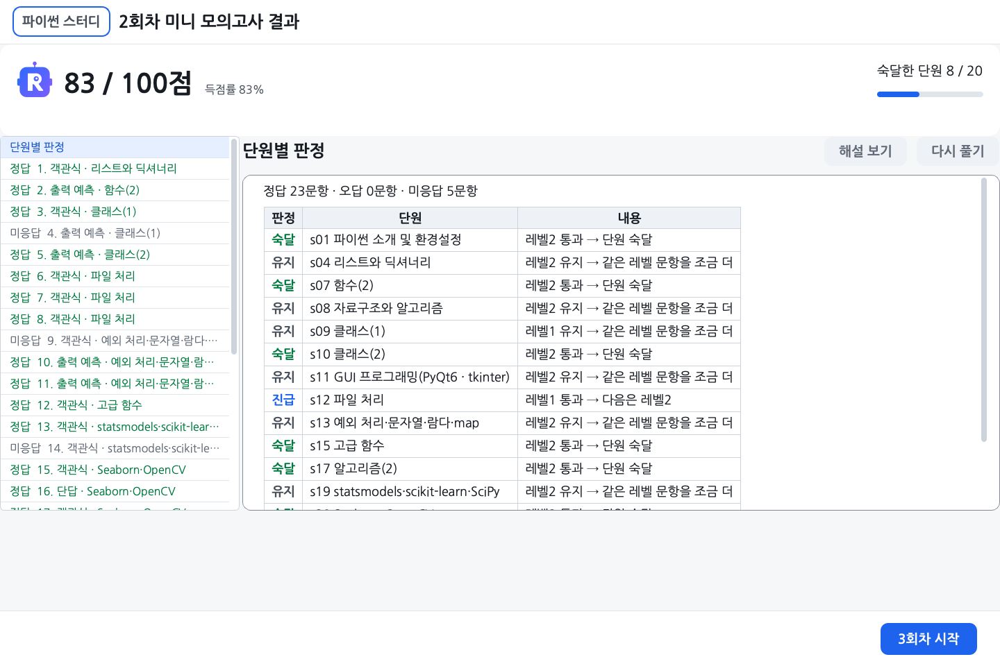
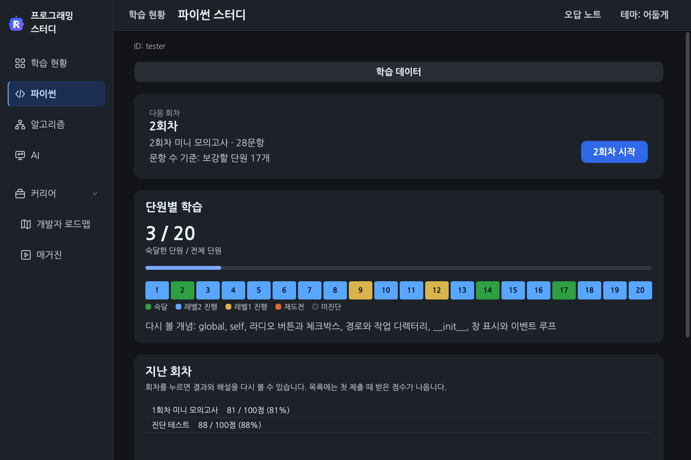

# 파이썬 문제 풀이 가이드

[처음 안내로 돌아갑니다](../README.md)

이 문서의 터미널 명령은 `study.py`가 있는 `programming-study` 폴더에서 입력합니다. 문서가 있는 하위 폴더에서 실행하지 않습니다.

## 파이썬 평가 범위와 채점 조건

아래는 프로그램을 만들 때 준비한 **2026년 10월 16일 파이썬 평가**의 조건입니다. 앞으로 있을 평가의 일정·규정은 해당 수업 공지를 확인하세요.

| 항목 | 내용                                                            |
| ---- | --------------------------------------------------------------- |
| 일시 | 10/16(금) 14:30 ~ 16:30, 프로그래머스                           |
| 범위 | 강의 자료 + 주간 요약본                                         |
| 유형 | 빈칸 채우기, 반환값 문제, 출력 문제, 객관식                     |
| 채점 | 부분 점수가 없고, 요구한 형식과 정확히 같아야 정답입니다        |
| 금지 | IDE, VSCode, 파이썬 레퍼런스, 메모, 검색 (실행하기 버튼만 가능) |

파이썬 스터디 화면은 시험과 비슷하게 맞췄습니다. 왼쪽에 문항 목록, 가운데에 문제, 오른쪽에 답안이 있습니다. 코드를 적는 칸은 프로그래머스 편집기처럼 남색 바탕이고, 예약어와 문자열 같은 파이썬 문법에 따라 글자색이 달라집니다. 괄호와 따옴표는 자동으로 닫히고 자동완성은 없습니다. 복사, 붙여넣기, 우클릭 메뉴도 막아 두었습니다.

## 진단 테스트와 회차별 문제 풀이

첫 화면에서는 [파이썬 스터디]를, 왼쪽 메뉴에서는 [파이썬]을 고릅니다. 처음에는 [진단 테스트 시작]으로 단원별 문제를 풉니다. 모르는 답은 비워 두고 [회차 제출]로 채점해도 됩니다. 진단 결과에 따라 다음에 풀 회차를 준비합니다.

이후에는 파이썬 홈의 **다음 회차**에서 [2회차 시작]처럼 표시된 버튼을 누릅니다. 이미 풀던 회차가 있으면 이어서 풉니다. 화면에 '2회차 미니 모의고사'라고 나오는 것이 회차입니다. 120분짜리 실전 모의고사를 보려면 [터미널에서 모의고사 풀기](#모의고사-보기)를 따라 하세요.

왼쪽에서 문항을 고르고 가운데 문제를 읽은 뒤 오른쪽에 답을 적습니다. 화면 사진의 ID와 풀이 기록은 설명용 예시입니다.

- 답은 적는 대로 저장됩니다. 창을 닫아도 다음에 이어서 풉니다.
- 답을 적은 문항은 왼쪽 목록에서 초록 동그라미로 바뀝니다. 맞았는지는 회차를 제출해야 나옵니다.
- 코드 문항의 [코드 실행]은 문제에 나온 예시만 돌립니다. 시험의 '실행하기'와 같고, 눌러도 기록되지 않습니다.
- 코드를 적는 칸에는 줄 번호가 보이고, Ctrl+F(맥은 Cmd+F)를 누르면 그 칸 안의 글자를 찾습니다.
- 코드 칸에서 Ctrl+/(맥은 Cmd+/)를 누르면 커서가 있는 줄이나 고른 줄 앞에 `# ` 가 붙어 주석이 되고, 다시 누르면 풀립니다.
- [회차 제출]을 누르면 답한 문항 수와 미응답 문항을 확인할 수 있습니다. 확인 창의 [제출]을 누르면 채점 결과가 이 컴퓨터에 기록됩니다. 안 푼 문항은 오답이 됩니다. 풀이 파일을 서버에 보관하려면 [비공개 풀이 제출](../docs/API_SUBMISSIONS.md)을 따릅니다.
- 결과 화면에서 점수와 단원별 판정을 보고, 문항을 골라 [해설 보기]로 정답과 해설을 봅니다. 해설은 회차를 제출한 뒤에 열립니다.
- 틀린 문항은 [다시 풀기]로 고친 뒤 [다시 채점]을 눌러 볼 수 있습니다. 다시 채점한 점수는 단원 판정에 들어가지 않고 첫 제출만 들어갑니다.
- 홈 오른쪽 위의 [오답 노트]를 누르면 오답 노트가 열립니다. 첫 화면의 오답 노트 줄로도 열리고, 그때는 [← 처음 화면]으로 돌아옵니다. 첫 제출에서 틀렸거나 비워 둔 문항은 왼쪽 목록에서 '틀린 문항', '미응답 문항', '다시 맞힌 문항'으로 나뉘고, 그 안에서 차시별로 모입니다. 이름 줄을 누르거나 Enter 를 치면 그 묶음이 펴지거나 접히고, '다시 맞힌 문항'은 처음에 접혀 있습니다. 문항을 고르면 오른쪽에 문제와 내 답이 보이고, 아래쪽의 [해설 보기]와 [다시 풀기]를 누를 수 있습니다. 위아래 화살표를 누르면 이름 줄을 건너뛰고 문항 사이를 옮겨 다닙니다.

첫 화면 오른쪽 위의 [설정]에서 **보통 글자·큰 글자·더 큰 글자**와 테마를 고릅니다. 글자 크기는 Ctrl(맥은 Cmd)과 `+`, `-`, `0`으로도 바꿀 수 있습니다. 파이썬 홈의 테마 버튼은 누를 때마다 시스템·밝게·어둡게 순서로 바뀝니다. 시스템은 운영체제 설정을 따릅니다.

## 파이썬 답안 작성법과 채점 기준

문항 유형에 따라 아래 표를 보고 답을 적습니다.

파이썬 회차에서는 답을 적는 동안 자동 저장하고 [회차 제출]을 눌러 한꺼번에 채점합니다. [코드 실행]으로는 예시의 결과를 확인합니다.

| 유형        | 답 적는 법                                                                                                                  | 채점                                                                                |
| ----------- | --------------------------------------------------------------------------------------------------------------------------- | ----------------------------------------------------------------------------------- |
| 객관식      | 보기 카드를 누르거나 숫자 키로 고릅니다. "모두 고르세요" 문항은 여러 개를 고릅니다                                          | 고른 보기가 정답과 정확히 같아야 합니다                                             |
| 출력 예측   | 실행하면 화면에 찍히는 글자를 똑같이 적습니다. 답을 따옴표로 감싸지 않고, `['a', 'b']` 처럼 출력에 찍히는 따옴표만 적습니다 | 글자 단위로 같아야 합니다                                                           |
| 단답        | 따옴표로 감싸지 않고 한 줄로 적습니다                                                                                       | 대소문자까지 같아야 합니다. 대소문자나 띄어쓰기를 가리지 않는 문항이 몇 개 있습니다 |
| 빈칸 채우기 | 코드의 `____` 자리만 채웁니다                                                                                               | 빈칸 밖을 고치면 오답입니다                                                         |
| 반환값      | `solution` 함수를 완성합니다                                                                                                | 반환값이 자료형까지 같아야 합니다(3 과 3.0 은 다른 값)                              |
| 출력        | 프로그램을 작성합니다                                                                                                       | 출력이 글자 단위로 같아야 합니다                                                    |

- 회차와 진단 테스트는 100점 만점입니다. 문항마다 유형과 레벨로 가중치를 정하고, 가중치에 비례해 100점을 나눕니다. 가중치 표와 계산 방법은 [docs/CRITERIA.md](../docs/CRITERIA.md)의 '회차 배점'에 있습니다.
- 시험처럼 부분 점수가 없어서, 코드 문항(빈칸 채우기, 반환값, 출력)은 테스트를 전부 통과해야 점수를 받습니다.
- 출력을 비교할 때 줄 끝 공백과 맨 끝 빈 줄은 무시합니다.
- `input("안내 문구")` 의 안내 문구는 출력으로 치지 않습니다.
- 코드 문항은 문항 하나의 모든 테스트 실행을 합쳐 5초 안에 마쳐야 합니다.
- 코드 문항을 실행하는 동안 메모리를 512MB 넘게 쓰면 오답입니다.

## 문제를 고르는 방식

- 진단 테스트로 단원(차시)마다 출발 레벨을 정합니다. 레벨은 1 기본, 2 응용, 3 심화입니다.
- 회차마다 15~30문항을 목표로 여러 단원에서 문제를 고릅니다. 낼 문항이 부족하면 더 적게 나옵니다. 약한 단원의 비중이 높고, 아직 다른 회차의 첫 시도에서 맞히지 못한 오답은 마지막으로 본 지 두 회차 이상 지나면 재출제 후보가 됩니다.
- 한 레벨에서 푼 문항이 2~3개면 전부 맞혀야 하고, 4개 이상이면 최근 4문항 중 3문항 이상을 맞혀야 다음 레벨로 올라갑니다.
- 레벨2를 통과한 단원을 숙달로 칩니다. 홈과 결과 화면에는 숙달한 단원 수를 보여 줍니다.
- 클래스 1·2, GUI, 예외 처리, 정규표현식 단원(9·10·11·13·14차시)은 추첨 가중치가 1.5배라 더 자주 나옵니다.

규칙과 숫자 전체는 [docs/CRITERIA.md](../docs/CRITERIA.md)에 있습니다.

## 터미널에서 모의고사 풀기

실전 모의고사는 3회(`m1`, `m2`, `m3`)가 있고 각각 120분, 100점입니다. `m1` 과 `m2` 는 1\~16차시, `m3` 은 1\~21차시에서 냅니다. `m3` 의 Q17, Q18, p02, p10 은 시험 범위 밖인 21차시 문항입니다. 화면이 아니라 터미널에서 봅니다. 전 단원을 숙달한 뒤에 보기를 권하지만 그 전에도 받을 수 있습니다. 아래는 1회 기준이고, 2회와 3회는 `m1` 자리에 `m2`, `m3` 을 씁니다.

1. `python study.py start m1` 을 실행합니다. 처음 실행한 시각을 기록합니다. 120분이 지나도 자동 제출하지 않으므로 시계를 보고 아래 채점 명령을 실행하세요.
2. 문제지는 `problems/m1/quiz.md` 와 `problems/m1/p01/problem.md` 같은 파일이고, 답은 `submissions/<내 ID>/m1/` 의 `quiz.py` 와 `p01.py` 같은 파일에 적습니다. 파일은 메모장 같은 편집기로 엽니다.
3. `quiz.py` 는 화면과 달리 파이썬 값으로 적습니다. 객관식은 숫자(`Q1 = 3`), 출력 예측과 단답은 따옴표로 감싼 글자(`Q17 = "답"`), 여러 줄 출력은 `"""` 로 감쌉니다. 여러 보기를 고를 때는 `Q6 = [1, 3]`처럼 번호 목록을 적습니다. 같은 안내가 `quiz.py` 맨 위에도 적혀 있습니다.
4. `python study.py grade m1` 로 채점합니다. 틀린 문항의 해설은 `python study.py explain m1 Q3` 처럼 봅니다.
5. 풀이를 서버에 보관하려면 프로그램을 열고 [비공개 풀이 제출](../docs/API_SUBMISSIONS.md)을 따릅니다. 모의고사 풀이도 전송 파일 목록에서 확인합니다.

## 터미널에서 코딩테스트 연습

[Lv.1](c1/README.md)과 [Lv.2](c2/README.md)는 함수 구현 연습입니다. 프로그램 폴더의 터미널에서 `python study.py start c1`로 풀이 파일을 만들고 편집기에서 `solution` 함수를 완성합니다. `python study.py grade c1`로 예시와 숨은 테스트를 채점합니다. Lv.2는 명령의 `c1`을 `c2`로 바꿉니다. 풀이 파일 위치와 제한 조건은 각 세트의 안내에 있습니다.
