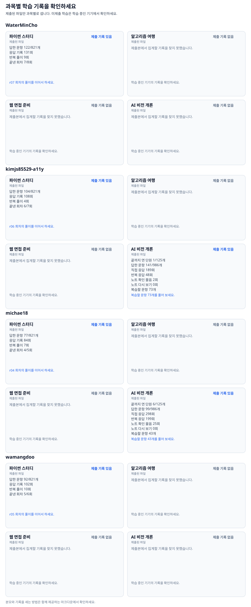
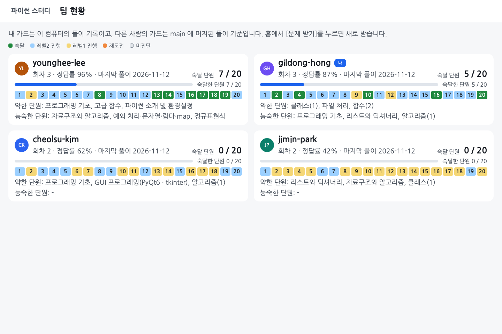

# 풀이를 제출하고 리뷰합니다

[처음 안내로 돌아갑니다](../README.md)

## 풀이 올리기(PR)와 리뷰

**학습·채점은 내 컴퓨터에서 하고 GitHub 공유는 [풀이 제출]로 따로 합니다.** 이 저장소에 올리려면 내 GitHub 계정에 쓰기 권한이 있어야 합니다. 스터디장의 저장소 초대를 수락한 참가자가 사용할 수 있으며 프로그램을 받거나 ID를 입력한 것만으로 권한이 생기지는 않습니다.

1. 과목에서 문제를 풀고 채점합니다. 파이썬은 [회차 제출], 알고리즘은 [채점하기], AI 연습은 [확실함]·[긴가민가]를 사용합니다.
2. 첫 화면인 **학습 현황**, 각 과목의 현황 화면 또는 파이썬 결과 화면에서 하단 알림 카드를 확인합니다. 제출할 변경이 있으면 [풀이 제출]이 보입니다. AI·알고리즘 문제를 푸는 중이라면 먼저 해당 과목의 현황 화면으로 돌아옵니다.
3. [풀이 제출]을 누릅니다. GitHub 인증이 필요하다는 안내가 나오면 [로그인 안내](../docs/GIT_GUIDE.md#처음-한-번-로그인)를 따라 합니다.
4. 내 풀이 폴더(`submissions/<내 ID>/`)가 GitHub의 `study/<내 ID>` 브랜치로 올라가고 브라우저에 PR 페이지가 열립니다. PR(Pull Request)은 올린 풀이를 공통 저장소에 합쳐 달라고 요청하고 피드백을 나누는 페이지입니다.
5. 조금 기다리면 자동 작업이 제출본을 검사하고 과목별 기록과 다음 학습 항목을 댓글로 표시합니다. 더 풀고 다시 제출하면 열린 PR에 이어서 올라갑니다.

[풀이 제출]에는 알고리즘 코드와 AI 기록도 함께 포함됩니다. 문제·프로그램 파일과 비공개 연구용 추가 데이터는 포함하지 않습니다. 서버 전송은 파이썬·AI 홈의 [학습 데이터] → [서버에 보내기]로 따로 합니다. [서버 전송 안내](../learning_server/README.md#풀이-데이터-수집)

제출할 풀이와 받을 자료가 있을 때만 하단 알림 카드가 나타납니다. 할 일이 없으면 카드가 보이지 않는 것이 정상입니다. 자료만 새로 받으려면 첫 화면 상단의 [새 문제 받기]를 누릅니다.

제출해도 이 컴퓨터의 풀이가 지워지지는 않습니다. GitHub에 올라가지 않은 AI 학습 위치·연습 초안·추가 수집 기록도 있으므로 PC를 바꿀 때는 [기록 보관 안내](../gui/README.md#컴퓨터를-바꾸거나-사본을-보관합니다)를 확인하세요.

## 팀원 풀이를 보고 피드백합니다

PR의 **Files changed**에서 풀이 코드를 읽고 궁금한 줄 옆의 `+`로 질문합니다. ‘왜 이 방법을 골랐나요?’, ‘빈 리스트일 때도 같은 결과가 나올까요?’처럼 코드와 입력을 짚어 물어보세요. 더 푼 뒤 프로그램에서 다시 제출하면 같은 PR에서 수정 내용을 비교할 수 있습니다.

리뷰를 마치면 스터디장이 풀이 PR을 저장소에 합칩니다. 모델 개발을 위한 fork·첫 PR은 [별도 개발 안내](../docs/LEARNING_WORKFLOW.md)를 따릅니다. 로그인과 오류 해결, 자세한 리뷰 순서는 [제출과 피드백](../docs/GIT_GUIDE.md)에 있습니다.

[현황판을 표로 보기](https://github.com/WaterMinCho/programming-study/blob/dashboard/DASHBOARD.md)

파이썬 홈의 [팀 현황]에서는 팀원들의 파이썬 단원별 상태를 봅니다. 내 카드는 이 컴퓨터의 기록이고 다른 사람은 공통 저장소의 main에 합쳐진 풀이 기준입니다. 아직 제출하지 않았거나 main에 합쳐지지 않은 풀이는 다른 사람의 현황에 반영되지 않을 수 있습니다.

